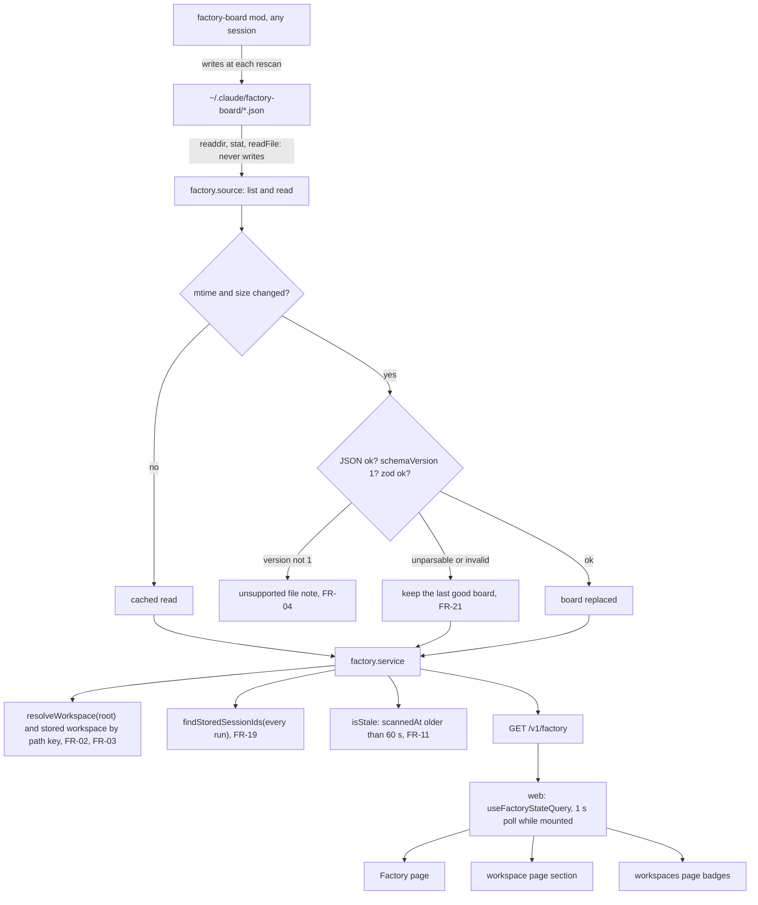

# Factory boards: every project's board, drawn as the pane

Feature: `factory-board` · Components: `api`, `web` · Spec: FR-01 to FR-23, BR-01, BR-02, BR-03

## Context

The factory-board mod writes its board as JSON at each rescan: `~/.claude/factory-board/{root}.json`, one file per project root. The root is named as `~/.claude/projects` names its folders, and a worktree is a root of its own. The content is `FactoryBoardExport` (`schemaVersion: 1`) of the mod's `types/index.d.ts`. Its reference copy is `C:/WS/webapp-factory/plugins/factory-board/types/index.d.ts`, and `exportBoard` in `hooks/planning.ts` builds it. It holds:

- the branch line;
- the live runs;
- each feature on the plan the pane follows, with its timeline rows (title, detail, marker, runs);
- the prompts of its buttons, built without the review and browser markers;
- the two `markers` the pane's checkboxes append.

This plan adds the first version of the feature:

- **api.** A new, read-only `factory` feature reads that folder on each request, keeps the last good read of each file in memory, and attaches each board to its workspace by the session rules. It marks stale boards, marks the runs whose session the history holds, and serves everything on `GET /v1/factory`. There is no table and no migration: nothing is stored (BR-01).
- **web.** A `Factory` page draws every board, grouped by workspace. The workspace page gets a factory section, and the workspaces page gets a factory badge on each row. A 1 s poll keeps them fresh (FR-20). Prompts are copied to the clipboard, with the exported markers appended when a switch is on.

## Decisions

- **Storage** → none. The boards live in the service's memory, like the live state: FR-21 and FR-22 concern the last good read of each file, not a history. No `db` layer, no migration.
- **Freshness (FR-20, 2 s)** → the web polls `GET /v1/factory` every 1000 ms, only from a mounted page that shows boards: the factory page, the workspace page and the workspaces page. The layout does not poll. The api re-reads only the files whose `mtimeMs` or `size` changed, and every request runs `readdir` and `stat`. The worst case is about 1 s of poll plus one read.
- **One route** → `GET /v1/factory` returns every board grouped by workspace. The workspace page and the workspaces page take their part from the same query, so there is one query key and one poll per page.
- **Workspace of a board (FR-02, FR-03)** → `resolveWorkspace(board.root, { scratchRoot, findRepoRoot })` from `ingestion.workspace.ts`, the session rules. Its `pathKey` is looked up among the stored workspaces with one `inArray` query.
  - Found: the group carries the stored `workspaceId`, `name` and `path`.
  - Not found: `workspaceId: null`, and the resolved `name` and `path`. For a checkout, that is its root's last folder.
- **The api computes, with the clock, only what the spec defines on top of the export** → `isStale` (FR-11), the group and board order (FR-07), the per-workspace counts and the live mark (FR-09), and `isStored` per run (FR-19). Everything else is the export's, passed through (BR-02).
  - Epoch-ms fields become ISO strings, as everywhere else in the API: the representation changes, not the value.
- **Prompt markers (FR-18)** → the web appends the exported `markers`, never literal strings, as the mod's `nextAction` does:
  - `markers.review` goes on `next.prompt` when it starts with `/factory:implement ` and does not end with ` — final review`, and on `next.all.prompt`;
  - `markers.browser` goes on `next.autopilot.prompt` only.
- **BR-03** → the mod's rule. The application draws only the runs the export holds, and never builds a run from the live state or the logs.
- **Stage segments (FR-13)** → drawn from the exported `marker` of each `stage:N` row of `steps`: `done` is done, `next` or `running` is the one at hand, `pending` is later. They are never computed from `plan.stages[].done/total` (BR-02).

## Decisions taken autonomously

- Run the grill on the plan? → yes, autonomous. Every question below took its recommended answer, and none was left without one (autonomous mode of `write-plan`).
- Branch → stay on `feat/factory-board`, which holds the spec commit (not the base branch; the instruction for this run).
- Feature slug → `factory-board`, existing (its spec is committed and `Approved`: no status change, no spec delta).
- Plan type and name → `init-factory-board`: the feature's first plan, commit type `feat`.
- Stage order → `api`, then `web` (the manifest's order; `web` needs the handoff).
- Review after each stage → yes (the autonomous default).
- Browser test → in Validation, left `[ ]`, with its scenarios: the pipeline carries ` — with browser test`.
- Boards folder → `CLAUDE_FACTORY_BOARD_DIR`, defaulting to `~/.claude/factory-board` (`os.homedir()`). `CLAUDE_CONFIG_DIR` is not honoured, to match the three other Claude Code paths of `config.ts`, which ignore it too; the override covers that case.
- Which files → every `*.json` entry of the folder that is a file (`readdir` with `withFileTypes`). Other names are ignored. Nothing in the folder is ever written, moved or deleted (BR-01).
- A `schemaVersion` other than `1`, or missing → the file goes to `unsupportedFiles` with its version (a number, else `null`), and no board is drawn for it. It replaces any board cached from that file (FR-04).
- A file with `schemaVersion: 1` that fails the zod schema → treated as unparsable: the last good board stays, nothing is shown. One `console.error` per file until it parses again (a change of the mod's contract must not blank the page, and a half-written file looks the same).
- A file that cannot be read (EBUSY, EPERM) → the same as unparsable (FR-21).
- A file never read successfully and unparsable → no board until it parses.
- A missing or unlistable folder → `isBoardsDirReadable: false`, no board, the cache cleared. The page shows the FR-06 message naming `boardsDir`.
- A parse schema mirroring `FactoryBoardExport` → `z.looseObject` at every level, so new fields of the mod do not break the read. The enums (`state`, `marker`, run `status`) are strict, since an unknown value cannot be drawn. A change there is a contract change, which the mod's `schemaVersion` would announce.
- Fields not drawn → `repo`, `models`, `squash` and the runs' `root` and `repo` are read loosely and not served. The non-goals exclude the models screen and `Squasher`.
- Run session link (FR-19) → `isStored` is true when the `sessionId` matches `^[\w-]+$` and the history holds it. One `findStoredSessionIds` call gathers every run of every board (`live`, `autopilot`, the step runs): no N+1.
- Stale threshold → strictly more than 60 000 ms between `scannedAt` and `clock.now()` (FR-11).
- A stale board's `live` runs → they do not count as live, neither for the order (FR-07) nor for the badge's mark (FR-09). They are still listed, marked as their state at the last scan (FR-11): no mod is running, so the runs' state is not known now.
- Order (FR-07) → groups: those with a live run first, then by most recent `scannedAt` of their boards, then by key. Boards inside a group follow the same rule, then by root. Stale boards are never filtered out.
- Counts (FR-09) → per group: the features in state `running` (`En cours`) and `review` (`À valider`) over all its boards, stale ones included (the states are as exported). `hasLiveRun` is true when a non-stale board has a `live` run.
- Unsupported-file notes (FR-04) → on the factory page only, above the groups: the file may name no usable root, so it has no workspace.
- A `.claude/worktrees` worktree's board → it joins its repository's workspace through `resolveWorkspace`. A `git worktree add` folder elsewhere becomes a workspace of its own, as a session there would (limitation shared with session-ingestion BR-03). The export's `repo` is not used, to keep FR-02's "same rules as a session".
- State filters (FR-14) → one chip per `FactoryFeatureState` (`Sans spec`, `Spec seule`, `Plan prêt`, `En cours`, `À valider`, `Finalisée`), with the count of the board's features, plus `Toutes`, which clears them. They add up, and none pressed shows every feature. The filter is one set for every board on every page.
- `Finalisée` features (FR-14) → folded on one line, "N features finalisées · slug, slug", a button that unfolds them. Pressing the `Finalisée` chip shows them unfolded too, as in the mod.
- Unfolded card (FR-15, FR-23) → at most one per board, kept as `{ [root]: slug }`. A worktree board can share a slug with its main checkout, so the key is the root.
- Persistence (FR-23) → `localStorage` key `claude-companion.factory.view`, `{ stateFilters: string[]; expanded: Record<string, string> }`, every access guarded as in `notificationSettings.ts`, shared by the tabs through the `storage` event. Values that are not known states are dropped on read.
- The `avec revue` and `test navigateur` switches → not persisted (FR-23 does not name them): they are page state, both off by default, as the mod's checkboxes. One pair per page, shared by all its cards.
- Where the prompt buttons stand → under the timeline row whose marker is `next`. Without one, under the first `running` row, else after the last row. A feature with `next: null` and a live `autopilot` says "Autopilot en cours sur cette feature" there, as the mod does.
- A live run's step label (FR-12) → the title of the feature's `steps` row with the same `step`. A run with no feature, or an unknown step, gets a fallback: `Spec`, `Plan`, `Stage N`, `Revue finale`, else the raw step. An `autopilot` run reads "Autopilot · {step}". This is a label, not a state, so BR-02 still holds.
- Durations (FR-12, FR-15) →
  - a live run on a live board: from `updatedAt` (its status's start) to now, ticking with `useNow(1000)`;
  - on a stale board: from `updatedAt` to `scannedAt`, with the "au dernier scan" mark;
  - a run that is over: `updatedAt - since`.
- Session label → the first 8 characters of `sessionId`, as the mod shows it. It is a link to `/sessions/{id}` when `isStored`, else plain text.
- Page width → `--content-width`, like every page but the live one.
- The nav item → `Factory`, after `En direct`, with no badge (FR-07).
- Multi-select chips → a new shared `ToggleChipGroup` (several pressed). `ChipGroup` picks one item, and the live page keeps it unchanged.
- State colours → tokens in `overrides.css`, with dark values. The card's frame and the state pill take its state's colour. The rail markers and stage segments use `--factory-done` (green), `--factory-current` (orange) and `--factory-later` (the border colour).
- Clipboard (FR-17) → `useClipboard` from `shared/lib`: a `role="status"` line "Prompt copié" for 4 s. On failure, the prompt is shown in a selectable `<pre>`, as with the resume command.
- Web unit tests → none (`web/CLAUDE.md`); the browser test covers the stage.
- Stage 2 review findings left open → settled in the final review: the nullable components were fixed (`z.union([x, z.null()])` on `plan`, `next`, `all`, `autopilot`; `openapi.json` and the client regenerated; the `NonNullable` alias dropped); the finalized line only unfolds (the spec asks for unfold on demand only, FR-14; a persisted unfolded finalized card does keep its group open after a reload, FR-23).
- A live run hidden by a state filter → the click clears the filters, so the card unfolds (FR-12).

## api

### services

New folder `src/features/factory/`.

`src/config.ts`: `CLAUDE_FACTORY_BOARD_DIR: z.string().default(path.join(os.homedir(), ".claude", "factory-board"))`, with a comment: the factory-board mod's export, one JSON per project root, read only.

`src/features/factory/factory.source.ts`, read only. A header comment says: readdir, stat and readFile only; BR-01.

- `factoryExportSchema`: the zod parse schema of `FactoryBoardExport` v1, `z.looseObject` everywhere.
  - Timestamps: `z.number().int().nonnegative().max(8.64e15)`, as `live.source.ts`.
  - `runSchema`: `sessionId`, `feature` (nullable), `folder` (nullable), `command`, `step`, `lastStep` (nullish), `agentId` (optional), `status` (`running | waiting | done | interrupted`), `since`, `updatedAt`.
  - `planSchema`: `folder`, `title`, `stages[] { number, title, commit (nullable), sha (nullable), done, total }`, `validationDone`, `validationTotal`, `reviewDone`, `isDraft`.
  - `promptSchema { label, prompt }`; `next`: nullable `promptSchema` extended with `all` and `autopilot`, both optional.
  - `featureSchema`: `slug`, `title`, `state` (`empty | spec | plan | running | review | done`), `isNewPlan`, `hasSpec`, `specStatus` (nullable), `plan` (nullable), `plans` (string[]), `autopilot` (nullable run), `next`, `steps[] { step, title, detail, marker (done | running | next | pending), runs[] }`.
  - Board: `schemaVersion: z.literal(1)`, `scannedAt`, `root`, `branch` (nullable), `baseBranch`, `aheadCount` (nullable), `changedCount`, `error` (nullable), `markers { review, browser }`, `live[]`, `features[]`.
- `type FactoryExport = z.infer<typeof factoryExportSchema>`.
- `type BoardFileRead = { kind: "board"; board: FactoryExport } | { kind: "unsupported"; schemaVersion: number | null } | { kind: "unreadable" }`.
- `listBoardFiles(boardsDir): Promise<{ isDirReadable: boolean; files: { fileName: string; mtimeMs: number; size: number }[] }>`:
  - `readdir(boardsDir, { withFileTypes: true })`, keeping the files whose name ends with `.json`, sorted;
  - `stat` for each; a file whose `stat` fails is left out of this read;
  - any `readdir` error gives `{ isDirReadable: false, files: [] }`.
- `readBoardFile(file): Promise<BoardFileRead>`:
  - `readFile` and `JSON.parse`; any error is `unreadable`;
  - a `schemaVersion` that is not `1` is `unsupported`, with the value when it is a number, else `null`;
  - then `factoryExportSchema.safeParse`: a failure is `unreadable`.

`src/features/factory/factory.service.ts`: `createFactoryService({ workspacesRepo, clock, boardsDir, scratchRoot, findRepoRoot })`.

- `workspacesRepo: Pick<WorkspacesRepository, "findWorkspacesByPathKeys" | "findStoredSessionIds">`.
- `STALE_AFTER_MS = 60_000`.
- In memory: `cache = Map<fileName, { mtimeMs; size; read: board | unsupported }>` and `failedFiles = Set<string>` (one log per file).
- `readBoards()`:
  1. `listBoardFiles`. Not readable: clear the cache and return the empty state with `isBoardsDirReadable: false`.
  2. Drop the cache entries whose file is no longer listed (FR-22).
  3. For each listed file whose `mtimeMs` or `size` differs from its entry, or that has no entry, call `readBoardFile`:
     - `board` or `unsupported` replaces the entry, with the new stat, and clears `failedFiles`;
     - `unreadable` keeps the entry as it was, its old stat included, so the next request reads it again (FR-21). It logs once per file with `console.error`.
  4. Resolve each board's workspace with `resolveWorkspace(board.root, { scratchRoot, findRepoRoot })`. Then call `workspacesRepo.findWorkspacesByPathKeys([...distinct pathKeys])` once.
  5. Collect every run's `sessionId` matching `^[\w-]+$` (`live`, `features[].autopilot`, `features[].steps[].runs`). Call `workspacesRepo.findStoredSessionIds(ids)` once.
  6. Map each board to the `FactoryBoard` contract:
     - `fileName`, `isStale: now - scannedAt > STALE_AFTER_MS`;
     - every timestamp as ISO;
     - every run gets `isStored`, with `lastStep` and `agentId` defaulting to `null`;
     - `next.all` and `next.autopilot` default to `null`.

     Nothing else is changed (BR-02, with a comment).
  7. Group by `pathKey`:
     - `{ key, workspaceId, name, path }`: the stored row's when found, else the resolved workspace's (FR-03);
     - `hasLiveRun`: some board `!isStale && live.length > 0`;
     - `counts`: `{ running, review }`, the features of every board of the group in those states;
     - `boards`, sorted: live first, then `scannedAt` desc, then `root`.

     Groups are sorted by `hasLiveRun` desc, then max `scannedAt` desc, then `key` (FR-07).
  8. Return `{ readAt, boardsDir, isBoardsDirReadable: true, unsupportedFiles: [{ fileName, schemaVersion }] (sorted by name), workspaces }`.
- `getFactoryState()`: single flight, as `live.service.ts` (an overlapping request shares the read in progress).

`src/features/workspaces/workspaces.repository.ts`: `findWorkspacesByPathKeys(keys: string[]): Promise<Map<string, { id: number; name: string; path: string }>>`. An empty list returns an empty map without a query. Otherwise one select of `id, pathKey, name, path` with `inArray(workspaces.pathKey, keys)`.

`src/server.ts`: build `createFactoryService({ workspacesRepo, clock: systemClock, boardsDir: config.CLAUDE_FACTORY_BOARD_DIR, scratchRoot, findRepoRoot })` and pass it to `createApp` as `factory`.

`src/app.ts`: `AppContext` gains `factory: FactoryService`; `apiRouter.use(factoryRoutes({ factory }))`.

### routes

Public, like every route.

`src/features/factory/factory.schema.ts`, every entity with `.meta({ id })`:

- `FactoryRunStatus`: `z.enum(["running", "waiting", "done", "interrupted"])`.
- `FactoryFeatureState`: `z.enum(["empty", "spec", "plan", "running", "review", "done"])`.
- `FactoryMarker`: `z.enum(["done", "running", "next", "pending"])`.
- `FactoryRun`:
  - `sessionId`, `feature` (nullable), `folder` (nullable), `command`, `step`, `lastStep` (nullable), `agentId` (nullable), `status`;
  - `since`, `updatedAt` (`z.iso.datetime()`);
  - `isStored` (boolean, with a comment: the history holds the session, so it has a page, FR-19).
- `FactoryPrompt`: `{ label, prompt }`.
- `FactoryNextPrompt`: `{ label, prompt, all: FactoryPrompt.nullable(), autopilot: FactoryPrompt.nullable() }`.
- `FactoryPlanStage`: `{ number, title, commit (nullable), sha (nullable), done, total }`.
- `FactoryPlan`: `{ folder, title, stages, validationDone, validationTotal, reviewDone, isDraft }`.
- `FactoryTimelineStep`: `{ step, title, detail, marker, runs: FactoryRun[] }`.
- `FactoryFeature`:
  - `slug`, `title`, `state`, `isNewPlan`, `hasSpec`, `specStatus` (nullable);
  - `plan` (nullable), `plans: string[]`;
  - `autopilot` (nullable `FactoryRun`), `next` (nullable `FactoryNextPrompt`);
  - `steps: FactoryTimelineStep[]`.
- `FactoryBoard`:
  - `fileName`, `root`, `branch` (nullable), `baseBranch`, `aheadCount` (nullable), `changedCount`;
  - `scannedAt` (ISO), `isStale` (with a comment: scanned more than 60 s ago, no session of the project runs the mod, FR-11), `error` (nullable);
  - `markers: { review, browser }`;
  - `live: FactoryRun[]`, `features: FactoryFeature[]`.
- `FactoryWorkspace`: `{ key, workspaceId (nullable int), name, path, hasLiveRun, counts: { running, review }, boards }`.
- `FactoryUnsupportedFile`: `{ fileName, schemaVersion (nullable number) }`.
- `FactoryState`: `{ readAt, boardsDir, isBoardsDirReadable, unsupportedFiles, workspaces }`.
- `registry.registerPath` for `GET /v1/factory`, summary "Every factory board the factory-board mod exported, grouped by workspace", response 200 `FactoryState`.

`src/features/factory/factory.routes.ts`: `factoryRoutes({ factory })` with `router.get("/v1/factory", …)` → `res.json(await factory.getFactoryState())`.

`scripts/export-openapi.ts` imports `factory.schema.ts` beside the other schema modules.

Handoff: `api/openapi.json`.

## web

### data

`src/features/factory/data/`:

- `factoryKeys.ts`: `factoryKeys = { all: ["factory"], state: () => [...all, "state"] }`.
- `useFactoryStateQuery.ts`:
  - `FACTORY_POLL_INTERVAL_MS = 1000`, with a comment: FR-20, a change is visible within 2 s;
  - `useQuery({ queryKey: factoryKeys.state(), queryFn: unwrap(await api.GET("/v1/factory")), refetchInterval: FACTORY_POLL_INTERVAL_MS })`, with no background polling.
- `factoryView.ts`: the per-browser view (FR-23), modelled on `live/data/notificationSettings.ts`.
  - It holds `{ stateFilters: FactoryFeatureState[]; expanded: Record<string, string> }` under the key `claude-companion.factory.view`.
  - Reads drop unknown states and non-string values. Every `localStorage` access is in `try`/`catch`.
  - One snapshot is shared by the pages of the tab, and the `storage` event syncs the other tabs.
  - Exports `useFactoryView()`, `toggleStateFilter(state)`, `clearStateFilters()`, `setExpanded(root, slug | null)`.

### pages

- `src/router.tsx`: `{ path: "/factory", lazy: () => import("./features/factory/pages/FactoryPage.tsx") }`.
- `src/AppLayout.tsx`: a nav item `{ to: "/factory", label: t("layout.nav.factory") }` after `live`, with no badge (FR-07).
- `features/factory/pages/FactoryPage.tsx`: `useFactoryStateQuery()`, `useFactoryView()`, `useNow(1000)`, and `useState` for `isReview` and `isBrowser`.
  - `PageTitle` "Factory".
  - Loading and error states.
  - The `unsupportedFiles` as a `Banner` each, naming the file and saying its version is not supported (FR-04).
  - With `isBoardsDirReadable` false, or no workspace: an `EmptyState` naming `boardsDir` (FR-06).
  - Otherwise one `FactoryWorkspaceGroup` per workspace, in the api's order.
- `features/workspaces/pages/WorkspacePage.tsx`: after the header, when the factory query holds a group whose `workspaceId` equals the page's id, a `<section>` headed "Factory" with that group's boards, drawn by `FactoryBoardView` as on the factory page (FR-08). It shows nothing while loading, on error or without boards, so the history is never blocked.
- `features/workspaces/pages/WorkspacesPage.tsx`: reads the factory query and passes `WorkspaceList` a `factoryBadges: Map<number, { running: number; review: number; hasLiveRun: boolean }>` built from the groups with a `workspaceId` (FR-09).

### ui

`src/shared/ui/ToggleChipGroup.tsx`:

- props `{ label; items: { id: string; label: string; count?: number; color?: string }[]; selected: string[]; onToggle(id): void; allLabel: string; onClear(): void }`;
- the first chip is `allLabel`, pressed when `selected` is empty, and clears;
- every chip is a `<button aria-pressed>`;
- its styles are `ChipGroup.module.css`'s classes, combined in code (no `composes … from`).

`features/factory/ui/`:

- `labels.ts`:
  - `stateLabel(state)` → `factory.state.{state}`;
  - `runStatusLabel(status)` → `factory.run.status.{status}`;
  - `stepLabel(board, run)` (the row title of the run's feature and step, else the fallbacks of the Decisions, "Autopilot · …" for an `autopilot` run);
  - `STATE_ORDER = ["running", "review", "plan", "spec", "empty", "done"]` (the mod's grouping order);
  - `STATE_COLOR`: state → its CSS variable.
- `prompts.ts`: `promptsOf(next, markers, { isReview, isBrowser })` returns the up to three `{ label, prompt }` to show (next, all, autopilot), with the markers appended by the rule of Decisions (FR-18).
- `FactoryWorkspaceGroup.tsx`:
  - a heading with the workspace's name, linked to `/workspaces/{workspaceId}` when it is not null (FR-03), and its path in muted text;
  - then one `FactoryBoardView` per board.
- `FactoryBoardView.tsx`: props `{ board, now, view, isReview, isBrowser, onReviewChange, onBrowserChange }`.
  - **Branch line (FR-10):** a `BranchIcon`, the branch (`factory.board.noBranch` when null), "→ {baseBranch}", `tp("factory.board.ahead", aheadCount)` when not null, `tp("factory.board.changed", changedCount)`, then the root path in muted text (FR-02).
  - **Scan age (FR-11):** "scanné {formatRelative(scannedAt, now)}". When `isStale`, a `Banner` "Tableau figé au dernier scan ({formatDateTime}) : aucune session de ce projet n'a le mod ouvert."
  - **Error (FR-05):** a non-null `error` is shown in an `ErrorMessage` in place of the live runs, filters and features.
  - **Live runs (FR-12):** `FactoryLiveRuns` when `live` is not empty.
  - **Filters (FR-14):** `ToggleChipGroup` over the six states, with the board's counts.
  - **Features:** grouped by `STATE_ORDER`, the shown states only (filters), one `FactoryFeatureCard` each. `done` features are folded on one button line (`tp("factory.done.folded", n, { slugs })`), which unfolds them; they show unfolded when the `done` chip is pressed.
  - The `avec revue` and `test navigateur` switches are passed down to the cards.
- `FactoryLiveRuns.tsx`: one `<button>` line per run.
  - It shows the status pill, the feature (`factory.run.newFeature` when null), `stepLabel`, the status's duration (Decisions) and the session (`FactoryRunSession`).
  - On a stale board, the pill carries "au dernier scan" (FR-11).
  - A click calls `setExpanded(board.root, run.feature)` when the run has a feature, and scrolls its card into view (FR-12).
- `FactoryFeatureCard.tsx`: an `<article>` framed in its state's colour.
  - **Header (FR-13):** a `<button aria-expanded>` toggling `setExpanded`. It holds the slug, the state `Badge`, an "⚡ autopilot · {step}" `Badge` when `autopilot` is not null, and `FactoryStageSegments`. The title follows when it differs from the slug.
  - **Unfolded (FR-15):** the `FactoryTimeline`.
  - **New plan on its way (FR-16):** `isNewPlan` shows "Nouveau plan en cours" in place of the plan's folder.
- `FactoryStageSegments.tsx`: one segment per `steps` row whose `step` matches `^stage:\d+$`, coloured by its `marker` (Decisions), with an `aria-label` "{n} stages sur {m} faits".
- `FactoryTimeline.tsx`: an `<ol>` on a vertical rail.
  - Each row has its marker dot (done: a filled green tick; running: filled orange; next: an orange ring; pending: a grey ring), its `title` and its `detail`.
  - Under each row, its latest run as a `FactoryRunLine`. The earlier ones are in a `Disclosure` "{n} essai(s) précédent(s)".
  - The plan's folder name goes under the `plan` row when `plan` is not null.
  - The prompt block goes under the row chosen by Decisions.
- `FactoryRunLine.tsx`: the date (`formatDateTime(since)`), the duration, the session (`FactoryRunSession`), and the status pill unless `done` ("au dernier scan" on a stale board).
- `FactoryRunSession.tsx`: "session {first 8}"; a `Link` to `/sessions/{encodeURIComponent(id)}` when `isStored` (FR-19), else text.
- `FactoryPromptActions.tsx`: uses `useClipboard`.
  - For each prompt of `promptsOf`: a `Button` (the first `primary`, the others `quiet`) with `CopyIcon` and the exported label. A click copies (FR-17). The prompt follows, on one truncated line (`--font-mono`).
  - Then the two `Switch`es, `avec revue` and `test navigateur` (FR-18), each shown only when a prompt it affects is there.
  - A `role="status"` line confirms the copy for 4 s. On failure, the prompt goes in a selectable `<pre>`.
  - With `next` null and `autopilot` not null: "Autopilot en cours sur cette feature".
- `features/workspaces/ui/WorkspaceList.tsx`: a new optional prop `factoryBadges`. A workspace in it gets a `Badge` "Factory · {running} en cours · {review} à valider" (`tp` for each count), and a live dot with an `aria-label` "une session factory au travail" when `hasLiveRun` (FR-09).
- CSS Modules per component, layout only, skin variables only. `src/shared/ui/theme/overrides.css` gains, each with a dark value:
  - `--factory-done` (`#15803d` / `#4ade80`), `--factory-current` (`#c2410c` / `#fb923c`), `--factory-later` (`var(--border)`);
  - the state colours: `running` → `var(--accent)`, `review` → `var(--status-awaiting)`, `plan` → `var(--status-finished)`, `spec` and `empty` → `var(--text-muted)`, `done` → `var(--factory-done)`.
- `src/shared/lib/i18n/fr.json`, keys `factory.*` and `layout.nav.factory`:
  - page: title, empty and missing folder (with `{boardsDir}`), unsupported (with `{fileName}` and `{version}`);
  - board: branch line, scan age, frozen banner, error;
  - the six state labels, the four run status labels, "au dernier scan", "nouvelle feature";
  - filters (`Toutes`), the folded finalized line, "Nouveau plan en cours", "Autopilot en cours sur cette feature";
  - the switches `avec revue` and `test navigateur`, the copy confirmation and its failure, the earlier runs and the session label;
  - the workspace section title and the workspaces-page badge.

  Business terms in the strings: "tableau factory", "feature", "étape", "prompt".

## Conventions

- Root `CLAUDE.md`:
  - **Hard rules**, the read-only item: add `~/.claude/factory-board` (the factory-board mod's export) to the folders the application only reads. Rationale: BR-01, kept with the other read-only sources.
  - **Local development**, the `api` item: add that it reads the factory boards from `~/.claude/factory-board` (`CLAUDE_FACTORY_BOARD_DIR` overrides it).
- `api/CLAUDE.md`, Local run, "Source data": add the boards folder. It holds one `{root}.json` per project root, written by the factory-board mod at each rescan, `schemaVersion: 1`, whose reference contract is the mod's `types/index.d.ts`. `CLAUDE_FACTORY_BOARD_DIR` points elsewhere, and the API never writes there.
- `web/CLAUDE.md`, Structure: list `ToggleChipGroup` among the shared components ("toggle chips, several pressed").

## Tests

### api

Vitest, Arrange/Act/Assert. `test/setup.ts` creates a temp `boardsDir` (`{tempRoot}/factory-board`, recreated by `reset()`), builds the factory service with `findRepoRoot: () => null`, swaps it for a fresh one in `reset()` (its cache is in memory), and returns `boardsDir`. No test reads the real folder.

New `test/factory/factory-builders.ts`: `buildBoardExport(overrides)`, `buildExportFeature(overrides)`, `buildExportRun(overrides)` (valid v1 objects), and `writeBoard(boardsDir, fileName, value | string)`.

`test/factory/factory.routes.test.ts` (`GET /v1/factory`):

- a missing boards folder gives `isBoardsDirReadable: false`, `boardsDir` and no workspace (FR-06); an empty folder gives `true` and no workspace;
- a board file gives its board with the branch line, `markers`, the features, steps, runs and `next` as exported, timestamps as ISO, and `all` and `autopilot` as `null` when absent (BR-02);
- a non-`.json` file is ignored;
- a file with `schemaVersion: 2` is listed in `unsupportedFiles` with its version, and gives no board; a missing version is listed with `null` (FR-04);
- an unparsable rewrite of a file read before keeps its last board, and so does a v1 file that fails the schema. A file unparsable from the start gives no board and no error (FR-21);
- after an unparsable rewrite, a valid rewrite is served at the next request;
- a deleted file removes its board (FR-22);
- a board with `error` serves it with its features as exported (FR-05);
- `isStale` is false at exactly 60 s after `scannedAt` and true at 60.001 s, with the test clock (FR-11);
- a board whose root matches a stored workspace carries its `workspaceId` and name. A root under `{repo}/.claude/worktrees/{name}` joins the repository's workspace, beside the main checkout's board (FR-02). An unknown root gives `workspaceId: null` and its last folder as name (FR-03);
- the groups' order: a group with a live run on a non-stale board comes first, then by most recent scan. A stale board's live run does not count, and a long-stale board is still listed (FR-07);
- `counts` sums the `running` and `review` features of the group's boards, and `hasLiveRun` follows the non-stale live runs (FR-09);
- a run whose session the history holds has `isStored: true`, in `live`, in `autopilot` and in a step's runs; an unknown session has `false` (FR-19);
- the boards folder is unchanged after reads: same names, sizes and modification times (BR-01).

`findWorkspacesByPathKeys` is covered through the route tests above: no separate repository test file.

No integration tests: the api declares no `integration_tests`.

### web

None: `web/CLAUDE.md` has no unit tests on the front. The browser test of Validation checks the stage.

## Deviations

- A file whose `stat` fails is left out of the read (plan, services) and its cached board dropped → it is left out of the read but keeps its cached board: `listBoardFiles` also returns the names `readdir` listed, and only those decide FR-22 (a transient EBUSY on `stat` while the mod rewrites must not blank the board, FR-21).
- A nullable reference to a shared entity in the generated client (`autopilot: FactoryRun.nullable()`) → `autopilot: z.union([factoryRunSchema, z.null()])`, and `api/openapi.json` re-exported in the web stage commit (the generator emitted `FactoryRun & (Record<string, never> | null)`, a type with no readable field that broke the build of the front).
- `FactoryLiveRuns`: one `<button>` per run holding the session link → the session link is beside the button, in the same row (a link inside a button is invalid HTML).
- `promptsOf` returns the prompts only → it returns `{ prompts, hasReviewSwitch, hasBrowserSwitch }`, so the card shows a switch only when a prompt it affects is there.
- A factory section inline in `WorkspacePage.tsx` → a separate `features/factory/pages/WorkspaceFactorySection.tsx` component with its own poll, clock and switches, imported by the workspace page (the history page is not redrawn every second).
- State `Badge` on the card header → a styled `` taking the state's colour (Decisions: the state pill takes its state's colour).
- Browser test: crafted cases are not run → the prompt buttons and the earlier runs, absent from the real board (no feature has a `next` now), were checked through a throwaway stub on another port in front of the real API with a modified response, and a second dev server of the front on another port; both were stopped. The real folder was never written.

## Progress

### Stage 1 — api
Commit: `feat(factory-board): api — read the factory boards`
- [x] services: `CLAUDE_FACTORY_BOARD_DIR`; `factory.source.ts` (export schema, list and read); `factory.service.ts` (cache, last good read, workspace, stale, order, counts, `isStored`); `findWorkspacesByPathKeys`; server, app and test setup wiring
- [x] routes: `factory.schema.ts` contracts, `GET /v1/factory`, OpenAPI export script import, route tests
- [x] Conventions: root `CLAUDE.md` and `api/CLAUDE.md` source notes
- [x] Handoff: `api/openapi.json` exported

### Stage 2 — web
Commit: `feat(factory-board): web — factory page, workspace section and badge`
- [x] Prepare: client regenerated from `api/openapi.json`
- [x] data: `factoryKeys`, `useFactoryStateQuery` (1 s poll), `factoryView` (localStorage)
- [x] pages: `/factory` route and nav item, `FactoryPage`, the workspace page's factory section, the workspaces page's badges
- [x] ui: `ToggleChipGroup`; the factory components (group, board, live runs, card, segments, timeline, run line, session, prompt actions), labels and prompts helpers; `WorkspaceList` badge; tokens; i18n keys
- [x] Conventions: `web/CLAUDE.md` lists `ToggleChipGroup`

## Validation

- [x] Review: the `reviewer` agent on the plan's implementation, its findings settled
- [x] Tests: the full `test` command of `api` green on the plan's final code
- [x] Browser test: the change tested in `web` (`test-in-browser` skill). Scenarios:
  - `Factory` in the navigation opens the page. This project's board shows under its workspace, with its branch line, its scan age and its features grouped by state;
  - a card unfolds into its timeline: markers, details and runs; the earlier runs fold behind their count; a stored run's session opens its session page;
  - the step at hand shows its prompt buttons. A click copies the prompt and confirms. `avec revue` appends ` — with review` to a stage prompt, and `test navigateur` appends ` — with browser test` to the autopilot prompt (read the clipboard, run nothing);
  - the state filters add up, `Toutes` clears them, and the finalized line unfolds. The filters and the unfolded card survive a reload;
  - freshness: as the mod rewrites the real board file, the scan age and the live run lines update with no reload;
  - the workspace page shows its factory section, and the workspaces page shows the factory badge with its counts and its live mark;
  - no horizontal scroll at 375 px; both colour schemes are readable.

  Only against the real `~/.claude/factory-board`, which is never written: the cases that need a crafted file are covered by the api route tests and are not run in the browser. Those cases are an unparsable file kept (FR-21), the version note (FR-04), a deleted file (FR-22), a stale board (FR-11) and a missing folder (FR-06). Running them in the browser would mean writing into the real folder or restarting the API on another folder, and both are forbidden.
