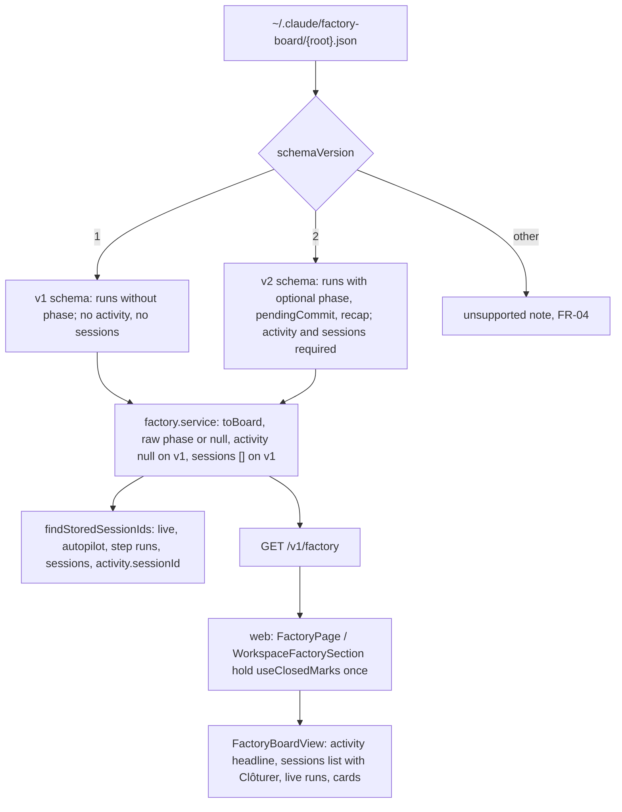

# Factory boards: session phases, activity, recap and Clôturer

Feature: `factory-board` · Components: `api`, `web` · Spec: FR-24, FR-25, FR-26, FR-27, FR-28, BR-02, BR-04

## Context

The factory-board mod now writes its export as `schemaVersion: 2`. The contract is `FactoryBoardExport` in the mod's `types/index.d.ts` (reference copy: `C:/WS/webapp-factory/plugins/factory-board/types/index.d.ts`), and the README section "The export for companion apps" describes it. `exportBoard` in `hooks/planning.ts` builds it. Version 2 adds:

- on each run (`FactoryBoardRun`), three optional fields: `phase` (`FactoryBoardPhase`: `working | awaiting-commit | awaiting-answer | job-done | interrupted`), `pendingCommit` (the commit message the turn ended on) and `recap` (`FactoryBoardRecap`: `{ text: string | null; commits: { sha; subject }[] }`, the done footer). `phase` is set at each turn's end from its final text;
- on the board, `activity`: the session that most needs the person. Its fields are `phase` (a `FactoryBoardPhase` or `idle`), `sessionId`, `feature`, `step`, `since`, `pendingCommit` and `recap`, all nullable;
- on the board, `sessions`: each session's latest main-loop run, most recently changed first, a month at most, with `phase` always set.

The first iteration (`20261020-181133-init-factory-board`) reads only version 1. Today a v2 file shows up as an unsupported-version note, so every board is hidden as soon as the mod is updated.

This plan does the following:

- **api.** It reads versions 1 and 2. It passes the run phase, the pending commit, the recap, the activity and the sessions through as exported, and marks their sessions `isStored`.
- **web.** It shows each run's phase in French, falling back to the status. It heads each board with its activity and lists its factory sessions, with `Clôturer` on the finished ones. It shows the pending commit message and the recap. The `Clôturée` marks are the ones the live page already uses (`web/src/shared/lib/useClosedMarks.ts`, live-sessions BR-10).

## Decisions

- **Version 1 keeps parsing** → `readBoardFile` accepts `schemaVersion` 1 and 2, and any other value is unsupported (FR-04). The unsupported-version test moves to version 3.
- **Run phase passed raw (BR-02)** → the api serves `phase` exactly as the file holds it on every run (`live`, `autopilot`, step runs, `sessions`), and `null` when absent, even in v2. It is never derived from `status`. `pendingCommit` and `recap` follow the same rule: `null` when absent.
- **Which phase the web shows on a run (FR-24)** → the mod carries a turn's `phase` over through later status changes (`hooks/register.tsx` spreads `...run` on a status change and on an interruption). So a `running` run can still hold the `awaiting-commit` of its previous turn. The contract reads the phase together with the status (`runPhase` in `hooks/planning.ts`: "the status wins while a turn runs or once it is interrupted"). The web shows the label with this precedence, a presentation rule taken from the contract, not a derived state:
  - status `running` → "Au travail";
  - status `interrupted` → "Interrompue";
  - otherwise the `phase` label when `phase` is not null, else the status label (`Attend une réponse`, `Terminé`; FR-24, the fallback for an older export or run).

  `sessions[].phase` and `activity.phase` are shown exactly as exported: the mod computed them with `runPhase` already.
- **Pending commit and recap on a run** → shown only when the displayed phase is `awaiting-commit` (the message) or `job-done` (the recap). A stale carried-over `pendingCommit` on a running run is never shown.
- **Activity on a v1 board** → served as `null`, and the web draws no activity headline. `idle` is never invented for a file that does not carry an activity (BR-02). `sessions` on a v1 board → `[]`.
- **Shared nullable entities** → every nullable reference to an entity with `.meta({ id })` (enums included) is `z.union([x, z.null()])`, never `.nullable()` (the generator emits an unusable `allOf` with null).
- **`isStored` for sessions and activity (FR-19 links)** → `runsOf` also collects `sessions` and `activity.sessionId`, so one `findStoredSessionIds` call still covers every run.
- **`Clôturée` marks (BR-04)** → `useClosedMarks()` is called once per page (`FactoryPage`, `WorkspaceFactorySection`), and its `isClosed` and `close` are passed down. Each hook instance holds its own state, and the `storage` event never fires in the tab that wrote, so one instance per board would leave the other boards stale. A `Closable` is built as follows:
  - a session: `{ sessionId, turnEndedAt: phase === "working" ? null : updatedAt }`. The mod sets `updatedAt` at each turn's end (`hooks/register.tsx`, the turn-end handler), so a later turn moves it past the mark and the session comes back (FR-28);
  - the activity: `{ sessionId, turnEndedAt: phase === "working" ? null : since }`, only when `sessionId` is not null.

## Decisions taken autonomously

- (stage 2) `factory.activity.since` text → "{when}" instead of "depuis {when}" (formatRelative already reads "il y a ..."; recorded in Deviations).
- (stage 2) Review finding: phase pill and boxes styled in the feature's CSS rather than `Badge` → kept (the live runs' pill did the same before this plan; the plan says CSS Modules per component).
- (stage 2) Review: `Clôturer` uses the default variant with `CheckIcon` like the live tile; the activity colour goes through a `--phase-color` custom property.

- Run the grill on the plan? → yes, autonomous. Every question below took its recommended answer, and none had no recommendation.
- Branch → stay on `feat/factory-board-session-phases`, which holds the spec commit `6ba1f89` (not the base branch; the instruction for this run).
- Feature slug → `factory-board`, existing. Its spec is committed and `Approved`, so there is no status change and no spec delta.
- Plan type and name → `add-session-phases`: a new iteration adding behaviour, commit type `feat`.
- Stage order → `api`, then `web` (the manifest's order; `web` needs the handoff).
- Review after each stage → yes (the autonomous default).
- Browser test → in Validation, left `[ ]`, with its scenarios.
- Source schema shape → a `z.discriminatedUnion("schemaVersion", [v1, v2])`. The v2 object extends v1 with `schemaVersion: z.literal(2)`, `activity` and `sessions`, both required. A v2 file missing them, or holding an unknown enum value, is unreadable: the last good board stays (FR-21).
- Strict enums → run `phase` uses the five phases. `activity.phase` uses the five plus `idle`. An unknown value makes the file unreadable, as for the v1 enums.
- `sessions[].phase` → required at parse time (the contract: "`phase` always set"). It is served by a `FactorySession` entity (`FactoryRun` fields with `phase: FactoryPhase`, not nullable) under its own `.meta({ id })`.
- Where the activity and the sessions stand → under the branch line, the scan age and the frozen banner, before the error, the live runs and the cards (the spec's UX flow). They also show when the board carries an `error`, since they are not features (FR-05 replaces the features only).
- Which sessions are hidden by a mark → every session whose `Closable` `isClosed` returns true, whatever its phase. A `working` session is never closed (`turnEndedAt: null`). One mark serves the live page and the board (live-sessions BR-10), so a session closed on the live page while it waited is hidden here too. `Clôturer` is offered only on `job-done` and `interrupted` sessions (FR-28).
- Known limit → a session closed while `awaiting-answer` that the mod later marks `interrupted` (a day of silence) moves `updatedAt` and comes back as `interrompue`. It is accepted: the export has no other turn time, and one more `Clôturer` settles it.
- Activity closed (FR-27) → when its session `isClosed`, the headline reads "Au repos", as for `idle`, and shows nothing else. The application never picks another session for the activity (BR-02).
- Stale suffix → the existing key `factory.run.atLastScan` ("au dernier scan") is kept, appended on a stale board to every phase that is not over. Those phases are `working`, `awaiting-commit` and `awaiting-answer`, or status `running` or `waiting` when the phase is null. It applies to live runs, timeline run lines, session lines and the activity alike.
- Phase labels → capitalised like the existing status labels: "Au travail", "Attend la validation du commit", "Attend une réponse", "Job done", "Interrompue", "Au repos".
- Where the pending commit and the recap are shown → in the activity headline, on the session lines and on the live run lines (the pending commit only, a live run has no recap). The timeline run lines show the phase label only, to stay compact.
- Recap content (FR-26) → `recap.text` when not null. Else the commit subjects, one per line, without the SHA. Else nothing.
- Pending commit display → a `<pre>` in `--font-mono` with `white-space: pre-wrap`, so it wraps and causes no horizontal scroll at 375 px.
- "Since when" → `formatRelative(updatedAt, now)` for a session line, and `formatRelative(activity.since, now)` for the headline.
- Step label of the activity → `stepTitle` takes `{ feature, step }` instead of a `FactoryRun`, so the activity can use it. `stepLabel` keeps the "Autopilot · …" prefix for runs.
- A session line's click → none. The session link (FR-19) and `Clôturer` are its controls. The live runs keep their unfold-on-click (FR-12).
- Web unit tests → none (`web/CLAUDE.md`); the browser test covers the stage.

## api

### services

`src/features/factory/factory.source.ts`:

- `phaseSchema = z.enum(["working", "awaiting-commit", "awaiting-answer", "job-done", "interrupted"])`.
- `recapSchema = z.looseObject({ text: z.string().nullable(), commits: z.array(z.looseObject({ sha: z.string(), subject: z.string() })) })`.
- `runSchema` gains `phase: phaseSchema.optional()`, `pendingCommit: z.string().nullish()` and `recap: recapSchema.nullish()`. They are optional in both versions.
- `sessionSchema = runSchema.extend({ phase: phaseSchema })`.
- `activitySchema = z.looseObject({ phase: z.enum([...phases, "idle"]), sessionId: z.string().nullable(), feature: z.string().nullable(), step: z.string().nullable(), since: timestamp.nullable(), pendingCommit: z.string().nullable(), recap: recapSchema.nullable() })`.
- `exportV1Schema`: the current board object, with `schemaVersion: z.literal(1)`.
- `exportV2Schema = exportV1Schema.extend({ schemaVersion: z.literal(2), activity: activitySchema, sessions: z.array(sessionSchema) })`.
- `factoryExportSchema = z.discriminatedUnion("schemaVersion", [exportV1Schema, exportV2Schema])`. Its comment names both versions of the mod's contract.
- Export the types `FactoryExport` (the union), `FactoryExportV1`, `FactoryExportV2`, `ExportRun`, `ExportSession` and `ExportActivity`.
- `readBoardFile`: `version !== 1 && version !== 2` → `unsupported`; the rest is unchanged.

`src/features/factory/factory.service.ts`:

- `runsOf(board)` also returns `board.sessions` when `schemaVersion === 2`. The id collection adds `board.activity.sessionId` when it is not null.
- `toRecap(recap)`: `{ text, commits: commits.map(({ sha, subject }) => ({ sha, subject })) }`.
- `toRun` adds:
  - `phase: run.phase ?? null`, with a comment: BR-02, never derived from the status;
  - `pendingCommit: run.pendingCommit ?? null`;
  - `recap: run.recap == null ? null : toRecap(run.recap)`.
- `toSession(session, storedSessions)`: `{ ...toRun(session, storedSessions), phase: session.phase }`.
- `toBoard` narrows on `board.schemaVersion`:
  - `schemaVersion` is served;
  - `activity`: `null` on v1. On v2 it is `{ phase, sessionId, feature, step, since (ISO or null), pendingCommit, recap (toRecap or null), isStored: sessionId !== null && storedSessions.has(sessionId) }`;
  - `sessions`: `[]` on v1, `board.sessions.map(toSession)` on v2, in the exported order;
  - everything else is unchanged.

### routes

`src/features/factory/factory.schema.ts`:

- `factoryPhaseSchema = z.enum(["working", "awaiting-commit", "awaiting-answer", "job-done", "interrupted"]).meta({ id: "FactoryPhase" })`.
- `factoryActivityPhaseSchema = z.enum([...the five, "idle"]).meta({ id: "FactoryActivityPhase" })`.
- `factoryRecapSchema = z.object({ text: z.string().nullable(), commits: z.array(z.object({ sha: z.string(), subject: z.string() })) }).meta({ id: "FactoryRecap" })`.
- `factoryRunSchema` gains the following, each with a short comment:
  - `phase: z.union([factoryPhaseSchema, z.null()])`: null when the export carries none (an older export or run), never derived (BR-02). It is read with the status, see the mod's `runPhase`;
  - `pendingCommit: z.string().nullable()`;
  - `recap: z.union([factoryRecapSchema, z.null()])`.
- `factorySessionSchema = factoryRunSchema.extend({ phase: factoryPhaseSchema }).meta({ id: "FactorySession" })`. Its comment: a session's latest main-loop run, phase always set by the mod (FR-28).
- `factoryActivitySchema = z.object({ phase: factoryActivityPhaseSchema, sessionId: z.string().nullable(), feature: z.string().nullable(), step: z.string().nullable(), since: z.iso.datetime().nullable(), pendingCommit: z.string().nullable(), recap: z.union([factoryRecapSchema, z.null()]), isStored: z.boolean() }).meta({ id: "FactoryActivity" })`. Its comment: FR-27, the mod's pick, never recomputed.
- `factoryBoardSchema` gains:
  - `schemaVersion: z.union([z.literal(1), z.literal(2)])`;
  - `activity: z.union([factoryActivitySchema, z.null()])`, with a comment: null on a version 1 export;
  - `sessions: z.array(factorySessionSchema)`, with a comment: empty on a version 1 export.
- Types: export `FactorySession` and `FactoryActivity`.

`GET /v1/factory` itself is unchanged. Handoff: `api/openapi.json` re-exported.

## web

### data

- Prepare: `src/api/schema.d.ts` regenerated from `api/openapi.json`.
- `src/features/factory/data/factoryTypes.ts`: add `FactoryPhase`, `FactoryActivityPhase`, `FactoryRecap`, `FactorySession` and `FactoryActivity` from `components["schemas"]`.

### pages

- `features/factory/pages/FactoryPage.tsx` and `features/factory/pages/WorkspaceFactorySection.tsx`: each calls `const closedMarks = useClosedMarks()` once (`shared/lib/useClosedMarks.ts`) and passes it down as `closedMarks: { isClosed; close }`. In `FactoryPage` that goes through `FactoryWorkspaceGroup`; in the section, straight to `FactoryBoardView`.

### ui

`features/factory/ui/labels.ts`:

- `phaseLabel(phase: FactoryActivityPhase)` → `t("factory.phase.{phase}")`.
- `shownPhase(run: FactoryRun): FactoryPhase | null`, the precedence of Decisions: `running` → `"working"`, `interrupted` → `"interrupted"`, else `run.phase`. A comment cites the mod's `runPhase` and says it is a reading of the contract, not a derived state (BR-02).
- `runStateLabel(run)`: `phaseLabel(shownPhase(run))` when the phase is not null, else `runStatusLabel(run.status)` (FR-24).
- `isUnderway(run)`: the shown phase is `working`, `awaiting-commit` or `awaiting-answer`, or the phase is null and the status is `running` or `waiting`. It drives the "au dernier scan" suffix on stale boards.
- `toClosableSession(session)` and `toClosableActivity(activity)`: the `Closable`s of Decisions.
- `stepTitle(board, { feature, step })`: the input narrowed; `stepLabel(board, run)` is unchanged around it.

`features/factory/ui/FactoryRecapView.tsx` (FR-26): props `{ recap: FactoryRecap }`. It shows `recap.text` in a `
` when not null. Else, when `commits` is not empty, a `<ul>` of the subjects with the label `factory.recap.commits`. Else nothing.

`features/factory/ui/FactoryPendingCommit.tsx` (FR-25): props `{ message: string }`. A label `factory.pendingCommit.label` and a `<pre>` holding the message (mono, `pre-wrap`).

`features/factory/ui/FactoryActivity.tsx` (FR-27): props `{ board, activity: FactoryActivity, now, isClosed }`.

- `idle`, or `isClosed(toClosableActivity(activity))` → one line: "Au repos".
- Otherwise:
  - the phase label (with " · au dernier scan" on a stale board when the phase is not over);
  - the feature (`factory.run.newFeature` when null) and `stepTitle(board, activity)` when `step` is not null;
  - `factory.activity.since` with `formatRelative(since, now)` when `since` is not null;
  - the session (`FactoryRunSession` with `isStored`) when `sessionId` is not null;
  - under it, `FactoryPendingCommit` when the phase is `awaiting-commit` and `pendingCommit` is not null, and `FactoryRecapView` when the phase is `job-done` and `recap` is not null.
- It is a `<section aria-label={t("factory.activity.label")}>` styled as the board's headline: phase colour on the left edge, with tokens of Decisions below.

`features/factory/ui/FactorySessions.tsx` (FR-28): props `{ board, now, isClosed, onClose(session) }`.

- The shown sessions are `board.sessions.filter((s) => !isClosed(toClosableSession(s)))`, in the exported order (most recently changed first).
- No shown session → nothing rendered.
- Otherwise a `<ul aria-label={t("factory.sessions.label")}>`, one `<li>` per session:
  - the phase pill (`phaseLabel(session.phase)`, with the stale suffix for an unfinished phase);
  - the feature (`newFeature` when null), `stepLabel(board, session)`, `formatRelative(updatedAt, now)` and `FactoryRunSession`;
  - a `Button` "Clôturer" (`aria-label` `factory.sessions.closeLabel` with the session's 8-character id) when the phase is `job-done` or `interrupted`, calling `onClose(session)`;
  - under the line, `FactoryPendingCommit` for `awaiting-commit` with a message, and `FactoryRecapView` for `job-done` with a recap.

`features/factory/ui/FactoryBoardView.tsx`: a new prop `closedMarks`. After the header and the stale banner, and before `renderContent()` (so also with an `error`):

- `board.activity !== null` → `<FactoryActivity>`;
- then `<FactorySessions onClose={(s) => closedMarks.close([toClosableSession(s)])}>`.

`features/factory/ui/FactoryWorkspaceGroup.tsx`: passes `closedMarks` through.

`features/factory/ui/FactoryLiveRuns.tsx`:

- the pill shows `runStateLabel(run)`;
- its colour class is keyed by the shown phase when not null, else by the status;
- the suffix follows `isUnderway`;
- under the line, `FactoryPendingCommit` when `shownPhase(run) === "awaiting-commit"` and `pendingCommit` is not null.

`features/factory/ui/FactoryRunLine.tsx`: it shows `runStateLabel(run)` unless the run is over and done, that is, `shownPhase(run) === "job-done"` or (`phase === null && status === "done"`), as FR-15's "unless done". The suffix follows `isUnderway`.

CSS Modules per new component, layout only, skin variables only. `src/shared/ui/theme/overrides.css` gains phase colours, each with its dark value through the existing variables:

- `--factory-phase-working: var(--accent)`;
- `--factory-phase-awaiting-commit: var(--status-awaiting)`;
- `--factory-phase-awaiting-answer: var(--status-awaiting)`;
- `--factory-phase-job-done: var(--factory-done)`;
- `--factory-phase-interrupted: var(--text-muted)`;
- `--factory-phase-idle: var(--text-muted)`.

`src/shared/lib/i18n/fr.json` gains:

- `factory.phase.working` "Au travail", `factory.phase.awaiting-commit` "Attend la validation du commit", `factory.phase.awaiting-answer` "Attend une réponse", `factory.phase.job-done` "Job done", `factory.phase.interrupted` "Interrompue", `factory.phase.idle` "Au repos";
- `factory.activity.label` "Activité du projet" and `factory.activity.since` "depuis {when}";
- `factory.sessions.label` "Sessions factory", `factory.sessions.close` "Clôturer" and `factory.sessions.closeLabel` "Clôturer : session {id}";
- `factory.pendingCommit.label` "Commit proposé" and `factory.recap.commits` "Commits".

## Conventions

- `api/CLAUDE.md`, Local run, "Source data": `schemaVersion: 1` → `schemaVersion` 1 or 2 (2 adds the run phases, the activity and the sessions; 1 is still read). Rationale: the documented source contract follows the versions read.

## Tests

### api

Vitest, Arrange/Act/Assert, in the existing `test/factory/factory.routes.test.ts`.

`test/factory/factory-builders.ts`:

- `buildBoardExport(overrides: Partial<FactoryExportV2>)` now builds a valid v2 object (`schemaVersion: 2`, an `idle` activity with nulls, `sessions: []`);
- `buildBoardExportV1(overrides: Partial<FactoryExportV1>)` builds the former v1 object;
- `buildExportActivity(overrides)` and `buildExportSession(overrides)` (a run with `phase: "job-done"`);
- `ExportRun` gains the optional fields.

The existing tests keep their assertions; the ones on `schemaVersion: 2` as unsupported move to `3`. New or changed tests:

- a version 1 board still parses and is served with `schemaVersion: 1`, `activity: null`, `sessions: []`, and `phase`, `pendingCommit` and `recap` null on its runs;
- a version 2 board serves each run's `phase`, `pendingCommit` and `recap` as exported (live, autopilot, step runs), with the recap's text and commits (BR-02, FR-24 to FR-26);
- a version 2 run without `phase` and with status `done` is served with `phase: null`, not derived from its status (BR-02);
- a version 2 board serves its `activity` as exported, with `since` as ISO, its pending commit or recap, and `isStored` (FR-27). An `idle` activity is served with nulls and `isStored: false`;
- a version 2 board serves its `sessions` in the exported order, each with its `phase` (FR-28);
- a session whose id the history holds has `isStored: true` in `sessions` and in `activity`, and `false` otherwise (FR-19);
- a file with `schemaVersion: 3` is listed in `unsupportedFiles` with its version and draws no board (FR-04, moved from 2);
- a version 2 file with an unknown run `phase`, an unknown `activity.phase`, or without `sessions`, keeps the last good board (FR-21, strict enums).

No integration tests: the api declares no `integration_tests`.

### web

None: `web/CLAUDE.md` has no unit tests on the front. The browser test of Validation checks the stage.

## Progress

### Stage 1 — api
Commit: `feat(factory-board): api — export version 2: phases, activity and sessions`
- [x] services: v1 and v2 parse schemas (phase, pendingCommit, recap, activity, sessions); `readBoardFile` accepts 1 and 2; `toBoard` narrows on the version; `runsOf` covers sessions and activity
- [x] routes: `FactoryPhase`, `FactoryActivityPhase`, `FactoryRecap`, `FactorySession`, `FactoryActivity`; run and board fields; builders and route tests
- [x] Conventions: `api/CLAUDE.md` source note names versions 1 and 2
- [x] Handoff: `api/openapi.json` exported

### Stage 2 — web
Commit: `feat(factory-board): web — session phases, activity, recap and Clôturer`
- [x] Prepare: client regenerated from `api/openapi.json`
- [x] data: new types in `factoryTypes.ts`
- [x] pages: `useClosedMarks` once in `FactoryPage` and `WorkspaceFactorySection`, passed down
- [x] ui: phase labels and precedence helpers; `FactoryActivity`, `FactorySessions`, `FactoryRecapView`, `FactoryPendingCommit`; phase on live runs and run lines; tokens; i18n keys

## Validation

- [x] Review: the `reviewer` agent on the plan's implementation, its findings settled
- [x] Tests: the full `test` command of `api` green on the plan's final code
- [-] Browser test: not run (autopilot without browser test). Scenarios:
  - this project's board (version 2, written by the mod) shows on the factory page, with no unsupported note;
  - the board is headed by its activity: the phase in French, the feature and step, since when, and the session link. A session ending on a commit question shows "Attend la validation du commit" and its message;
  - the sessions list shows each session with its phase. A `job done` shows its recap (text, else commit subjects) and `Clôturer`. A click hides it, and the live page shows it closed too (and the other way round);
  - closing the activity's session turns the headline into "Au repos";
  - live runs and timeline run lines show the phase label, with the status for a run without phase;
  - the workspace page's factory section behaves the same;
  - no horizontal scroll at 375 px, a long commit message included; both colour schemes are readable.

  Only against the real `~/.claude/factory-board`, which is never written. The cases that need a crafted file are covered by the api route tests and are not run in the browser: a version 1 file, a version 3 note, a stale board's suffix, an unknown phase.

## Deviations

- `factory.activity.since` "depuis {when}" → "{when}" (`formatRelative` already reads "il y a ...", so "depuis" would double it).
