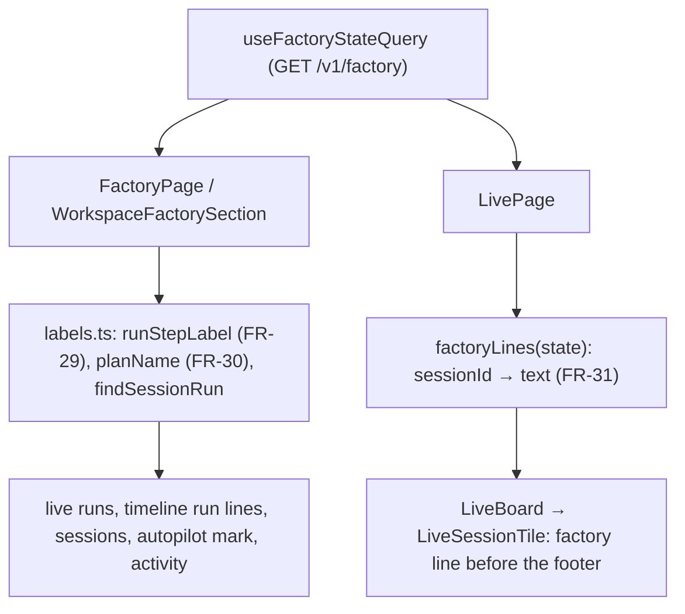

# Factory boards: step labels from the run's plan, plan names, factory line on live tiles

Feature: `factory-board` · Components: `web` · Spec: FR-29, FR-30, FR-31, BR-02

## Context

`stepTitle` (`web/src/features/factory/ui/labels.ts`) labels a run's step with the title of the feature's timeline row for that step. The timeline rows belong to the plan the mod follows, the feature's latest one. A run of an older plan of the same feature therefore gets a stage title of another plan. Example: `implement … — stage 1` of `init-factory-board` reads "Stage 1 — api" of `add-session-phases`. And two `Revue finale` runs of the same feature cannot be told apart. The live page does not say which factory job a running session does.

This iteration is web-only. The served contract already holds everything the requirements need:

- every `FactoryRun` (live runs, timeline runs, the autopilot, `sessions`) carries `folder` (the plan folder the command named, relative, forward slashes), `command`, `step`, `agentId` and `sessionId`;
- `FactoryFeature.plan` carries the followed plan's `folder` and `stages` (`number`, `title`);
- the timeline row of a stage carries the exported title `Stage {N} — {stage title}`;
- `FactoryActivity` carries `sessionId`, `feature` and `step` but no `folder` and no `command`: those come from the session's run among the board's live runs and sessions (spec decision).

The live page gets the boards from the existing `GET /v1/factory` query (`useFactoryStateQuery`), the same way `WorkspacesPage` and `WorkspacePage` already read it from another feature.

## Decisions

- **No api stage** → the web does it all from the served data. Rejected alternative: an api join that puts each live session's factory run on `GET /v1/live`. It would couple the live-sessions read to the factory boards, and it would add a second copy of the run lookup. The factory query already polls every second on the pages that show boards.
- **Step label of a run (FR-29)** → `runStepLabel(board, run)`, replacing `stepTitle` for runs:
  - `spec` → "Spec", `review` → "Revue finale": fixed labels, whatever the row titles say;
  - `plan` → "Revue du plan" when `run.command === "review"`, else "Plan";
  - `stage:{N}` → the timeline row's title (`Stage {N} — {stage title}`, as exported, BR-02) only when the run's feature has a followed `plan`, the run's `folder` equals `plan.folder` (`samePlanFolder`), and the feature has a row `stage:{N}`. Otherwise `Stage {N}` (`factory.step.stage`). A feature with `plan === null` (a plan on its way) always gives `Stage {N}`;
  - any other step → the raw step string, as today.
- **Stage title source** → the timeline row's title ("Stage 1 — web"), not the bare `plan.stages[].title` ("web"). The bare title reads badly alone on a tile, and the row title is already the exported label of that stage of that plan.
- **`samePlanFolder(a, b)`** → backslashes turned to `/`, trailing `/` dropped, then compared exactly. A null `folder` never matches.
- **Plan name (FR-30)** → `planName(folder)`: null for a null folder. Otherwise the last path segment (after normalising backslashes and dropping a trailing `/`), with a leading `^\d{8}-\d{6}-` stripped. A segment without that prefix is shown as it is.
- **The activity's run** → `findSessionRun(board, { sessionId, feature, step })`. It searches `board.live` first, then `board.sessions`, for a run with that `sessionId`, the same `feature` and the same `step`. Among several matches, the main-loop run (`agentId === null`) wins, then the latest `updatedAt`. Found → the step label and the plan name come from that run (`runStepLabel`, `planName`). Not found → `runStepLabel` on a pseudo-run with `folder: null` and `command: ""` (fixed labels, `Stage {N}`) and no plan name. Matching feature and step as well as the session keeps a subagent's run of another step (same `sessionId`) from naming the activity's plan.
- **Run for a live tile (FR-31)** → `factoryLines(state)` builds one `Map<sessionId, string>` over every board of `state.workspaces`:
  - first the live runs of every board, the main-loop run winning over a subagent's, then the latest `updatedAt`;
  - then, for the sessions still without a line, the `sessions` of every board, the latest `updatedAt` winning;
  - live runs win over sessions (spec decision: the fresher one). A stale board is used too (spec decision); `unsupportedFiles` carry no board and give nothing.
- **Text of the factory line** → `{feature or "nouvelle feature"} · {step label} · {plan name} · {phase}`, the plan name left out when null:
  - the step label is `runStepLabel`, with the `Autopilot · …` prefix for an autopilot run, as on the board's lines;
  - the phase of a live run is `runStateLabel(run)` (the precedence of `shownPhase`, falling back to the status, FR-24);
  - the phase of a session is `phaseLabel(session.phase)`;
  - on a stale board, `· au dernier scan` is appended when the phase is not over (`isUnderway` / `isUnderwayPhase`), as on the board.
- **Factory query on the live page** → `LivePage` calls `useFactoryStateQuery()`. While it is pending, or when it fails, the tiles have no factory line, and nothing about it is shown. The live page never shows a factory error, and its own loading and error states are unchanged.
- **Where the line sits** → in `LiveSessionTile`, a `
` just before the footer, muted and clamped to one line with the full text as its `title`. It shows in the three columns (awaiting, running, finished). `IdleGroup` gets none (spec non-goal). The tile stays presentational: it receives `factoryLine: string | null`.
- **Timeline run lines** → they gain the plan name only. They sit under their row, so they show no step label, as today.
- **Autopilot mark (FR-30)** → `factory.card.autopilot` reads `⚡ autopilot · {step}`, with `{step}` taking `runStepLabel(board, autopilot)` and `· {plan}` added when `planName(autopilot.folder)` is not null.

## Decisions taken autonomously

- Run the grill on the plan? → yes, autonomous. Every question below took its recommended answer, and none had no recommendation.
- Branch → stay on `feat/factory-board-session-phases`, which holds the spec commit `3903714` (not the base branch; the instruction for this run).
- Feature slug → `factory-board`, existing. The spec is `Approved` and already carries FR-29 to FR-31: no spec delta, no status change.
- Plan type and name → `add-plan-labels-and-live-line`: a new iteration adding behaviour, commit type `feat`.
- Does the api need a stage? → No (see Decisions: every field is served; an api join on the live state was rejected).
- Stages → one, `web`. Review after it → yes (the autonomous default).
- Prepare step → kept (`web` declares `commands.prepare`). The contract does not change, so `src/api/schema.d.ts` must come out unchanged. If it changes, another session's uncommitted contract is in the working tree: the file is not staged.
- Stage title: the row title or the bare stage title? → the row title (reads alone on a tile; as exported).
- Folder comparison → normalised slashes and trailing slash, exact case. The mod writes both folders the same way, from the project root.
- Activity lookup key → session, feature and step, not the session alone. A subagent's run carries its parent's `sessionId`.
- Several runs for one session on the live page → the main loop first, then the latest `updatedAt`. Live runs before sessions, across every board.
- A stale board's phase on a tile → suffixed "au dernier scan" like on the board, so the tile does not pass an old phase off as live.
- Factory query failing on the live page → no line, no error (the live page is about the live state; the factory page shows the factory errors).
- Line placement → before the footer, one clamped line (the spec's "under its usual content").
- `stepTitle` → removed. `runStepLabel` takes a run, and the activity goes through `findSessionRun`. `stepLabel` keeps its autopilot prefix around `runStepLabel`.
- Web unit tests → none (`web/CLAUDE.md`); the browser test covers the stage.

## web

### data

- Prepare: `src/api/schema.d.ts` regenerated from `api/openapi.json`; expected unchanged (see Decisions taken autonomously).
- `src/features/factory/data/useFactoryStateQuery.ts`: the comment that lists the pages that poll adds the live page. No code change.

### pages

`src/features/live/pages/LivePage.tsx`:

- `const factoryQuery = useFactoryStateQuery()`, imported from `../../factory/data/useFactoryStateQuery.ts`. `WorkspacesPage` is the precedent for a cross-feature data hook.
- `const factoryLinesBySession = useMemo(() => factoryQuery.data === undefined ? new Map() : factoryLines(factoryQuery.data), [factoryQuery.data])`. `factoryLines` comes from `../../factory/ui/factoryLines.ts`. A comment cites FR-31: no line while the query is pending or failed, and no error shown.
- `LiveBoard` gets `factoryLineOf={(session) => factoryLinesBySession.get(session.sessionId) ?? null}`.

### ui

`src/features/factory/ui/labels.ts`:

- `samePlanFolder(a: string | null, b: string | null): boolean`, as in Decisions.
- `planName(folder: string | null): string | null`, as in Decisions, with a comment citing FR-30.
- `runStepLabel(board, run: Pick<FactoryRun, "feature" | "folder" | "command" | "step">): string`, as in Decisions. A comment cites FR-29: never a stage title of another plan of the feature.
- `stepTitle` is removed, and its callers move to `runStepLabel`.
- `stepLabel(board, run)` = `runStepLabel` with the autopilot prefix (unchanged around it).
- `findSessionRun(board, target: { sessionId: string; feature: string | null; step: string }): FactoryRun | null`, as in Decisions (live, then sessions; main loop, then latest `updatedAt`).
- `withPlanName(label: string, folder: string | null): string` → `label` or `{label} · {plan}`. Used by every line that shows a step and a plan.

`src/features/factory/ui/factoryLines.ts` (new, pure, no React):

- `factoryLines(state: FactoryState): Map<string, string>`, as in Decisions. It is built from `stepLabel`, `planName`, `runStateLabel`, `phaseLabel`, `isUnderway`, `isUnderwayPhase` and the i18n keys `factory.run.newFeature` and `factory.run.atLastScan`, joined with ` · `.

`src/features/factory/ui/FactoryLiveRuns.tsx`: the step span shows `withPlanName(stepLabel(board, run), run.folder)`.

`src/features/factory/ui/FactoryRunLine.tsx`: after the duration, a `` with `planName(run.folder)` when not null.

`src/features/factory/ui/FactorySessions.tsx`: the step span shows `withPlanName(stepLabel(board, session), session.folder)`.

`src/features/factory/ui/FactoryFeatureCard.tsx`: the autopilot badge's `step` is `withPlanName(runStepLabel(board, autopilot), autopilot.folder)`.

`src/features/factory/ui/FactoryActivity.tsx`:

- when `activity.step` is not null, `const run = findSessionRun(board, { sessionId, feature, step })` when `sessionId` is not null;
- the step span shows `withPlanName(runStepLabel(board, run ?? { feature: activity.feature, folder: null, command: "", step: activity.step }), run?.folder ?? null)`.

`src/features/live/ui/LiveBoard.tsx`: a new prop `factoryLineOf: (session: BoardSession) => string | null`, passed to each `LiveSessionTile` as `factoryLine`.

`src/features/live/ui/LiveSessionTile.tsx`:

- a new prop `factoryLine: string | null`;
- when not null, just before the `<footer>`: `
{factoryLine}
`;
- `LiveSessionTile.module.css` gains `.factory` (layout only: margin, `min-width: 0`).

`src/shared/lib/i18n/fr.json` gains:

- `factory.step.planReview` "Revue du plan";
- `live.tile.factoryLabel` "Job factory".

## Tests

### api

None: the api is not touched.

### web

None: `web/CLAUDE.md` has no unit tests on the front. The browser test of Validation checks the stage.

## Deviations

- `labels.ts` also exports `isNewerRun` and `isBetterRun` (not listed in the plan) → shared by `findSessionRun` and `factoryLines` so the run-picking rule exists once (reuse before writing).
- The factory line `
` carries `role="note"` (the plan gave an `aria-label` alone) → ARIA ignores a name on a plain paragraph (review finding).

## Progress

### Stage 1 — web
Commit: `feat(factory-board): web — step labels from the run's plan, plan names, factory line on live tiles`
- [x] Prepare: client regenerated from `api/openapi.json` (unchanged)
- [x] data: `useFactoryStateQuery` comment names the live page
- [x] pages: `LivePage` reads the factory state and passes `factoryLineOf` to `LiveBoard`
- [x] ui: `runStepLabel`, `planName`, `samePlanFolder`, `findSessionRun` and `withPlanName` in `labels.ts`, with `stepTitle` removed; `factoryLines.ts`; plan names on the live runs, timeline run lines, sessions, autopilot mark and activity; the factory line on `LiveSessionTile` through `LiveBoard`; i18n keys

## Validation

- [x] Review: the `reviewer` agent on the plan's implementation, its findings settled
- [-] Browser test: not run (autopilot without browser test). Scenarios were: the change tested in `web` (`test-in-browser` skill). Scenarios, against the real `~/.claude/factory-board` (never written):
  - the timeline run lines and the session lines of an older plan's stage run read `Stage N`, with that plan's name beside them, e.g. a past `implement` of `init-factory-board` on `factory-board`;
  - a run of the followed plan's stage reads that stage's row title, e.g. `Stage 1 — web` on `live-sessions`, with its plan name;
  - a `review` run on the `plan` step reads "Revue du plan"; two `Revue finale` runs of the same feature show their plan names;
  - the autopilot mark and the activity name their plan; a `write-spec` run shows no plan name;
  - on the live page, a running factory session's tile shows its factory line (feature, step, plan, phase), a session typed without `/factory:` shows none, and the `Idle` group shows none;
  - with the factory query failing (api stopped after load), the live page keeps working with no factory error;
  - no horizontal scroll at 375 px; both colour schemes are readable.
