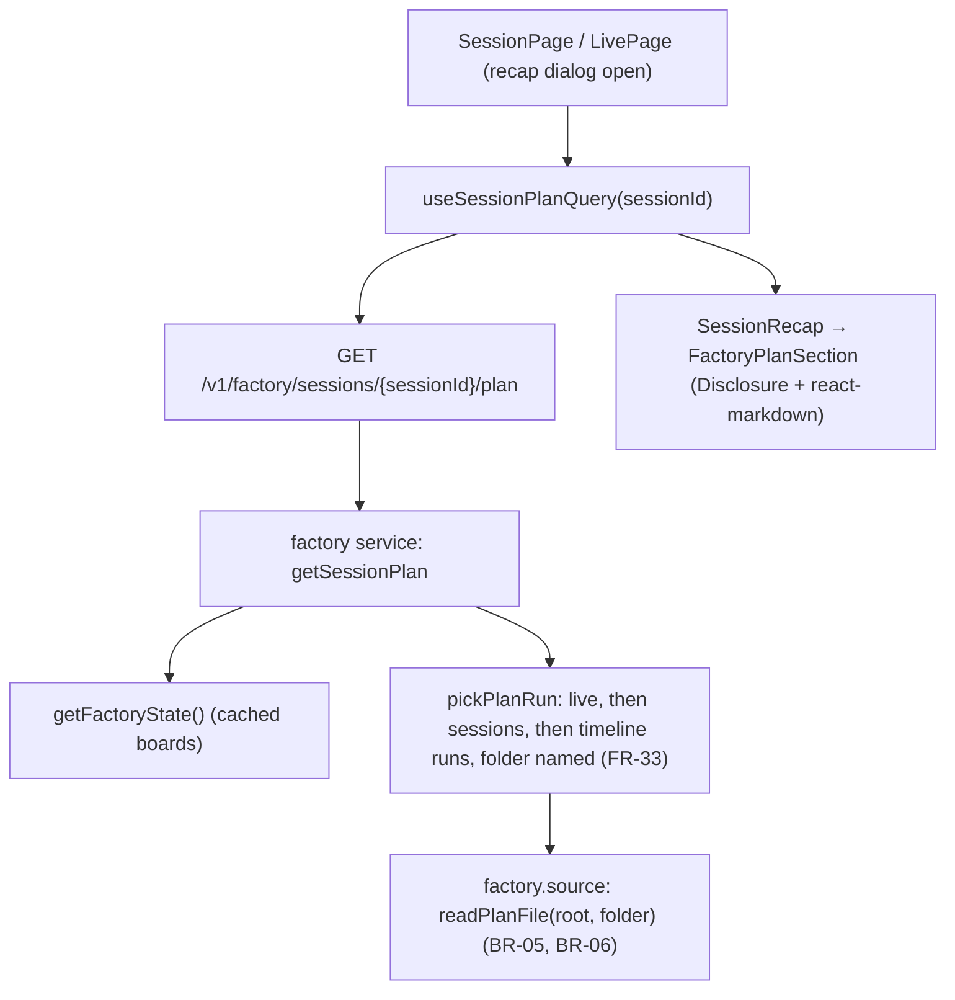

# Factory boards: a session's plan in its recap

Feature: `factory-board` · Components: `api`, `web` · Spec: FR-32, FR-33, FR-34, FR-35, FR-36, FR-37, BR-05, BR-06

## Context

A stored session's recap (the session page, and the live page's recap dialog, which draws the same `SessionRecap`, live-sessions FR-42) says nothing of the factory plan the session works on. The exported runs name a plan folder (`FactoryRun.folder`, relative to the board's `root`, forward slashes), but the export does not carry the plan's text. This iteration:

- adds an api read: it picks the session's plan folder among its runs over every board (FR-33), reads that folder's `plan.md` under the board's root, read only and never outside that root (FR-35, FR-36, BR-05, BR-06);
- adds a folded `Plan` section to the recap, under the session's facts. Unfolded, it renders the plan's Markdown (FR-34). It shows nothing when the session has no plan (FR-37).

The run's root is its board's `root`: a worktree has its own board file, with the worktree as its root, so a worktree's run reads the worktree's plan (FR-35).



## Decisions

- **Where the plan comes from** → a new factory route, `GET /v1/factory/sessions/{sessionId}/plan`. It does not go on `GET /v1/sessions/{sessionId}`:
  - the session detail is read from the database and belongs to `workspaces`;
  - the plan is a factory read of the boards and of a project file;
  - keeping it apart leaves the session recap's contract and its tests untouched;
  - the front reads both on the same open.
- **Session id** → the Claude Code session id, the same string as `SessionDetail.id`, the session page's route param and `FactoryRun.sessionId`. Validated by the factory's existing `SESSION_ID` pattern (`^[\w-]+$`) → `400` otherwise. The route does not check that the history holds the session: a session that no board knows gives `{ plan: null }`.
- **Run pick (FR-33)** → `pickPlanRun(state, sessionId)`. It is not `matchSessionJobs`, which picks the best run first and then drops it when it is off the workflow. Here the candidates are filtered first, then ordered:
  - candidates: the runs of every board of `state.workspaces` (stale boards included; unsupported files carry no board, so they are excluded) with `run.sessionId === sessionId` and a `folder` that is not null and not empty after trimming. Off-workflow runs carry no folder, so the filter drops them. An off-workflow live run therefore never hides an older run that names a plan;
  - first tier: the board's `live` runs, ordered by `isBetterLiveRun` (the main loop over a subagent's run, then the latest `updatedAt`);
  - second tier, when the first is empty: the board's `sessions`, the latest `updatedAt` winning;
  - third tier, when the second is empty: the timeline runs, i.e. every `feature.steps[].runs` and every `feature.autopilot`, ordered by `isBetterLiveRun`;
  - the winner keeps its board, whose `root` is the root to read under.
- **Plan file read (BR-05, BR-06)** → `readPlanFile(root, folder)` in `factory.source.ts`, the only place that touches a project file. It uses `realpath`, `stat` and `readFile`, nothing that writes. Steps:
  1. `path` = `path.resolve(root, folder, "plan.md")`. This path is always returned, so FR-36 can name it.
  2. Refused, and the file never opened, when any of these holds: `folder` is absolute (`path.isAbsolute`, or a Windows drive `^[A-Za-z]:` or a leading `\\` / `/`); `folder` normalises to `.` or empty (it would read `{root}/plan.md`, which is no plan folder); `path.relative(root, path)` starts with `..` or is absolute.
  3. Then `realpath` of the root and of the target, and the same `relative` check on the real paths, so a junction or a symlink cannot lead outside the root.
  4. `stat`: not a file, or larger than `PLAN_MAX_BYTES` (1 MiB) → not readable.
  5. Otherwise `readFile(…, "utf8")`. Any error (missing file, removed worktree, permission) → not readable. Nothing is logged: a removed worktree is common.
- **Title (FR-34)** → the text of the first ATX level-1 heading (`/^# +(.+?)\s*#*\s*$/`) found outside a fenced code block (lines between ```` ``` ```` or `~~~` fences are skipped), trimmed; null when there is none. It is computed in the api (`planTitle(content)`, pure), so the front does not parse the Markdown twice.
- **No cache of the plan** → read at every request (FR-35: the current content each time the recap opens). The boards keep their existing file cache through `getFactoryState()`'s single flight.
- **Response** → `{ plan: FactorySessionPlan | null }`. `FactorySessionPlan` is:
  - `folder` (as exported) and `root` (the board's);
  - `path` (absolute, the file looked for);
  - `title: string | null`;
  - `content: string | null`, null when the file was not read (FR-36, BR-06).
  A wrapper object, not a bare nullable body: the openapi-fetch client and `unwrap` handle a `200` with `{ plan: null }` cleanly.
- **Markdown rendering (parked by the spec)** → `react-markdown` `10.1.0` with `remark-gfm` `4.0.1`, pinned exact like every `web` dependency. Checked with `npm view`: `react-markdown` peers `react >=18` and `@types/react >=18`, so React 19.3 is covered. GFM is needed for tables and task-list checkboxes (FR-34). Rules:
  - no `rehype-raw`: raw HTML in a plan is shown as text, never injected;
  - links render as plain text (`a` → `span`): a plan's relative links (`[File](src/…)`) would route into the SPA;
  - images render as nothing but their alt text in brackets: the images a plan references are a spec non-goal;
  - fenced code (Mermaid included) renders as a code block, not as a diagram;
  - task-list checkboxes render disabled (read only), as `remark-gfm` emits them.
- **Freshness on the front (FR-35)** → `useSessionPlanQuery(sessionId, { enabled })` has no `staleTime` and no `refetchInterval`, so each mount refetches. The session page enables it always. The live page enables it only while the recap dialog is open, as `useSessionQuery` is gated today.
- **Section states** →
  - query pending → no section (most sessions have no plan; no flicker of an empty block);
  - query failed → the section's heading with an `ErrorMessage` (`common.state.error`);
  - `plan: null` → no section at all (FR-37);
  - `content: null` → the section's heading with a warning line naming `path` (FR-36), no disclosure;
  - readable → a `Disclosure`, folded, its summary `{planName(folder)} · {title}` (the title left out when null), its content the rendered Markdown.
- **Where the section sits** → in `SessionRecap`, right after `SessionFacts` ("under the session's facts", spec UX flow). `SessionRecap` takes a `plan: SessionPlanState` prop, so it stays presentational. The two pages build that state from the query with one helper.
- **Phone width** → tables and code blocks scroll horizontally inside their own container (`overflow-x: auto`), so the page itself never scrolls sideways at 375 px.

## Decisions taken autonomously

- Run the grill on the plan? → yes, autonomous. Every question below took its recommended answer, and none had no recommendation.
- Branch → stay on `feat/factory-board-session-plan`, which holds the spec commit `14c9f47` (not the base branch; the instruction for this run).
- Feature slug → `factory-board`, existing. The spec is `Approved` and already carries FR-32 to FR-37, BR-05 and BR-06: no spec delta, no status change.
- live-sessions FR-42 lists the recap's contents (facts, tokens, activity, subagents, tools); does it need a delta? → No. It says the dialog shows "the same recap as the session's stored page", and factory-board FR-32 names the dialog explicitly.
- Plan type and name → `add-session-plan`: a new iteration adding behaviour, commit type `feat`.
- Stages → `api` then `web`, the manifest's order. Review after each stage → yes (the autonomous default).
- New route on the factory feature, or a field of `SessionDetail`? → the factory route (see Decisions: no coupling of the database recap to the boards and project files).
- Route path → `/v1/factory/sessions/{sessionId}/plan` (the factory feature owns `/v1/factory`; the session id is the Claude Code one, as everywhere).
- Off-workflow runs in the pick → excluded by the folder filter, before the order. An off-workflow live run must not hide an older run that names a plan, unlike the tile's band, which hides itself.
- Does `feature.autopilot` count as a timeline run? → Yes, in the third tier with the steps' runs. It is a run of the feature's timeline, as the board draws it on the card.
- Order inside the timeline tier → `isBetterLiveRun` (the main loop, then the latest change), the same order FR-31 states for live runs.
- An empty or `.` folder → refused as not readable (it would read the root's `plan.md`, which is no plan folder; BR-05 reads only a plan folder's `plan.md`).
- Junctions and symlinks → the real paths are checked too (BR-06 forbids reading outside the root, whatever the link).
- A size cap → 1 MiB, beyond it not readable (FR-36). A plan is a few tens of KiB; the cap keeps a wrong file from flooding the dialog.
- The title: api or web? → api (`planTitle`), the first H1 outside code fences. One parse; the front only renders.
- Markdown library → `react-markdown` 10.1.0 + `remark-gfm` 4.0.1 (the spec parked the choice; GFM tables and checkboxes are required; safe by default, no raw HTML).
- Links and images in a plan → links as text, images as their alt text (relative links would route into the SPA; images are a spec non-goal).
- Mermaid fences → shown as code (no diagram renderer for one section; the plan's text is the spec's requirement).
- Plan query pending → no section. Failed → an error in the section (the web convention: a data read shows its error).
- An unreadable plan → heading plus a warning line naming the path, not folded (FR-36: the person must see why, at once).
- Demo data → unchanged. Its board roots are never created (`demoWorkspaceFolder`: outside any repository, on purpose), so in the demo the dialog shows the FR-36 message. A readable plan is checked on the session page against the real boards, read only. The live page stays tested on the demo only (`web/CLAUDE.md`).
- The root `CLAUDE.md` hard rule (parked by the spec) → it gains the project `plan.md` files that exported runs name, as a read-only source. The api's `CLAUDE.md` source paragraph says the same.
- Prepare step of `web` → kept (`web` declares `commands.prepare`); the regenerated `src/api/schema.d.ts` carries the new route.
- Web unit tests → none (`web/CLAUDE.md`); the browser test covers the stage.

## api

### services

`src/features/factory/factory.source.ts`:

- `export const PLAN_MAX_BYTES = 1024 * 1024`.
- `export async function readPlanFile(root: string, folder: string): Promise<{ path: string; content: string | null }>`, as in Decisions. Its comment cites BR-05 and BR-06: only the `plan.md` of the named folder, never outside the root, real paths checked, read only.
- `export function planTitle(content: string): string | null`, as in Decisions (FR-34). Pure, beside the reader.
- The file's header comment ("Read only (BR-01) …") adds that the project's `plan.md` read is read only too (BR-05).

`src/features/factory/factory.service.ts`:

- `export function pickPlanRun(state: FactoryState, sessionId: string): { board: FactoryBoard; run: FactoryRun } | null`, as in Decisions (FR-33). It reuses `isBetterLiveRun` and `updatedAtMs`. A comment cites FR-33 and why it filters before ordering, unlike `matchSessionJobs`.
- `getSessionPlan(sessionId: string): Promise<FactorySessionPlanResponse>`, returned by `createFactoryService` beside `getFactoryState` and `getSessionJobs`:
  - `const picked = pickPlanRun(await getFactoryState(), sessionId)`;
  - none → `{ plan: null }` (FR-37);
  - else `readPlanFile(picked.board.root, picked.run.folder)` → `{ plan: { folder, root, path, title: content === null ? null : planTitle(content), content } }`.

### routes

`src/features/factory/factory.schema.ts`:

- `factorySessionPlanParamsSchema = z.object({ sessionId: z.string().regex(/^[\w-]+$/) })`.
- `factorySessionPlanSchema`, as in Decisions, with `.meta({ id: "FactorySessionPlan" })`. Its comments say:
  - `path`: absolute, the file looked for, named when it cannot be read (FR-36);
  - `content`: null when not read (FR-36, BR-06).
- `factorySessionPlanResponseSchema = z.object({ plan: z.union([factorySessionPlanSchema, z.null()]) }).meta({ id: "FactorySessionPlanResponse" })`.
- Types `FactorySessionPlan` and `FactorySessionPlanResponse` by `z.infer`.
- `registry.registerPath({ method: "get", path: "/v1/factory/sessions/{sessionId}/plan", summary: "The plan of a session: the plan.md of the folder its factory runs name, read under the run's root", request: { params }, responses: { 200, 400 } })`. The `400` uses a problem-details response, as `workspaces.schema.ts` declares `invalid`.

`src/features/factory/factory.routes.ts`:

- `router.get("/v1/factory/sessions/:sessionId/plan", validate({ params: factorySessionPlanParamsSchema }), …)` → `res.json(await factory.getSessionPlan(params.sessionId))`, with `inputOf` as in `workspaces.routes.ts`.

Handoff: `npx tsx scripts/export-openapi.ts openapi.json`, then commit `api/openapi.json`.

## web

### data

- Prepare: `src/api/schema.d.ts` regenerated from `api/openapi.json`. It now carries `FactorySessionPlan` and the new route.
- `src/features/factory/data/factoryKeys.ts`: `sessionPlan: (sessionId: string) => [...factoryKeys.all, "session-plan", sessionId] as const`.
- `src/features/factory/data/useSessionPlanQuery.ts` (new): `useSessionPlanQuery(sessionId, options?: { enabled?: boolean })`. It calls `api.GET("/v1/factory/sessions/{sessionId}/plan", …)` through `unwrap`. No `staleTime`, no `refetchInterval`. A comment cites FR-35: the current plan at each open.
- `src/features/factory/data/sessionPlanState.ts` (new, pure): `type SessionPlanState = { kind: "none" } | { kind: "error"; message: string } | { kind: "loaded"; plan: FactorySessionPlan }` and `toSessionPlanState(query)`, mapping as follows:
  - pending → `none`;
  - error → `error`;
  - `plan === null` → `none`;
  - otherwise → `loaded`.

### pages

- `src/features/workspaces/pages/SessionPage.tsx`: `const planQuery = useSessionPlanQuery(sessionId)`; passes `plan={toSessionPlanState(planQuery)}` to `SessionRecap`.
- `src/features/live/pages/LivePage.tsx`:
  - `const planQuery = useSessionPlanQuery(openSessionId ?? "", { enabled: openSessionId !== null })`;
  - the `loaded` `RecapDialogState` gains `plan: toSessionPlanState(planQuery)`.

### ui

`src/features/factory/ui/FactoryPlanSection.tsx` (new) and its `FactoryPlanSection.module.css`:

- `FactoryPlanSection({ plan }: { plan: Exclude<SessionPlanState, { kind: "none" }> })`, presentational. It draws the section's body only. The `<section>` and its `<h2>` `factory.plan.title` ("Plan") are drawn by `SessionRecap` with its existing `styles.section` and `styles.sectionTitle`, as its other sections are.
- `error` → `ErrorMessage` with `common.state.error`.
- `loaded`, `content === null` → a paragraph `factory.plan.unreadable` ("Le plan ne peut pas être lu : {path}"), styled with `--warning`, the path in `--font-mono`, wrapping (`overflow-wrap: anywhere`) (FR-36).
- `loaded`, readable → `Disclosure`, its `summary` `planName(plan.folder)` joined with `plan.title` by ` · ` (when the name is null, which cannot happen for a non-empty folder, the title alone, else `factory.plan.untitled` "Plan"). Its content is `<PlanMarkdown content={plan.content} />` (FR-34).

`src/features/factory/ui/PlanMarkdown.tsx` (new) and its `PlanMarkdown.module.css`:

- `<div className={styles.markdown}><ReactMarkdown remarkPlugins={[remarkGfm]} components={{ a: …, img: … }}>{content}</ReactMarkdown></div>`:
  - `a` → `<span className={styles.link}>{children}</span>`;
  - `img` → `<span>[{alt}]</span>`;
  - a comment cites the Decisions: no raw HTML, links as text, no images.
- `table` and `pre` wrapped, or styled, with `display: block; overflow-x: auto; max-width: 100%`.
- The module styles headings, lists, task-list items (`li:has(> input[type="checkbox"])` with `list-style: none`), tables (borders `--border`), inline code and `pre` (`--font-mono`, `--surface-2`), blockquotes. Skin variables only, as `web/CLAUDE.md` requires.

`src/features/workspaces/ui/SessionRecap.tsx`:

- a new prop `plan: SessionPlanState`;
- right after `<SessionFacts>`, when `plan.kind !== "none"`: `<section className={styles.section}><h2 className={styles.sectionTitle}>{t("factory.plan.title")}</h2><FactoryPlanSection plan={plan} /></section>`; nothing for `none` (FR-37);
- the component comment adds the plan section (factory-board FR-32).

`src/features/live/ui/RecapDialog.tsx`:

- the `loaded` state gains `plan: SessionPlanState`;
- `SessionRecap` receives `plan={state.plan}`.

`src/shared/lib/i18n/fr.json` gains:

- `factory.plan.title` "Plan";
- `factory.plan.unreadable` "Le plan ne peut pas être lu : {path}";
- `factory.plan.untitled` "Plan".

`package.json` / `package-lock.json`: `react-markdown` `10.1.0` and `remark-gfm` `4.0.1` in `dependencies`, installed with `npm install --save-exact`.

## Conventions

| File | Change | Rationale |
|---|---|---|
| `CLAUDE.md` (root), hard rule "The session logs, the live state and Claude Code's settings are read only" | Add: the application also reads the `plan.md` of a plan folder that an exported factory run names, under that run's root, and nothing else of a project; it never writes, moves or deletes there (factory-board BR-05, BR-06). | A new read-only source outside `~/.claude` (parked by the spec). |
| `api/CLAUDE.md`, Local run, "Source data" | Add the plan read: the `plan.md` of a run's plan folder under its board's root, never outside it, read at each request. Update "these five places" to say the API never writes in any of these places nor in a project. | Keeps the list of the API's sources complete. |
| `web/CLAUDE.md`, Design | One line: a plan's Markdown is rendered by `react-markdown` with `remark-gfm` (`PlanMarkdown`); no raw HTML, links as text, no images; tables and code blocks scroll inside their own box. | A new rendering rule, for the next feature that renders Markdown. |

The root and api `CLAUDE.md` edits go in the api stage's commit, and the `web/CLAUDE.md` edit in the web stage's.

## Tests

### api

Route tests in `test/factory/factory.routes.test.ts`, a new `describe("the plan of a session")`. Each test writes boards whose `root` is a temporary folder holding `plan.md` files. A helper `writePlan(root, folder, content)` is added to `test/factory/factory-builders.ts`, and the folders are cleaned up in `afterEach`. The tests:

- returns `{ plan: null }` when no board names the session (FR-37);
- returns `{ plan: null }` when the session's runs name no plan folder (a `write-spec` run with `folder: null`) (FR-37);
- reads the `plan.md` of the live run's folder under its board's root: `folder`, `root`, `path`, the whole `content`, and the `title` from its first `# ` heading (FR-32, FR-34, FR-35);
- prefers a live run over a session entry and over a timeline run naming another folder (FR-33);
- prefers the main loop's live run over a subagent's, then the latest `updatedAt` (FR-33);
- uses a session entry when no live run names a folder, and a timeline run (a step's run, or the autopilot) when neither does (FR-33);
- skips an off-workflow live run with no folder and uses the session entry that names a plan (FR-33);
- reads the plan under the root of the run's own board when two boards (a checkout and its worktree) hold the same folder (FR-35);
- includes a stale board, and ignores a board file of an unsupported version (FR-33);
- returns the new content after the file changed between two requests (FR-35);
- returns `content: null` and `title: null` with the path looked for when the file is missing (FR-36);
- returns `content: null` for a folder leading outside the root (`../outside`) and for an absolute folder, even though a `plan.md` exists there (BR-06);
- returns `content: null` for an empty folder (`""` after trimming, or `.`) (BR-05);
- returns `content: null` for a file larger than `PLAN_MAX_BYTES` (FR-36);
- returns `title: null` when the plan has no level-1 heading, and ignores a `# ` line inside a fenced code block (FR-34);
- answers `400` for a session id that is not a session id (`a b`).

`planTitle` and `pickPlanRun` are covered through the route; no separate unit test file. A junction escape is not tested: creating one needs rights the test run may lack on Windows. The real-path check is reviewed instead.

### web

None: `web/CLAUDE.md` has no unit tests on the front. The browser test of Validation checks the stage.

## Progress

### Stage 1 — api
Commit: `feat(factory-board): api — the plan of a session, read from its run's folder`
- [ ] services: `readPlanFile`, `planTitle` and `PLAN_MAX_BYTES` in `factory.source.ts`; `pickPlanRun` and `getSessionPlan` in `factory.service.ts`
- [ ] routes: `FactorySessionPlan` and its response schema, registered; `GET /v1/factory/sessions/{sessionId}/plan`
- [ ] tests: the route tests of "the plan of a session", with `writePlan` in the builders
- [ ] conventions: root `CLAUDE.md` hard rule and `api/CLAUDE.md` source paragraph name the plan read
- [ ] Handoff: `api/openapi.json` exported

### Stage 2 — web
Commit: `feat(factory-board): web — a folded plan section in the session recap`
- [ ] Prepare: client regenerated from `api/openapi.json`
- [ ] data: `react-markdown` and `remark-gfm` installed exact; `factoryKeys.sessionPlan`, `useSessionPlanQuery`, `sessionPlanState.ts`
- [ ] pages: `SessionPage` and `LivePage` read the session's plan and pass its state to the recap
- [ ] ui: `FactoryPlanSection`, `PlanMarkdown`, the `plan` prop of `SessionRecap` and `RecapDialog`, i18n keys
- [ ] conventions: `web/CLAUDE.md` Design line on the Markdown rendering

## Validation

- [ ] Review: the `reviewer` agent on the plan's implementation, its findings settled
- [ ] Tests: the full `test` command of `api` green on the plan's final code
- [ ] Browser test: the change tested in `web` (`test-in-browser` skill). Scenarios:
  - session page, against the real API on 3100 (`~/.claude/factory-board` and the projects read only): a session that ran `/factory:implement` on a plan of this repository shows a folded `Plan` section under its facts, headed `{plan name} · {title}`. Unfolded, it shows the plan with its headings, lists, ticked and unticked checkboxes, tables and code blocks; links read as text, and no image loads;
  - a session typed without `/factory:`, or one that ran only `write-spec`, shows no `Plan` section;
  - a session whose plan lives in a removed worktree shows "Le plan ne peut pas être lu" with the path;
  - live page, on the demo only (api `npm run demo`, web `npm run dev:demo`): the recap dialog of a factory session shows the section with the FR-36 message (the demo's roots do not exist), and the dialog of the off-workflow session shows none;
  - reopening the recap after editing the plan file shows the new content (on the session page, real data);
  - no horizontal page scroll at 375 px with a wide table unfolded; both colour schemes are readable.
