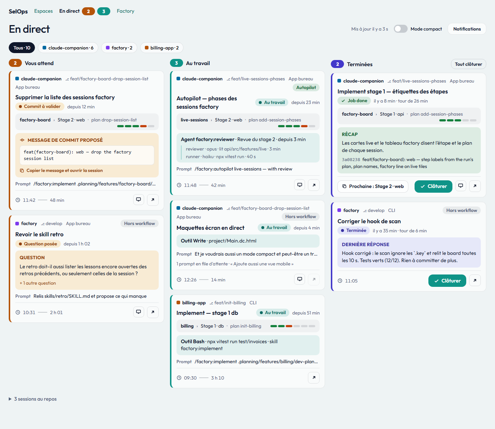
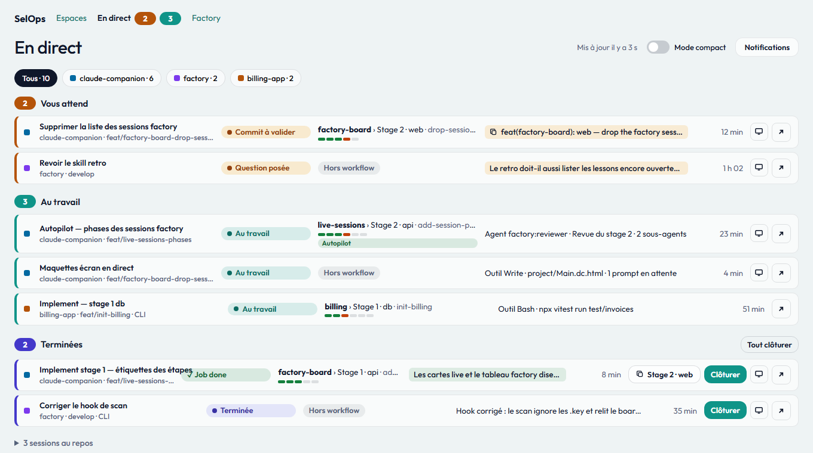
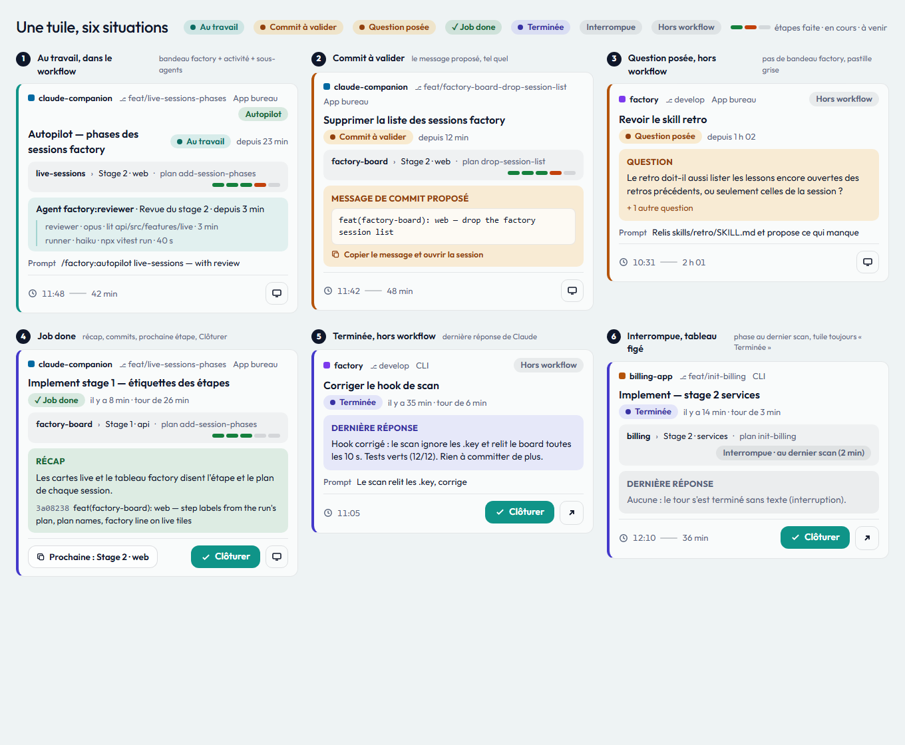

# Live sessions (sessions en direct) — PRD

> **Slug**: `live-sessions`
> **Tags**: #sessions #factory
> **Status**: Approved
> **Last updated**: 2026-10-20

## TL;DR

The person runs several Claude Code sessions at once, in several workspaces, and only sees what each one does by switching to it. This feature adds a live page: every session running on this machine, as tiles in three columns (waiting for the person, at work, finished), each tile naming its workspace, what the session is doing right now (tool, skill, agent), its last prompt and, once finished, Claude's last reply. When a factory board knows the session, its tile also says where it stands in the factory workflow (feature, step, plan) and what it waits for: a commit to validate, an answer, or nothing more once its job is done, with the next step's prompt one click away; a session outside the workflow says so. The page updates by itself; a session whose process ends leaves it and stays in the stored history. On request, the browser also notifies the person when a session asks a question and, if they choose, when a turn ends.

## Problem

With five or six sessions open across the desktop app, a terminal and worktrees, the person loses track: which one is still working, which one stopped on a question an hour ago, which one finished and waits for the next prompt. Finding out means clicking through every session. The recap pages of the application show the stored history, which changes on a refresh only; they say nothing about the sessions in progress.

A first live page grouped the sessions by workspace: the person still had to scan every workspace to find what needs them, and a session that had just finished its turn looked the same as one idle for hours, folded away with it.

The tiles say what a session does, not where it stands in its job: a factory session waiting for the person to validate a commit looks like one still running (the commit's permission request counts as running), a session whose job is done looks like any finished turn, and the person opens each of them to learn whether the work is over, which step comes next, and whether the session can be closed.

The board and the counts in the tab's title still have to be looked at: while the person works in another window, a session can wait on a question for an hour before they glance back.

## Non-goals

- Acting on a session: sending it a prompt, answering its question, validating its commit, stopping it. The page observes only; opening a desktop-app session in the desktop app (FR-31), after copying a commit subject or a next step's prompt to the clipboard (FR-36, FR-38), is its one shortcut.
- Opening a session of the CLI or of an IDE from its tile: the application cannot bring a terminal to the front, and a resume command would start a second process (BR-18).
- Tokens and costs of a running session: tokens come from the stored history, after the fact.
- Sessions of other machines, cloud sessions, conversations of claude.ai and of the Claude desktop chat.
- The relation between a session and the sessions it started: each live session stands on its own, under its workspace.
- Enriching the stored history from the live view: the history keeps coming from the logs through a refresh.
- Sharing the `Clôturée` marks across browsers or devices: they belong to the browser the person closed the session in.
- Showing a session whose process ended as finished: it leaves the page at once (BR-01); the stored history holds it.
- Notifications while no page of the application is open: the browser notifies only through an open page.
- Correcting the factory data: a session's `Phase`, `Récap`, proposed commit, steps and `Prompt suivant` are drawn as the factory board exports them (factory-board BR-02).
- A factory band or a `Hors workflow` mark in the folded `Idle` group: its lines stay short (FR-07).
- Notifications for other changes (a session starting to run, a change of `CurrentActivity`, a session leaving the page): only a question and, on request, the end of a turn need the person.
- Sharing the notification settings across browsers or devices: like the `Clôturée` marks, they belong to the browser the person set them in.
- A recap dialog anywhere but the live page: the workspace's session list, the factory page and a notification's click (FR-28) keep opening their pages as before.
- A live recap in the dialog: it shows the stored history as of the last `Refresh`, like the stored page.

## Domain Glossary

Canonical entity names introduced or reused. Names only: no properties, relationships or persistence.

| Business term | Identifier | Business meaning | Status |
|---|---|---|---|
| `Workspace` | `Workspace` | A real folder in which Claude Code sessions ran; a repository's worktrees and case variants of its path belong to it | Reused |
| `Groupe Scratch` | `ScratchGroup` | All the temporary scratch workspaces of the Claude desktop app, gathered as one workspace | Reused |
| `Session` | `Session` | One Claude Code conversation, from one log file, with its subagents | Reused |
| `Sous-agent` | `Subagent` | A helper agent a session launched; it has a type and runs on a model | Reused |
| `Prompt` | `Prompt` | A message or a slash command the person typed in a session | Reused |
| `Actualisation` | `Refresh` | One pass that reads the new and changed log files into the database | Reused |
| `Session en direct` | `LiveSession` | A `Session` whose Claude Code process is alive on this machine | New |
| `État` | `LiveStatus` | What a `LiveSession` is doing from the person's point of view: `En cours` (`Running`), `Question posée` (`AwaitingAnswer`) or `Au repos` (`Idle`) | New |
| `Activité courante` | `CurrentActivity` | What a `Running` session is doing right now: a tool, a skill, an agent, or thinking | New |
| `Prompt en file d'attente` | `QueuedPrompt` | A `Prompt` the person sent while the session was busy, not yet taken up | New |
| `Tour` | `Turn` | One `Prompt`, or a message that restarts Claude without the person (a background task's notification, a message from another session), and the work Claude Code does on it, until the session is `Idle` again | New |
| `Dernière réponse` | `LastReply` | The last text Claude wrote to the person in the latest `Turn` of a session | New |
| `Terminée` | `Finished` | An `Idle` `LiveSession` whose latest `Turn` ended and that the person has not `Clôturée` yet | New |
| `Clôturée` | `Closed` | The person's mark that they are done with a `Finished` session's latest `Turn`, made on the live page and also honoured by the factory board's `Activité` (factory-board BR-04) | New |
| `Lien bureau` | `DesktopLink` | A link that opens a `Session` in the Claude desktop app | Reused |
| `Commande de reprise` | `ResumeCommand` | The command that reopens a `Session` in a terminal (session-ingestion) | Reused |
| `Notification` | `LiveNotification` | A browser notification about one `LiveSession`, of one of two kinds: `Question posée` (it entered `Vous attend`, BR-20) or `Tour terminé` (it became `Finished`) | New |
| `Tableau factory` | `FactoryBoard` | The board of one project root as the factory-board mod exports it (factory-board) | Reused |
| `Tableau figé` | `StaleBoard` | A `FactoryBoard` whose last scan is more than 60 seconds old (factory-board) | Reused |
| `Run` | `FactoryRun` | One session working on one step of one factory feature (factory-board) | Reused |
| `Session factory` | `FactorySession` | A session's latest `FactoryRun` of its main conversation (factory-board) | Reused |
| `Phase` | `FactoryPhase` | Where a factory session stands for the person: `au travail`, `attend la validation du commit`, `attend une réponse`, `job done`, `interrompue` (factory-board) | Reused |
| `Étape` | `TimelineStep` | One step of a factory feature's timeline, with its marker: done, running, next or pending (factory-board) | Reused |
| `Récap` | `FactoryRecap` | What a session's job done says it did: its recap line and its commits (factory-board) | Reused |
| `Prompt suivant` | `NextPrompt` | The factory command prepared for a feature's next step (factory-board) | Reused |
| `Commit proposé` | `PendingCommit` | The commit message a session `attend la validation du commit` proposed, as the factory board exports it | New |
| `Hors workflow` | `OffWorkflow` | A `LiveSession` of which no `FactoryBoard` exports a `FactoryRun` of a factory job, typically a session typed without a `/factory:` command, whose run the mod may record as a free request off the workflow (factory-board FR-31) | New |

## Functional Requirements

### The live page

- **FR-01** — A live page lists every `LiveSession` of this machine as tiles in three columns, `Vous attend` (the `AwaitingAnswer` sessions and those whose `FactoryPhase` asks for a commit's validation, BR-20), `Au travail` (the other `Running` sessions) and `Terminées` (the other `Finished` sessions), each with its count, and the other `Idle` sessions below them, so that what needs the person is read by state, not workspace by workspace.
- **FR-02** — Each `LiveSession` tile shows, top to bottom: a context line with its `Workspace` (name and a colour that stays the same for that workspace), its git branch and its origin (CLI, desktop app, IDE…); its title with its status pill (FR-32) and since when; its factory band (FR-33) when it has one; the callout that needs the person (the question FR-05, the proposed commit FR-36, the `Récap` FR-37 or the `LastReply` FR-16); its `CurrentActivity`; its last prompt and its `QueuedPrompt`s in order; a footer with its start time and total duration as one strip (`🕓 11:48 ─ 42 min`, in tabular figures) and its actions as icons with an accessible label, so that the person reads the tile in the order of what matters.
- **FR-03** — A `Running` session names its activity: the tool being called, the skill being run, or the agent launched with its type and description; a session thinking between two tool calls shows that.
- **FR-04** — A `Running` session lists its running subagents, each with its type, its description, its current tool and since when it runs, so that a long review or exploration is visible as such.
- **FR-05** — An `AwaitingAnswer` session shows the question Claude Code asked, shortened, so that the person knows what to answer before opening the session.
- **FR-06** — Long texts (last prompt, queued prompts, question, agent description) are shortened on the page, the last prompt on one line (`Prompt · …`) with its full text on hover, so that one screen holds every session.
- **FR-07** — The `Idle` sessions that are not `Finished` are folded in one group for the whole page, each reduced to its title, its `Workspace`, since when it is idle and its `DesktopLink` when it has one (FR-31), and unfold on demand.
- **FR-08** — The sessions of the `ScratchGroup` are always shown, their `Workspace` named as the group, without the switch of the workspaces page: a running session is never noise.
- **FR-09** — When no session is live, the page says so.
- **FR-10** — Each `LiveSession` opens its stored session in a recap dialog over the live page (FR-42) through an arrow action (↗) when the history already holds it; a session not yet refreshed shows the action greyed out, so that the tile's actions do not move once it is.

### Freshness

- **FR-11** — The page updates by itself, without a reload, and a change of `LiveStatus` or of `CurrentActivity` is visible within 5 seconds.
- **FR-12** — When the live state can no longer be read (folder missing or unreadable), the page says so instead of freezing on stale sessions.
- **FR-13** — When a `LiveSession` leaves the page (its process ended), a `Refresh` runs, so that its recap in the stored history is up to date without the person asking.

### Navigation

- **FR-14** — The navigation links to the live page with two counts, the sessions in `Vous attend` (highlighted) and those in `Au travail` (FR-01), and the browser tab's title starts with the number of sessions in `Vous attend` when there is one, so that a waiting session is visible from every page and from another tab.
- **FR-41** — The navigation names the application `SelOps`.

### The status board

- **FR-15** — Inside a column the order is stable: `Vous attend` and `Au travail` by the time the session entered the column, oldest first; `Terminées` most recent first; a tile keeps its place while its state does not change, so that the page does not jump at every update.
- **FR-16** — A `Finished` session shows its `LastReply`, shortened, and the duration of its latest `Turn`, so that the person knows the outcome before opening the session; a `Job done` tile shows its `Récap` in place of the `LastReply` (FR-37).
- **FR-17** — The person closes a `Finished` session with `Clôturer`, one at a time or the whole column at once; it then moves to the folded `Idle` group, and only then: a finished session never leaves the column by itself, so that no outcome goes unread.
- **FR-18** — A session whose column or status pill just changed is highlighted for a few seconds (8 s), with no motion when the person's system asks for reduced motion, so that a change is noticed without staring at the page.
- **FR-19** — The person filters the page by `Workspace`: one choice per workspace with its number of sessions, all of them by default; the filter applies to the three columns and to the `Idle` group, never to the navigation counts.
- **FR-20** — An empty column says so in a line, so that "nothing waits for you" is read as such.
- **FR-21** — The page shows how long ago it was last updated.
- **FR-22** — On a phone-sized screen the three columns become three tabs with their counts, `Vous attend` first.

### Notifications

- **FR-23** — Notifications are off until the person turns them on from the live page; accepting the browser's permission turns the `Question posée` notifications on at once.
- **FR-24** — When a `LiveSession` enters `Vous attend`, a `Question posée` notification names its `Workspace`, its title and the question, or the subject of its `PendingCommit` (FR-36), shortened, so that the person knows which session waits and for what without opening the application.
- **FR-25** — The `Tour terminé` notifications have their own switch, off by default; once on, a session that becomes `Finished` and enters `Terminées` (not `Vous attend`, BR-20) gives a notification naming its `Workspace`, its title, its `LastReply` shortened and the duration of its `Turn`.
- **FR-26** — The person turns each kind of notification off and on again from the live page, without changing the browser's permission.
- **FR-27** — Notifications arrive as long as one page of the application is open in the browser, whichever page it is, so that the person does not have to keep the live page open.
- **FR-28** — Clicking a notification brings the application's tab to the front and opens the live page filtered on the session's `Workspace` (FR-19).
- **FR-29** — When the browser refuses notifications (permission denied, or no support), the live page says so and how to allow them again, instead of a switch that does nothing.
- **FR-30** — A `Question posée` notification is withdrawn once its session leaves `Vous attend` (answered, its commit validated or declined, or ended), so that only the questions still waiting remain.

### Opening a session

- **FR-31** — A `LiveSession` that comes from the Claude desktop app (its origin, FR-02) and has a `DesktopLink` offers to open it in the desktop app, through an app icon on its tile and on its line in the folded `Idle` group, so that the person jumps from the board to the session.
- **FR-42** — The arrow (FR-10) of a tile, of a compact line and of a line of the folded `Idle` group opens, in a dialog over the live page, the same recap as the session's stored page (session-ingestion, session-activity): its facts, tokens, activity, subagents and tools, so that the person reads a session's history without leaving the board.
- **FR-43** — The recap dialog links to the session's full stored page, and its links to the workspace and to the dashboard leave the live page as on the stored page.
- **FR-44** — The recap dialog closes with `Escape`, a close button or a click outside it, and the live page is then as the person left it: same workspace filter, same `Mode compact`, same scroll, the focus back on the arrow that opened it.
- **FR-45** — The live page's address names the session whose recap dialog is open, so that a reload reopens it and the browser's back button closes it.
- **FR-46** — While the recap dialog is open the board behind it keeps updating (FR-11), and the dialog stays open when its session leaves the page (BR-01), so that a recap being read never disappears under the person.
- **FR-47** — On a phone-sized screen the recap dialog fills the screen.

### The factory workflow on a tile

- **FR-32** — A tile's status pill is its `FactoryPhase` when a `FactoryBoard` that is not a `StaleBoard` knows the session (found by its session among the board's live `FactoryRun`s or `FactorySession`s, the live run winning, as factory-board FR-31 matches them): `Au travail`, `Commit à valider`, `Question posée`, `Job done` or `Interrompue`; otherwise its `LiveStatus`: `En cours`, `Question posée` or `Terminée`. The `LiveStatus` keeps the tile's column (except BR-20) and its colour edge, so that the person reads where the job stands while the board still sorts by live state.
- **FR-33** — Under its title, a tile a `FactoryBoard` knows carries a factory band: its feature (`nouvelle feature` without one), its step (factory-board FR-29) and its plan name (factory-board FR-30), read `feature › étape · plan`, with one segment per stage of the feature's followed plan, done, at hand or to come, as the factory page draws its card (factory-board FR-13); an `Autopilot` mark heads the tile while an autopilot works on the feature.
- **FR-34** — A tile no `FactoryBoard` knows, or whose matched run is the mod's record of a free request off the workflow (`OffWorkflow`, factory-board FR-31), carries a grey `Hors workflow` mark in its context line and no factory band, so that a session outside the workflow is told apart at a glance.
- **FR-35** — On a tile known by a `StaleBoard` (BR-21), the band shows the `FactoryPhase` at the last scan, marked so with the scan's age (`Interrompue · au dernier scan (2 min)`), so that a frozen phase is never read as the current one.
- **FR-36** — A `Commit à valider` tile shows a `Message de commit proposé` callout with the subject of its `PendingCommit`, never its body; the callout is a button that copies the subject to the clipboard and opens the session in the desktop app (FR-31), so that the person validates or corrects the commit in one move; a session without a `DesktopLink` only copies, and the button says so (BR-18).
- **FR-37** — A `Job done` tile shows a `Récap` callout with its recap line and its commits (short hash and subject), as factory-board FR-26 gives them, and offers `Clôturer` (FR-17) as its primary action, so that the person reads the outcome and closes the session.
- **FR-38** — A `Job done` tile whose feature has a `NextPrompt` for its next step offers, in its footer, `Prochaine : {étape}`: it copies that prompt with the `avec revue` and `test navigateur` markers as the factory page's switches set them (factory-board FR-18, the same switches) and opens the session in the desktop app; a session without a `DesktopLink` only copies, and the button says so.

### Compact mode

- **FR-39** — A `Mode compact` switch in the page's bar shows each session as one line instead of a tile, grouped under the three columns' headings in the order `Vous attend`, `Au travail`, `Terminées`, each with its count (`Terminées` with `Tout clôturer`), the folded `Idle` group below them, so that a dozen sessions fit on one screen.
- **FR-40** — A compact line shows: the `Workspace` colour, the title with the workspace, branch and origin under it; the status pill (FR-32); `feature › étape · plan` with its stage segments and `Autopilot` mark under it, or `Hors workflow`; what counts, shortened: the `PendingCommit`'s subject as the copy-and-open button (FR-36), the question, the recap line, the `LastReply`, or the `CurrentActivity` with its number of subagents and of `QueuedPrompt`s; since when; and the tile's actions: the app icon, the arrow (FR-10), `Clôturer` and the next step's button (FR-38).

## Business Rules

- **BR-01** — A session is live only while its Claude Code process is alive on this machine; a session whose process is gone leaves the page at once, with no "ended" status, and stays in the stored history like any other.
- **BR-02** — `Running` means Claude Code is busy: a tool, a skill, an agent or its own thinking is in progress; `AwaitingAnswer` means Claude Code asked the person a question and waits for the answer to go on; `Idle` means the turn ended and the session waits for the next prompt.
- **BR-03** — A permission request cannot be told apart from a tool that runs: a session waiting for a permission counts as `Running`.
- **BR-04** — The status Claude Code declares wins over what the log suggests: a log whose last tool call has no result while Claude Code says the session is idle (an interrupted tool) gives an `Idle` session.
- **BR-05** — A session too young to have a readable log is live all the same: its status comes from Claude Code and its `CurrentActivity` is unknown.
- **BR-06** — A `LiveSession` is titled and attached to its `Workspace` by the same rules as a stored session (session-ingestion FR-07, BR-02, BR-03, BR-04, BR-10), so that the live page and the workspaces page agree.
- **BR-07** — The live page stores nothing on the application's side: it reads the live state of Claude Code and the session logs, and never writes, moves or deletes anything there; the `Clôturée` marks are kept by the person's browser only (BR-10).
- **BR-08** — A session started by another session is a `LiveSession` like any other, under its own workspace, with no link to the session that started it.
- **BR-09** — A session is `Finished` while it is `Idle`, has had a `Turn` since its Claude Code process started (a resumed session's older turns do not count) and is not `Clôturée`, however long ago the turn ended; otherwise an `Idle` session goes to the folded group. A session too young to have a turn is never `Finished`.
- **BR-10** — A `Clôturée` mark covers the turns ended before it: a session that runs again and finishes a new turn is `Finished` again. The mark is made on the live page only; the factory board's `Activité` honours it too (factory-board FR-27, BR-04), and the factory board offers no `Clôturer` of its own. The marks live in the browser the person used, survive a reload, and are forgotten with the browser's data or a month after they were made.
- **BR-11** — The `LastReply` is the last text Claude Code wrote in the main conversation of the latest `Turn`, never a subagent's; a turn that ended without text (an interruption, tool calls only) has none, and the tile says so.
- **BR-12** — One change of a session gives one notification, however many pages of the application are open; a newer notification of the same session replaces the previous one instead of piling up.
- **BR-13** — Only a change seen while a page of the application is open notifies: sessions already in `Vous attend` or `Finished` when a page opens, or when the live state can be read again (FR-12), notify nothing, so that opening the application never fires a burst of notifications.
- **BR-14** — Notifications follow the columns: a session waiting for a permission counts as `Running` (BR-03) and notifies nothing, unless its `FactoryPhase` puts it in `Vous attend` (BR-20).
- **BR-15** — The workspace filter (FR-19) never applies to notifications: every `LiveSession` of this machine can notify.
- **BR-16** — The notification settings are kept by the person's browser only, like the `Clôturée` marks (BR-10): they survive a reload and are forgotten with the browser's data.
- **BR-17** — Clicking a `Tour terminé` notification does not close the session: `Clôturer` stays the person's act on the page.
- **BR-18** — A `LiveSession` never offers a `ResumeCommand`, whatever its `LiveStatus` (session-ingestion BR-15): a second Claude Code process would write to the same log; a live session without a `DesktopLink` offers no way to open it.
- **BR-19** — A `Tour terminé` notification is given only for a turn that ended after the previous read of the live state: a session seen for the first time, or seen again after a read that missed it, whose turn ended earlier notifies nothing, so that an old finished turn never notifies.
- **BR-20** — A session whose `FactoryPhase` is `attend la validation du commit`, on a board that is not a `StaleBoard`, goes in `Vous attend` whatever its `LiveStatus` (`Running` while its commit's permission request is open, BR-03, or `Finished` when the question ended its turn), counts there in the navigation (FR-14), offers no `Clôturer`, and leaves it when its phase changes; its `LiveStatus` itself is unchanged.
- **BR-21** — A `StaleBoard`'s phase moves no tile and sets no pill or callout: the column, the pill and the callout follow the `LiveStatus` (FR-35), so that a board whose mod stopped never pins a session in `Vous attend`.
- **BR-22** — The `Mode compact` switch is off by default and kept by the person's browser only, like the notification settings (BR-16).

## UX Flow

- The person works in another tab: its title reads "(2) claude-companion", two sessions wait for an answer. In the application the navigation shows "2" highlighted and "4" running.
- The person opens the live page: on the left `Question posée`, the longest wait on top, each tile with its workspace, the question shortened and since when it waits.
- In `En cours`, each tile names its workspace, its current tool or agent and its subagents; the person reads what each session does without switching to it.
- A session finishes its turn: within 5 seconds its tile moves to `Terminées`, highlighted for a few seconds, with Claude's last reply and the turn's duration.
- The person reads the reply and clicks `Clôturer`: the tile moves to the folded idle group. Left alone, it stays in `Terminées`.
- The person picks one workspace in the filter: the three columns and the idle group show its sessions only.
- The person closes a session: it leaves the page, and a refresh updates its recap in the history.
- The person clicks a session's arrow: its recap opens in a dialog over the board, with its prompts and activity; `Escape` closes it, the board unchanged behind it.
- On the live page, the person turns notifications on and accepts the browser's request: `Question posée` notifications are on; `Tour terminé` stays off until they tick it.
- The person works in another window with the workspaces page open: a session asks a question, a notification names its workspace, its title and the question.
- The person clicks the notification: the application's tab comes to the front on the live page, filtered on that workspace, the waiting tile in `Question posée`.
- The person answers in the session: the notification disappears.
- On the tile of a desktop-app session, the person clicks to open it: the desktop app shows that session.
- A factory session proposes a commit: its tile moves to `Vous attend` with `Commit à valider` and the subject; the person clicks the subject, it is copied and the session opens in the desktop app.
- A factory session's job is done: its tile in `Terminées` reads `Job done`, its recap and commits; the person clicks `Prochaine : Stage 2 · web`, the next prompt is copied and the session opens; back on the page, they click `Clôturer`.
- A session typed without a `/factory:` command reads `Hors workflow` and keeps the last reply of its turn.
- The person turns `Mode compact` on: one line per session, grouped by column; the switch is still on after a reload.

## Decisions taken autonomously

- Feature slug → `live-sessions`, existing (the notifications report changes of `LiveStatus`, which this feature owns).
- Where are the notification switches? → On the live page (it is the page about live sessions; the navigation keeps its counts only).
- Can `Question posée` be turned off without revoking the browser's permission? → Yes, its own switch (FR-26) (the person cannot be asked to dig into browser settings to mute it).
- What does a notification show? → `Workspace`, title, and the question or the `LastReply` shortened, plus the turn's duration for `Tour terminé` (the same facts as the tile, enough to decide whether to switch).
- Several pages of the application open? → One notification per change (BR-12) (one per tab would multiply them).
- Sessions already waiting when a page opens? → No notification (BR-13) (opening the application would fire a burst; the board and the tab title already show them).
- Does a permission request notify? → No (BR-14) (it counts as `Running`, BR-03; the live state cannot tell it apart).
- Does the workspace filter mute notifications? → No (BR-15) (same as the navigation counts; the filter is a view, not a subscription).
- Notify while the live page is in the foreground? → Yes, no suppression (the person asked for any open page; the page may be open but behind another window).
- Does clicking a `Tour terminé` notification close the session? → No (BR-17) (`Clôturer` stays an explicit act on the page).
- A `Question posée` notification for a question already answered? → Withdrawn (FR-30) (a stale question would send the person to a session that no longer waits).
- Browser refuses or cannot notify? → The live page says so and how to allow them again (FR-29) (a switch that silently does nothing would mislead).
- Feature slug (opening a session) → `live-sessions`, existing (the tile and the folded group belong to this feature).
- Does the folded `Idle` group offer the `DesktopLink` too? → Yes (~FR-07, FR-31) (an idle desktop session is the one the person most often reopens).
- Does clicking a notification open the session in the desktop app? → No, FR-28 is unchanged (the notification brings the person to the board; the link stays on the tile).
- Does opening the desktop app's link break "the page observes only"? → No, the non-goal is clarified (it writes nothing and sends nothing to the session).
- live-sessions BR-10 and the `Clôturée` glossary entry after the factory board dropped its session list (factory-board FR-28, 2026-10-20) → the mark is made on the live page only and the factory board's `Activité` honours it (the board's `Clôturer` went with its list; wording fix, no behaviour change on the live page).
- Feature slug (factory phases on the tiles, 2026-10-20) → `live-sessions`, existing (the tile, its columns and the page's switches belong to this feature; the factory data stays factory-board's).
- Does the band follow factory-board FR-31's matching (the live run winning over the `FactorySession`)? → Yes (FR-32) (one matching rule for the pill and the band).
- Phase pill on a `StaleBoard`? → No: the `LiveStatus` pill, the phase in the band marked `au dernier scan` (FR-35, BR-21) (the mockup's sixth tile; a frozen phase would mislead).
- Does a stale `attend la validation du commit` keep the tile in `Vous attend`? → No (BR-21) (it would pin the tile there for good once the mod stops).
- Where does a commit to validate go when the question ended the turn (`Finished`) rather than in a permission request (`Running`)? → `Vous attend` too, without `Clôturer` (BR-20) (what matters is that the person is waited for).
- Does a commit to validate notify? → Yes, a `Question posée` notification with the commit's subject (FR-24, BR-14) (it waits for the person like a question; one kind of notification is enough).
- Labels of the `LiveStatus` pill outside the workflow? → `En cours`, `Question posée`, `Terminée` as decided, although the board mockup reads `Au travail` on an off-workflow running tile (the written decision wins; the mismatch is raised with the spec's commit).
- `Job done` while the session runs a new turn, before the next scan? → No rule added: the pill follows the board until its next scan (within 10 s), the column follows the `LiveStatus`.
- `Job done` on a `StaleBoard`? → The `LastReply` callout, not the `Récap` (BR-21: a stale phase sets nothing).
- Is the compact switch remembered? → Yes, by the browser like the notification settings (BR-22) (the workspace filter is not remembered, so it is not the model).
- Which segments does the band draw? → One per stage of the feature's followed plan, as its factory card (factory-board FR-13) (the only timeline the export carries).
- Does the folded `Idle` group get the band or `Hors workflow`? → No (non-goal) (unchanged from factory-board's choice).
- The application's name `SelOps` (FR-41) → recorded here (no spec owns the navigation; this one owns its counts).
- factory-board FR-31 (the factory line on the live tile) and its non-goal "Changing the live page beyond the factory line of FR-31" → superseded by FR-32 to FR-38 here; left for the plan (write-spec called mode on factory-board): this commit holds the live-sessions spec only.
- factory-board FR-31 and its non-goals (plan `add-factory-phases`, 2026-10-20) → revised there in called mode, in the plan's commit: the factory line becomes the band, the phase the pill.
- The mod records a free request as a run (`off-workflow` command) → such a session is `OffWorkflow` (~FR-34, glossary) (it runs no factory job; reading it as one would give a band with no feature and no step).
- Feature slug (recap in a dialog, 2026-10-20) → `live-sessions`, existing (the arrow FR-10 and the board belong to this feature).
- Branch → `develop`, no `feat/live-sessions` (the person works directly on `develop`, as the caller asked).
- Which "open a session" becomes a pop-up? → The arrow to the stored session (FR-10) only; the desktop-app link (FR-31) and the copy-and-open buttons (FR-36, FR-38) are unchanged (they open another application, a dialog cannot hold it).
- A browser window or a dialog in the page? → A dialog in the page (a browser pop-up is blocked or opens as a tab, and hides the board).
- Where does the arrow open the dialog? → Tile, compact line and folded `Idle` group (FR-42) (one arrow, one behaviour).
- What does the dialog show? → The same recap as the stored page (FR-42) (one recap to read and to maintain).
- Can the full page still be reached? → Yes, a link in the dialog (FR-43) (the page stays the reference, and a new tab from it is possible).
- How does it close, and what does the board keep? → `Escape`, a close button, a click outside; filter, compact mode, scroll and focus kept (FR-44) (the point is not to lose one's place).
- Does the dialog have its own address? → Yes (FR-45) (a reload keeps it, the back button closes it as the person expects).
- The session ends while its dialog is open? → The dialog stays open, the board updates behind it (FR-46) (the stored history outlives the process, BR-01).
- A session not yet stored? → The arrow stays greyed out (FR-10 unchanged) (no recap to show).
- Phone-sized screen? → The dialog fills the screen (FR-47) (a floating dialog does not fit).
- Does a dialog offer a `ResumeCommand` for a live session? → No, BR-18 already rules it out; no new rule (the recap's reopen action already follows it).
- Other pages (workspace session list, factory page, notification click)? → Unchanged (non-goal) (the request names the live page only).
- Does the dialog's recap update live? → No (non-goal) (it is the stored history, refreshed when the session leaves, FR-13).
