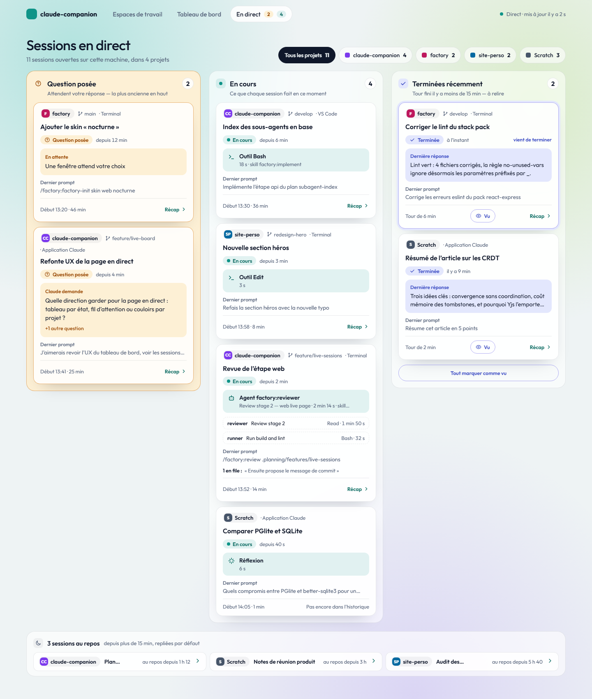
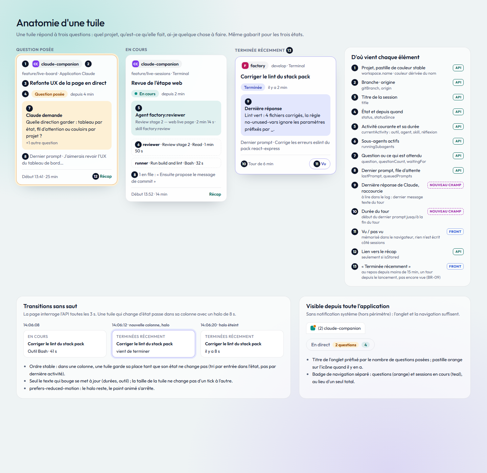

# Live sessions (sessions en direct) — PRD

> **Slug**: `live-sessions`
> **Tags**: #sessions
> **Status**: Approved
> **Last updated**: 2026-10-20

## TL;DR

The person runs several Claude Code sessions at once, in several workspaces, and only sees what each one does by switching to it. This feature adds a live page: every session running on this machine, as tiles in three columns by state (waiting for an answer, running, just finished), each tile naming its workspace, what the session is doing right now (tool, skill, agent), its last prompt and, once finished, Claude's last reply. The page updates by itself; a session whose process ends leaves it and stays in the stored history.

## Problem

With five or six sessions open across the desktop app, a terminal and worktrees, the person loses track: which one is still working, which one stopped on a question an hour ago, which one finished and waits for the next prompt. Finding out means clicking through every session. The recap pages of the application show the stored history, which changes on a refresh only; they say nothing about the sessions in progress.

A first live page grouped the sessions by workspace: the person still had to scan every workspace to find what needs them, and a session that had just finished its turn looked the same as one idle for hours, folded away with it.

## Non-goals

- Acting on a session: sending it a prompt, answering its question, stopping it. The page observes only.
- Tokens and costs of a running session: tokens come from the stored history, after the fact.
- System or browser notifications when a session starts waiting: the person watches the page.
- Sessions of other machines, cloud sessions, conversations of claude.ai and of the Claude desktop chat.
- The relation between a session and the sessions it started: each live session stands on its own, under its workspace.
- Enriching the stored history from the live view: the history keeps coming from the logs through a refresh.
- Sharing the `Vu` marks across browsers or devices: they belong to the browser the person marked them in.
- Showing a session whose process ended as finished: it leaves the page at once (BR-01); the stored history holds it.

## Domain Glossary

Canonical entity names introduced or reused. Names only: no properties, relationships or persistence.

| Business term | Identifier | Business meaning | Status |
|---|---|---|---|
| `Workspace` | `Workspace` | A real folder in which Claude Code sessions ran; a repository's worktrees and case variants of its path belong to it | Reused |
| `Groupe Scratch` | `ScratchGroup` | All the temporary scratch workspaces of the Claude desktop app, gathered as one workspace | Reused |
| `Session` | `Session` | One Claude Code conversation, from one log file, with its subagents | Reused |
| `Sous-agent` | `Subagent` | A helper agent a session launched; it has a type and runs on a model | Reused |
| `Prompt` | `Prompt` | A message or a slash command the person typed in a session | Reused |
| `Actualisation` | `Refresh` | One pass that reads the new and changed log files into the database | Reused |
| `Session en direct` | `LiveSession` | A `Session` whose Claude Code process is alive on this machine | New |
| `État` | `LiveStatus` | What a `LiveSession` is doing from the person's point of view: `En cours` (`Running`), `Question posée` (`AwaitingAnswer`) or `Au repos` (`Idle`) | New |
| `Activité courante` | `CurrentActivity` | What a `Running` session is doing right now: a tool, a skill, an agent, or thinking | New |
| `Prompt en file d'attente` | `QueuedPrompt` | A `Prompt` the person sent while the session was busy, not yet taken up | New |
| `Tour` | `Turn` | One `Prompt`, or a message that restarts Claude without the person (a background task's notification, a message from another session), and the work Claude Code does on it, until the session is `Idle` again | New |
| `Dernière réponse` | `LastReply` | The last text Claude wrote to the person in the latest `Turn` of a session | New |
| `Terminée récemment` | `RecentlyFinished` | An `Idle` `LiveSession` whose `Turn` just ended and that the person has not marked `Vu` yet | New |
| `Vu` | `Seen` | The person's mark that they have taken note of a `RecentlyFinished` session's latest `Turn` | New |

## Functional Requirements

### The live page

- **FR-01** — A live page lists every `LiveSession` of this machine as tiles in three columns, `Question posée` (`AwaitingAnswer`), `En cours` (`Running`) and `Terminées récemment` (`RecentlyFinished`), each with its count, and the other `Idle` sessions below them, so that what needs the person is read by state, not workspace by workspace.
- **FR-02** — Each `LiveSession` shows its `Workspace` (name and a colour that stays the same for that workspace), its title, its `LiveStatus` and since when, its start time and total duration, its `CurrentActivity`, its last prompt, its `QueuedPrompt`s in order, its git branch and its origin (CLI, desktop app, IDE…).
- **FR-03** — A `Running` session names its activity: the tool being called, the skill being run, or the agent launched with its type and description; a session thinking between two tool calls shows that.
- **FR-04** — A `Running` session lists its running subagents, each with its type, its description, its current tool and since when it runs, so that a long review or exploration is visible as such.
- **FR-05** — An `AwaitingAnswer` session shows the question Claude Code asked, shortened, so that the person knows what to answer before opening the session.
- **FR-06** — Long texts (last prompt, queued prompts, question, agent description) are shortened on the page, so that one screen holds every session.
- **FR-07** — The `Idle` sessions that are not `RecentlyFinished` are folded in one group for the whole page, each reduced to its title, its `Workspace` and since when it is idle, and unfold on demand.
- **FR-08** — The sessions of the `ScratchGroup` are always shown, their `Workspace` named as the group, without the switch of the workspaces page: a running session is never noise.
- **FR-09** — When no session is live, the page says so.
- **FR-10** — Each `LiveSession` links to its stored session page when the history already holds it; a session not yet refreshed has no link.

### Freshness

- **FR-11** — The page updates by itself, without a reload, and a change of `LiveStatus` or of `CurrentActivity` is visible within 5 seconds.
- **FR-12** — When the live state can no longer be read (folder missing or unreadable), the page says so instead of freezing on stale sessions.
- **FR-13** — When a `LiveSession` leaves the page (its process ended), a `Refresh` runs, so that its recap in the stored history is up to date without the person asking.

### Navigation

- **FR-14** — The navigation links to the live page with two counts, the `AwaitingAnswer` sessions (highlighted) and the `Running` sessions, and the browser tab's title starts with the number of `AwaitingAnswer` sessions when there is one, so that a waiting session is visible from every page and from another tab.

### The status board

- **FR-15** — Inside a column the order is stable: `Question posée` and `En cours` by the time the session entered the state, oldest first; `Terminées récemment` most recent first; a tile keeps its place while its state does not change, so that the page does not jump at every update.
- **FR-16** — A `RecentlyFinished` session shows its `LastReply`, shortened, and the duration of its latest `Turn`, so that the person knows the outcome before opening the session.
- **FR-17** — The person marks a `RecentlyFinished` session `Vu`, one at a time or the whole column at once; it then moves to the folded `Idle` group.
- **FR-18** — A session whose `LiveStatus` just changed is highlighted for a few seconds (8 s), with no motion when the person's system asks for reduced motion, so that a change is noticed without staring at the page.
- **FR-19** — The person filters the page by `Workspace`: one choice per workspace with its number of sessions, all of them by default; the filter applies to the three columns and to the `Idle` group, never to the navigation counts.
- **FR-20** — An empty column says so in a line, so that "nothing waits for you" is read as such.
- **FR-21** — The page shows how long ago it was last updated.
- **FR-22** — On a phone-sized screen the three columns become three tabs with their counts, `Question posée` first.

## Business Rules

- **BR-01** — A session is live only while its Claude Code process is alive on this machine; a session whose process is gone leaves the page at once, with no "ended" status, and stays in the stored history like any other.
- **BR-02** — `Running` means Claude Code is busy: a tool, a skill, an agent or its own thinking is in progress; `AwaitingAnswer` means Claude Code asked the person a question and waits for the answer to go on; `Idle` means the turn ended and the session waits for the next prompt.
- **BR-03** — A permission request cannot be told apart from a tool that runs: a session waiting for a permission counts as `Running`.
- **BR-04** — The status Claude Code declares wins over what the log suggests: a log whose last tool call has no result while Claude Code says the session is idle (an interrupted tool) gives an `Idle` session.
- **BR-05** — A session too young to have a readable log is live all the same: its status comes from Claude Code and its `CurrentActivity` is unknown.
- **BR-06** — A `LiveSession` is titled and attached to its `Workspace` by the same rules as a stored session (session-ingestion FR-07, BR-02, BR-03, BR-04, BR-10), so that the live page and the workspaces page agree.
- **BR-07** — The live page stores nothing on the application's side: it reads the live state of Claude Code and the session logs, and never writes, moves or deletes anything there; the `Vu` marks are kept by the person's browser only (BR-10).
- **BR-08** — A session started by another session is a `LiveSession` like any other, under its own workspace, with no link to the session that started it.
- **BR-09** — A session is `RecentlyFinished` while it is `Idle`, has had a `Turn` since its Claude Code process started (a resumed session's older turns do not count), became `Idle` less than 15 minutes ago and is not marked `Vu`; otherwise an `Idle` session goes to the folded group. A session too young to have a turn is never `RecentlyFinished`.
- **BR-10** — A `Vu` mark covers one `Turn`: a session that runs again and finishes a new turn is `RecentlyFinished` again. The marks live in the browser the person used, survive a reload, and are forgotten with the browser's data.
- **BR-11** — The `LastReply` is the last text Claude Code wrote in the main conversation of the latest `Turn`, never a subagent's; a turn that ended without text (an interruption, tool calls only) has none, and the tile says so.

## UX Flow

- The person works in another tab: its title reads "(2) claude-companion", two sessions wait for an answer. In the application the navigation shows "2" highlighted and "4" running.
- The person opens the live page: on the left `Question posée`, the longest wait on top, each tile with its workspace, the question shortened and since when it waits.
- In `En cours`, each tile names its workspace, its current tool or agent and its subagents; the person reads what each session does without switching to it.
- A session finishes its turn: within 5 seconds its tile moves to `Terminées récemment`, highlighted for a few seconds, with Claude's last reply and the turn's duration.
- The person reads the reply and clicks `Vu`: the tile moves to the folded idle group. Left alone, it moves there after 15 minutes.
- The person picks one workspace in the filter: the three columns and the idle group show its sessions only.
- The person closes a session: it leaves the page, and a refresh updates its recap in the history.
- The person clicks a session's link: its stored page, with its prompts and activity.
