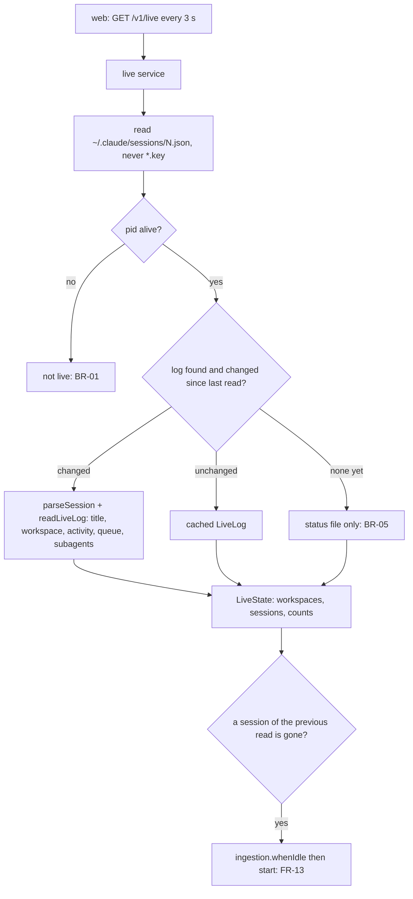

# Live page

Feature: `live-sessions` · Components: `api`, `web` · Spec: FR-01–FR-14, BR-01–BR-08

## Context

The recap pages show the stored history only. This iteration adds a live view of the Claude Code sessions running on this machine. The api reads Claude Code's own live state (one status file per running process under `~/.claude/sessions`), keeps the sessions whose process is alive, and completes each one from the tail of its log (title, workspace, branch, current activity, question, last prompt, queued prompts, running subagents). It stores nothing. The web polls it every 3 seconds, shows the live page grouped by workspace, and adds a shared navigation with a badge of the running and waiting sessions on every page. When a session leaves the live state, the api starts an incremental refresh so its stored recap catches up.

## Decisions

The brief of this plan was settled without the person (no grill-me, by their request); the facts below were read from the local machine (13 status files, all alive; 287+ logs; Claude Code 2.1.299), read only.

- Live source → one JSON file per running process, `{CLAUDE_SESSIONS_DIR}/{pid}.json` (default `~/.claude/sessions`, new env var parsed in `config.ts` like `CLAUDE_PROJECTS_DIR`). Only names matching `^\d+\.json$` are opened: the sibling `{pid}.{hash}.key` files hold credentials and are never opened, read or logged. Fields used: `pid`, `sessionId`, `cwd`, `startedAt` (ms), `entrypoint`, `name`, `status`, `waitingFor`, `statusUpdatedAt` (ms), `updatedAt` (ms); all but `pid`, `sessionId`, `cwd` and `startedAt` optional (loose zod schema). A file that fails to parse (Claude Code rewriting it) keeps the snapshot of the previous read for that file name, so a session never flickers off the page nor triggers a false FR-13 refresh; a file with no previous snapshot is skipped. Two files with the same `sessionId` → the one with the latest `updatedAt`.
- Liveness (BR-01) → `process.kill(pid, 0)` in a `try`/`catch`: no throw or `EPERM` → alive, `ESRCH` (or any other error) → dead. Works on Windows and POSIX. Injected into the live service as `isPidAlive` (like `findRepoRoot`), so tests need no real dead process. Accepted limitation: a status file left behind by a crashed process whose pid the system has reused shows a ghost session until that process ends (the file's `procStart` could tell them apart, but its format is platform-specific).
- Status mapping (BR-02, BR-03, BR-04) → the status file's `status` wins over the log. Read from Claude Code's binary (2.1.299): `busy` (loading or delegated work, background agents included), `idle`, or `waiting` with a `waitingFor`. A dialog that declares no `waitingFor` (every tool permission dialog) gives `permission prompt`; the others are `input needed` (AskUserQuestion, MCP elicitation), `dialog open`, `goal proposal`, `sandbox request`, `worker request`. Claude Code itself files `permission prompt`, `sandbox request`, `worker request` and `goal proposal` as permissions, `input needed` as a question. Mapping: `busy` → `running`; `idle` → `idle`; `waiting` with a permission value (`permission prompt`, `sandbox request`, `worker request`, `goal proposal`) → `running` (BR-03); `waiting` with `input needed`, `dialog open` or any other value → `awaitingAnswer`. A missing or unknown `status` → `idle`. No spec change: BR-03's rule holds as written, although Claude Code can now tell a permission wait apart.
- Status since → `statusUpdatedAt`, else `updatedAt`, else `startedAt`. Last activity of a session → the latest of its status since and its log's last timestamp. Start time (FR-02) → the log's `startedAt` (the session's first line) when a log is found, else the status file's `startedAt` (the process start, which differs after a `/clear` or a resume in the same process).
- Log lookup → the main log is `{CLAUDE_PROJECTS_DIR}/{any folder}/{sessionId}.jsonl`: found by `readdir` of the logs folder and a `stat` per folder, then cached by session id (folder names vary in case, e.g. `c--WS-…` and `C--WS-…`: never rebuilt from the cwd). A cached path that no longer stats is searched again; a missing logs folder → no log. Any error while locating, listing or reading one session's files (a file vanishing, `EPERM`, `EBUSY` on Windows) → that session has no log for this read, never a failed response.
- Log reading → the whole main file and its subagent files, as the ingestion does, but parsed only when one of them changed: the service caches each session's `LiveLog` keyed by the files' paths, sizes and modification times, compared by `haveFilesChanged` (extracted from the ingestion's `hasChanged`, shared by both). An idle session costs one `stat` per file per poll; a busy one is re-read (the largest log here is 2.6 MB, read in tens of ms). A tail read was rejected: the last prompt, the queue and the title can sit anywhere in the file.
- Shared rules reused, not copied (BR-06) → `parseSession` (with the subagent files) gives the title, `firstCwd`, `gitBranch`, `origin`, the prompts, the skill calls and the subagents; `resolveWorkspace(firstCwd, { scratchRoot, findRepoRoot })` gives the workspace, as the ingestion does. The new live reading imports the parser's line reader, tool-block walker, schemas and constants, which this plan exports (see api services).
- Young session (BR-05) → no log yet, or a log `parseSession` rejects (no cwd yet): live all the same; title = the status file's `name`, else the session id; workspace from the status file's `cwd`; `gitBranch`, `lastPrompt` and `question` null, no queue, no subagents, `currentActivity` null (shown "unknown" for a running session). When the log's title falls back to the session id (no title, no prompt yet) and the status file has a `name`, the `name` is used.
- Origin → the status file's `entrypoint`, else the log's. Shown with a French label for `cli`, `claude-desktop`, `claude-vscode`, `print`; any other value shown as is.
- Current activity (FR-03) → only for a `running` session with a log. The pending calls are the `tool_use` blocks of the **last assistant message** of the main log (the `message.id` of the last assistant line, whatever its content, text-only included; every line sharing that id) with no `tool_result` in the main log; older calls without a result (an interrupted turn) are never pending. The last pending call gives the activity: `Agent` / `Task` → `agent` with `subagent_type` (default `general-purpose`) and `description`; `Skill` → not a step of its own (see skill below); any other name → `tool` with that name. No pending call and at least one running subagent → `subagents` (the turn ended while background agents run: Claude Code stays `busy`). No pending call and no running subagent → `thinking`. `since` → the pending call's line timestamp; for `subagents` and `thinking`, the log's last timestamp. `skill` → the name of the last skill call of the session itself (typed command or Skill tool call, `agentId` null) at or after the last prompt's time, else null: a Skill tool call returns at once while the skill keeps running, so the skill is a context of the step, not a step.
- Question (FR-05) → for an `awaitingAnswer` session: the pending `AskUserQuestion` call's `input.questions[0].question` (shape checked on 74 calls), with `questionCount` = the number of questions; no such call (an elicitation, a dialog) → `question` null and the web shows a label for `waitingFor`.
- Queued prompts (FR-02) → replayed from the main log's `{"type":"queue-operation"}` lines in order: `enqueue` appends its `content` (an enqueue without content, 92 seen, holds its slot but is never shown); `dequeue` drops the oldest; `remove` drops the first queued item with the same content, an unmatched remove (207 `absorbed_mid_turn` removes, some of messages never enqueued) is ignored. A content that is not a string contributes its text blocks, else is a content-less item. Shown items: those whose trimmed text is not machine-made, i.e. not starting with one of the parser's injected prefixes nor with a tag (`/^<[a-z][\w:-]*[\s>]/i`: `<task-notification>`, `<agent-message …>`, `<cross-session-message …>`). Queued prompts are returned only for a session that is not `idle`: 15 items in 14 logs were never dequeued, and an idle session takes a queued prompt up at once.
- Last prompt → the last of `parseSession`'s prompts (the person's prompts, the ingestion filter), not the truncated `last-prompt` line.
- Running subagents (FR-04) → only for a `running` session. A subagent (a subagent file, from `parseSession`'s subagents with `isLogMissing` false) runs while it is not finished. Finished when: its launching Agent call (`launchToolUseId`, new parser field) has a `tool_result` in any of the session's files whose `toolUseResult.status` is not `async_launched`; or any `tool_result` names its `agentId` with a status other than `async_launched`; or a `<task-notification>` block (in a queue `enqueue` content or a user line's text, any origin) holds `<task-id>{agentId}</task-id>` (all 96 background launches seen were notified; statuses `completed`, `failed`, `killed`, `stopped`, all terminal). Each running subagent: `agentType`, `description`, `since` = its `launchedAt`, `currentTool` = the last pending call of its own file's last assistant message (rule above), null when thinking.
- Long texts (FR-06) → the api caps `lastPrompt`, each queued prompt, `question` and descriptions at 300 characters (whitespace runs collapsed to one space, trimmed, `…` appended when cut), so the payload stays small; the web clamps them further to two lines in CSS.
- Order (FR-01) → by the api: sessions inside a workspace by status rank (`awaitingAnswer` 0, `running` 1, `idle` 2) then last activity, most recent first; workspaces with an `awaitingAnswer` session first, then by their most recent session activity. The Scratch group is a workspace like the others, always included (FR-08).
- Stored link (FR-10) → `isStored` true when the `sessions` table holds the id (archived or not), one `inArray` query per read.
- Freshness (FR-11) → `GET /v1/live` polled by the web every 3 s (TanStack Query `refetchInterval`), no server push: the application is local and single-user. The page and the navigation badge share one query.
- Unreadable live state (FR-12) → `isSessionsDirReadable: false` when the sessions folder is missing or cannot be listed; the response then holds no session and the page says so, naming the folder.
- Refresh on leave (FR-13) → the service keeps, in memory, the session ids of its previous successful read; a read in which one of them is gone runs `ingestion.whenIdle().then(() => ingestion.start())`, not awaited (errors logged): a run already in progress may have read the log before the session's last writes, so a new run follows it. The first read after start-up and an unreadable read trigger nothing and leave the previous ids as they were.
- Navigation (FR-14) → the web has no shared navigation yet: a root layout route renders a navigation bar (workspaces, dashboard, live) around every page; the live link carries a badge with `counts.running + counts.awaitingAnswer`, hidden at 0. The nav's workspaces and dashboard links carry `scratch=1` when the current URL has it (session-activity FR-14); the pages' own links (the workspaces page's dashboard link, the dashboard's back link) stay as they are. The layout also mounts `useRefreshStatusQuery`, so the refresh started on a session's leave is followed and its end reloads the recap on every page, not only on the workspaces page.
- Times → the api sends ISO timestamps only; durations and "since when" are computed on the web against a ticking `now` (a poll returning equal data does not re-render: structural sharing).

## api

### services

`src/config.ts`: `CLAUDE_SESSIONS_DIR: z.string().default(path.join(os.homedir(), ".claude", "sessions"))`.

`src/features/ingestion/ingestion.source.ts` (extract, behaviour unchanged):

- Export `statFile(path) → FileStat`.
- Extract from `scanLogs` an exported `scanSubagentFiles(folderPath, sessionId) → SubagentFileStat[]` (the `{sessionId}/subagents/agent-*.jsonl` listing with `metaPath`); `scanLogs` calls it.
- Export `haveFilesChanged(scanned: FileStat[], stored: FileStat[]) → boolean` (the body of `hasChanged` in `ingestion.service.ts`: count, path, size, modification time); `hasChanged` calls it with the session's files (`StoredLogFile` carries the same three fields).

`src/features/ingestion/ingestion.parser.ts` (extract and export, behaviour of `parseSession` unchanged):

- `export type ParsedLine` (the current `Line`).
- `export function parseLogLines(rawLines: string[], sessionId: string): { lines: ParsedLine[]; unreadableLines: number }` — the `readLines` closure of `parseSession` (blank lines skipped, unparsable lines counted, lines of another session id dropped); `parseSession` uses it.
- `export function readToolBlocks(lines: ParsedLine[]): ToolBlocks` (one file) with `ToolBlocks = { calls: ToolUseBlock[]; results: Map<string, ToolResultInfo>; lastAssistantMessageId: string | null }`, `ToolUseBlock = { toolUseId, name, input: unknown, messageId: string | null, calledAt: Date | null }` (deduplicated by id within the file, first seen kept, log order; `calledAt` null when the line has no timestamp), `ToolResultInfo = { isError: boolean; agentId: string | null; resultStatus: string | null }` (`agentId`, `status` read from the line's `toolUseResult` through a loose schema; a later result of the same id replaces an earlier one), `lastAssistantMessageId` the `message.id` of the file's last assistant line, any content (`assistantBlocksSchema` gains an optional `id`). `readActivity` is rebuilt on it with the same output: it calls `readToolBlocks` per file in the order main then subagents, keeps the first file's call for an id seen in several files (and that file's `agentId`), lets a later result replace an earlier one across files, and still falls back to the session's start when `calledAt` is null.
- Export `SKILL_TOOL`, `AGENT_TOOLS`, `DEFAULT_AGENT_TYPE`, `agentInputSchema`, and `isInjectedText(text) → boolean` (the `INJECTED_PREFIXES` test, used by `readUserLine`).
- `ParsedSubagent` gains `launchToolUseId: string | null`: the id of the Agent call it is linked to (the `callId` already computed), the call id itself for a missing-log subagent. Not stored: `saveSession` maps the subagent columns one by one.

`src/features/live/live.source.ts` (new; read only, BR-07: `readdir`, `stat`, `readFile` only):

- `statusFileSchema` (loose zod, fields of Decisions), `type StatusFile`.
- `readStatusFiles(sessionsDir) → { isDirReadable: boolean; files: { fileName: string; status: StatusFile | null }[] }`: lists the folder (missing or unlistable → `isDirReadable: false`, no throw), keeps names matching `^\d+\.json$`, reads and parses each; `status` null when the file cannot be read or does not match the schema.
- `isPidAlive(pid) → boolean` (Decisions).
- `findSessionLog(logsDir, sessionId) → { mainPath: string; folderPath: string } | null`.

`src/features/live/live.log.ts` (new; pure, no I/O):

- `readLiveLog({ sessionId, mainLines, subagentFiles }) → LiveLog | null` (null when `parseSession` returns null). Calls `parseSession` once and `parseLogLines` on the main file and on each subagent file, then `readToolBlocks`. `LiveLog = { firstCwd, title, isTitleFallback (title equals the session id), gitBranch, origin, lastPrompt: string | null, lastLineAt: Date | null, activity: CurrentActivityRead | null, question: string | null, questionCount: number, queuedPrompts: string[], subagents: { agentId, agentType, description, launchedAt, isRunning, currentTool: string | null }[] }`, `startedAt: Date` (from `parseSession`), `CurrentActivityRead` = `{ kind: "tool"; toolName } | { kind: "agent"; agentType; description } | { kind: "subagents" } | { kind: "thinking" }` plus `skill: string | null` and `since: Date`. Every rule is in Decisions: pending calls, skill of the turn, question, queue replay and filter, subagent run state, text cap (`shortenText(text, 300)`, exported).

`src/features/workspaces/workspaces.repository.ts`: `findStoredSessionIds(ids: string[]) → Set<string>` (one `select id … where id in`; empty input → empty set without a query).

`src/features/live/live.service.ts` (new): `createLiveService({ workspacesRepo, ingestion, clock, sessionsDir, logsDir, scratchRoot, isPidAlive, findRepoRoot })` → `{ getLiveState(): Promise<LiveState> }`. In memory: the snapshot per status file name, the log path per session id, the `LiveLog` cache per session id (entries of sessions no longer live dropped), the previous read's ids. One read:

1. `readStatusFiles`; unreadable folder → `{ isSessionsDirReadable: false, workspaces: [], counts 0 }`, nothing else touched.
2. Status per file (fresh, else previous snapshot), deduplicated by session id, kept when `isPidAlive(pid)`.
3. Per session, inside one `try`/`catch` (an error → no log for this read, logged once with the session id): locate the log, stat it and `scanSubagentFiles`, reuse or rebuild its `LiveLog` (`readLines`, `readMeta`).
4. Map the status (Decisions), resolve the workspace, build the `LiveSession` (activity, question, queue and subagents kept only for the statuses Decisions name), `isStored` from one `findStoredSessionIds` call.
5. Group by workspace `pathKey`, order (FR-01), count statuses, `readAt: clock.now()`.
6. FR-13 trigger against the previous ids, then store the current ids.

`src/app.ts`: `AppContext` gains `live: LiveService`, `createApp` mounts `liveRoutes`. `src/server.ts` builds it with `isPidAlive`, `findRepoRoot`, the config's folders and the same `scratchRoot` as the ingestion. `test/setup.ts`: see Tests.

### routes

Public, as every route. `src/features/live/live.schema.ts` (`.meta({ id })` on each named schema):

- `LiveStatus`: `z.enum(["running", "awaitingAnswer", "idle"])`.
- `CurrentActivity`: discriminated union on `kind`: `{ kind: "tool", toolName: string, skill: string | null, since }`, `{ kind: "agent", agentType: string, description: string, skill: string | null, since }`, `{ kind: "subagents", skill: string | null, since }`, `{ kind: "thinking", skill: string | null, since }` (`since` ISO datetime).
- `RunningSubagent`: `{ agentId, agentType, description, currentTool: string | null, since }`.
- `LiveSession`: `{ sessionId, title, status: LiveStatus, statusSince, startedAt, lastActivityAt, origin: string | null, gitBranch: string | null, isLogFound: boolean, isStored: boolean, lastPrompt: string | null, question: string | null, questionCount: int, waitingFor: string | null, queuedPrompts: string[], currentActivity: CurrentActivity | null, runningSubagents: RunningSubagent[] }`.
- `LiveWorkspace`: `{ key: string (the pathKey), name: string, isScratch: boolean, sessions: LiveSession[] }`.
- `LiveState`: `{ readAt, sessionsDir: string, isSessionsDirReadable: boolean, counts: { running, awaitingAnswer, idle }, workspaces: LiveWorkspace[] }`.

`GET /v1/live` → `200 LiveState` (no parameters, no error case of its own). `src/features/live/live.routes.ts`: one service call. `scripts/export-openapi.ts` imports `live.schema.ts`. Handoff: `api/openapi.json`.

## web

### data

- `src/features/live/data/liveKeys.ts` (`all`, `state()`), `useLiveStateQuery()`: `GET /v1/live`, `refetchInterval: LIVE_POLL_INTERVAL_MS` (3000). When a read holds fewer of the previous read's session ids (a session left), it invalidates `refreshKeys.status()`, so the refresh started by the api is seen and its running → idle edge reloads the recap queries.
- `src/shared/lib/useNow.ts`: `useNow(intervalMs) → Date`, re-rendering every interval, cleared on unmount; the live page uses 10 s.
- `src/shared/lib/i18n/fr.json`: every new string, keys `live.{element}.{text}` and `layout.nav.{text}` (below), plurals through `tp` (`.one` / `.other`).

### pages

- `src/AppLayout.tsx` (new, root layout route, named export `AppLayout`): `NavBar` with three items — "Espaces de travail" (`/`), "Tableau de bord" (`/dashboard`), both with `?scratch=1` when the current URL has it, and "En direct" (`/live`) with the badge `counts.running + counts.awaitingAnswer` from `useLiveStateQuery` (none while loading, on error or at 0; its accessible label through `tp("layout.nav.liveBadge", n)`: "{count} session active" / "{count} sessions actives") — then `<Outlet />`. It also calls `useRefreshStatusQuery()` (Decisions, FR-13).
- `src/router.tsx`: one root route `{ Component: AppLayout, children: [...] }` holding the four existing routes and `/live` → `features/live/pages/LivePage.tsx` (lazy).
- `features/live/pages/LivePage.tsx` (FR-01–FR-12): `PageTitle` "Sessions en direct", a line with the counts; states: loading, error (`ErrorMessage` with the message), `isSessionsDirReadable` false → `ErrorMessage` "Impossible de lire l'état des sessions dans {dir}." (FR-12), no workspace → `EmptyState` "Aucune session Claude Code ne tourne sur cette machine." (FR-09); else one `LiveWorkspaceSection` per workspace in the api's order. `now` from `useNow`.

### ui

- `src/shared/ui/NavBar.tsx` (+ module CSS): `NavBar({ label, items: { to, label, badge?: { count: number; label: string } }[] })`, a `<nav aria-label>` of React Router `NavLink`s (inactive links in `--text-muted`; the active one marked with `aria-current="page"`, in `--text`, weight 600 and underlined: the skin keeps the accent for the primary action), badge rendered with `Badge` tone `attention`; hover and `--focus` focus-visible states; wraps at narrow widths. No feature word.
- `src/shared/ui/Badge.tsx`: optional `tone: "default" | "attention" | "muted"` (default `default`, today's look); `attention` reads `color: var(--danger)` on `background: var(--danger-soft)` (as the ghost button's hover does: `--danger-text` is meant for a solid `--danger` fill), `muted` a transparent background, `--text-muted` and `--border`.
- `src/shared/ui/Disclosure.tsx` (+ module CSS): a styled native `
` / `
` with the summary label as a prop and the content as children; a marker (inline SVG chevron in `currentColor`, rotated when open, motion 120–150 ms under `prefers-reduced-motion: no-preference`), pointer cursor, hover and `--focus` focus-visible states, tokens only. No feature word.
- `features/live/ui/LiveWorkspaceSection.tsx` (+ module CSS): workspace name (a "Scratch" `Badge` muted when `isScratch`), the non-idle sessions as `LiveSessionCard`s, then the idle ones folded in a `Disclosure` (summary through `tp("live.idle.count", n)`: "{count} session au repos" / "{count} sessions au repos"), each an `IdleSessionRow`: title and "au repos depuis {relative}" (FR-07).
- `features/live/ui/LiveSessionCard.tsx` (+ module CSS): title (a `Link` to `/sessions/{id}` when `isStored`, plain text otherwise, FR-10); status `Badge` (`attention` for "Question posée", `default` for "En cours") and "depuis {relative}"; facts: started at (time), duration (`now - startedAt`), origin label, branch; for `running`: the activity line ("Outil {name}", "Agent {type} — {description}", "Sous-agents en cours", "Réflexion", each with "· skill {name}" when set, "Activité inconnue" when null) and `RunningSubagentList`; for `awaitingAnswer`: the question (with "+{n} autres questions" when `questionCount > 1`) or the `waitingFor` label; the last prompt; the queued prompts as an ordered list under "En file d'attente" (FR-02). Long texts clamped to two lines with `overflow-wrap: anywhere` (FR-06).
- `features/live/ui/RunningSubagentList.tsx`: per subagent type, description, current tool or "Réflexion", "depuis {relative}" (FR-04).
- `features/live/ui/labels.ts`: `originLabel(origin)` and `waitingForLabel(waitingFor)` mapping known values to i18n keys (`input needed` → "Une réponse est attendue", `dialog open` → "Une fenêtre attend votre choix", `goal proposal` → "Un objectif attend votre accord", other → "Claude Code attend votre réponse").

Styles: CSS Modules for each component's layout, the skin's variables only; the cards stack at narrow widths, no horizontal scroll at 375px.

## Conventions

- Root `CLAUDE.md` (stage 1): the hard rule "The session logs are read only" becomes "The session logs and the live state are read only": the application reads `~/.claude/projects` and `~/.claude/sessions` and never writes, moves or deletes anything there; it never opens the `*.key` files of `~/.claude/sessions` (credentials). The Local development `api` line names `CLAUDE_SESSIONS_DIR`. Rationale: a second read-only source with credential files beside it.
- `api/CLAUDE.md` (stage 1), Local run: the source data bullet adds the live state, read only, from `~/.claude/sessions` (one `{pid}.json` per running process, `*.key` files never opened), `CLAUDE_SESSIONS_DIR` pointing elsewhere.
- `web/CLAUDE.md` (stage 2), Structure: `src/AppLayout.tsx` (the root layout route: the shared navigation around every page), `NavBar` and `Disclosure` in the `shared/ui` list, `Badge` with its `tone`, `useNow.ts` under `shared/lib`.

## Tests

**api** (Vitest; route tests with Supertest on in-memory PGlite; status files and logs written to the test's temp folder, never the real `~/.claude`):

- `test/setup.ts`: `createTestContext` uses `{tempRoot}/sessions` as the sessions folder (returned as `sessionsDir`, created at start and re-created by `reset()`, which empties `tempRoot`) and builds the live service with a fake `isPidAlive` reading a returned `alivePids: Set<number>`. The app receives a forwarding `live` (`{ getLiveState: () => current.getLiveState() }`) and `reset()` builds a fresh `current` and clears `alivePids`, so the service's memory (snapshots, previous ids, caches) never leaks from one test to the next; the production service has no test-only method.
- `test/live/live-builders.ts`: `statusFile(overrides)` (a status file object with consistent defaults), `writeStatusFile(sessionsDir, file)`; `test/ingestion/log-builders.ts` gains `queueLine(operation, content?)`, `taskNotificationText(agentIds, status)` and `askUserQuestionBlock(id, questions)`. `test/factories.ts`: `buildSubagent` gains `launchToolUseId: null`.
- `test/live/live.log.test.ts` (pure): pending tool of the last assistant message → `tool`; pending Agent → `agent` with type and description, default type; no pending call → `thinking` with the last timestamp; no pending call with a running background subagent → `subagents`; a call without result in an earlier message is not pending, also when a later prompt is followed by a text-only assistant message; a pending Skill call is not a step (`thinking` with its `skill`); a Skill tool call or a typed command since the last prompt sets `skill`, a later prompt clears it; AskUserQuestion gives the first question and the count; queue replay: enqueue/dequeue FIFO, remove by content, unmatched remove ignored, content-less enqueue holds its slot unshown, `<task-notification>` and `<cross-session-message …>` contents hidden; subagents: foreground running without result, finished with a result, background (`async_launched`) running until a task-notification in a queue line and in a user line, nested subagent linked from another subagent's file, current tool of a subagent; last prompt from the person's prompts; texts capped at 300 characters; null when the log has no cwd.
- `test/live/live.source.test.ts`: only `{pid}.json` names are listed (a `.key` file and a non-numeric `.json` beside them are ignored); an invalid file gives a null status; a missing folder → `isDirReadable: false`; `isPidAlive(process.pid)` true and false for the pid of a child process that has exited; `findSessionLog` finds the file in any folder and returns null when absent or when the logs folder is missing.
- `test/live/live.routes.test.ts`: `GET /v1/live` maps `busy`, `idle`, `waiting` + `input needed` / `dialog open` to `awaitingAnswer`, `waiting` + `permission prompt` / `sandbox request` / `worker request` / `goal proposal` to `running`, an unknown status to `idle` (BR-02, BR-03); the start time comes from the log, else from the status file; a dead pid is left out (BR-01); an idle session with a pending call has no activity (BR-04); a session without log is live, titled from the status file, activity null (BR-05); a worktree cwd and a scratch cwd land in their repository's workspace and in the Scratch group (BR-06, FR-08); ordering of workspaces and sessions (FR-01); queued prompts empty for an idle session; `isStored` true for a stored session only (FR-10); counts; a missing sessions folder → `isSessionsDirReadable: false` and no session (FR-12); a session gone between two reads starts a refresh that stores it (FR-13), the first read and an unreadable read start none; an unparsable status file keeps the previous snapshot and starts no refresh; two files for one session keep the latest; a session started by another session (its log holding a cross-session message) is listed under its own workspace (BR-08); an unchanged log is not re-read (a second read after replacing the file's content with an unreadable one, size and modification time restored, returns the first read's activity) and a changed one is; a moved log is found again in its new folder; the logs and sessions folders' listings and modification times are unchanged after reads (BR-07).
- `test/ingestion/ingestion.parser.test.ts`: `launchToolUseId` for a subagent linked by its meta, by its result's `agentId`, and for a missing-log subagent; the two tests asserting whole subagent objects (`toEqual`, around lines 554 and 632) gain the expected `launchToolUseId`. The other parser, service and route tests stay green unchanged (the extractions keep the behaviour).

**web**: none (no unit tests on the front, per its `CLAUDE.md`); checked in the browser (Validation).

## Deviations

- `LiveLog.activity` typed `CurrentActivityRead | null` → typed `CurrentActivityRead`, never null (a log always yields an activity, `thinking` being the fallback; a null case would be dead code)
- Status file schema "loose, all but `pid`, `sessionId`, `cwd` and `startedAt` optional" → also `pid` positive integer and `sessionId` restricted to `^[\w-]+$`; optional text and number fields accept `null` (the session id becomes a file name in the logs folder, so a crafted status file cannot point the reader outside it)
- Status mapping silent on a `waiting` status with no `waitingFor` → mapped to `running` (Claude Code files a dialog that declares no reason as a permission prompt, BR-03)
- `shortenText` cap: "caps at 300 characters, `…` appended when cut" → the text is cut at 300 characters and the ellipsis follows, so a cut text is 301 characters long (same shape as the parser's `titleFromPrompt`)
- Two status files for one session → "deduplicated by session id, kept when `isPidAlive(pid)`" → liveness first, then the dedupe among the live files (latest `updatedAt`, else `statusUpdatedAt`, else `startedAt`) (a file left by a dead process with a later `updatedAt` must not hide the live one: the session would vanish and a false FR-13 refresh would start)
- Status file times → plain numbers → integers within 0 to 8.64e15 (a crafted value outside a `Date`'s range made `toISOString` throw and the whole response fail; such a file reads as invalid)
- `getLiveState` reads freely → single flight: calls that overlap share one read (out-of-order reads would move the previous ids backwards and re-trigger FR-13)
- `since` of the `subagents` and `thinking` activities = "the log's last timestamp" → the main log's last timestamp only (the subagents' lines restart no step of the session); `lastActivityAt` still counts every file
- Parser extraction "behaviour unchanged" → kept identical on three edge cases: an assistant `message.id` of `null` is accepted, a `toolUseResult` whose `status` is not a string still gives its `agentId`, and a later result of a call without agent id keeps the earlier one
- "Since when" labels and durations computed on the web → through a new `formatElapsed(iso, now)` in `shared/lib/format.ts` (the existing `formatRelative` reads "il y a 5 minutes", wrong after "depuis"; it reuses `formatDuration`)

## Progress

### Stage 1 — api
Commit: `feat(live-sessions): api — live state of the running sessions`
- [x] services: config `CLAUDE_SESSIONS_DIR`; parser and log source extractions (`parseLogLines`, `readToolBlocks`, `scanSubagentFiles`, `haveFilesChanged`, `launchToolUseId`); live source, live log reading, stored ids query, live service with cache and refresh on leave; their tests
- [x] routes: live contract and router, app and server wiring, route tests
- [x] Conventions: root `CLAUDE.md` and `api/CLAUDE.md` read-only rule for `~/.claude/sessions`
- [x] Handoff: `api/openapi.json` exported

### Stage 2 — web
Commit: `feat(live-sessions): web — live page and navigation badge`
- [x] Prepare: client regenerated from `api/openapi.json`
- [x] data: live keys and polled query, `useNow`, i18n keys
- [x] pages: root layout with the navigation and its badge, `/live` route and page
- [x] ui: `NavBar`, `Disclosure`, `Badge` tones, workspace section, session card, running subagents, labels
- [x] Conventions: `web/CLAUDE.md` structure

## Validation

- [x] Review: the `reviewer` agent on the plan's implementation, its findings settled (api: 6 findings fixed; web: findings 1-4 fixed, 5-7 left open: no current nav item on drill-down pages, idle-row link weight, nits)
- [x] Tests: the full `test` command of `api` green on the plan's final code (184 tests)
- [-] Browser test: run in part on the real sessions (badge on every page, live page grouped and ordered, a running session's activity and subagents, idle sessions folded and stable across polls, link to a stored session, 375px without horizontal scroll, one poll per 3 s); not run: a question shown, a closed session leaving, the unreadable folder (covered by the route tests). Scenarios: the change tested in `web` (`test-in-browser` skill): the badge on every page, the live page with the real sessions grouped and ordered, a running session's activity and subagents, a question shown while a session waits, idle sessions folded, a closed session leaving the page and its recap refreshed, the link to a stored session, the sessions folder unreadable (`CLAUDE_SESSIONS_DIR` pointing to a missing folder), a 375px width without horizontal scroll
