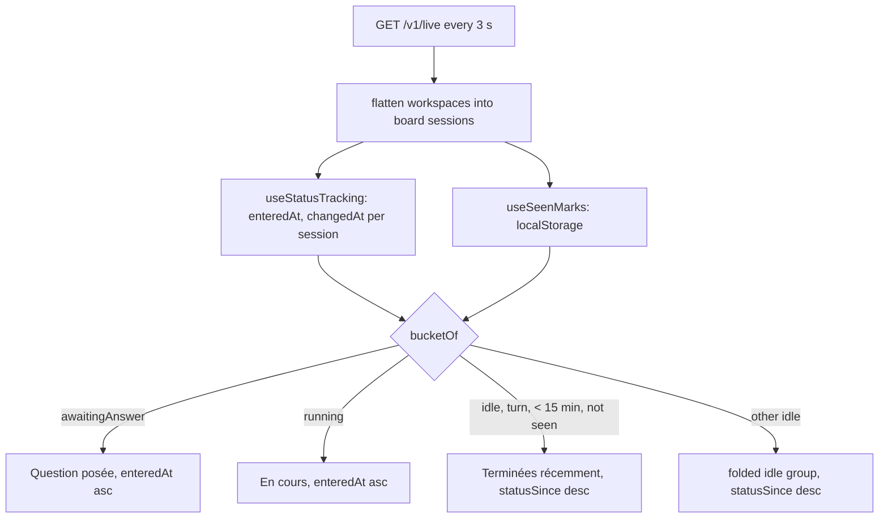

# Status board

Feature: `live-sessions` · Components: `api`, `web` · Spec: FR-01, FR-02, FR-07, FR-08, FR-14–FR-22, BR-07, BR-09–BR-11

## Context

The first live page grouped the sessions by workspace. This iteration turns it into a status board: three columns (`Question posée`, `En cours`, `Terminées récemment`) and one folded group for the other idle sessions, every tile naming its workspace. A finished tile shows Claude's last reply and the turn's duration, and the person marks it `Vu`. Mockups: `../../assets/live-status-board.png` and `../../assets/live-tile-anatomy.png` (from the design canvas https://claude.ai/artifact/DuFw5Kw53ts1hrE6oZFv2y, direction A).

The api adds two fields to each live session, `lastReply` and `turnStartedAt`. Everything else is computed by the web: the `RecentlyFinished` bucket (BR-09), the `Vu` marks (BR-10, browser storage), the stable order (FR-15), the highlight on a status change (FR-18), the workspace filter (FR-19), the tabs on a phone (FR-22) and the split navigation counts (FR-14).

## Decisions

Grill not run, to move straight on; the defaults below come from the mockups.

- Contract shape → the `LiveState` keeps its `workspaces` grouping; the web flattens it. No breaking change for the navigation badge, and the workspace filter reads its choices and counts from the groups. The api's workspace and session order (old FR-01) stays as is: the web sorts by itself.
- `turnStartedAt` → the time of the session's last prompt (`ParsedPrompt.sentAt` of `session.prompts.at(-1)`), null without a prompt. The service keeps it only when that prompt is at or after the status file's `startedAt` (the process start), else null with `lastReply` null too: a resumed session (`--resume`, `--continue`, the desktop app reopening it) carries a last prompt of days ago and must not land in `Terminées récemment` with "Tour de 3 j" (BR-09). The web shows a finished turn's duration as `statusSince − turnStartedAt`; BR-09's "has had a turn since its process started" is `turnStartedAt !== null`.
- `lastReply` (BR-11) → read per message, not per line: Claude Code writes one line per content block. Take the `message.id` of the last assistant line of the **main** log that carries a text block and is dated at or after the last prompt, then join the text blocks of every line with that id, in order, with a space, shortened by `shortenText` (300 characters); this mirrors `lastAssistantMessageId` in `readToolBlocks`. Lines whose `message.model` is `<synthetic>` (Claude Code's own "No response requested.", API error notices) are skipped. Null without a prompt or when the turn has no text. Returned for every status; the web shows it on finished tiles only.
- Stable order (FR-15) → the web keeps, per session id, the status it last saw and the moment it entered it (`enteredAt`: the session's `statusSince` the first time the status is seen, kept while the status stays the same). `statusSince` alone is not stable: a permission wait (`waiting` filed as `running`, BR-03) moves it while the tile stays in `En cours`.
- Highlight (FR-18) → a status change seen while the page is open sets `changedAt`; a tile changed less than 8 s ago gets the highlight. The first sight of a session (page load, new session) is not a change. The move from `Terminées récemment` to the idle group after 15 minutes is not a status change: no highlight. No slide animation: the tile appears in its new column with the halo (an animated move through TanStack's updates was judged not worth its cost). An `aria-live="polite"` region announces each change ("{title} : {status}").
- `Vu` marks (BR-10) → `localStorage` key `claude-companion.live.seen`, a JSON object `{ [sessionId]: turnStartedAt }`; a session is seen when its entry equals its current `turnStartedAt`. Entries of sessions no longer live are pruned on each write, against the full, unfiltered session list of a successful read whose `isSessionsDirReadable` is true only: a workspace filter or a failed or unreadable poll never wipes marks. Every read and write is wrapped in `try`/`catch`: without storage the marks last until the page is left.
- 15-minute window (BR-09) → a web constant `RECENTLY_FINISHED_MS = 15 * 60_000`, re-evaluated with the page's 1-second `now`.
- Workspace filter (FR-19) → local state of the page (`null` = every workspace), not in the URL: a workspace key is a local path. A filtered workspace that leaves the live state resets the filter to every workspace.
- Workspace colour (FR-02) → 8 colour tokens `--workspace-1`…`--workspace-8` (light and dark values) chosen by a stable hash of the workspace key; the `ScratchGroup` takes `--text-muted`.
- Status colours → the skin's `--danger` is too alarming for a question: new tokens `--status-awaiting`, `--status-awaiting-soft`, `--status-finished`, `--status-finished-soft` (light and dark); `En cours` uses the accent.
- Width → the live page and the navigation above it use `--live-width: 1360px`; the other pages keep `--content-width`. `AppLayout` passes `isWide` to `NavBar` on `/live`.
- Recap link (FR-10) → the tile's footer carries a `Récap` link when `isStored`, else "Pas encore dans l'historique"; the title is plain text.
- Tab title (FR-14) → `AppLayout` sets `document.title` to "(N) claude-companion" when N sessions wait for an answer, else "claude-companion".
- Phone (FR-22) → below 768 px a tab list shows above the columns, `Question posée` selected by default, and only the selected column is shown; above it the tab list is hidden and every column shows. Pure CSS on a `data-selected` attribute, the selected tab in the page's state.

## Decisions taken autonomously

- Shape of the parser helper → `readAssistantTexts(lines)` returns `{ messageId, text, at }[]` (the plan's `{ text, at }[]` plus the message id the join needs, since the plan's Decisions join the lines by message id; the `<synthetic>` filter lives in it, next to `SYNTHETIC_MODEL`)
- Assistant line without a timestamp → left out of the last reply (it cannot be dated against the last prompt)
- Assistant line without a message id → its own text is the reply (no line to join it with)
- Existing route tests → the full-session `toEqual` and the BR-05 `toMatchObject` gained the two fields; the BR-05 case also has its own `it` as the Tests section names it
- Review finding: a copied assistant line (same uuid, re-appended before a compaction) → counted once in `readAssistantTexts`; blank text blocks dropped (hardening, one condition each, tested)
- Review finding: a built-in command (`/model`, `/compact`) counts as a prompt and moves `turnStartedAt` → left as the plan's Decisions say (`prompts.at(-1)`), reported to the person as a plan gap for stage 2 or a plan revision (departing from the plan is not an autonomous call)
- Review finding: the same copied chains can move `turnStartedAt` back for a few lines around a compaction → left open, same reason
- Web, built-in command moving `turnStartedAt` (stage 1 open point 1) → `bucketOf` treats an idle session whose last prompt is newer than its `statusSince` as having no finished turn (idle group); the api and the seen-mark key stay as the Decisions say (a prompt answered with no turn, such as `/model`, leaves the status as it is, so there is no turn to show and the person has just been in the session)
- Web, background task notification restarting Claude without moving `turnStartedAt` (stage 1 open point 4) → left open, as the seen-mark key is `turnStartedAt` per the Decisions; the web cannot tell the new turn from the marked one (a plan revision could key the mark on `statusSince`)
- Prune of seen marks → `useSeenMarks().prune` runs from the page's effect against the full list of a successful, readable read, and drops the stored entries of sessions no longer live
- Status tracking → the map lives in `useState`, advanced during render once per `dataUpdatedAt` (the `react-hooks` lint forbids a ref written during render); an unreadable folder keeps the entries, so a recovery does not reset the order
- Tab and filter state → the filter falls back to every workspace by derivation (no effect); the phone's selected tab stays in the page's state, `Question posée` by default
- Live region → announces the changes of the last read only (they clear on the next 3 s read)
- Browser test → run on a dev server pair started for the test (api :3150 on a scratch database, web :5190) because the api on :3100 was started before stage 1 and does not serve the new fields; the running-to-finished move, the questions, the queue and the built-in command case were driven through a stub on :3160 that rewrites a few real sessions, as no real session could be made to finish on demand
- Review finding: `Tabs` half of the ARIA pattern → fixed: ids, `aria-controls`, `role="tabpanel"` on the columns labelled by their heading, roving `tabindex`, arrow keys, Home and End
- Review finding: two tabs wiping each other's `Vu` marks → fixed: writes merge onto the storage, a `storage` listener re-reads; the prune's write left the state updater
- Review finding: the workspace filter sat below the header → fixed: in the header, as the plan and the mockup say
- Review finding: announcement of a finished session read "Au repos", and hidden sessions were announced → fixed: it says "Terminée" when the tile is in `Terminées récemment`, and only visible sessions are announced
- Review finding: `MoonIcon` and the `.link` rule of `texts.module.css` unused, a glued summary sentence and `live.announce` key naming → fixed (icon and rule removed, `live.page.summary` and `live.announce.change`)
- Review remark (api, not fixed): `statusSince` falls back to the status file's `updatedAt` when `statusUpdatedAt` is missing; if that is a heartbeat the 15-minute window and "Tour de" drift → not verified, left open

## api

### services

- `src/features/ingestion/ingestion.parser.ts`: export the assistant line schema the live reading needs (a looseObject with `type: "assistant"`, `timestamp`, `message: { model?: string, content: array of { type, text? } }`), or a small `readAssistantTexts(lines)` helper returning `{ text, at }[]` for the assistant lines that carry text blocks; reuse it rather than a third schema.
- `src/features/live/live.log.ts`:
  - `LiveLog` gains `lastReply: string | null` and `turnStartedAt: Date | null`.
  - `readLiveLog`: `turnStartedAt = prompt?.sentAt ?? null`; `lastReply` per the Decisions (main log only, at or after `prompt.sentAt`, `<synthetic>` skipped, `shortenText`).
- `src/features/live/live.service.ts`: the session gains `turnStartedAt` and `lastReply` from the log, both null when the log's `turnStartedAt` is before the status file's `startedAt` (Decisions). A young session (BR-05) has both null. The comment of `groupByWorkspace` names FR-01 for an order the spec no longer asks: reword it as the api's own order of the groups (no spec id).

### routes

- `src/features/live/live.schema.ts`: `liveSessionSchema` gains `lastReply: z.string().nullable()` (comment: the last text Claude wrote in the latest turn, shortened; null without a prompt or text) and `turnStartedAt: z.iso.datetime().nullable()` (comment: the last prompt's time, null before the first prompt).
- Handoff: `npx tsx scripts/export-openapi.ts openapi.json`.

## web

### data

- `src/features/live/data/useSeenMarks.ts` (new): `useSeenMarks()` returns `{ isSeen(session), markSeen(sessions) }` over the storage of the Decisions; state in `useState` initialised from storage, written back on `markSeen`; a `prune(liveIds)` the page calls with every session id of a successful, readable read, never the filtered list (Decisions).
- `useLiveStateQuery.ts`: unchanged (3 s poll; `dataUpdatedAt` feeds FR-21).

### pages

- `src/features/live/pages/useStatusTracking.ts` (new): `useStatusTracking(sessions, dataUpdatedAt, now)` keeps a `useRef<Map<sessionId, { status, enteredAt, changedAt | null }>>`, updated once per new data (keyed on the query's `dataUpdatedAt`, never on the 1 s `now`, so a StrictMode double run or a tick changes nothing), entries of gone sessions dropped; returns, per session id, `{ enteredAt, isHighlighted }` (`now − changedAt < 8 s`) and the list of changes since the previous data for the live region.
- `src/features/live/pages/LivePage.tsx` (rewritten): no `Panel`; a `main` at `--live-width`. Header: `PageTitle`, the line "{n} sessions ouvertes sur cette machine, dans {m} projets", the freshness "Mis à jour il y a {duration}" (FR-21), the `WorkspaceFilter`. Then `LiveBoard`, then `IdleGroup`. Keeps the loading, error, unreadable-folder and empty states (FR-09, FR-12). State: the workspace filter, the selected tab. Builds the columns with `board.ts` from the flattened sessions, the seen marks and the tracking. The `aria-live` region.
- `src/AppLayout.tsx`: two counts on the live item (awaiting, tone `attention`; running, tone `default`), each hidden when 0; `isWide` on `/live` (`useMatch`); the `document.title` effect.

### ui

- `src/features/live/ui/board.ts` (new, pure): `BoardSession` (a `LiveSession` with its workspace `{ key, name, isScratch }`), `flattenWorkspaces(state)`, `bucketOf(session, { now, isSeen })` → `awaiting | running | recentlyFinished | idle` (BR-09), `buildColumns(sessions, tracking, …)` with the FR-15 orders (ties broken by session id), `workspaceChoices(sessions)` with counts.
- `src/features/live/ui/workspaceColor.ts` (new): `workspaceColorVar(workspace)` → `var(--workspace-N)` from a stable string hash; Scratch → `var(--text-muted)`.
- `src/features/live/ui/WorkspaceChip.tsx` (new): colour square with the workspace's initials, and its name.
- `src/features/live/ui/StatusPill.tsx` (new): the status label with its icon (pulse dot for `En cours`, question mark, check), tones from the status tokens; the pulse stops under `prefers-reduced-motion`.
- `src/features/live/ui/LiveSessionTile.tsx` (new, replaces `LiveSessionCard`): meta line (workspace chip, branch, origin), title, status pill and since when, then by state: activity line and `RunningSubagentList` (running), the question block (awaiting, as today), the last reply block or "Pas de réponse écrite pour ce tour" (finished, BR-11); last prompt; queue as "{n} en file : « first »"; footer: start and duration, or "Tour de {duration}" for a finished tile, the `Vu` button (finished), the `Récap` link or "Pas encore dans l'historique". `isHighlighted` adds the halo.
- `src/features/live/ui/LiveColumn.tsx` (new): icon, title, count, caption, the tiles, the empty line (FR-20), "Tout marquer comme vu" in the finished column when it holds a tile.
- `src/features/live/ui/LiveBoard.tsx` (new): the three columns in a responsive grid, and the tab list for phones (FR-22) using the shared `Tabs`.
- `src/features/live/ui/IdleGroup.tsx` (new): a `Disclosure` "{n} sessions au repos", rows of workspace chip, title, "au repos depuis {duration}", `Récap` link.
- `src/features/live/ui/WorkspaceFilter.tsx` (new): the shared `ChipGroup` with "Tous les projets" and one chip per workspace (colour, name, count).
- Removed: `LiveSessionCard.tsx` and `LiveWorkspaceSection.tsx` with their CSS modules; `SessionTitle.tsx` if nothing uses it any more.
- `src/shared/ui/Tabs.tsx` (new): a `role="tablist"` of buttons (`role="tab"`, `aria-selected`), each with a label and a count; props `label`, `items`, `selected`, `onSelect`.
- `src/shared/ui/ChipGroup.tsx` (new): a `role="group"` of toggle buttons (`aria-pressed`), each with a label, an optional colour and count; props `label`, `items`, `selected`, `onSelect`.
- `src/shared/ui/NavBar.tsx`: `badge` becomes `badges: { count, label, tone }[]`; `isWide` prop switches the max width to `--live-width`.
- `src/shared/ui/theme/overrides.css`: `--live-width`, `--workspace-1`…`--workspace-8`, the four status tokens, their dark values.
- `src/shared/lib/i18n/fr.json`: the new strings (columns' titles, captions and empty lines, `Vu`, "Tout marquer comme vu", "Dernière réponse", "Pas de réponse écrite pour ce tour", "Tour de {duration}", "Terminée", "il y a {duration}", the filter's label and "Tous les projets", the freshness line, the header line, the tab list label, the navigation counts, the tab titles, the live region's message); the keys no component reads any more are removed.

## Conventions

- `web/CLAUDE.md`, Structure: add `Tabs` and `ChipGroup` to the `shared/ui` list and say `NavBar` takes counts as `badges`. Design: one line, "The live page and its navigation use `--live-width` (1360 px): its board needs three columns; every other page keeps `--content-width`." Rationale: both are new shared pieces and a new application rule.

## Tests

- **api**, unit (`test/live/live.log.test.ts`), new `describe("turn")`:
  - `it("dates the turn from the last prompt")`, `it("has no turn before the first prompt")`;
  - `it("takes the last text Claude wrote since the last prompt for the last reply")`;
  - `it("joins the text blocks of the last reply's lines that share its message id")`;
  - `it("has no last reply when the turn wrote no text")` (text before the last prompt only);
  - `it("does not take a subagent's text for the last reply")`;
  - `it("skips Claude Code's synthetic messages for the last reply")`;
  - `it("caps the last reply at 300 characters")`.
- **api**, routes (`test/live/live.routes.test.ts`): `it("returns the last reply and the turn start of a session")`; `it("returns no last reply and no turn start for a session too young to have a log")`; `it("has no turn when the last prompt predates the process")` (a resumed session).
- **web**: none (the component has no unit tests); the browser test below.

## Progress

### Stage 1 — api
Commit: `feat(live-sessions): api — last reply and turn start of a live session`
- [x] services: `lastReply` and `turnStartedAt` read in `live.log.ts` and passed by `live.service.ts`, with their tests
- [x] routes: `liveSessionSchema` fields, route tests
- [x] Handoff: `api/openapi.json` exported

### Stage 2 — web
Commit: `feat(live-sessions): web — status board`
- [x] Prepare: client regenerated from `api/openapi.json`
- [x] data: `useSeenMarks`
- [x] pages: `useStatusTracking`, `LivePage` rewritten, `AppLayout` counts, width and tab title
- [x] ui: `board.ts`, tile, column, board, idle group, filter, chip, pill; shared `Tabs`, `ChipGroup`, `NavBar`; tokens; i18n; old components removed
- [x] Conventions: `web/CLAUDE.md` updated

## Validation

- [x] Review: the `reviewer` agent on the plan's implementation, its findings settled
- [x] Tests: the full `test` command of `api` green on the plan's final code
- [x] Browser test: the change tested in `web` (`test-in-browser` skill): the three columns and their counts; a session moving from `En cours` to `Terminées récemment` with the halo and its last reply; `Vu` and "Tout marquer comme vu" survive a reload; the filter; the folded idle group; the navigation counts and the tab title; the tabs at 375 px; dark mode
