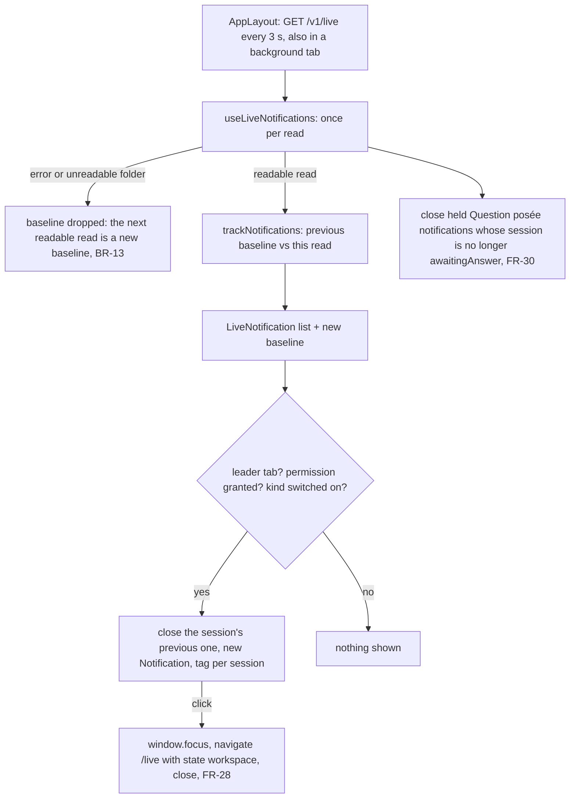

# Browser notifications

Feature: `live-sessions` · Components: `web` · Spec: FR-23–FR-30, BR-12–BR-17 (glossary `LiveNotification`)

## Context

The status board and the tab title still have to be looked at. This iteration lets the browser notify the person, on request, when a `LiveSession` becomes `AwaitingAnswer` (`Question posée`) and, behind a second switch, when it becomes `RecentlyFinished` (`Tour terminé`).

No api change. `AppLayout` already polls `GET /v1/live` every 3 s on every page (`useLiveStateQuery({ isPolling: true })`), and the live state carries everything a notification needs: status, workspace, title, `question`, `waitingFor`, `lastReply`, `turnStartedAt`, `statusSince`. Changes are detected in the browser, from one read to the next, by the same layout that drives the navigation counts. So FR-27 (any open page) needs no new channel.

The app runs on two origins: the dev server (http://localhost:5180, `/api` proxied) and the root `npm start` (http://localhost:3100, the api serving the built front). Both are `localhost`, so both are secure contexts where the Notification API is available. Nothing in the code depends on the origin. Each origin keeps its own permission, settings, `Vu` marks and lock (see the Decisions taken autonomously).

## Decisions

- Scope → `web` only, one stage. The live poll the layout already runs is the change detector (see Context). The caller asked to check this before deciding.
- Branch → stay on `develop`, no new branch. The caller asked for this, which overrides the skill's default of cutting `feat/live-sessions-browser-notifications` from the base branch.
- Both run modes (dev 5180, `npm start` 3100) must work → no origin-specific code: relative `/live` navigation, no absolute URL, no service worker path to register.

## Decisions taken autonomously

The grill was run in autonomous mode. Every question took its recommended answer:

- Grill on the plan → run in autonomous mode, without offering it (skill's autonomous default)
- Stage order and review → the manifest's order (one stage, `web`); a review after the stage (autonomous default)
- New api endpoint or SSE stream for changes → no. The 3 s poll of `AppLayout` already runs on every page and carries every field a notification needs (an api stage would duplicate the poll)
- Background tabs → `useLiveStateQuery` sets `refetchIntervalInBackground: isPolling`. TanStack Query stops a `refetchInterval` in a hidden tab by default, and on Windows Chrome a fully covered window counts as hidden. That is exactly when a notification is needed (FR-27). Side effect: the FR-14 tab title no longer goes stale in a hidden tab
- Chrome's intensive throttling (a page hidden for over 5 minutes runs its chained timers about once a minute) → accepted, no workaround. The spec sets no latency for notifications (FR-11's 5 s is the page's), and a delay of up to about a minute is still far better than the hour it replaces. The lock holder may be such a long-hidden tab while a visible tab sees the change first. The delay stays bounded by about a minute. An SSE stream would avoid it, at the cost of an api stage
- Several tabs (BR-12) → every tab tracks the changes, but only one shows notifications: the tab that holds the Web Lock `claude-companion.live.notifier` (`navigator.locks.request`, held while `AppLayout` is mounted, released on unmount; an `AbortController` cancels a pending request, so a StrictMode double mount never leaves two holders). When the leader closes, the next waiting tab takes the lock. It already has a baseline from its own polls, so it never fires a burst. Without `navigator.locks` (very old browser), every tab notifies and the tag below folds the duplicates
- Replacing a session's previous notification (BR-12) → `tag: "claude-companion.live.{sessionId}"` on every notification. The leader also closes its own previous notification of that session before showing the new one. A same-tag replacement alone is silent in Chrome (no `renotify` in the TypeScript DOM lib), so a second question of the same session would not alert the person
- Page notifications (`new Notification`) or a service worker (`registration.showNotification`) → page notifications. They need no extra file served on both ports, no registration and no worker-to-page messaging. Limitation accepted: only the tab that created a notification can close it or handle its click, so a leader tab's open notifications cannot be withdrawn (FR-30) or followed (FR-28) by the next leader once it closes. New changes are notified by the new leader
- What counts as a change (BR-13) → the tracking keeps, per session, the last trusted read's `{ status, question, turnStartedAt }`. The first readable read of the tab, a read whose `isSessionsDirReadable` is false and a failed read (`isError`) drop the baseline, and the next readable read becomes a new baseline that notifies nothing. `useStatusTracking` is not reused: it keeps its entries across an unreadable read, which BR-13 forbids here, and it only runs on the live page
- A session first seen after the baseline, already `AwaitingAnswer` or `RecentlyFinished` → it notifies. BR-13 exempts only the sessions present when a page opens or when the state is readable again
- `Question posée` trigger (FR-24) → the session's status is `awaitingAnswer` and, in the baseline, it was absent, not `awaitingAnswer`, or `awaitingAnswer` with another `question`, both non-null (two questions answered within one 3 s poll; a null on either side, from a log not read yet, is not a new question, so BR-12 holds). `statusSince` is not compared: a change of `waitingFor` could move it during one wait and notify twice
- `Tour terminé` trigger (FR-25) → `bucketOf(session, { now: read time, isSeen: () => false })` is `recentlyFinished` and, in the baseline, the session was absent, not `idle`, or `idle` with another `turnStartedAt` (a turn started and ended between two polls). This keeps BR-09 and the built-in command exclusion of `bucketOf`, and never re-notifies an idle turn already seen. `isSeen` is ignored: a turn that has just ended cannot carry a `Vu` mark yet, and reading the marks in the layout would need them shared within the tab. Evaluated with the read's time (`dataUpdatedAt`), not the page's 1 s `now`
- Permission request (FR-23) → only from the click on `Activer les notifications` (browsers ignore a request outside a user gesture). On `granted`, the `Question posée` switch is set on at once and `Tour terminé` stays off. A dismissed prompt (`default`) changes nothing
- Settings (BR-16) → `localStorage` key `claude-companion.live.notifications`, `{ awaiting: boolean, finished: boolean }`, both false by default. Every read and write is guarded (`try`/`catch`); without storage the settings last as long as the tab. The settings are read by the live page (the switches) and by the layout (the gate) in the same tab, so they live in a module store read through `useSyncExternalStore`, with a `storage` listener for the other tabs. `useSeenMarks`' per-hook `useState` would not see a switch flipped by the other hook in the same tab
- Permission state (FR-29) → four states: `unsupported` (`!("Notification" in window) || !window.isSecureContext`, e.g. the app opened through a LAN address), `default`, `granted`, `denied`. It is re-read when `navigator.permissions.query({ name: "notifications" })` reports a change (where supported), on `focus` and `visibilitychange`, and after the request. `Notification.permission` is checked again right before every show, in case it was revoked while the page was open
- Turning a kind off (FR-26) → the leader closes the open notifications of that kind it holds. The browser's permission is untouched
- Withdrawal (FR-30) → on every readable read, the leader closes each `Question posée` notification it holds whose session is absent or no longer `awaitingAnswer`. A failed or unreadable read withdraws nothing (it says nothing about the sessions). A `Tour terminé` is never withdrawn: the spec asks it for questions only. A newer notification of the session replaces it anyway
- Click (FR-28) → `window.focus()`, then `navigate("/live", { state: { workspace: workspaceKey } })`, then `close()`. The workspace filter stays page state, not a URL parameter (the status board plan kept local paths out of the URL). `LivePage` applies `location.state.workspace` on mount and whenever `location.key` changes while it is mounted (adjusted during render, like `useStatusTracking`). A workspace that has left falls back to every workspace (existing behaviour). Clicking never marks `Vu` (BR-17). The phone's selected tab is left as it is
- Live page in the foreground → it notifies anyway (the spec's own decision); the leader may well be the visible tab
- Notification texts (FR-24, FR-25), French, through i18n → `Question posée` titled "Question posée · {workspace}", with the session title then the question as body; `waitingForLabel(waitingFor)` when `question` is null. `Tour terminé` titled "Tour terminé · {workspace}", with the session title and "Tour de {duration}" (`statusSince − turnStartedAt`, as on the tile), then the `LastReply`, as body; "Pas de réponse écrite pour ce tour" when it is null (BR-11). Question and reply cut to 140 characters with an ellipsis (the api's 300-character reply is too long for a toast). The workspace is its live name (`Scratch` group name for the `ScratchGroup`). `lang: "fr"`. No icon: the app has no favicon, and the browser shows its own
- `requireInteraction` → not set (browser default). The OS keeps the notification in its notification centre, and FR-30 removes stale questions
- Where the switches sit (FR-23, FR-26, FR-29) → a `NotificationSettings` block on the live page, between the header and the board. It is shown in every state of the page (loading, error, unreadable, empty), since the settings do not depend on the sessions
- A "send a test notification" button → no (not in the spec)
- Both origins open at once (5180 and 3100) → each notifies on its own (permission, settings, lock and tags are per origin); accepted, the person runs one mode at a time
- Layer placement → browser APIs and storage in `data/` (like `useSeenMarks`); the pure change detection and texts in `ui/notifications.ts` (like `board.ts`); the effectful orchestration in `pages/useLiveNotifications.ts` (like `useStatusTracking`), called by `AppLayout`
- Spec → unchanged and already `Approved` (commit 7a9f7db); the plan covers its delta only
- Prepare at implementation → `openapi-typescript` regenerated `schema.d.ts` with no change (the working tree stayed clean), so it is not part of the stage commit
- `NotificationSettings` names the settings type (`data/`) and the component (`ui/`) → the component imports the type under the alias `NotificationSettingsValue` (a same-named import and declaration do not compile)
- Autopilot without browser test → `Browser test` is `[-]` in the Validation (not run: autopilot without browser test); the scenarios stay in the item for a later manual run
- Review finding: a read without the log (`isLogFound` false, e.g. a busy file on Windows) nulls `turnStartedAt` and `question`, so the next read with the log notified the same `Tour terminé` again → fixed: `trackNotifications` keeps the previous baseline's question and turn for a session whose log is missing (the status-based triggers are unchanged)
- Review finding: `NotificationSettings.module.css` restates the label and muted text styles of `texts.module.css` → left as is (that file is the live cards' texts; the values match the skin's recipes, a nit)
- Review finding: the workspace of a clicked notification stays in the history state, so a reload or back navigation re-applies it → left as is (what the plan specifies; the status board plan kept the filter out of the URL)

## web

### data

- `src/features/live/data/useLiveStateQuery.ts`: add `refetchIntervalInBackground: isPolling` to the query (Decisions taken autonomously, background tabs). Comment: notifications (FR-27) need the poll while the tab is hidden.
- `src/features/live/data/notificationSettings.ts` (new): the settings store (BR-16).
  - `export interface NotificationSettings { awaiting: boolean; finished: boolean }`; `STORAGE_KEY = "claude-companion.live.notifications"`; default `{ awaiting: false, finished: false }`.
  - A module-level cached snapshot, parsed from storage (guarded, invalid JSON or wrong shape gives the default). A set of listeners. `subscribe(listener)` adds the listener and, for the first one, a `window` `storage` listener on `STORAGE_KEY` that re-reads the snapshot and notifies.
  - `getNotificationSettings()` returns the snapshot (stable reference until it changes). `setNotificationSettings(patch)` merges onto the current snapshot, writes it (guarded), replaces the snapshot and notifies.
  - `useNotificationSettings()` is `useSyncExternalStore(subscribe, getNotificationSettings)`.
- `src/features/live/data/notificationPermission.ts` (new): the permission store (FR-23, FR-29).
  - `export type NotificationPermissionState = "unsupported" | NotificationPermission`. `readPermission()` gives `"unsupported"` when `!("Notification" in window) || !window.isSecureContext`, else `Notification.permission`.
  - Same store pattern. `subscribe` also listens to `focus` and `visibilitychange`, and to `navigator.permissions.query({ name: "notifications" })`'s `change` event when available. The promise is guarded, since some browsers reject that name.
  - `useNotificationPermission()` is `useSyncExternalStore(subscribe, readPermission)`.
  - `async requestNotificationPermission()`: `await Notification.requestPermission()`, notify the listeners, and on `"granted"` call `setNotificationSettings({ awaiting: true })` (FR-23). It returns nothing; errors are swallowed and the state is re-read.

### pages

- `src/features/live/pages/useLiveNotifications.ts` (new): `useLiveNotifications(liveQuery)`, given the layout's query result. It shows, replaces, withdraws and handles clicks (FR-24, FR-25, FR-27, FR-28, FR-30, BR-12–BR-15).
  - **Leader:** an effect requests the Web Lock `claude-companion.live.notifier` with an `AbortController` signal. Its callback sets `isLeaderRef.current = true` and returns a promise that the cleanup resolves. The cleanup aborts a pending request, releases a held lock and resets the ref. Without `navigator.locks` the ref is simply `true`.
  - **Tracking:** an effect keyed on `[liveQuery.dataUpdatedAt, liveQuery.isError, liveQuery.data]`. It first checks `isError`, a missing `data` and `!data.isSessionsDirReadable`: any of them sets `baselineRef.current = null` and stops. This check runs before the once-per-read guard and does not depend on it, since in TanStack v5 a failed refetch keeps `data` and `dataUpdatedAt` and only moves `isError`. Then the guard: each `dataUpdatedAt` is processed once (a ref of the last one handled, so a StrictMode re-run changes nothing). A read after an error has a new `dataUpdatedAt`, so it is processed, against a null baseline. Otherwise it calls `trackNotifications(baselineRef.current, flattenWorkspaces(data), new Date(liveQuery.dataUpdatedAt))`, stores the new baseline, withdraws the stale questions (below), then shows the returned notifications.
  - **Show:** only when `isLeaderRef.current`, `Notification.permission === "granted"` and the kind is switched on in `getNotificationSettings()`. For each `LiveNotification`, close the held one of that session if any, then `new Notification(text.title, { body: text.body, tag: notificationTag(sessionId), lang: "fr" })`, and hold it in a `Map<sessionId, { kind, notification }>` ref. `onclose` drops the entry if it still holds that object. `onclick` runs `window.focus()`, then `navigate("/live", { state: { workspace: workspaceKey } })` (`useNavigate`), then `close()`. A `new Notification` that throws is caught and skipped.
  - **Withdraw (FR-30):** on each readable read, close and drop every held entry of kind `awaitingAnswer` whose session is absent from the read or not `awaitingAnswer`.
  - **Switch off (FR-26):** an effect on `useNotificationSettings()` closes and drops the held entries of every kind that is now off.
  - Nothing is closed on unmount: the notifications stay in the OS until their click, their dismissal or a page reload.
- `src/AppLayout.tsx`: call `useLiveNotifications(liveQuery)` after `useLiveStateQuery({ isPolling: true })`. Comment: FR-27, every page of the application notifies.
- `src/features/live/pages/LivePage.tsx`:
  - Render `<NotificationSettings permission={…} settings={…} onEnable={requestNotificationPermission} onChange={setNotificationSettings} />` between the `header` and `renderContent()`, in every state of the page. It reads `useNotificationPermission()` and `useNotificationSettings()`.
  - FR-28: `useLocation()`; `readWorkspaceState(location.state)` (a local guard: an object with a string `workspace`, else null). `selectedWorkspace` is initialised from it. A `useState` of the last applied `location.key` is compared during render: on a new key carrying a workspace, set `selectedWorkspace` to it and remember the key. The existing fallback (a workspace no longer live means every workspace) is unchanged.

### ui

- `src/features/live/ui/notifications.ts` (new, pure apart from `t`):
  - `export type LiveNotificationKind = "awaitingAnswer" | "recentlyFinished"`; `export interface LiveNotification { kind: LiveNotificationKind; session: BoardSession }`.
  - `export type NotificationBaseline = Map<string, { status: LiveStatus; question: string | null; turnStartedAt: string | null }>`.
  - `trackNotifications(baseline: NotificationBaseline | null, sessions: BoardSession[], readAt: Date): { baseline: NotificationBaseline; notifications: LiveNotification[] }`. It always returns the baseline built from `sessions`. With `baseline === null` it returns no notification (BR-13). Otherwise it applies the two triggers of the Decisions taken autonomously (`Question posée`: status, absence or another question; `Tour terminé`: `bucketOf` with `isSeen: () => false` and `now: readAt`, then absence, a non-`idle` status or another `turnStartedAt`). It runs over every session, never a filtered list (BR-15), and on status only (BR-14: a permission wait is `running`).
  - `notificationTag(sessionId)` gives `claude-companion.live.{sessionId}`.
  - `notificationText(notification): { title: string; body: string }` builds the texts of the Decisions taken autonomously. It uses `waitingForLabel` (from `labels.ts`), `formatDuration` and a local `cut(text, 140)` that adds `…`.
- `src/features/live/ui/NotificationSettings.tsx` (new) and `NotificationSettings.module.css`: a `section` labelled by a small "Notifications" heading. Props: `permission: NotificationPermissionState`, `settings: NotificationSettings`, `onEnable(): void`, `onChange(patch: Partial<NotificationSettings>): void`.
  - `unsupported`: a `Banner` saying the browser cannot show notifications for this page, and that a recent browser on a `localhost` address is needed.
  - `denied`: a `Banner` saying notifications are blocked for this site, and how to allow them again (the site settings icon left of the address, allow notifications, then reload).
  - `default`: a `Button` (variant `primary`) "Activer les notifications" calling `onEnable`, with a muted hint saying the browser will ask for permission.
  - `granted`: two shared `Switch`es, "Questions posées" (`awaiting`) and "Tours terminés" (`finished`), each calling `onChange`, with a muted hint saying notifications arrive as long as a page of the application is open (FR-27).
  - The layout is a flex row that wraps, with the skin's spacing and colour variables only (`--text-muted` for the hint).
- `src/shared/lib/i18n/fr.json`, new keys:
  - `live.notify.heading` "Notifications".
  - `live.notify.enable` "Activer les notifications"; `live.notify.enableHint` "Le navigateur vous demandera l'autorisation."
  - `live.notify.awaiting` "Questions posées"; `live.notify.finished` "Tours terminés".
  - `live.notify.grantedHint` "Tant qu'une page de l'application reste ouverte dans ce navigateur."
  - `live.notify.unsupported` "Ce navigateur ne peut pas afficher de notifications ici : il faut un navigateur récent et l'adresse localhost de l'application."
  - `live.notify.denied` "Les notifications sont bloquées pour ce site. Pour les autoriser, cliquez sur l'icône à gauche de l'adresse, autorisez les notifications, puis rechargez la page."
  - `live.notify.awaitingTitle` "Question posée · {workspace}"; `live.notify.awaitingBody` "{title}\n{question}".
  - `live.notify.finishedTitle` "Tour terminé · {workspace}"; `live.notify.finishedBody` "{title} · {turn}\n{reply}".
  - The existing `live.tile.turn` ("Tour de {duration}") and `live.reply.none` are reused for `{turn}` and a missing reply.

## Tests

- **web**: none. The component has no unit tests (`web/CLAUDE.md`); the browser test below covers it.
- **api**: none (untouched).

## Progress

### Stage 1 — web
Commit: `feat(live-sessions): web — browser notifications`
- [x] Prepare: client regenerated from `api/openapi.json`
- [x] data: background poll in `useLiveStateQuery`; `notificationSettings.ts` and `notificationPermission.ts` stores
- [x] pages: `useLiveNotifications` (leader lock, tracking, show, withdraw, click), called by `AppLayout`; `LivePage` renders the settings and applies the workspace from the navigation state
- [x] ui: `notifications.ts` (`trackNotifications`, tag, texts), `NotificationSettings` with its CSS module, i18n keys

## Validation

- [x] Review: the `reviewer` agent on the plan's implementation, its findings settled
- [-] Browser test: not run (autopilot without browser test). Scenarios kept for a manual run on the dev server (http://localhost:5180) and on `npm start` (http://localhost:3100):
  - notifications are off by default, and `Activer les notifications` turns `Question posée` on at once on `granted`;
  - a session becoming `AwaitingAnswer` notifies from the workspaces page, with the tab in the background;
  - answering it withdraws the notification;
  - `Tour terminé` notifies only once its switch is on;
  - clicking a notification opens `/live` filtered on its workspace, already on `/live` too, with no `Vu` mark;
  - two tabs give one notification;
  - opening a page while a session already waits notifies nothing;
  - `denied` and `unsupported` show their banner.

  The browser's native permission prompt needs the person or a pre-granted profile. Sessions can be driven through a stub of `/v1/live`, as in the status board's browser test.
