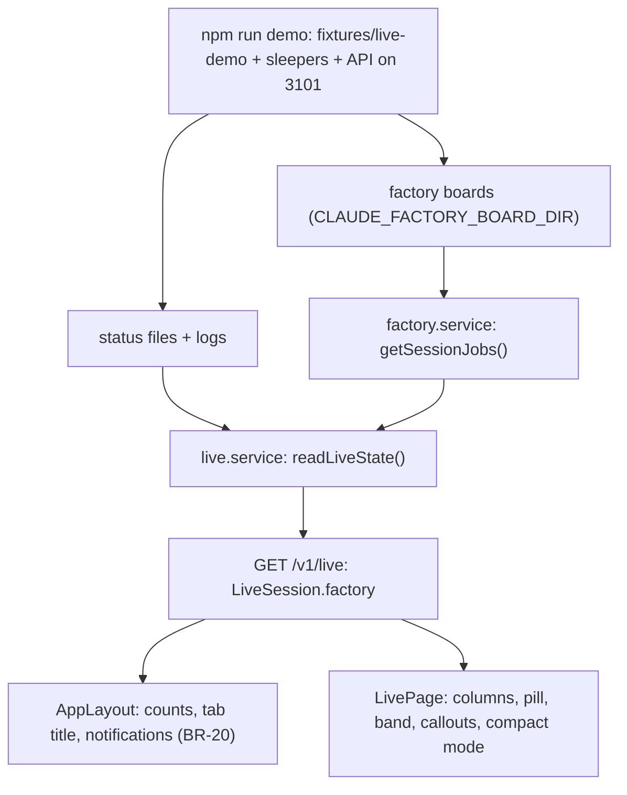

# Live page: factory phases, band, commit and recap callouts, compact mode, demo dataset

Feature: `live-sessions` · Components: `api`, `web` · Spec: FR-01, FR-02, FR-06, FR-10, FR-14, FR-15, FR-16, FR-17, FR-18, FR-22, FR-24, FR-25, FR-30, FR-31, FR-32, FR-33, FR-34, FR-35, FR-36, FR-37, FR-38, FR-39, FR-40, FR-41, BR-14, BR-18, BR-20, BR-21, BR-22; factory-board FR-23, FR-31 (both revised in this plan's commit)

## Context

The spec (commit 656cd9b) redoes the `En direct` page around the factory workflow:

- columns `Vous attend` / `Au travail` / `Terminées`;
- the status pill is the session's `FactoryPhase` (FR-32);
- a factory band reads `feature › étape · plan` with the stage segments (FR-33);
- a `Hors workflow` mark (FR-34), a frozen-board marker (FR-35);
- callouts: the commit to validate (FR-36), the `Récap` (FR-37);
- the next step's prompt button `Prochaine : …` (FR-38);
- a remembered compact mode (FR-39, FR-40, BR-22);
- the application named `SelOps` in the navigation (FR-41).

A session waiting for its commit's validation goes in `Vous attend` whatever its `LiveStatus` (BR-20), unless its board is frozen (BR-21).

Mockups:   

Today the live tile has a one-line factory line (factory-board FR-31, plan `add-plan-labels-and-live-line`). `LivePage` builds it from `GET /v1/factory` (`factoryLines.ts`). That join only runs on the live page, at 1 s, and never while the tab is hidden. BR-20 now needs the factory phase where the layout computes things on every page, in the background too:

- the navigation counts and the tab title (FR-14);
- the `Question posée` notification of a commit to validate, with its subject (FR-24, FR-30, BR-14).

So the match moves to the api: `GET /v1/live` carries, per session, the factory job its boards export (`factory`). The page, the layout and the notifications all read it from the one live poll. `factoryLines.ts` goes, and factory-board FR-31 is revised (the line becomes the band, the phase the pill).

Before any front work, the api stage adds a demo dataset. `npm run demo` in `api` generates logs, status files and two factory boards under `api/fixtures/live-demo/`. It starts one sleeping process per fake session, so that each status file's pid is alive. Then it runs the API on that folder. The web stage's browser test runs against it, never against `~/.claude`.

## Decisions

- **The match moves to the api** → `LiveSession.factory: FactorySessionJob | null`, computed by the factory service and attached by the live service. This reverses the `add-plan-labels-and-live-line` decision "no api join". The reasons:
  - BR-20 changes the navigation counts and the notifications, which the layout computes on every page from `/v1/live` alone, in the background too;
  - the pill (FR-32) and the column (BR-20) must come from one read, or two polls of different rates disagree;
  - a tile must not flash `Hors workflow` while a second query is pending.

  The labels (step, plan name, phase) stay in the web, from the served data (BR-02: drawn as exported).
- **Match rule (factory-board FR-31)** → unchanged, ported from `web/src/features/factory/ui/factoryLines.ts`:
  - over every board of every workspace, a stale one included: first the board's `live` runs, the main loop (`agentId === null`) winning over a subagent's, then the latest `updatedAt`;
  - for the sessions still without a match, the boards' `sessions`, the latest `updatedAt` winning;
  - an unsupported or unreadable board gives nothing.
  - **New:** when the winning run's `command` is `off-workflow`, the session gets `factory: null` (`OffWorkflow`, ~FR-34). The latest run decides: an older factory run of the same session never shows while it works off the workflow.
- **What the job carries** → only what the tile draws, never a whole board (the live poll runs every 3 s):
  - `fileName`, `root`, `isStale`, `scannedAt`, `markers`;
  - `source` (`live` | `session`) and the matched `run` (a `FactoryRun`; a `session`'s `phase` is always set);
  - `feature`: the run's feature on the same board, reduced to `slug`, `title`, `plan`, `autopilot`, `next` and `steps` without their runs; null without a feature or when the board does not list it.
- **Shown phase** → the web's existing `shownPhase(run)` (`labels.ts`: `running` → `working`, `interrupted` → `interrupted`, else `run.phase`). A null shown phase (an older export or run) gives the `LiveStatus` pill, never a derived phase (BR-02).
- **Column (BR-20, BR-21)** → computed in the web (`board.ts`), as today.
  - `awaiting`: `status === "awaitingAnswer"`, or the job is on a board that is not stale and its shown phase is `awaiting-commit`;
  - `running`: otherwise `status === "running"`;
  - `finished` / `idle`: as today (BR-09, the `Clôturée` marks).
  - A `Running` session whose board says `awaiting-commit` cannot happen with the mod (a running run reads `working`); the rule does not depend on it.
- **Pill (FR-32)** →
  - on a non-stale board with a shown phase: the phase (`Au travail`, `Commit à valider`, `Question posée`, `Job done`, `Interrompue`);
  - otherwise the `LiveStatus` pill: `En cours`, `Question posée`, `Terminée` (an `Idle` session in `Vous attend` through BR-20 cannot occur without a phase).
  - The tile's coloured edge follows its column (the mockups: the commit to validate has the `Vous attend` edge).
- **Callout (FR-02)** → one per tile, the first that applies:
  1. the question, when `status === "awaitingAnswer"` (FR-05; the live state is fresher than the board);
  2. the proposed commit, when the shown phase is `awaiting-commit` on a non-stale board (FR-36);
  3. the `Récap`, when the tile is in `Terminées` with the shown phase `job-done` on a non-stale board and a `recap` (FR-37);
  4. the `LastReply`, when the tile is in `Terminées` (FR-16; a stale `job-done` gives this one, BR-21);
  5. none.

  A running tile shows its activity and subagents under the callout's place, as today.
- **Commit subject (FR-36)** → the first non-empty line of `run.pendingCommit`, never the body.
  - One `<button>` holds the subject and its action. A click copies the subject; on success, a session with a valid `DesktopLink` (`isDesktopLink`) is then opened with `window.location.assign(link)`.
  - A failed copy opens nothing and shows the subject selectable with a note. Without a link the button only copies, and its label says so (BR-18).
- **Next step (FR-38)** → only on a `Job done` tile (non-stale board) whose `job.feature.next` is not null. The label is `Prochaine : {next.label}`. It copies the first prompt of `promptsOf(next, job.markers, switches)` (`prompts.ts`), the factory page's rule for the `avec revue` marker. Then it opens the session as FR-36 does.
- **Shared switches** → `avec revue` / `test navigateur` move from page-local `useState` (`FactoryPage`, `WorkspaceFactorySection`) to a browser-kept store, `web/src/shared/lib/promptSwitches.ts` (factory-board ~FR-23). The live page reads them and shows no switch.
- **Tracking (FR-15, FR-18) and notifications (FR-24, FR-25, FR-30)** → keyed on the tile's column and pill instead of the `LiveStatus`:
  - a session moving from `Au travail` to `Vous attend` through BR-20 changes column without changing status;
  - `enteredAt` resets on a column change only;
  - the highlight fires on a column or pill change;
  - a `Question posée` notification fires when a session enters `Vous attend` (or its question or commit subject changes there);
  - `Tour terminé` fires only for a turn that ends outside `Vous attend`.
- **Navigation counts (FR-14)** → computed by the layout from the sessions (`columnCounts` in `board.ts`: `awaiting` and `running` need no marks), no longer from `LiveState.counts`. `counts` stays in the contract, unchanged, for compatibility.
- **The application's name (FR-41)** → a `brand` prop of `NavBar`, shown before the links. The other nav labels and the tab title (`claude-companion`) are unchanged; the mockups' "Espaces" is a shortening, not a requirement.
- **Notifications panel** → folded behind a `Notifications` disclosure in the page's bar (the mockups). FR-23 to FR-29 are unchanged.
- **Compact mode (FR-39, FR-40, BR-22)** → a `Switch` in the page's bar, kept in `localStorage` like the notification settings. On a phone the grouped list stays one list (no tabs, FR-22 is about the columns), each line wrapping its parts.
- **Demo dataset (the person's requirement)** →
  - a pure generator, `api/scripts/demo/live-demo.ts`, writes logs, status files and boards for given folders, pids and `now`;
  - a runner, `api/scripts/demo.ts` (`npm run demo`), starts the sleepers, writes the dataset under `api/fixtures/live-demo/`, keeps the fresh board fresh and runs the API on it;
  - an api test reads the generator's output through the real services, so that a shape drift breaks a test, not the browser test.
  - The generated folder is git-ignored: pids and timestamps change at every run.
- **Demo port** → the demo API runs on its own port, **3101**, with its own database `api/.data/pglite-demo` (wiped at each start). The web's `npm run dev:demo` (`vite --mode demo`) proxies `/api` to 3101 on the usual 5180; `npm run dev` keeps 3100.
  - The person's real API (`npm start` or `npm run dev` on 3100, `.data/pglite`) keeps running and is never touched: the workflow rule forbids stopping a server that answers.
  - A demo sharing `.data/pglite` would write the fake sessions into the real history (and PGlite allows one process per folder).
- **No fake-pid tolerance** → production code is unchanged for liveness. The demo's pids are real sleeping `node` processes, so `process.kill(pid, 0)` succeeds.

## Decisions taken autonomously

- Run the grill on the plan? → yes, autonomous. Every question below took its recommended answer, and none was left without one.
- Branch → stay on `develop`, no branch created (the caller's instruction overrides the skill's base-branch default `feat/live-sessions-add-factory-phases`).
- Plan type and name → `add-factory-phases`, commit type `feat` (new behaviour on an existing feature).
- Stages → the manifest's order, `api` then `web`; a review after each stage (autonomous default).
- factory-board FR-31 in this plan (the caller's request) → revised by write-spec in called mode, with its non-goals, its UX line and FR-23 (the shared switches), shipped in this plan's commit. live-sessions ~FR-34 and the `OffWorkflow` glossary entry gain the off-workflow run (see below).
- Where is the factory join? → api (see Decisions: BR-20 on every page, one read for pill and column).
- The mod's `off-workflow` runs (the export records free requests as runs; neither spec foresaw them) → a match on one gives `factory: null`, `Hors workflow` (they are no factory job; the latest run decides).
- Pill when the run has no phase (older export) → the `LiveStatus` pill (BR-02: never derived).
- Tile edge colour → follows the column (the mockups), the pill carries the phase.
- Callout precedence when the live state asks a question and the board says `awaiting-commit` → the question (fresher source).
- Copy failure on the commit or next-step button → nothing opens, the text is shown selectable (the person still needs it).
- Next-step prompt → `promptsOf(...).prompts[0]`, the step's own prompt (not the chained or autopilot variant): FR-38 names "the next step's prompt".
- Recap callout → its text when it has one, then its commits (short hash: the first 7 characters of `sha`, and subject); without text, the commits alone (factory-board FR-26).
- Tab title → unchanged (`claude-companion`); FR-41 names the navigation only.
- Column headers → a count bubble and the title, as the mockups; the column captions go.
- Footer actions → icons with an accessible label (FR-02): desktop app, recap arrow (FR-10); `Clôturer` and `Prochaine : …` stay labelled buttons (the mockups).
- Compact mode on a phone → one grouped list, lines wrap (no tabs; FR-22 is about the three columns).
- Notifications panel → behind a `Notifications` disclosure in the bar (the mockups); behaviour unchanged.
- "One factory board" in the request → **two** board files: situations 1, 2 and 4 need a fresh board, situation 6 a frozen one, and staleness is per file. The fresh board's `scannedAt` is rewritten every 10 s while the demo runs; otherwise it would go stale after 60 s.
- Demo sessions → the six situations of the mockup, plus:
  - an off-workflow run at work with a queued prompt (the `off-workflow` rule, the mockup's "Maquettes écran en direct");
  - a CLI commit to validate (the copy-only variant of FR-36, BR-18);
  - a resumed idle session (the folded group);
  - nine sessions in all.
- Demo port → its own port 3101 and database `.data/pglite-demo`, with `vite --mode demo` on 5180 (see Decisions).
- Demo API process → `node --import tsx src/server.ts`, one process, no watch. Killing it frees the port at once; a `tsx watch` wrapper would leave its child on Windows. Restart the demo after an api change.
- Demo workspaces' folders → under `{drive root}/selops-live-demo/{name}`, which do not exist. They sit outside any git repository: under `api/fixtures/` they would all fold into the `claude-companion` workspace.
- Demo log shapes → the generator imports the test builders (`test/ingestion/log-builders.ts`, `test/live/live-builders.ts`, `test/factory/factory-builders.ts`). The shapes exist once, and the fixtures parse like the tests.
- Demo settings and plugins files → pointed into the demo folder, absent: the demo reads nothing of `~/.claude`.
- Browser test against `5180` when a non-demo dev server already answers there → the test checks `GET /api/v1/live`'s `sessionsDir` and `GET /api/v1/factory`'s `boardsDir`. Both must end in `fixtures/live-demo/…`; otherwise the browser test stops, `[-]` with the reason (it never stops the person's server).
- Web unit tests → none (`web/CLAUDE.md`).
- Demo session #1's step (stage 1) → the autopilot run is on `stage:3` and the reviewer's description reads "Revue du stage 3", not `stage:2`. The plan's markers say done, done, running, pending, so the running stage is the third; with `stage:2` the band would name a stage its segments show as done. The browser test's band reads `{autopilot label of stage 3}`.
- Demo session #8's plan (stage 1) → its own folder `…/20261020-110000-fix-live-labels` on the `factory-board` feature, listed in the feature's `plans`. The board follows the drop-list plan, so #8's step label falls back to `Stage 1`.
- Demo database path (stage 1) → `PGLITE_DIR` is the absolute `api/.data/pglite-demo`, resolved from the runner's file like the dataset folder, so no path depends on the current folder.
- Stopping the demo without a terminal (stage 1) → kill the process listening on 3101. The runner sees its API child exit and kills the sleepers. Checked by hand: nine sessions on `GET /v1/live`; the fresh board still fresh after 75 s; no sleeper left after the stop. A hard kill of the runner itself would orphan the API child, so it is never the documented way.
- Stage 1 review findings (stage 1) → all four fixed:
  - a test of a boards read that rejects (`/v1/live` still answers, `factory: null`, one log);
  - no board read while no process runs (`/v1/live` is polled every 3 s on every page);
  - the sleeper is given the runner's pid as the plan says (`process.argv[1]` under `node -e`);
  - the runner refuses to start, before emptying any folder, when 3101 already answers (a demo already running).
- `CommitCallout`'s input (stage 2) → it takes the subject, computed once by `commitSubjectOf` in `board.ts`, instead of the whole `pendingCommit`. The notifications need the same subject (FR-24), so the first-non-empty-line rule exists once.
- Knowing that a copy succeeded (stage 2) → `useClipboard().copy` now resolves to a boolean. The commit and next-step buttons open the session only after a successful copy; the existing callers ignore the value.
- `StatusIcon` (stage 2) → removed. The column headers are a count bubble and a title (the mockups); each pill draws its own icon. A dead export would be left otherwise.
- Column background tint (stage 2) → dropped: the columns are a heading over tiles, as the mockups draw them. The tiles carry the column's tone on their left edge, and so do the compact lines.
- `enteredAt` on a column change without a status change (stage 2, BR-20) → the time of the read that showed the change. `statusSince` predates a move made by the factory phase, so it would misplace the tile in `Vous attend`.
- Question callout label (stage 2) → a `Question` label heads the question, as the mockups draw it; new key `live.question.label`.
- Dead i18n keys (stage 2) → `live.status.running/awaitingAnswer/idle/finished`, `live.status.ago` and `live.tile.started` removed too: the pills and the footer strip replace them, and nothing reads them any more.
- Shared helpers (stage 2) → `activityLabel`, `startLabel` and `turnDuration` move to the live `labels.ts`; `FactoryMarks` (the `Hors workflow` / `Autopilot` chips) is exported by `LiveSessionTile`. The tile and the compact line both use them.
- Notifications disclosure (stage 2) → in the page's bar, taking the bar's full width once opened. The workspace filter moves under the header, as the mockups draw it.
- Stage 2 review findings (stage 2) →
  - fixed: `Prochaine : …` only on a tile in `Terminées` (the recap's and the primary `Clôturer`'s rule); the copy status lines stay in the accessibility tree; the next-step button's accessible name starts with its visible label and it says `Prompt copié` (new key `live.next.copied`); the footer strip's name on a `role="group"`; the notification settings' own heading is for screen readers only, under the disclosure's summary; the dead `QuestionIcon` removed; the Validation scenarios of #1 (stage 3) and #2 (the click opens the link) aligned with the Decisions;
  - compact lines wrap below 1024 px instead of 768 px: the seven parts do not fit one row between 768 and 1024 px (finding on the grid's squeezed columns);
  - not fixed: a `Tour terminé` then a `Question posée` toast if the board marked `awaiting-commit` one poll after the turn ended. It depends on the mod's write order, unverified, and holding notifications back would delay every `Tour terminé`; left as is.
- Browser test (stage 2) → not run. `5180` already answered when the test was due: the person's own `vite` (`npm run dev`), whose `/api/v1/live` reads `~/.claude/sessions`. The plan's rule applied: it was never stopped, and the item is marked `[-]`.
- Browser test on 5181 instead of 5180 → person's vite held 5180 against real API; demo mode proxy identical (final review: `npx vite --mode demo --port 5181 --strictPort`; `/api/v1/live`'s `sessionsDir` and `/api/v1/factory`'s `boardsDir` checked under `api/fixtures/live-demo/`).
- Checking the desktop open without following `claude://` (final review) → page script cannot replace `window.location.assign` in Chromium (it stays native), so the open was checked in a same-origin sandboxed iframe of `/live` whose Navigation API `navigate` event was recorded and cancelled: #2's and #4's exact `claude://…/local_…` links were caught, nothing for #8 or a failed copy. One main-tab click on #2 before that ran the real `assign`; the tab stayed on `/live`.
- Final review finding (browser test) → fixed: the copy-failed message of `CommitCallout` and `NextStepButton` sat outside the `role="status"` line, so a failed copy was never announced (the plan puts it in that line); the status line now holds copied, failed or nothing (the `ReopenActions` pattern), the `<pre>` stays outside. `FactoryPromptActions` (factory page, not this plan's code) has the same gap, left open.

## api

### db

None: nothing is stored (live-sessions BR-07, factory-board BR-01).

### services

`src/features/factory/factory.service.ts`:

- `export function matchSessionJobs(state: FactoryState): Map<string, FactorySessionJob>`, pure, the rule of Decisions:
  - candidates: every `board.live` run (`source: "live"`), picked per `sessionId` with the main loop first, then the latest `updatedAt`. Then every `board.sessions` entry (`source: "session"`), latest `updatedAt`, only for the sessions without a live match;
  - a winner whose `run.command === "off-workflow"` is dropped (no entry);
  - each entry: `{ fileName, root, isStale, scannedAt, markers, source, run, feature }`. `feature` is `board.features.find((f) => f.slug === run.feature)`, mapped to `{ slug, title, plan, autopilot, next, steps: steps.map(({ step, title, marker }) => …) }`, else null;
  - a comment cites factory-board FR-31 and live-sessions FR-34.
- `getSessionJobs(): Promise<Map<string, FactorySessionJob>>` = `matchSessionJobs(await getFactoryState())`. It goes through the single-flight `getFactoryState` and the file cache, so a live poll re-reads only the board files that changed. Returned with `getFactoryState`.
- The `OFF_WORKFLOW = "off-workflow"` constant, commented as the mod's command for a free request.

`src/features/live/live.service.ts`:

- New dependency `findFactoryJobs: () => Promise<Map<string, FactorySessionJob>>`.
- In `readLiveState`, after the logs, `const jobs = await findFactoryJobs().catch(...)`:
  - a failure logs once (until a read succeeds, like `failedSessions`) and gives an empty map;
  - `/v1/live` never fails because of the boards.
- `toEntry` sets `factory: jobs.get(status.sessionId) ?? null`. An unreadable sessions folder returns the empty state as today, without calling it.

`src/server.ts`: `createFactoryService` moves before `createLiveService`, which gets `findFactoryJobs: () => factory.getSessionJobs()`.

`test/setup.ts`: `buildLive` passes `findFactoryJobs: () => currentFactory.getSessionJobs()`, the factory service of the current context (`reset()` swaps both), so a test writes boards in `ctx.boardsDir` and reads them on `/v1/live`.

### routes

`src/features/factory/factory.schema.ts`:

- `factoryJobStepSchema` (`.meta({ id: "FactoryJobStep" })`): `step`, `title`, `marker: factoryMarkerSchema`.
- `factoryJobFeatureSchema` (`FactoryJobFeature`):
  - `slug`, `title`;
  - `plan: z.union([factoryPlanSchema, z.null()])`;
  - `autopilot: z.union([factoryRunSchema, z.null()])`;
  - `next: z.union([factoryNextPromptSchema, z.null()])`;
  - `steps: z.array(factoryJobStepSchema)`.
- `factorySessionJobSchema` (`FactorySessionJob`):
  - `fileName`, `root`, `isStale: z.boolean()`, `scannedAt: z.iso.datetime()`;
  - `markers: z.object({ review, browser })`;
  - `source: z.enum(["live", "session"])`;
  - `run: factoryRunSchema`;
  - `feature: z.union([factoryJobFeatureSchema, z.null()])`;
  - a comment: the job of one live session, as factory-board FR-31 matches it.
- Its type `FactorySessionJob` is exported.

`src/features/live/live.schema.ts`: `liveSessionSchema` gains `factory: z.union([factorySessionJobSchema, z.null()])`, with a comment citing live-sessions FR-32 and factory-board FR-31. Not `.nullable()`: the generator's `allOf` issue on a shared entity.

`src/features/live/live.routes.ts`: unchanged.

Handoff: `npx tsx scripts/export-openapi.ts openapi.json`, committed with the stage.

### demo dataset

Before any front work, in this stage (the person's requirement).

`scripts/demo/live-demo.ts` (pure apart from the writes, no process, no timer):

- `export const DEMO_SESSIONS`: the nine sessions below, in order. Each has a fixed `sessionId` (uuid v4 shape), workspace, title, origin, live status and its log, status-file and board content.
- `export async function writeLiveDemo({ projectsDir, sessionsDir, boardsDir, now, pids }: { …; now: number; pids: number[] })`:
  - writes, for each session `i`, its status file `{pids[i]}.json` (pid `pids[i]`) and its log `projectsDir/{folder}/{sessionId}.jsonl`, plus its subagent files when it has some;
  - then both boards;
  - every timestamp is relative to `now`: `startedAt`, `statusUpdatedAt` and `updatedAt`, log lines, run `since`/`updatedAt`, and `scannedAt` (`now - 5 s` for the fresh board, `now - 2 min` for the frozen one).
- `export async function writeFreshBoard(boardsDir: string, now: number)` rewrites the fresh board with `scannedAt = now - 5 s`. It writes a temp file then renames it; the reader tolerates half-written files anyway (factory-board FR-21).
- The workspaces' folders: `path.join(path.parse(process.cwd()).root, "selops-live-demo", name)`, which do not exist and sit outside any repository. Three workspaces: `claude-companion`, `factory`, `billing-app`. Each log folder is named as Claude Code names it (`C--selops-live-demo-claude-companion`).
- Builders: `userLine`, `assistantLine`, `toolUseBlock`, `askUserQuestionBlock`, `commandLine`, `queueLine`, `titleLine`, `writeSession` (`test/ingestion/log-builders.ts`); `statusFile`, `writeStatusFile` (`test/live/live-builders.ts`); `buildBoardExport`, `buildExportFeature`, `buildExportRun`, `buildExportSession`, `writeBoard` (`test/factory/factory-builders.ts`). Fixed test timestamps are overridden; nothing of a real log is copied.
- Desktop sessions: `entrypoint: "claude-desktop"` and `hostSessionId: "local_{uuid}"` (a valid `DesktopLink`). CLI sessions: `entrypoint: "cli"`, no `hostSessionId`.

The sessions (`T` = `now`; the fresh board's root is the `claude-companion` folder, the frozen board's root the `billing-app` folder; the matches go by session id):

| # | Situation | Workspace · branch · origin | Live state and log | Board |
|---|---|---|---|---|
| 1 | At work in the workflow, with subagents | claude-companion · `feat/live-sessions-phases` · desktop | `busy`, started T−42 min; prompt `/factory:autopilot live-sessions — with review`; a pending `Agent` call (`factory:reviewer`, "Revue du stage 3", T−3 min); two running subagents, one on `Read`, one on `Bash` | fresh: a `live` run, `command: "autopilot"`, `feature: "live-sessions"`, plan folder `…/20261020-090000-add-session-phases`, `step: "stage:3"`, `status: "running"`. Feature `live-sessions`: plan with 4 stages, steps `stage:1`–`stage:4` marked done, done, running, pending; `autopilot` = that run |
| 2 | Commit to validate | claude-companion · `feat/factory-board-drop-session-list` · desktop | `idle`; turn T−20 → T−12 min, after the start (T−48 min); last reply ends on the commit's code block | fresh: a `live` run, `command: "implement"`, `feature: "factory-board"`, folder `…/20261020-100000-remove-session-list`, `step: "stage:2"`, `status: "waiting"`, `phase: "awaiting-commit"`. `pendingCommit`: `feat(factory-board): web — drop the factory session list` plus a blank line and a body line (only the subject may show) |
| 3 | Question outside the workflow | factory · `develop` · desktop | `waiting`, `waitingFor: "input needed"`, since T−62 min; a pending `AskUserQuestion` with two questions | none |
| 4 | Job done | claude-companion · `feat/live-sessions-phases` · desktop | `idle`; turn T−34 → T−8 min | fresh: a `sessions` entry, `command: "implement"`, `feature: "session-activity"`, folder `…/20261020-080000-add-step-labels`, `step: "stage:1"`, `status: "done"`, `phase: "job-done"`, `recap` with a text and one commit (`3a08238…`, a subject). Feature `session-activity`: plan of that folder, 2 stages (done, pending), `next` = `{ label: "Stage 2 · web", prompt: "/factory:implement .planning/features/session-activity/dev-plans/20261020-080000-add-step-labels/ — stage 2 (web)", all: null, autopilot: null }` |
| 5 | Finished outside the workflow | factory · `develop` · CLI | `idle`; turn T−41 → T−35 min; a text reply | none |
| 6 | Interrupted on a frozen board | billing-app · `feat/init-billing` · CLI | `idle`; turn T−17 → T−14 min ending on a tool call with no text (no `LastReply`) | frozen (`scannedAt` T−2 min): a `sessions` entry, `command: "implement"`, `feature: "billing"`, folder `…/20261020-070000-init-billing`, `step: "stage:2"`, `status: "interrupted"`, `phase: "interrupted"`. Feature `billing`: 3 stages (done, running, pending) |
| 7 | Off-workflow run at work | claude-companion · `feat/factory-board-drop-session-list` · desktop | `busy`; a pending `Write` call; one queued prompt | fresh: a `live` run, `command: "off-workflow"`, `step: "off-workflow"`, `feature: null` (must give `factory: null`) |
| 8 | Commit to validate from the CLI | claude-companion · `fix/live-labels` · CLI | `idle`; turn ended T−5 min | fresh: a `live` run like #2 on feature `factory-board`, `status: "waiting"`, `phase: "awaiting-commit"`, a one-line `pendingCommit` |
| 9 | Resumed, idle | factory · `develop` · desktop | `idle`; its only prompt is older than its process start (no turn since: folded `Idle` group) | none |

`scripts/demo.ts` (`npm run demo`), the runner:

1. `apiDir` and `demoDir` (`fixtures/live-demo/`) are resolved from `import.meta.url`, never from the current folder.
2. `demoDir` and `.data/pglite-demo` are emptied and recreated. These two folders only: `rm` with `recursive`, guarded by a check that each path ends with its expected segments.
3. It starts `DEMO_SESSIONS.length` sleepers: `spawn(process.execPath, ["-e", SLEEPER, String(process.pid)], { stdio: "ignore" })`.
   - `SLEEPER` checks every 2 s that the parent pid still answers `process.kill(ppid, 0)` and exits otherwise, so a crashed demo leaves no process behind.
   - The runner awaits each child's `spawn` event to read its `pid`.
4. `writeLiveDemo({ projectsDir: demoDir/projects, sessionsDir: demoDir/sessions, boardsDir: demoDir/factory-board, now: Date.now(), pids })`.
5. A `setInterval` of 10 s calls `writeFreshBoard(boardsDir, Date.now())`.
6. It starts the API: `spawn(process.execPath, ["--import", "tsx", "src/server.ts"], { cwd: apiDir, stdio: "inherit", env })`. `env` is `process.env` plus:
   - `PORT=3101`, `PGLITE_DIR=.data/pglite-demo`;
   - `CLAUDE_PROJECTS_DIR`, `CLAUDE_SESSIONS_DIR` and `CLAUDE_FACTORY_BOARD_DIR` on the three folders;
   - `CLAUDE_SETTINGS_FILE=demoDir/settings.json` and `CLAUDE_PLUGINS_FILE=demoDir/installed_plugins.json` (both absent).
7. It prints the URLs: API `http://localhost:3101`; front `cd web && npm run dev:demo` → `http://localhost:5180`.
8. Stop: on `SIGINT`, `SIGTERM` or the API child's `exit`, it clears the interval, kills every sleeper and the API (`child.kill()`; on Windows a single node process dies with it), then exits. A `process.on("exit")` handler kills the sleepers synchronously as a last resort. If 3101 is busy, the API exits with its own message and the runner stops with it.

`package.json`: `"demo": "tsx scripts/demo.ts"`.

`.gitignore` (root): `api/fixtures/live-demo/` and `**/.data/pglite-demo/`.

## web

### data

- Prepare: `src/api/schema.d.ts` regenerated from `api/openapi.json` (`LiveSession.factory`, `FactorySessionJob`, `FactoryJobFeature`, `FactoryJobStep`).
- `vite.config.ts` becomes `defineConfig(({ mode }) => …)`. The proxy target is `http://127.0.0.1:3101` when `mode === "demo"`, else `http://127.0.0.1:3100`, with a comment pointing to api's `npm run demo`. `package.json` gains `"dev:demo": "vite --mode demo"`. It is portable: no environment variable syntax in an npm script.
- `src/shared/lib/promptSwitches.ts` (new):
  - the shared `avec revue` / `test navigateur` switches (factory-board ~FR-23), on the pattern of `notificationSettings.ts`: key `claude-companion.factory.promptSwitches`, `{ isReview: false, isBrowser: false }` by default, every storage access guarded, the `storage` event followed, one snapshot;
  - exports `usePromptSwitches()`, `getPromptSwitches()`, `setPromptSwitches(patch)`.
- `src/features/live/data/compactMode.ts` (new): the same pattern (BR-22), key `claude-companion.live.compact`, `false` by default; exports `useCompactMode()` and `setCompactMode(isCompact)`.
- `src/features/factory/data/useFactoryStateQuery.ts`: the comment no longer lists the live page.
- `src/features/factory/data/factoryTypes.ts`: `FactorySessionJob`, `FactoryJobFeature`, `FactoryJobStep`.

### pages

`src/AppLayout.tsx`:

- `NavBar` gets `brand={t("layout.nav.brand")}` (FR-41).
- The counts come from `columnCounts(flattenWorkspaces(data))` (`board.ts`) when the read is readable, nothing on error or unreadable. Badges: `awaiting` (attention) and `running`. The tab title uses the `awaiting` count (FR-14, BR-20).

`src/features/live/pages/LivePage.tsx`:

- `useFactoryStateQuery` and `factoryLines` are removed.
- `const isCompact = useCompactMode()`, `const switches = usePromptSwitches()`.
- `buildColumns(visible, { isClosed, enteredAt })` stays, on the new `bucketOf`.
- The header bar on the right, in this order:
  - the `Mis à jour il y a …` line (FR-21);
  - `<Switch label={t("live.compact.label")} checked={isCompact} onChange={setCompactMode} />`;
  - a `Disclosure` `t("live.notify.heading")` holding `NotificationSettings`.
- The content: `isCompact ? <CompactBoard … /> : <LiveBoard … />`, then `IdleGroup`. Both boards get `columns`, `now`, `isHighlighted`, `switches`, `onClose`, `onCloseAll`; `LiveBoard` also `selected` and `onSelect`.
- The announcements use `pillLabel(tileState(session).pill)` of the session as it is now.

`src/features/live/pages/useStatusTracking.ts`: the entry keeps `column` and `pill` instead of `status`.

- `advance` takes `stateOf: (session) => { column: Bucket; pill: PillId }` (the page passes `tileState` with its marks).
- `enteredAt` resets on a column change; `changedAt` and a `StatusChange` on a column or pill change.
- `StatusChange` carries `pill` instead of `status`.

`src/features/live/pages/useLiveNotifications.ts`: the `Question posée` set of FR-30 is `sessions.filter(isAwaitingPerson)`; nothing else changes.

`src/features/factory/pages/FactoryPage.tsx`, `WorkspaceFactorySection.tsx`: `useState` of `isReview` / `isBrowser` is replaced by `usePromptSwitches()` and `setPromptSwitches({ isReview })` / `({ isBrowser })` (factory-board ~FR-23).

### ui

`src/features/live/ui/board.ts`:

- `BoardSession` keeps `factory` from the contract.
- `export type PillId = "working" | "awaiting-commit" | "awaiting-answer" | "job-done" | "interrupted" | "running" | "awaitingAnswer" | "finished" | "idle"`.
- `export function factoryPhaseOf(session): FactoryPhase | null`: `shownPhase(session.factory.run)` when `factory !== null` and `!factory.isStale`, else null. `shownPhase` is imported from `../../factory/ui/labels.ts`.
- `export function isAwaitingPerson(session): boolean`: `status === "awaitingAnswer" || factoryPhaseOf(session) === "awaiting-commit"` (BR-20, BR-21).
- `bucketOf`: `awaiting` when `isAwaitingPerson`, `running` when `status === "running"`, then `finished` / `idle` as today. A comment cites BR-20.
- `export function tileState(session, { isClosed }): { column: Bucket; pill: PillId }`: the pill is `factoryPhaseOf(session) ?? (column === "finished" ? "finished" : session.status)`.
- `export function columnCounts(sessions): { awaiting: number; running: number }`, with no marks: neither column depends on them.

`src/features/live/ui/labels.ts`: `pillLabel(pill: PillId)` → `t("live.pill.{pill}")`.

`src/features/live/ui/StatusPill.tsx`, `.module.css`:

- props `{ pill: PillId; label: string }`;
- tones as the mockups: `working` and `running` a pulsing dot (the pulse stops under reduced motion); `awaiting-commit` and `awaiting-answer`/`awaitingAnswer` the attention tone; `job-done` a check in the success tone; `finished` the finished tone; `interrupted` and `idle` muted;
- colours from skin variables or `overrides.css`, never literal. `StatusIcon` keeps serving the column headers.

`src/features/live/ui/FactoryBand.tsx`, `.module.css` (new; FR-33, FR-35):

- props `{ job: FactorySessionJob; now: Date }`.
- One line, `{feature slug or t("factory.run.newFeature")} › {stepLabelOf(job.feature, job.run)} · {t("live.band.plan", { name })}`. The plan part is left out without a plan name (`planName(run.folder)`); the step label carries the autopilot prefix of `stepLabel`. The full text is the line's `title`.
- `FactoryStageSegments` of `job.feature.steps`, when it has stage rows.
- On a stale board, a muted chip `t("live.band.atLastScan", { phase: runStateLabel(job.run), age: formatDuration(now - scannedAt) })` (FR-35): e.g. `Interrompue · au dernier scan (2 min)`.
- `role="note"`, `aria-label={t("live.band.label")}`.

`src/features/live/ui/CommitCallout.tsx`, `.module.css` (new; FR-36):

- props `{ pendingCommit: string; desktopLink: string | null; title: string }`;
- the heading `t("live.commit.heading")`;
- one `<button>`: the subject (first non-empty line) in `--font-mono`, then the action `t(hasLink ? "live.commit.copyAndOpen" : "live.commit.copyOnly")`;
- on click, `useClipboard().copy(subject)`, then `openDesktopLink(link)` on success;
- a `role="status"` line: `t("live.commit.copied")`, or on failure `t("live.commit.copyFailed")` with the subject in a selectable `<pre>`.

`src/features/live/ui/openDesktopLink.ts` (new): `openDesktopLink(link: string | null)`. It calls `window.location.assign(link)` only when `isDesktopLink(link)`. The one place the live page opens a link by script.

`src/features/live/ui/RecapCallout.tsx`, `.module.css` (new; FR-37):

- props `{ recap: FactoryRecap }`;
- the heading `t("live.recap.heading")`;
- the text when not null;
- then one line per commit, `<code>{sha.slice(0, 7)}</code> {subject}`.

`src/features/live/ui/NextStepButton.tsx` (new; FR-38):

- props `{ job: FactorySessionJob; switches: PromptSwitches; desktopLink: string | null }`.
- `next = job.feature?.next ?? null`; nothing when null. `prompt = promptsOf(next, job.markers, { isReview: switches.isReview, isBrowser: switches.isBrowser }).prompts[0]`.
- A quiet `Button` with `CopyIcon`, labelled `t("live.next.label", { step: next.label })`; its `aria-label` and `title` are `t(hasLink ? "live.next.copyAndOpen" : "live.next.copyOnly", { step })`.
- On click: copy, then `openDesktopLink` on success; a failure shows `t("live.next.copyFailed")` and the prompt in a selectable `<pre>`.

`src/features/live/ui/LiveSessionTile.tsx`, `.module.css`, rewritten in the FR-02 order:

- props `{ session; state: { column; pill }; now; isHighlighted; switches; onClose }`; the `factoryLine` prop and its `.factory` style go. The edge class comes from `state.column`.
1. Context line:
   - `WorkspaceChip`, the branch, the origin;
   - on the right, a muted `Hors workflow` chip when `session.factory === null` (FR-34);
   - an `Autopilot` chip when `session.factory?.feature?.autopilot` is not null (FR-33).
2. Title, `StatusPill` (`state.pill`, `pillLabel`) and since when:
   - `Terminées`: `t("live.status.agoTurn", { ago, turn })` (FR-16);
   - others: `t("live.status.since", …)`.
3. `FactoryBand` when `session.factory !== null`.
4. The callout, by the precedence of Decisions: the question block (as today), `CommitCallout`, `RecapCallout`, or the `LastReply` block.
5. Running column: `ActivityLine` and `RunningSubagentList`, as today.
6. The last prompt on one line, labelled `t("live.prompt.last")` = "Prompt" (FR-06); the queued prompts as today.
7. Footer:
   - the strip `<ClockIcon /> {startLabel} ─ {formatElapsed(startedAt, now)}`, in tabular figures;
   - then the actions: `NextStepButton` (a `Job done` tile, non-stale board); `Clôturer` (`Terminées` only, primary on `Job done`, else as today); the desktop icon `ButtonLink` (`aria-label` `live.tile.desktopLabel`, no visible text); `RecapLink`.

`src/features/live/ui/RecapLink.tsx`, `.module.css`: an arrow icon (`ArrowUpRightIcon`) with the same `aria-label`s; greyed and inert when `!isStored` (FR-10), its place kept.

`src/features/live/ui/LiveColumn.tsx`, `.module.css`: the header is a count bubble in the column's tone, then the title (the mockups); the `caption` prop and the `icon` prop go.

`src/features/live/ui/LiveBoard.tsx`: `factoryLineOf` goes. Props gain `stateOf` and `switches`. The column titles are `live.column.{id}.title` ("Vous attend", "Au travail", "Terminées"); `Tout clôturer` stays in the `Terminées` header area (the mockups: at the right of the header).

`src/features/live/ui/CompactBoard.tsx`, `.module.css` (new; FR-39):

- the same props as `LiveBoard` minus `selected` / `onSelect`;
- three `<section>`s in the order `awaiting`, `running`, `finished`, each headed by a count bubble and the title, `Terminées` with `Tout clôturer`, an empty one saying so (FR-20);
- one `<ul>` of `CompactSessionLine` per section.

`src/features/live/ui/CompactSessionLine.tsx`, `.module.css` (new; FR-40):

- a grid row, from left to right:
  - the workspace colour bar (`workspaceColor`);
  - the title, with `workspace · branch · origin` under it;
  - the `StatusPill`;
  - the band in short form (`FactoryBand` with an `isCompact` prop: two lines, no plan label) or the `Hors workflow` chip, with the `Autopilot` chip under it;
  - what counts, clamped to one line: `CommitCallout` with an `isCompact` prop (the subject button alone), else the question, the recap line (`recap.text`, else the first commit's subject), the `LastReply`, or the `CurrentActivity` label with `tp("live.compact.subagents", n)` and `tp("live.compact.queued", n)` when not zero;
  - since when (`formatElapsed(statusSince)`);
  - the actions: desktop icon, `RecapLink`, `Clôturer` and `NextStepButton` (with an `isCompact` prop: the step name alone, e.g. `Stage 2 · web`).
- Below 768 px the grid wraps to two lines (title and pill, then the rest).
- The highlight of FR-18 as on the tile.

`src/features/live/ui/IdleGroup.tsx`: the desktop action becomes the icon `ButtonLink`, as on the tile.

`src/features/live/ui/notifications.ts`:

- The baseline entry becomes `{ isAwaiting, status, question, commitSubject, turnStartedAt }`, with `isAwaiting = isAwaitingPerson(session)` and `commitSubject` the subject of `factoryPhaseOf === "awaiting-commit"` runs.
- `awaitingAnswer` kind: `isAwaitingPerson(session)`, and (no `before`, or `!before.isAwaiting`, or another question, or another commit subject, both sides non-null).
- `finished` kind: only when `!isAwaitingPerson(session)`, with today's turn rule (BR-19).
- `notificationText` awaiting body:
  - with a question: `session.question`;
  - else, with a commit subject: `t("live.notify.commitBody", { subject })`;
  - else: `waitingForLabel` (FR-24).

`src/features/factory/ui/labels.ts`:

- `runStepLabel(board, run)` becomes a wrapper over `export function stepLabelOf(feature: { plan: FactoryPlan | null; steps: { step: string; title: string }[] } | null | undefined, run)`. It keeps the same rule (FR-29), with the feature lookup moved to the wrapper.
- `export function jobStepLabel(job: FactorySessionJob): string` gives the autopilot prefix as `stepLabel`.

`src/features/factory/ui/FactoryStageSegments.tsx`: the prop becomes `steps: { step: string; marker: FactoryMarker }[]`; `FactoryFeatureCard` passes `feature.steps`.

`src/features/factory/ui/factoryLines.ts`: removed. The tile's factory line is replaced by the band.

`src/shared/ui/NavBar.tsx`, `.module.css`: an optional `brand: string` drawn before the list, as bold text (a ``, not a link).

`src/shared/ui/icons.tsx`: `ClockIcon` and `ArrowUpRightIcon`, in the style of the existing icons (`aria-hidden`, `currentColor`).

`src/shared/ui/theme/overrides.css`: the pill tones the skin lacks (`--live-commit`, `--live-commit-soft`, `--live-done`, `--live-done-soft`), as variables beside the existing live aliases, if the skin has no matching token.

`src/shared/lib/i18n/fr.json`:

- changed:
  - `layout.nav.liveAwaiting.one/other` "{count} session vous attend" / "{count} sessions vous attendent";
  - `layout.nav.liveRunning.one/other` "{count} session au travail" / "{count} sessions au travail";
  - `live.column.awaiting.title` "Vous attend";
  - `live.column.running.title` "Au travail";
  - `live.column.running.empty` "Aucune session au travail.";
  - `live.column.awaiting.empty` "Rien ne vous attend.";
  - `live.prompt.last` "Prompt".
- removed: `live.column.*.caption`, `live.tile.factoryLabel`, `live.tile.desktop` (visible text), `live.tile.recap` (visible text).
- added:
  - `layout.nav.brand` "SelOps";
  - `live.pill.working` "Au travail", `live.pill.awaiting-commit` "Commit à valider", `live.pill.awaiting-answer` "Question posée", `live.pill.job-done` "Job done", `live.pill.interrupted` "Interrompue", `live.pill.running` "En cours", `live.pill.awaitingAnswer` "Question posée", `live.pill.finished` "Terminée", `live.pill.idle` "Au repos";
  - `live.status.agoTurn` "il y a {ago} · tour de {turn}";
  - `live.mark.offWorkflow` "Hors workflow", `live.mark.autopilot` "Autopilot";
  - `live.band.label` "Job factory", `live.band.plan` "plan {name}", `live.band.atLastScan` "{phase} · au dernier scan ({age})";
  - `live.commit.heading` "Message de commit proposé", `live.commit.copyAndOpen` "Copier le sujet et ouvrir la session", `live.commit.copyOnly` "Copier le sujet (session à ouvrir à la main)", `live.commit.copied` "Sujet copié", `live.commit.copyFailed` "Copie impossible : sélectionnez le sujet ci-dessous";
  - `live.recap.heading` "Récap";
  - `live.next.label` "Prochaine : {step}", `live.next.copyAndOpen` "Copier le prompt de « {step} » et ouvrir la session", `live.next.copyOnly` "Copier le prompt de « {step} » (session à ouvrir à la main)", `live.next.copyFailed` "Copie impossible : sélectionnez le prompt ci-dessous";
  - `live.compact.label` "Mode compact", `live.compact.subagents.one/other` "{count} sous-agent" / "{count} sous-agents", `live.compact.queued.one/other` "{count} prompt en attente" / "{count} prompts en attente";
  - `live.notify.commitBody` "Commit à valider : {subject}";
  - `live.footer.label` "Début et durée".

## Conventions

- `api/CLAUDE.md`:
  - Structure: `scripts/demo.ts` (the demo runner), `scripts/demo/` (its generator) and `fixtures/live-demo/` (generated, git-ignored).
  - Package scripts: `demo`, "generates the live demo under `fixtures/live-demo/`, starts one sleeping process per fake session and runs the API on it on port 3101 with the database `.data/pglite-demo`; Ctrl+C stops all of it".
  - Local run: one line on the demo and why it has its own port and database (the real API keeps 3100 and `.data/pglite`).
  - Rationale: the next sessions start the demo without rediscovering it.
- `web/CLAUDE.md`:
  - Package scripts: `dev:demo` (`vite --mode demo`, proxy to the demo API on 3101).
  - Testing: "a browser test of the live page runs against the demo (api `npm run demo`, then web `npm run dev:demo`), never against `~/.claude`; check that `/api/v1/live`'s `sessionsDir` ends in `fixtures/live-demo/sessions`".
  - Structure: `shared/lib/promptSwitches.ts`, `ClockIcon` and `ArrowUpRightIcon` in `icons.tsx`, `NavBar`'s `brand`; `useClosedMarks.ts`' description no longer mentions the factory board's list.
- Root `.gitignore`: `api/fixtures/live-demo/` and `**/.data/pglite-demo/`.

## Tests

### api

Route tests, Supertest on `createTestContext`, as the component's conventions say.

`test/live/live.routes.test.ts`, a new `describe("factory job")`; boards are written into `ctx.boardsDir` with `factory-builders.ts`, sessions with `startSession`:

- `it("attaches the board's live run, its staleness, markers and feature to the live session")`: `source: "live"`, `run.sessionId`, `isStale: false`, `markers`, and `feature` with `plan`, `autopilot`, `next`, `steps` without `runs`.
- `it("prefers a live run over the session entry of the same session")`.
- `it("prefers the main loop over a subagent's run, then the latest change")`.
- `it("takes the board's session entry when no live run names the session")`: `source: "session"`, `phase` set.
- `it("gives no factory job when the session's latest run is off the workflow")`: an `off-workflow` live run, and an older factory `sessions` entry for the same session; expects `factory: null`.
- `it("keeps the job of a stale board, marked stale")`: `scannedAt` more than 60 s before the test clock, `isStale: true`.
- `it("gives a null feature when the board does not list the run's feature")`.
- `it("gives no factory job without a boards folder, and still answers 200")`.
- `it("ignores a board of an unsupported version")`.

`test/demo/live-demo.test.ts` (new): one context.

- `writeLiveDemo` into `ctx.logsDir`, `ctx.sessionsDir` and `ctx.boardsDir`, with `now` = the test clock and pids `[9001…9009]` added to `ctx.alivePids`.
- `it("serves the nine demo sessions with the situation each one stands for")`, through `GET /v1/live`:
  - #1 `running`, an `agent` activity of `factory:reviewer`, two running subagents, a live autopilot job not stale;
  - #2 `idle` with a turn, `awaiting-commit` with a multi-line `pendingCommit`, a desktop link;
  - #3 `awaitingAnswer`, its question, `questionCount` 2, `factory: null`;
  - #4 `idle` with a turn, `job-done` with a recap of one commit and `feature.next`;
  - #5 `idle`, a `lastReply`, `factory: null`;
  - #6 `idle` with a turn and no `lastReply`, a job with `isStale: true` and `run.status` `interrupted`;
  - #7 `running` on a `Write` tool, one queued prompt, `factory: null`;
  - #8 `awaiting-commit` with `desktopLink: null`;
  - #9 `idle` with `turnStartedAt: null`.
- `it("serves both demo boards, the billing one frozen")`: `GET /v1/factory`, two boards, one `isStale`.
- `it("keeps the fresh board fresh once it is rewritten")`: the clock is moved 5 min forward, then `writeFreshBoard(ctx.boardsDir, now + 5 min)`; that board is not stale while the billing one is.

The runner (`scripts/demo.ts`: processes, ports) has no automated test. It is checked by hand in the stage: `npm run demo`, `GET http://localhost:3101/v1/live` lists nine sessions, then Ctrl+C leaves no `node` sleeper (`tasklist`/`ps`).

### web

None: `web/CLAUDE.md` has no unit tests on the front. The browser test of Validation checks the stage.

## Progress

### Stage 1 — api
Commit: `feat(live-sessions): api — factory job on live sessions, live demo dataset`
- [x] Demo dataset: `scripts/demo/live-demo.ts` generator (nine sessions, two boards), `scripts/demo.ts` runner, `npm run demo`, `.gitignore`; `test/demo/live-demo.test.ts` (written against the current contract first, the `factory` assertions added with the services step); checked by hand on port 3101
- [x] services: `matchSessionJobs` and `getSessionJobs` in `factory.service.ts`; `findFactoryJobs` in `live.service.ts`; `server.ts` and `test/setup.ts` wiring
- [x] routes: `FactoryJobStep`, `FactoryJobFeature`, `FactorySessionJob` schemas; `LiveSession.factory`; the `factory job` route tests
- [x] Conventions: `api/CLAUDE.md` (structure, `demo` script, local run)
- [x] Handoff: `api/openapi.json` exported

### Stage 2 — web
Commit: `feat(live-sessions): web — factory phases, band, commit and recap callouts, compact mode, SelOps`
- [x] Prepare: client regenerated from `api/openapi.json`
- [x] data: `vite.config.ts` demo mode and `dev:demo`; `promptSwitches.ts`; `compactMode.ts`; factory types and the factory query's comment
- [x] pages: `AppLayout` (brand, BR-20 counts); `LivePage` (bar, compact switch, notifications disclosure, no factory query); `useStatusTracking` on column and pill; `useLiveNotifications`; factory pages on the shared switches
- [x] ui: `board.ts` (`factoryPhaseOf`, `isAwaitingPerson`, `tileState`, `columnCounts`), `StatusPill`, `FactoryBand`, `CommitCallout`, `RecapCallout`, `NextStepButton`, `openDesktopLink`, `LiveSessionTile`, `RecapLink`, `LiveColumn`, `LiveBoard`, `CompactBoard`, `CompactSessionLine`, `IdleGroup`, `notifications.ts`; factory `labels.ts` (`stepLabelOf`, `jobStepLabel`), `FactoryStageSegments`, `factoryLines.ts` removed; `NavBar` brand, icons, `overrides.css`, i18n
- [x] Conventions: `web/CLAUDE.md` (`dev:demo`, demo browser test, structure)

## Validation

- [x] Review: the `reviewer` agent on the plan's implementation, its findings settled
- [x] Tests: the full `test` command of `api` green on the plan's final code
- [x] Browser test: run on 5181 against the demo (5180 held by the person's own dev server on the real `~/.claude`, never stopped); every scenario passed. Planned: the change tested in `web` (`test-in-browser` skill) on http://localhost:5180, **against the demo API**, never `~/.claude`:
  - Setup: in `api`, `npm run demo` (port 3101, `.data/pglite-demo`). In `web`, `npm run dev:demo`. If 5180 already answers, check `GET /api/v1/live`'s `sessionsDir` and `GET /api/v1/factory`'s `boardsDir`: both must point under `fixtures/live-demo/`. Otherwise stop and mark this item `[-]` with the reason; never stop the person's server.
  - Scenarios:
    - the navigation reads `SelOps`, `En direct` with `3` (attention: #2, #3, #8) and `2` (#1, #7); the tab title starts with `(3)`;
    - columns `Vous attend` (#2, #3, #8), `Au travail` (#1, #7), `Terminées` (#4, #5, #6); one session (#9) in the folded idle group;
    - #1: pill `Au travail`, `Autopilot` chip, band `live-sessions › {autopilot label of stage 3} · plan add-session-phases` with 2 done, 1 running and 1 pending segments, the agent and two subagents;
    - #2: pill `Commit à valider`, the subject only (no body line). The button copies the subject (check the clipboard), and, once copied, the click opens the session's `claude://` link through `window.location.assign` (stub it, do not follow it). No `Clôturer`;
    - #8: the same callout says it only copies;
    - #3: `Hors workflow`, `Question posée`, the question and `+1 autre question`;
    - #4: `Job done`, `Récap` with its text and `3a08238` and its subject, `Clôturer` primary, `Prochaine : Stage 2 · web`. With `avec revue` switched on on the factory page, the copied prompt ends with the board's review marker; switched off, it does not;
    - #5: `Hors workflow`, `Terminée`, `il y a … · tour de 6 min`, the last reply;
    - #6: pill `Terminée` (not `Interrompue`), band with `Interrompue · au dernier scan (2 min)`, the "no reply" line, column `Terminées`;
    - #7: `Hors workflow` despite its off-workflow run, `Au travail` column, `Outil Write`, one queued prompt;
    - `Clôturer` on #5 moves it to the idle group; `Tout clôturer` empties `Terminées`;
    - `Mode compact` shows one line per session grouped `Vous attend` / `Au travail` / `Terminées` with counts and the idle group; it is still on after a reload;
    - the workspace filter applies to both modes, never to the navigation counts;
    - at 375 px: the tabs of FR-22 in comfortable mode, the wrapped lines in compact mode, no horizontal scroll; both colour schemes readable;
    - after 70 s the fresh board's tiles keep their phase pills (the runner rewrites its scan).
