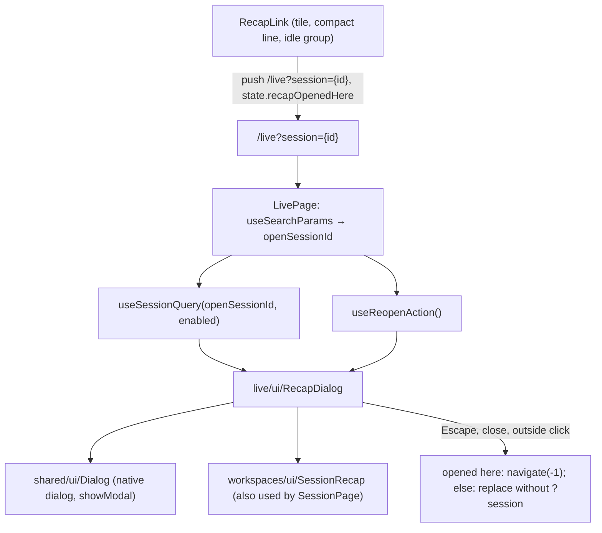

# Live page: a session's recap in a dialog

Feature: `live-sessions` · Components: `web` · Spec: FR-10, FR-42, FR-43, FR-44, FR-45, FR-46, FR-47, BR-01, BR-18

## Context

The spec (commit 2cce3b6) changes the arrow (↗) of the live page (FR-10). It no longer leaves for `/sessions/:id`. It opens the same recap in a dialog over the board (FR-42), with:

- links to the full page, the workspace and the dashboard (FR-43);
- closing with `Escape`, a close button or an outside click, the board left as the person had it (FR-44);
- an address that names the open dialog (FR-45);
- a board that keeps updating behind it, the dialog staying open when its session leaves the page (FR-46);
- full screen on a phone (FR-47).

**Web only: no api stage.** Everything the dialog needs is already served:

- `GET /v1/sessions/{sessionId}` returns the recap the stored page draws;
- `LiveSession.isStored` already says whether the arrow is active (FR-10, unchanged).

No contract, no `openapi.json` change. The single stage is `web`.

Today the arrow is `web/src/features/live/ui/RecapLink.tsx`. It is a `<Link to="/sessions/{id}">`, used by exactly the three places FR-42 names:

- `LiveSessionTile.tsx` (the tile);
- `CompactSessionLine.tsx` (the compact line);
- `IdleGroup.tsx` (the folded `Idle` group).

The recap itself is drawn inline by `features/workspaces/pages/SessionPage.tsx`.

## Decisions

- **The arrow becomes a search-param link, not a callback** → `RecapLink` keeps its props (`sessionId`, `title`, `isStored`) and only changes its target to `/live?session={id}`. This affects its three callers:
  - the tile, the compact line and the idle group stay untouched;
  - no `onOpenRecap` callback is threaded through `LiveBoard`, `CompactBoard`, `LiveColumn` and their lines;
  - the URL is the dialog's single source of truth (FR-45).
- **The recap is extracted once, never duplicated** → the body of `SessionPage` moves to a presentational `workspaces/ui/SessionRecap.tsx` that both the page and the dialog render (FR-42: "the same recap").
- **A generic `shared/ui/Dialog`** → a native `<dialog>` with a title, a close button and children, following the skin's `.dialog` recipe. `ConfirmDialog` stays as it is: its shape is a confirmation, not a container.
- **Data in the page** → `LivePage` calls `useSessionQuery` and `useReopenAction`, as the web conventions want (UI components take props). `useSessionQuery` gains an optional `enabled` option so that it fetches only while a dialog is open.

## Decisions taken autonomously

- Branch → `develop`, no new branch (the caller asked to stay on `develop`; the person works there directly).
- Review → a review after the stage (autopilot's default, ` — with review`).
- Stage order → `web` alone (the manifest's order; the api is untouched).
- Spec status → already `Approved`, no spec delta in this plan (commit 2cce3b6 holds the whole business change).
- Search param name → `session` (`/live?session={sessionId}`) (short, reads as what it names, collides with no existing param of `/live`).
- How the arrow opens the dialog → a `<Link>` push with `state: { recapOpenedHere: true }` and `preventScrollReset` (a push makes the browser's back button close it, FR-45).
- How the dialog closes → when `location.state.recapOpenedHere` is true, `navigate(-1)`; otherwise (a reload, a pasted address) `navigate` to `/live` without `session`, `replace: true`, `preventScrollReset: true`. Back must close the dialog, never add an entry, and a dialog opened from a fresh load must not leave the app on close.
- Back button and the FR-28 filter → `LivePage` applies a new key's `workspace` state only on a `PUSH` or `REPLACE` navigation (`useNavigationType()`), never on `POP`. Going back to an older entry that holds a notification's `workspace` would otherwise reset the filter the person changed since (FR-44: "same workspace filter"). A push from the arrow carries no `workspace`, so it never changes the filter.
- Where the dialog renders → in `LivePage`'s `<main>`, outside `renderContent()`. That function returns early while loading, on an error, an unreadable folder or an empty board, and the dialog must survive all of them (FR-46).
- Is the dialog's session still on the board? → irrelevant. The dialog opens from the URL alone, never from the board's list (FR-46, BR-01: the stored history outlives the process).
- Unknown or deleted session id in the address → the dialog shows `session.state.notFound` ("Cette session n'existe pas."); its close works as usual (same message as the stored page).
- Dialog title while loading or on an error → `live.recap.title` ("Récapitulatif"); once loaded, the session's title (the dialog always has an accessible name).
- Outside click → a `click` on the `<dialog>` whose `event.target` is the `<dialog>` element itself closes it. The `<dialog>` has `padding: 0` and an inner wrapper carries the padding, so that a click in the padding is not "outside".
- Focus back on the arrow (FR-44) → the native `close()` restores focus to the opener when that node still exists. A poll can re-mount it: a tile changing column, the compact mode toggled behind the dialog. So, after closing, when `document.activeElement` is `body` (or null), `LivePage` focuses `[data-recap-session="{id}"]` (the attribute `RecapLink` now carries), and otherwise does nothing. The focus never moves elsewhere: a session that left the board has no arrow to return to.
- Scroll (FR-44) → the router has no `ScrollRestoration` (checked: `router.tsx`, `AppLayout.tsx`), and `preventScrollReset` is set anyway. `showModal()` does not scroll the page. No scroll lock is added, since the backdrop covers the board.
- Phone size (FR-47) → under `max-width: 640px` the dialog takes `width: 100vw`, `height: 100dvh`, `max-width/max-height: none`, `margin: 0`, `border-radius: 0` (the breakpoint the live page's columns already switch at is not shared; 640 px is a phone).
- Desktop size → `width: min(960px, calc(100% - 32px))`, `max-height: calc(100dvh - 64px)`; the header (title, links, close) stays fixed and the recap scrolls inside (a long activity must not push the close button away).
- A notification click or a navigation link while the dialog is open → it navigates away and the dialog closes with the page (non-goal: the spec names only `Escape`, the close button and the outside click; the next page's own rules apply).
- `ReopenActions` in the dialog → shown, as on the stored page. `useReopenAction` already applies BR-18: no `ResumeCommand` for a live session (the spec's decision: no new rule).
- Review: no retry exception for a 404 in `useSessionQuery` (an unknown id shows "loading" a few seconds before the not-found message) → left as is (pre-existing behaviour, shared with the stored page; changing the query's retry policy is out of this plan's scope).
- Review: the recap's section headings are `h2` like the dialog's title → accepted (the plan wants the same recap in both places; a heading-level option would be speculative).
- The full page link (FR-43) → a plain `<Link to="/sessions/{id}">` labelled `live.recap.fullPage` ("Ouvrir la page complète"). It navigates in the same tab, and a middle click opens a new tab natively.

## web

### data

- `features/workspaces/data/useSessionQuery.ts`: signature `useSessionQuery(sessionId: string, options?: { enabled?: boolean })`; pass `enabled: options?.enabled ?? true` to `useQuery`. `SessionPage` keeps calling it without options.

### pages

- `features/workspaces/pages/SessionPage.tsx`: keep the loading and error states, and the header (the back link to the workspace, the dashboard link, `PageTitle`, `ReopenActions`). Replace the facts and the four sections with `<SessionRecap session={session} />`. No visible change on the stored page.
- `features/live/pages/LivePage.tsx`:
  - read `const [searchParams] = useSearchParams(); const openSessionId = searchParams.get("session");`;
  - `const recapQuery = useSessionQuery(openSessionId ?? "", { enabled: openSessionId !== null });` and `const reopenActionOf = useReopenAction();`;
  - `const navigationType = useNavigationType();` the FR-28 block applies `requestedWorkspace` only when `navigationType !== "POP"` (see Decisions taken autonomously). It still records `appliedKey` on every key change;
  - `closeRecap()`: if `location.state` has `recapOpenedHere === true`, `navigate(-1)`; else `navigate({ pathname: "/live" }, { replace: true, preventScrollReset: true })`. Then restore the focus as decided: a `requestAnimationFrame` (after the dialog's own focus restoration) that, when `document.activeElement` is `document.body` or null, focuses `document.querySelector('[data-recap-session="' + CSS.escape(id) + '"]')` if present. The id is remembered before navigating;
  - render `{openSessionId !== null && <RecapDialog … />}` as the last child of `<main>`, outside `renderContent()`, with:
    - `sessionId={openSessionId}`;
    - `state` derived from `recapQuery`: `{ kind: "loading" }`, `{ kind: "notFound" }` (an `ApiError` with status 404), `{ kind: "error", message }`, or `{ kind: "loaded", session, reopenAction: reopenActionOf(session) }`;
    - `onClose={closeRecap}`;
  - the `location.state` reader is a small typed function beside `readWorkspaceState` (`readRecapOpenedHere(state: unknown): boolean`).

### ui

- **New** `shared/ui/Dialog.tsx` and `Dialog.module.css`: a generic modal container.
  - Props: `title: ReactNode`, `closeLabel: string`, `actions?: ReactNode` (rendered in the header beside the close button), `children`, `onClose(): void`. It is shown while mounted: `showModal()` in an effect guarded by `!dialog.open` (StrictMode), as in `ConfirmDialog`.
  - `aria-labelledby` from `useId()` on the `<h2>`.
  - `onCancel` (Escape): `event.preventDefault()` then `onClose()`. `onClose` of the element: if still mounted, call `onClose()` (a repeated Escape the browser cannot prevent), as in `ConfirmDialog`.
  - `onClick`: `if (event.target === event.currentTarget) onClose()`.
  - Close button: `Button variant="ghost"` with a cross icon (add `CloseIcon` to `icons.tsx`) and `aria-label={closeLabel}`.
  - Structure: `<dialog>` (padding 0) › `.frame` (grid, `grid-template-rows: auto 1fr`, max-height as decided) › `.header` (title, actions, close; sticky) and `.body` (`overflow: auto`, padding 24px).
  - Styles follow the `.dialog` recipe (`--pop-bg`, `--border`, `--radius`, `--shadow-pop`, `--blur`, `::backdrop` `--scrim`, the fade). Desktop and phone sizes as decided; skin variables only.
  - Register it in `web/CLAUDE.md`'s `shared/ui` list (see Conventions).
- **New** `features/workspaces/ui/SessionRecap.tsx` and `SessionRecap.module.css`: props `{ session: SessionDetail }`, the type `components["schemas"]["SessionDetail"]`, as `SessionFacts` declares it. It renders `SessionFacts` and the four sections (tokens per model, activity, subagents, tools) exactly as `SessionPage` does now, with the same i18n keys. Its module holds copies of `pages.module.css`'s `.section` and `.sectionTitle`; `pages.module.css` is left unchanged (`WorkspacesPage` still uses `.section`).
- **New** `features/live/ui/RecapDialog.tsx` and `RecapDialog.module.css`: props `{ sessionId: string; state: RecapDialogState; onClose(): void }`. It renders `Dialog` with:
  - `title`: the session's title when loaded, else `t("live.recap.title")`;
  - `closeLabel`: `t("live.recap.close")`;
  - `actions` when loaded: `ReopenActions` (`action`, `title`);
  - body by state:
    - `loading`: `LoadingState` with `common.state.loading`;
    - `notFound`: `ErrorMessage` with `session.state.notFound`;
    - `error`: `ErrorMessage` with `common.state.error`;
    - `loaded`: a links row (FR-43), then `<SessionRecap session={session} />`. The links row has, side by side and wrapping, styled like the stored page's links: `Link` to `/sessions/{id}` (`live.recap.fullPage`), to `/workspaces/{workspace.id}` (`session.page.back`) and to `/dashboard?workspace={workspace.id}` (`session.page.dashboard`).
- `features/live/ui/RecapLink.tsx`: the stored case becomes `<Link to={{ pathname: "/live", search: "?session=" + encodeURIComponent(sessionId) }} state={{ recapOpenedHere: true }} preventScrollReset data-recap-session={sessionId} …>`, same class, label and icon. The greyed case is unchanged. Update its comment (FR-10, FR-42). The tile, the compact line and the idle group are **not** edited.
- `shared/lib/i18n/fr.json`: add
  - `live.recap.title`: "Récapitulatif";
  - `live.recap.close`: "Fermer le récapitulatif";
  - `live.recap.fullPage`: "Ouvrir la page complète".

  `live.tile.recapLabel` ("Récap de la session : {title}") stays: it names the recap, not a page.

## Conventions

- `web/CLAUDE.md`, Structure: add `Dialog (a native <dialog> holding any content: title, close button, actions; full screen on a phone)` to the `shared/ui` list after `ConfirmDialog`, and `CloseIcon` to `icons.tsx`'s list. Rationale: the list is the inventory the next feature reads before adding a component.

## Tests

- **web**: no unit tests (web/CLAUDE.md: the front has no unit tests; never a `*.test.tsx`). Checked by its build, the lint of the changed files and the browser test below.
- **api**: not touched, no tests.
- **Integration tests**: none.

Browser test scenarios, against the demo (api `npm run demo`, web `npm run dev:demo`; check `/api/v1/live`'s `sessionsDir` ends in `fixtures/live-demo/sessions`). The demo's database is wiped at each start, so run a `Refresh` from the workspaces page first, until the live arrows are active:

1. On `/live`, click a tile's ↗: the dialog opens over the board, the address becomes `/live?session={id}`, and the recap shows facts, tokens, activity, subagents and tools (FR-42).
2. `Escape` closes it: the address is `/live` again, the board has the same filter, compact mode and scroll, and the focus is on the arrow (FR-44). Repeat with the close button and with a click on the backdrop. A click inside the dialog's padding does not close it.
3. Open from a compact line (compact mode on) and from the unfolded `Idle` group: same dialog (FR-42).
4. With the dialog open, reload: it reopens. Close it: the address is `/live`, the page stays in the app (FR-45). Open again from an arrow, then press the browser's back button: the dialog closes, the filter unchanged (FR-45, FR-44).
5. Pick a workspace in the filter, open a recap, press back: the filter is still that workspace.
6. With the dialog open, the board behind keeps updating (the "mis à jour il y a" counter and the statuses move) (FR-46). Close a demo session's process (or wait for one to leave) while its dialog is open: the dialog stays (FR-46).
7. `/live?session=does-not-exist`: the dialog says "Cette session n'existe pas." and closes normally.
8. In the dialog, the full page link opens `/sessions/{id}`; back returns to the open dialog. The workspace and dashboard links leave the live page (FR-43).
9. At 375 px wide (mobile preset), the dialog fills the screen and its content scrolls; the close button stays visible (FR-47).
10. `/sessions/{id}` (the stored page) looks as before the change.
11. A not-yet-stored session's arrow is still greyed and inert (FR-10).

## Deviations

- Focus back on the arrow (FR-44) → restored by an effect of `LivePage` when `?session` goes from an id to none, not by a `requestAnimationFrame` in `closeRecap()`. `navigate(-1)` is processed asynchronously, so a frame queued after it could run while the dialog is still mounted. An open `<dialog>` removed from the page does not restore the focus natively, and the browser's back button never goes through `closeRecap()`. The effect covers every way out. Same rule: when the focus is on the body, the arrow found by `data-recap-session` gets it, otherwise nothing.
- `Dialog` calls `onClose` at most once per mount (a ref). Escape, the native close of a repeated Escape, the button and the outside click may follow each other before the page unmounts it, and a second call would navigate back twice. Its effect only opens the dialog; no `close()` in a cleanup (under StrictMode its asynchronous `close` event would land after the re-mount).
- The dialog's close button is `Button variant="quiet"`, not `ghost`: the ghost button hovers toward `--danger`, and closing is not destructive (the same reason as `web/CLAUDE.md`'s `ButtonLink` rule).
- An outside click closes the dialog only when the press and the click both land on the `<dialog>` element itself (a `pointerdown` ref): a text selection released over the backdrop does not close it.
- The focus goes back to the arrow with `preventScroll: true` (FR-44: the same scroll), and an empty `?session=` counts as no dialog.
- `RecapDialog` takes no `sessionId` prop (unused: the loaded session carries its id); `LivePage` keys it by the open id instead, so that another session gets a fresh dialog.

## Progress

### Stage 1 — web
Commit: `feat(live-sessions): web — recap dialog from the live page`
- [x] Prepare: client regenerated from `api/openapi.json`
- [x] data: `useSessionQuery` takes an optional `enabled`
- [x] ui: `shared/ui/Dialog` and `CloseIcon`
- [x] ui: `workspaces/ui/SessionRecap` extracted from `SessionPage`
- [x] ui: `live/ui/RecapDialog`; `RecapLink` points to `/live?session={id}` with `recapOpenedHere` and `data-recap-session`
- [x] ui: i18n keys `live.recap.*`
- [x] pages: `SessionPage` renders `SessionRecap`
- [x] pages: `LivePage` opens the dialog from `?session`, closes it by history, restores focus, applies FR-28 only on PUSH/REPLACE
- [x] Conventions: `web/CLAUDE.md` lists `Dialog` and `CloseIcon`

## Validation

- [x] Review: the `reviewer` agent on the plan's implementation, its findings settled
- [-] Browser test: not run (autopilot without browser test)
