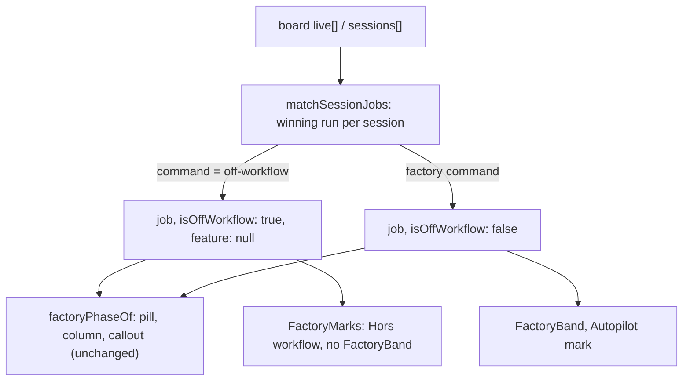

# Live page: an off-workflow session keeps its run's phase and recap

Feature: `live-sessions` · Components: `api`, `web` · Spec: FR-32, FR-33, FR-34, FR-36, FR-37, BR-20, BR-21

## Context

The spec (commit c09ee2e) revises FR-34. A session typed without a `/factory:` command is `OffWorkflow`. When the factory-board mod records it as a free request (a run with `command: "off-workflow"`, factory-board FR-31), that run now sets the tile like a factory run's:

- its pill, its column and its callout follow the run's `FactoryPhase` (FR-32, BR-20, BR-21);
- `Job done` shows the `Récap` callout (FR-37), or the last reply when the board gives no recap;
- `Commit à valider` goes to `Vous attend` with the subject of its `PendingCommit` (FR-36);
- the tile keeps the grey `Hors workflow` mark and shows no factory band (FR-33, FR-34).

Today `matchSessionJobs` (`api/src/features/factory/factory.service.ts`) deletes the session's job when the winning run is off the workflow. The tile then falls back to its `LiveStatus` (`Terminée` and the last reply). The factory-board mod 0.11.0 already exports `phase`, `recap` and `pendingCommit` on these runs (checked on 2026-10-21: a `job-done` run with its recap reads `Terminée` on the live page).

This plan supersedes the off-workflow lines of `20261020-222736-add-factory-phases/plan.md` (an off-workflow winning run gives no job). That plan stays as it is.

## Decisions

- **The job carries an explicit flag** → `FactorySessionJob.isOffWorkflow: boolean`, always present, set by the api from `run.command === "off-workflow"`. The front never compares the command string itself: the mod's command name stays an api detail.
- **The winning run is still the job** → an off-workflow live run still beats an older factory entry of the same session in the board's `sessions[]`. The older factory band never comes back while the session works off the workflow. Only the deletion is dropped.
- **Both sources are flagged** → an off-workflow run can come from `live[]` or from `sessions[]`. The flag reads the run's command, whatever its source.
- **The phase logic of the front is unchanged** → `factoryPhaseOf`, `bucketOf`, `commitSubjectOf`, `tileState` and the notifications already read `session.factory.run`. With the job kept, they give the pill, the column, the callout and BR-20 for free. Only the marks and the band test the flag.
- **A stale board** → BR-21 already gives the `LiveStatus` for a stale job (`factoryPhaseOf` returns null). An off-workflow tile shows no band, so the FR-35 `au dernier scan` note does not show for it. This is intended: FR-35 is a band's note, and FR-34 gives an off-workflow tile no band.
- **The next-step button** → `NextStepButton` already returns nothing for a job with no feature, and an off-workflow job has none. No change.
- **A demo session for the new case** → the live demo gains a tenth session, an idle off-workflow session whose run reads `job-done` with a recap, so that the browser test checks the done criterion on the demo.

## api

### services

`src/features/factory/factory.service.ts`:

- `toJob` sets `isOffWorkflow: run.command === OFF_WORKFLOW`.
- `matchSessionJobs`: the loop over `[...sessions, ...live]` always sets `toJob(candidate)`; the `jobs.delete(sessionId)` branch goes. The rest stays: a live run wins over a session entry, the main loop over a subagent, then the latest change.
- Rewrite the comment above `matchSessionJobs`. The last sentence becomes: live-sessions FR-34, an off-workflow winning run is the session's job too, flagged `isOffWorkflow`, so an older factory run of the same session never shows while it works off the workflow.

`scripts/demo/live-demo.ts` (the demo dataset):

- A tenth `DEMO_SESSIONS` entry, `situation: "Off-workflow job done"`: title `Board export check`, `cwd: COMPANION`, branch `develop`, origin `desktop` with a `hostSessionId`, `startedMin: 18`, `status: "idle"`, `statusMin: 4`. Add its id `OFF_WORKFLOW_DONE` to the destructuring and its tuple type.
- Its log (`linesOf`): the title, a prompt (`Check what the board exports for a free request`, 18 min ago) and a reply (`The export carries the phase and the recap of a free request.`, 4 min ago).
- On the fresh board, an `ExportRun` in `live[]`: `command: "off-workflow"`, `step: "off-workflow"`, `feature: null`, `folder: null`, `status: "done"`, `phase: "job-done"`, `recap: { text: "The board export of a free request is checked.", commits: [] }`, `since: ago(18)`, `updatedAt: ago(4)`.

### routes

`src/features/factory/factory.schema.ts`, `factorySessionJobSchema`: add `isOffWorkflow: z.boolean()` after `source`, with the comment: the run is the factory-board mod's record of a free request (live-sessions FR-34): it has a phase and a recap, no feature and no step to draw.

Handoff: `api/openapi.json` regenerated (`FactorySessionJob.isOffWorkflow`, required).

## web

Prepare: `src/api/schema.d.ts` regenerated from `api/openapi.json`.

### ui

`src/features/live/ui/board.ts`:

- New `isOffWorkflow(session: BoardSession): boolean`: true when `session.factory` is null or `session.factory.isOffWorkflow`. Comment: FR-34, a session no board knows, or whose run is a free request.
- New `factoryBandJob(session: BoardSession): FactorySessionJob | null`: the job when the session has one and it is not off the workflow, else null. Comment: FR-33, the job a factory band draws.

`src/features/live/ui/LiveSessionTile.tsx`:

- `FactoryMarks`: the `Hors workflow` mark when `isOffWorkflow(session)`; otherwise the `Autopilot` mark as today. Update its comment (FR-34: no board knows it, or its run is a free request).
- The band: render `FactoryBand` from `factoryBandJob(session)` instead of `session.factory`.
- The tile comment for FR-02 stays.

`src/features/live/ui/CompactSessionLine.tsx`:

- The factory cell: render `FactoryBand` (`isCompact`) from `factoryBandJob(session)`, then `FactoryMarks` as today.

Unchanged and checked by the browser test: the pill (`pillLabel` of the phase), the column (`bucketOf`, BR-20), the commit callout (`commitSubjectOf`), the recap callout and its fallback to the last reply, `Clôturer` as the primary action on `Job done`, the notifications.

## Tests

**api** (route tests, `test/live/live.routes.test.ts`, the `factory` block):

- Replace `gives no factory job when the session's latest run is off the workflow` with `keeps the phase and the recap of the session's off-workflow run, flagged off the workflow`. Same arrangement (an off-workflow `live[]` run beside an older factory `sessions[]` entry of the same session), the live run now with `status: "done"`, `phase: "job-done"` and a recap with one commit. Assert `factory` matches `{ source: "live", isOffWorkflow: true, feature: null, run: { command: "off-workflow", phase: "job-done", recap } }`.
- New: `keeps the pending commit of an off-workflow run waiting for its validation`. A `live[]` off-workflow run with `status: "waiting"`, `phase: "awaiting-commit"`, `pendingCommit`. Assert `isOffWorkflow: true` and `run.pendingCommit`.
- New: `flags an off-workflow run of the board's session entries`. A `sessions[]` off-workflow entry only. Assert `{ source: "session", isOffWorkflow: true }`.
- New: `flags a factory run as on the workflow`. A `live[]` run with a factory command. Assert `isOffWorkflow: false`.

**api** (demo test, `test/demo/live-demo.test.ts`):

- `serves the nine demo sessions…` becomes `serves the ten demo sessions…`, with the tenth: `{ status: "idle", factory: { isOffWorkflow: true, feature: null, run: { phase: "job-done" } } }` and its recap text.
- The running off-workflow session: `factory: null` becomes `factory: { isOffWorkflow: true, run: { phase: "working" } }`.

Integration tests: none (the api has none for this area).

**web**: none: the front has no unit tests (`web/CLAUDE.md`). The browser test covers it, on the demo.

## Deviations

- The plan's api tests → also `isOffWorkflow: false` in the existing exact `toEqual` of `attaches the board's live run…`, and a tenth pid in the demo test's `PIDS` (both needed by the new required field and the tenth demo session).

## Progress

### Stage 1 — api
Commit: `fix(live-sessions): api — an off-workflow run keeps its phase and recap`
- [x] services: `toJob` sets `isOffWorkflow`; `matchSessionJobs` keeps the off-workflow job; comment rewritten
- [x] services: demo session `Off-workflow job done` with its log and its board run
- [x] routes: `FactorySessionJob.isOffWorkflow`
- [x] Tests: the live route tests and the demo test
- [x] Handoff: `api/openapi.json` exported

### Stage 2 — web
Commit: `fix(live-sessions): web — an off-workflow tile reads its run's phase`
- [ ] Prepare: client regenerated from `api/openapi.json`
- [ ] ui: `isOffWorkflow` and `factoryBandJob` in `board.ts`
- [ ] ui: `FactoryMarks` and the band of `LiveSessionTile`
- [ ] ui: the band of `CompactSessionLine`

## Validation

- [ ] Review: the `reviewer` agent on the plan's implementation, its findings settled
- [ ] Tests: the full `test` command of `api` green on the plan's final code
- [ ] Browser test: the change tested in `web` (`test-in-browser` skill), on the demo: `Board export check` reads `Job done`, its `Récap` and `Hors workflow`, no band; `Live screen mockups` reads `Au travail` and `Hors workflow`, no band
