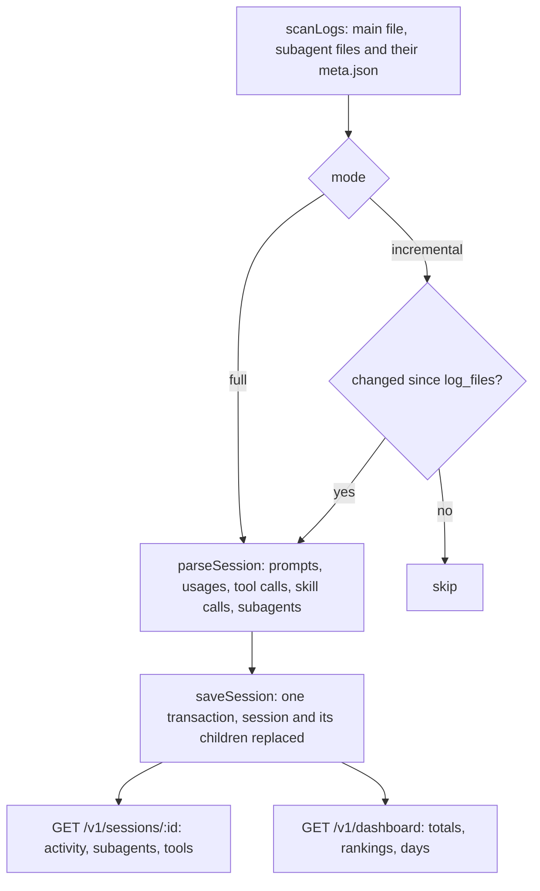

# Session activity and dashboard

Feature: `session-activity` · Components: `api`, `web` · Spec: FR-01–FR-14, BR-01–BR-09

## Context

Session ingestion keeps the prompts and the tokens of each session. This iteration makes the parser also read what Claude Code did: tool calls, skill calls and subagents (type, model, description, tokens, tool calls). It stores them beside the session and adds a full refresh, so the sessions stored before this feature get their activity. The session page gains an activity timeline, a subagents table and a tools table. A new dashboard page shows the totals, the rankings and the activity per day of a period, over all workspaces or one.

## Decisions

Facts read from the local logs (287 sessions, 185 subagent files, 12,595 tool calls) that the parser must honour:

- Tool calls → `tool_use` content blocks of `assistant` lines, in the main file and the subagent files; the same `tool_use.id` can appear on several lines (166 repeats) → deduplicated by id per session. Results → `tool_result` blocks of `user` lines, matched by `tool_use_id`; `is_error: true` is a failure, a result without `is_error` a success, no result at all is neither (BR-08: `isError` null). No main file holds `isSidechain` tool calls, so a main-file call is always the session's own.
- MCP server (BR-04) → a tool name `mcp__{server}__{tool}` belongs to `{server}` (`name.split("__")[1]`): real names include `Claude_Browser`, `claude-in-chrome` and UUID connectors; a name with fewer than three parts or an empty server is a built-in tool.
- Skill tool → `name: "Skill"`, `input: { skill, args? }`; agent tool → `name: "Agent"` (older logs: `"Task"`), `input: { subagent_type, description, model?, prompt }`. Both count as tools too (BR-03).
- Typed skill calls (BR-01, BR-02) → a `user` line of the main file holding `<command-name>`, under the prompt filter of session-ingestion (not `isMeta`, `isSidechain`, compact summary, transcript-only; origin absent or `human`). The name is the tag's content without its leading `/`, plugin prefix kept. Names in the `BUILT_IN_COMMANDS` constant of the parser are not skills: `add-dir`, `advisor`, `agents`, `bashes`, `bug`, `clear`, `compact`, `config`, `context`, `cost`, `doctor`, `effort`, `exit`, `export`, `extra-usage`, `fast`, `feedback`, `help`, `hooks`, `ide`, `init`, `login`, `logout`, `mcp`, `memory`, `model`, `output-style`, `permissions`, `plugin`, `pr-comments`, `privacy-settings`, `release-notes`, `reload-plugins`, `remote-control`, `resume`, `review`, `rewind`, `security-review`, `status`, `statusline`, `terminal-setup`, `theme`, `todos`, `upgrade`, `usage`, `usage-credits`, `vim`. Any other name counts, even one that is not a known skill (`/x` in the logs): the application cannot tell a mistyped command from a project skill.
- Skill expansions → after a Skill tool call, Claude Code writes an `isMeta` sidechain line holding `<command-name>{skill}</command-name>` (34 lines): never counted, the Skill tool call already is.
- Plugin-sent commands → `origin.kind: "plugin"` lines holding `<command-name>` (`/session-debug`, `/ponytail:ponytail`) → a skill call with `isTyped: false` (Claude Code ran it, not the person), unless built-in; still not a prompt.
- Subagent identity → one subagent per `{session}/subagents/agent-{agentId}.jsonl` file; its sibling `agent-{agentId}.meta.json` holds `agentType` (always), `description`, `toolUseId` (182/184: the `tool_use.id` of the Agent call that launched it, in the main file or in another subagent's file for nested agents), rarely `model` (13/184, an alias). A meta file that is missing or unreadable is `null`. Fallback link: the Agent call's `tool_result` line carries `toolUseResult.agentId`.
- Subagent fields → `agentType`: meta, else the linked Agent call's `subagent_type`, else `general-purpose` (Claude Code's default type); `description`: meta, else the Agent call's, else empty; `model`: the model with the most input + output tokens among the subagent's own assistant lines (`<synthetic>` skipped), else the meta's or the Agent call's alias, else null; `launchedAt`: the Agent call's timestamp, else the subagent file's first timestamp, else the session's start; tokens per model from its own assistant lines (deduplicated by `message.id` within the file); `toolCallCount` from its own file.
- BR-09 → an Agent call no subagent file links to (by meta `toolUseId` or `toolUseResult.agentId`) is a subagent with `agentId` = the call's `tool_use.id`, `isLogMissing: true`, type and description from the call's input, model the input's alias or null, no tokens, no tool calls.
- `sessions.subagentCount` → the number of subagents including the missing-log ones (BR-09: launched), no longer the number of files.
- The meta files are read at parse time only; change detection (`log_files`) still compares the `.jsonl` files alone (a meta file is written once, when the agent starts).
- Session timeline (FR-06) → served ready-made by the api as one `activity` list replacing `prompts` in `SessionDetail` (its only reader is the web, updated in the same plan): prompts, skill calls and subagents sorted by time, ties kept in log order (prompt, then skill, then subagent). A typed skill call is also a prompt: it shows once, as the skill call (`skill_calls.promptPosition` links them; the prompt with that position is left out of `activity`).
- Full refresh (FR-05) → `POST /v1/refresh?mode=full` (default `incremental`); it re-reads every scanned session whatever `log_files` says; BR-06 holds for both modes (a call while a run is in progress returns that run's status, whatever the mode). The report gains `mode` and `sessionsRead` (sessions parsed by the run), which says how many were re-read. Archived sessions have no log left: their activity stays empty after a full refresh.
- New `NOT NULL` columns on existing tables get defaults (`0`, `'{}'`, `'incremental'`), since local databases already hold rows. Child rows are bulk-inserted by chunks of 500 (the largest session has 424 tool calls; Postgres caps a statement at 65,535 parameters).
- Dashboard (FR-08–FR-12) → one endpoint `GET /v1/dashboard`, one call per selector change. Period (BR-06) → `startedAt >= clock.now() - N days` (7, 30, 90), no lower bound for `all`. Workspace filter → `workspaceId` optional; FR-14 → `includeScratch` (default `false`) excludes the Scratch group only when no workspace is chosen (a Scratch session's page links to its own dashboard). Archived sessions count (BR-07).
- Per-day buckets (FR-12) → by the session's start day in the person's time zone: the web sends `timeZone` (IANA name from `Intl.DateTimeFormat().resolvedOptions().timeZone`, default `UTC`), the repository groups with `(started_at at time zone $tz)::date` (a parameterised `sql` template: the one documented raw-SQL case), the service fills the days without session with zeros, from the period's first day (for `all`, the first session's day) to today.
- Rankings → each item carries the figure it is ranked by plus, when no workspace is chosen, `byWorkspace` (FR-11); one grouped query per ranking (by name and workspace), the service folds it. Agent types carry runs and tokens, sorted by runs; the web lets the person sort them by tokens (FR-10). Models are ranked by input + output tokens, the figure the pages show (session-ingestion's decision). Tools and MCP servers count every call, sub-agents' included (BR-05).
- Scratch switch across pages (FR-14) → the `scratch=1` search parameter: the workspaces page's dashboard link carries it, the dashboard has the same switch and its back link keeps it.
- Per-day chart → plain CSS bars on the skin's tokens, no chart library (`web/package.json` has none and the chart is two bar series).
- Squash base → the branch was cut from `feat/session-ingestion-first-recap`, not from `develop` (which lacks session-ingestion): the squash range is `git merge-base feat/session-ingestion-first-recap HEAD`..`HEAD`.

## api

### db

`src/features/workspaces/workspaces.table.ts` (the session's children stay beside `prompts` and `sessionModelUsages`):

- `sessions` gains `toolCallCount` integer, `failedToolCallCount` integer, `skillCallCount` integer (all default `0`), `agentTypes` text array default `'{}'` (distinct, sorted) (FR-04).
- `toolCalls`: `sessionId` FK → `sessions.id` on delete cascade; `toolUseId` text; `agentId` text null (null: the session itself); `name` text; `mcpServer` text null; `calledAt` timestamptz; `isError` boolean null (BR-08); PK `(sessionId, toolUseId)`; index on `name`.
- `skillCalls`: `sessionId` FK cascade; `position` integer; `name` text; `args` text null; `calledAt` timestamptz; `isTyped` boolean; `agentId` text null; `promptPosition` integer null; PK `(sessionId, position)`.
- `subagents`: `sessionId` FK cascade; `agentId` text; `agentType` text; `model` text null; `description` text; `launchedAt` timestamptz; `toolCallCount` integer; `isLogMissing` boolean; PK `(sessionId, agentId)`.
- `subagentModelUsages`: `sessionId`, `agentId`, FK `(sessionId, agentId)` → `subagents` on delete cascade; `model` text; the four bigint counters (mode `number`); PK `(sessionId, agentId, model)`.

`src/features/ingestion/ingestion.table.ts`: `refreshRuns` gains `mode` text enum `incremental | full` default `incremental` and `sessionsRead` integer default `0`.

Migration: `npx drizzle-kit generate --name session_activity` (the `drizzle-migrations` skill), SQL reviewed for the defaults.

### services

`src/features/ingestion/ingestion.source.ts`:

- `ScannedSession.subagentFiles` items become `SubagentFileStat = FileStat & { agentId: string; metaPath: string }` (`agentId` from `agent-{agentId}.jsonl`, `metaPath` the sibling `agent-{agentId}.meta.json`, which may not exist).
- `readMeta(path) → unknown | null`: `readFile` + `JSON.parse`, `null` when missing or unreadable. Read only (BR-01 of session-ingestion).

`src/features/ingestion/ingestion.parser.ts`:

- Input: `subagentFiles: { agentId: string; lines: string[]; meta: unknown }[]` (the meta narrowed by a loose zod schema: `agentType`, `description`, `toolUseId`, `model`, all optional).
- `ParsedSession` gains `toolCalls: ParsedToolCall[]` (`toolUseId`, `agentId | null`, `name`, `mcpServer | null`, `calledAt`, `isError: boolean | null`), `skillCalls: ParsedSkillCall[]` (`name`, `args | null`, `calledAt`, `isTyped`, `agentId | null`, `promptPosition | null`; in time order), `subagents: ParsedSubagent[]` (`agentId`, `agentType`, `model | null`, `description`, `launchedAt`, `usages: ModelUsage[]`, `toolCallCount`, `isLogMissing`), and `toolCallCount`, `failedToolCallCount`, `skillCallCount`, `agentTypes`; `subagentCount` becomes `subagents.length`. Rules: see Decisions. `ParsedPrompt` gains its `position` (index in `prompts`), so a typed skill call names it.
- Exported pure helper `mcpServerOf(toolName) → string | null` (BR-04).
- Assistant lines are read through a second loose schema (`message.content` blocks `tool_use` with `id`, `name`, `input`); the usage schema stays as it is.

`src/features/ingestion/ingestion.service.ts`:

- `start({ mode })` and `refresh({ mode })`, `mode: "incremental" | "full"` (default `incremental`); `full` skips `hasChanged`. Reads each subagent's meta through `readMeta`. Counts `sessionsRead` (parsed sessions, `null` results included). Records `mode` and `sessionsRead` in the run.

`src/features/workspaces/workspaces.repository.ts`:

- `saveSession` also writes the session's new counters and inserts its tool calls, skill calls, subagents and subagent usages, in chunks of 500 rows, in the same transaction (the delete of the session cascades to the old ones).
- `sessionColumns` gains the four counters; `findSession` also returns `skillCalls` (ordered by `position`), `subagents` with their usages (one `inArray` query), and `tools`: tool calls grouped by `name`, `mcpServer` with `count(*)` and `count(*) filter (where is_error)` (Drizzle `sql` count expression), ordered by count desc then name.

`src/features/workspaces/workspaces.service.ts`:

- `toSessionSummary` adds `toolCallCount`, `failedToolCallCount`, `skillCallCount`, `agentTypes`.
- `getSession` builds `activity` (Decisions), `subagents` (tokens summed over models, sorted by `launchedAt`) and `tools`.

`src/features/dashboard/dashboard.repository.ts` (new feature folder; reads only, every query joins `sessions` and `workspaces` and takes one `DashboardFilter = { since: Date | null; workspaceId: number | null; includeScratch: boolean }` turned into one `where` by a local helper):

- `totals(filter)`: session count, prompt sum, tool call sum, skill call sum over `sessions`; subagent count over `subagents`; the four token sums over `sessionModelUsages`.
- `agentTypes(filter)`: per `agentType` and workspace: run count, the four token sums of `subagentModelUsages`.
- `skills(filter)`, `tools(filter)`, `mcpServers(filter)` (`mcpServer` not null): per name and workspace, call count.
- `models(filter)`: per model and workspace, the four token sums of `sessionModelUsages`.
- `days(filter, timeZone)`: per local start day, session count and the four token sums.
- `firstSessionStart(filter)` for the `all` period's first day.

`src/features/dashboard/dashboard.service.ts`: `createDashboardService({ dashboardRepo, clock })` → `getDashboard({ period, workspaceId, includeScratch, timeZone })`: computes `since`, runs the queries, folds the per-workspace rows into ranked items (`byWorkspace` sorted like the items, omitted — empty array — when a workspace is chosen), fills the days, returns the `Dashboard` contract. Sort: count (or tokens) desc, then name.

`src/app.ts`: `AppContext` gains `dashboard: DashboardService`, `createApp` mounts its router; `src/server.ts` and `test/setup.ts` build it.

### routes

Public routes, as before. Contracts:

- `ingestion.schema.ts`: `refreshStartQuerySchema` `{ mode: "incremental" | "full" }` default `incremental`; `RefreshReport` gains `mode` and `sessionsRead`. `POST /v1/refresh?mode=` → `202 RefreshStatus`, `400` on an unknown mode.
- `workspaces.schema.ts`: `SessionSummary` gains `toolCallCount`, `failedToolCallCount`, `skillCallCount`, `agentTypes: string[]`. `SessionDetail` loses `prompts` and gains:
  - `activity: ActivityEntry[]`, `ActivityEntry` (`.meta({ id })`) a discriminated union on `kind`: `{ kind: "prompt", at, position, text }`, `{ kind: "skill", at, name, args: string | null, isTyped, agentType: string | null }` (the agent type of the subagent that called it), `{ kind: "subagent", at, agentId, agentType, description, model: string | null }`;
  - `subagents: SubagentSummary[]`: `{ agentId, agentType, model, description, launchedAt, toolCallCount, isLogMissing, tokens: TokenCounts }`;
  - `tools: ToolUsage[]`: `{ name, mcpServer: string | null, callCount, failedCount }`.
- `dashboard/dashboard.schema.ts`: `dashboardQuerySchema` `{ period: "7d" | "30d" | "90d" | "all"` default `30d`, `workspaceId` optional positive int (coerced), `includeScratch` `"true" | "false"` default `false`, `timeZone` string default `UTC`, refined by `Intl.DateTimeFormat` (unknown zone → `400`) `}`. `GET /v1/dashboard` → `200 Dashboard`, `400` on invalid query (an unknown `workspaceId` gives an empty dashboard, not `404`: it is a filter). `Dashboard` (`.meta({ id })`):
  - `period: { since: string | null, until: string }`, `workspaceId: number | null`;
  - `totals: { sessionCount, promptCount, toolCallCount, skillCallCount, subagentCount, tokens: TokenCounts }`;
  - `agentTypes: [{ name, runCount, tokens: TokenCounts, byWorkspace: [{ workspaceId, workspaceName, runCount, tokens }] }]`;
  - `skills`, `tools`, `mcpServers`: `CountRanking` items `{ name, count, byWorkspace: [{ workspaceId, workspaceName, count }] }`;
  - `models`: `[{ name, tokens: TokenCounts, byWorkspace: [{ workspaceId, workspaceName, tokens }] }]`;
  - `days: [{ date: "YYYY-MM-DD", sessionCount, tokens: TokenCounts }]`.
- `dashboard.routes.ts`: `GET /v1/dashboard`, `validate`, one service call.

`scripts/export-openapi.ts` imports `dashboard.schema.ts`. Handoff: `api/openapi.json`.

## web

### data

- `src/features/refresh/data/useStartRefreshMutation.ts`: `mutate({ mode })`, passed as the `mode` query parameter. `useRefreshStatusQuery` invalidates `dashboardKeys.all` too on the running → idle edge.
- `src/features/dashboard/data/dashboardKeys.ts`, `useDashboardQuery({ period, workspaceId, includeScratch })` (sends the browser's time zone; `placeholderData: keepPreviousData`, so the blocks stay while a selector changes).
- `src/shared/lib/i18n/fr.json`: every new string (keys below), `{feature}.{element}.{text}`.

### pages

`src/router.tsx`: `/dashboard` → `DashboardPage` (lazy).

- `features/dashboard/pages/DashboardPage.tsx` (FR-08–FR-12, FR-14): state in the search params (`period`, default `30d`; `workspace`, absent = all; `scratch=1`), back link to `/` keeping `scratch`; `PageTitle`, `DashboardFilters`, then `DashboardTotals`, the rankings, `ActivityChart`. The workspace options come from `useWorkspacesQuery({ includeScratch })` (plus the chosen workspace if it is the Scratch group). Loading, error and empty (no session in the period) states.
- `WorkspacesPage`: a link "Tableau de bord" to `/dashboard` (with `scratch=1` when the switch is on); `RefreshBar` gets the full refresh action.
- `WorkspacePage` (FR-13): a link to `/dashboard?workspace={id}`.
- `SessionPage` (FR-06, FR-07, FR-13): a link to its workspace's dashboard; after `SessionFacts` and `TokenTable`, `ActivityTimeline`, `SubagentTable`, `ToolTable` (replacing `PromptList`).

### ui

- `features/refresh/ui/RefreshBar.tsx`: a second button (variant `quiet`) "Tout relire" starting `mode: "full"`, disabled while running; the report names the mode and `sessionsRead` ("{n} sessions relues" on a full run).
- `features/workspaces/ui/ActivityTimeline.tsx` (+ module CSS), replacing `PromptList.tsx` (deleted): an ordered list, each entry with its time and a `Badge` of its kind (Prompt, Skill, Sous-agent); prompt text with preserved line breaks; skill name and args, "tapée" / "lancée par Claude" (and the calling agent type); subagent type, description, model.
- `features/workspaces/ui/SubagentTable.tsx`: type, description, model, tokens (`TokenCount`), tool calls, "journal absent" when `isLogMissing`.
- `features/workspaces/ui/ToolTable.tsx`: tool, MCP server, calls, failed calls.
- `features/workspaces/ui/SessionFacts.tsx`: tool calls (failed ones), skill calls, agent types.
- `features/dashboard/ui/DashboardFilters.tsx`: period `Select`, workspace `Select`, Scratch `Switch`, emitting changes.
- `features/dashboard/ui/DashboardTotals.tsx`: the six totals as figure tiles.
- `features/dashboard/ui/RankingTable.tsx`: one generic ranked table (`items: { name, value, detail? , byWorkspace? }[]` with labels as props); each row with a `byWorkspace` list expands through a native `
` (FR-11). Agent types get a sort `Select` (runs or tokens) in the page.
- `features/dashboard/ui/ActivityChart.tsx`: per day, two bar series (sessions, tokens), heights relative to the period's maximum, each bar with a `title` giving the date and the figure; date labels thinned on long periods; horizontal scroll at narrow widths.

Styles: CSS Modules for each feature component's layout, the skin's variables only.

## Conventions

None: the plan follows the components' `CLAUDE.md` as they are.

## Tests

**api** (Vitest; route tests with Supertest on in-memory PGlite):

- `test/ingestion/log-builders.ts`: `toolUseBlock`, `toolResultBlock` content builders, `assistantLine` accepting content blocks, `writeSession` taking a meta per subagent (`subagents: { lines, meta? }[]`, the plain array form kept) and naming subagent files after an `agentId`. `test/factories.ts`: `buildToolCall`, `buildSkillCall`, `buildSubagent`; `buildSession` gains the new fields with consistent defaults.
- `test/ingestion/ingestion.parser.test.ts`: tool calls from main and subagent lines with their `agentId`; deduplicated by id; `isError` true, false, null without result (BR-08); `mcpServerOf` on `mcp__Claude_Browser__computer`, `mcp__claude-in-chrome__navigate`, a UUID server, `Bash`, `mcp__x` (BR-04); Skill and Agent calls counted as tools (BR-03); Skill tool call with and without args, from a subagent; typed slash command with and without the leading `/`, plugin prefix kept (BR-02), built-in commands excluded (BR-01), linked to its prompt position; `isMeta` skill expansion not counted; plugin-origin command as not typed; subagent type, description from meta, model from its assistant lines then the meta alias, tokens per subagent and tool call count; nested subagent linked by `toolUseId` from another subagent's file; fallback link by `toolUseResult.agentId`; Agent call without file gives a missing-log subagent (BR-09); legacy `Task` name; session counters and `agentTypes`.
- `test/ingestion/ingestion.service.test.ts`: a full refresh re-reads an unchanged session (`sessionsRead`, `mode: "full"`) while an incremental one reads none; a re-read replaces the stored tool calls, skill calls and subagents (no duplicates); the subagent meta file is read; the logs folder is unchanged after a full refresh.
- `test/ingestion/ingestion.routes.test.ts`: `POST /v1/refresh?mode=full` reports `mode: "full"`; `400` on an unknown mode.
- `test/workspaces/workspaces.routes.test.ts`: session summaries carry the counters and agent types; `GET /v1/sessions/:id` `activity` interleaved by time with a typed skill call shown once, `subagents` with tokens and tool calls, `tools` summed per tool with failed calls apart.
- `test/dashboard/dashboard.routes.test.ts`: totals of the period; a session started before the period and ended inside it is out (BR-06); `all`; workspace filter with empty `byWorkspace`; Scratch out by default, in with `includeScratch=true`, in when it is the chosen workspace (FR-14); archived sessions counted (BR-07); rankings sorted, with their `byWorkspace` on all workspaces (FR-10, FR-11); models by tokens; MCP servers grouped; days filled with zeros and bucketed in the given time zone (FR-12); `400` on an unknown period and an unknown time zone.

**web**: none (no unit tests on the front, per its `CLAUDE.md`); checked in the browser (Validation).

## Deviations

- Per-day buckets grouped in the repository with `(started_at at time zone $tz)::date` → the repository returns one row per session (start, token sums) and the service puts each in its day with `Intl.DateTimeFormat` in the time zone (no raw SQL, and a parameterised expression repeated in `select` and `group by` is not the same expression to Postgres); `firstSessionStart` is dropped, the same rows give the first day.
- One grouped query per ranking → two for the agent types (`agentTypeRuns`, `agentTypeTokens`): joining the subagents to their usages in one query would count a run once per model.
- `ParsedPrompt` gains its `position` → not added: a prompt's position is its index in `prompts`, which `promptPosition` already names.
- `RankingTable` shows every item → the first 10, with a "Tout afficher" button (the tools ranking holds about 60 names).
- `ActivityChart` date labels thinned on long periods → the first and last day under the axis, every day readable in a readout above the chart (hover, or the arrow keys once the chart has the focus: one tab stop, however long the period); a chart token `--chart-bar` in `overrides.css`, the skin keeping the full accent for the primary action.
- Workspace options from `useWorkspacesQuery({ includeScratch })` plus the chosen Scratch group → `useWorkspacesQuery({ includeScratch: true })` filtered on the switch, the chosen workspace always listed (as "Espace inconnu" when its id matches none).
- Browser test on this worktree's own servers (api on 3101, web on 5181 through a temporary, uncommitted Vite config): another checkout's servers held 3100 and 5180 and were left as they were.

## Progress

### Stage 1 — api
Commit: `feat(session-activity): api — tool calls, skill calls, subagents, full refresh and dashboard`
- [x] db: session counters, tool calls, skill calls, subagents and their usages tables, refresh run mode; migration `session_activity`
- [x] services: log source meta, parser activity, full refresh, session repository and service, dashboard repository and service, with their tests
- [x] routes: refresh mode, session detail activity, dashboard contract and router, route tests
- [x] Handoff: `api/openapi.json` exported

### Stage 2 — web
Commit: `feat(session-activity): web — session activity and dashboard pages`
- [x] Prepare: client regenerated from `api/openapi.json`
- [x] data: refresh mode, dashboard query, i18n keys
- [x] pages: dashboard route and page, links from the workspaces, workspace and session pages
- [x] ui: refresh bar full refresh, activity timeline, subagent and tool tables, dashboard filters, totals, rankings and per-day chart

## Validation

- [x] Review: the `reviewer` agent on the plan's implementation, its findings settled (one left open for the person's decision, as it changes the specs: copied sessions counted twice, recorded in `.planning/technical-debt.md`)
- [x] Tests: the full `test` command of `api` green on the plan's final code
- [x] Browser test: the change tested in `web` (`test-in-browser` skill): full refresh and its report, dashboard totals, rankings with their per-workspace breakdown and the agent sort, per-day charts (hover and keyboard), period, workspace and Scratch selectors with the URL kept, an unknown workspace id, links from the workspaces, workspace and session pages, the session page activity, subagents and tools, a 375px width without horizontal scroll
