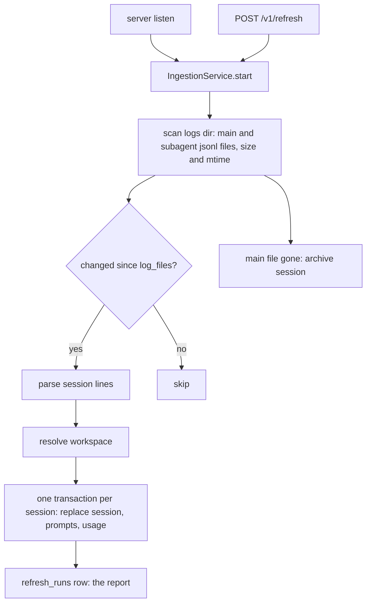

# Session ingestion and first recap

Feature: `session-ingestion` · Components: `api`, `web` · Spec: FR-01–FR-12, BR-01–BR-10

## Context

First iteration of the application. The api scans the Claude Code logs folder, parses each session (main log file plus its subagent logs), resolves its workspace, and stores it in PGlite, re-reading only the files that changed. It serves the recap (workspaces, sessions, a session's prompts) and the refresh (start, status, last report). The web shows the three pages and the refresh control.

## Decisions

Facts read from the 287 local log files (274 MB) that the parser must honour:

- Session identity → a session is one `{logsDir}/{folder}/{sessionId}.jsonl` file; its subagents are `{folder}/{sessionId}/subagents/agent-*.jsonl` (the `.meta.json` and `.prefix.json` files beside them are ignored). A scratch folder holding only `memory/` and `*.desktop-released.json` has no session and creates no workspace.
- Token usage is repeated on every content-block line of one assistant message (17,918 assistant lines, 7,688 distinct `message.id`) → usage is counted once per `message.id`, across the main file and its subagent files together; the model `<synthetic>` is skipped. Without it the totals inflate about 2.3×.
- Two files carry lines whose `sessionId` is another session's (copied history of a fork or a resume: all 63 of their assistant message ids also appear in the other file) → a line whose `sessionId` differs from its file's session id is ignored, so no history is counted twice.
- Compacted sessions inject a summary as a user line → lines with `isCompactSummary` or `isVisibleInTranscriptOnly` are not prompts.
- A user line's `origin` is absent (older lines) or `{ kind: "human" | "plugin" | "peer" | "task-notification" }` → only absent or `human` origins are the person's prompts (FR-06).
- Slash commands are stored as `<command-name>`, `<command-message>`, `<command-args>` tags, in either order → extracted by tag, not by position.
- Unreadable (BR-07) means a line that fails `JSON.parse` (typically the last line of a session being written). A valid line of a type the parser does not use (`attachment`, `queue-operation`, `atis-latch`, `file-history-snapshot`…) is skipped silently, never counted.
- Incremental detection (FR-02) → by file size and modification time, stored per file in `log_files`; a changed session is re-parsed in full (sessions are a few MB at most), so the token dedupe stays exact. Byte-offset appends are not worth their complexity.
- Refresh concurrency under PGlite (single connection) → one short transaction per session, never one for the whole refresh, so the recap reads stay served while it runs (FR-11). The running state is in memory; only finished runs are stored.
- Start-up refresh (FR-01) → started after `listen`, not awaited.
- A session whose file came back (BR-05) is re-parsed and counted in `sessionsUpdated` of the report (FR-03 lists no separate counter).
- The session's git branch (FR-04) → the last non-empty `gitBranch` of its main file. Its origin → the first `entrypoint` (`cli`, `claude-desktop`, …), shown as is.
- Token counters → the api returns the four counters (input, output, cache read, cache write) separately everywhere. Which figure do the pages show as "the tokens"? → input + output, cache excluded (the person's choice; the four counters stay in the figure's tooltip and in a session's token table).
- Scratch totals (FR-09) → computed by the api from the `includeScratch` query parameter, not by the web.
- BR-10 (repository root) → added to the spec at the person's request while planning; ships in this plan's commit.

## api

### db

`src/features/workspaces/workspaces.table.ts`:

- `workspaces`: `id` serial PK; `pathKey` text unique (the resolved path, normalised and lower-cased: BR-02); `path` text (the resolved path as first seen); `name` text (last segment of `path`, BR-08); `isScratch` boolean default false. The Scratch group is one row with `pathKey` `scratch`, `name` `Scratch`, `path` the scratch root.
- `sessions`: `id` text PK (the session id); `workspaceId` FK → `workspaces.id`; `title` text; `startedAt`, `endedAt` timestamptz; `gitBranch` text null; `origin` text null; `promptCount` integer; `subagentCount` integer; `isArchived` boolean default false. Index on `(workspaceId, startedAt)`.
- `sessionModelUsages`: `sessionId` FK → `sessions.id` on delete cascade; `model` text; `inputTokens`, `outputTokens`, `cacheReadTokens`, `cacheWriteTokens` bigint (mode `number`); PK `(sessionId, model)`.
- `prompts`: `sessionId` FK → `sessions.id` on delete cascade; `position` integer; `text` text; `sentAt` timestamptz; PK `(sessionId, position)`.

`src/features/ingestion/ingestion.table.ts`:

- `logFiles`: `path` text PK (absolute path of a main or subagent `.jsonl`); `sessionId` text; `sizeBytes` bigint (mode `number`); `modifiedAt` timestamptz.
- `refreshRuns`: `id` serial PK; `startedAt`, `finishedAt` timestamptz; `status` text (`succeeded` | `failed`); `logsDir` text; `isLogsDirFound` boolean; `sessionsAdded`, `sessionsUpdated`, `sessionsArchived`, `unreadableLines` integer; `error` text null.

`src/db/schema.ts` re-exports both table modules. Migration: `npm run db:generate -- --name session_ingestion` (the `drizzle-migrations` skill).

### services

`src/config.ts`: `CLAUDE_PROJECTS_DIR`, default `path.join(os.homedir(), ".claude", "projects")`.

`src/features/ingestion/ingestion.parser.ts`, pure, no I/O: `parseSession({ sessionId, mainLines, subagentFiles: string[][] }) → ParsedSession | null` (`null` when the main file has no line with a `cwd`). Each line goes through `JSON.parse` (a failure counts one unreadable line) then through loose zod schemas (`passthrough`) narrowing the few fields used; a line that does not match is skipped silently. Lines whose `sessionId` is not the file's are ignored. It returns:

- `firstCwd` (BR-09), `startedAt` / `endedAt` (min and max `timestamp` of the main file), `gitBranch` (last non-empty), `origin` (first `entrypoint`), `subagentCount` (number of subagent files);
- `title` (FR-07): the last `custom-title.customTitle`, else the last `ai-title.aiTitle`, else the first prompt cut to 80 characters with an ellipsis, else the session id;
- `usages` (FR-04, FR-05): per model, the four counters summed from `message.usage` (`input_tokens`, `output_tokens`, `cache_read_input_tokens`, `cache_creation_input_tokens`) of `assistant` lines, once per `message.id` across main and subagent lines, `<synthetic>` skipped;
- `prompts` (FR-06), from the main file only, in line order, with their `timestamp`: `user` lines that are not `isMeta`, `isSidechain`, `isCompactSummary` or `isVisibleInTranscriptOnly`, whose `origin` is absent or `kind: "human"`. Content is a string or an array: `tool_result` blocks and `image` blocks are dropped; each text block starting with `<system-reminder>`, `<local-command-`, `<task-notification>` or `[Request interrupted` is dropped; a block holding `<command-name>` becomes `{name} {args}` (tags read independently, `args` trimmed, omitted when empty). The remaining texts are joined with a blank line; a prompt with no text left is not kept;
- `unreadableLines` (main and subagent files).

`src/features/ingestion/ingestion.workspace.ts`: `resolveWorkspace(cwd, { scratchRoot, findRepoRoot }) → { pathKey, path, name, isScratch }`, in this order (BR-02, BR-03, BR-04, BR-10):

1. `cwd` under the desktop app's scratch root (`{APPDATA}\Claude\scratch-workspaces`, compared case-insensitively) → the Scratch group;
2. `cwd` containing a `.claude\worktrees\{name}` segment (either separator) → the path before `.claude` (this comes before the `.git` walk: a worktree has its own `.git` file);
3. `findRepoRoot(cwd)`: the nearest ancestor (itself included) holding a `.git` file or folder → that folder;
4. otherwise `cwd` itself (also when the folder no longer exists).

`pathKey` is the resolved path with separators normalised, no trailing separator, lower-cased. `findRepoRoot` is injected (the service passes an `fs.existsSync` walk) so the order is unit-testable.

`src/features/ingestion/ingestion.source.ts`: `scanLogs(logsDir) → { isLogsDirFound, sessions: [{ sessionId, mainFile: FileStat, subagentFiles: FileStat[] }] }` with `FileStat = { path, sizeBytes, modifiedAt }`, and `readLines(path) → string[]`. Read only: `readdir`, `stat`, `readFile`, nothing else (BR-01).

`src/features/ingestion/ingestion.repository.ts`: `listLogFiles()`, `replaceLogFiles(sessionId, files)`, `deleteLogFiles(sessionId)`, `insertRefreshRun(report)`, `findLastRefreshRun()`.

`src/features/workspaces/workspaces.repository.ts`:

- writes, each in one `db.transaction`: `saveSession(workspace, parsedSession)` (upsert the workspace by `pathKey`, keeping the first `path`; delete then insert the session with its usages and prompts; `isArchived` false) returning `"added" | "updated"`; `archiveSessions(ids)`; `listSessionIds()`;
- reads: `listWorkspaces({ includeScratch })` (one aggregate query: session count, `max(endedAt)` as last activity, the four token sums), `findWorkspace(id)`, `listSessions(workspaceId)` (sessions with their usages, one `inArray` query for the usages), `findSession(id)` (with workspace, usages, prompts ordered by `position`).

`src/features/ingestion/ingestion.service.ts`: `createIngestionService({ ingestionRepo, workspacesRepo, clock, logsDir, scratchRoot })`:

- `start(): RefreshStatus` starts a run unless one is running (BR-06: a second call returns the running status and does nothing), runs it without awaiting, logs and records a `failed` run on an unexpected error;
- `refresh(): Promise<RefreshReport>` the run itself: scan; compare every file with `log_files` (a session is re-parsed when its main file or any subagent file is new or has another size or `modifiedAt`, or when a stored subagent file is gone); parse, resolve, `saveSession`, `replaceLogFiles`, one session at a time; sessions in the database whose main file is no longer scanned and that are not archived yet → `archiveSessions` and `deleteLogFiles` (BR-05: never deleted); a session that `parseSession` returns `null` for is skipped. Records the run in `refresh_runs` with the clock's times;
- `getStatus(): Promise<RefreshStatus>` `{ isRunning, startedAt, logsDir, lastReport }`;
- `whenIdle(): Promise<void>` resolves when no run is in progress (tests).

`src/features/workspaces/workspaces.service.ts`: `listWorkspaces({ includeScratch })` returns the workspaces sorted by last activity, most recent first (FR-08), plus `totals` computed over the returned rows (FR-09); `getWorkspace(id)` with its sessions sorted by `startedAt` descending, each with `durationMs = endedAt - startedAt` and `models` (FR-10); `getSession(id)`. `NotFoundError` for an unknown id.

`src/app.ts`: `AppContext` gains `ingestion: IngestionService` and `workspaces: WorkspacesService`; `createApp` mounts the two routers. `src/server.ts` builds the repositories and services, calls `listen`, then `ingestion.start()` (FR-01). The scratch root comes from `process.env.APPDATA` (`{APPDATA}/Claude/scratch-workspaces`), empty when unset.

### routes

Public routes (no sign-in, `app.ts` says it once), all JSON, contracts in `ingestion.schema.ts` and `workspaces.schema.ts` with `.meta({ id })` on the named schemas:

- `GET /v1/refresh` → `200 RefreshStatus`: `{ isRunning: boolean, startedAt: string | null, logsDir: string, lastReport: RefreshReport | null }`; `RefreshReport`: `{ status: "succeeded" | "failed", startedAt, finishedAt, durationMs, isLogsDirFound, sessionsAdded, sessionsUpdated, sessionsArchived, unreadableLines }`.
- `POST /v1/refresh` → `202 RefreshStatus` (started, or the one already running: BR-06).
- `GET /v1/workspaces?includeScratch=true|false` (default `false`) → `200 { workspaces: WorkspaceSummary[], totals: { sessionCount, tokens: TokenCounts } }`; `WorkspaceSummary`: `{ id, name, path, isScratch, sessionCount, lastActivityAt, tokens: TokenCounts }`; `TokenCounts`: `{ input, output, cacheRead, cacheWrite }`.
- `GET /v1/workspaces/:workspaceId` → `200 { id, name, path, isScratch, sessions: SessionSummary[] }`, `404` unknown; `SessionSummary`: `{ id, title, startedAt, endedAt, durationMs, models: string[], gitBranch, origin, promptCount, subagentCount, isArchived, tokens: TokenCounts }`.
- `GET /v1/sessions/:sessionId` → `200 SessionDetail`: `SessionSummary` plus `workspace: { id, name }`, `usages: [{ model, tokens: TokenCounts }]`, `prompts: [{ position, text, sentAt }]`; `404` unknown.

`scripts/export-openapi.ts` imports both new schema modules (else the handoff misses their routes). Handoff: `api/openapi.json`.

## web

### data

- `src/shared/lib/i18n/fr.json` and `src/shared/lib/i18n/index.ts`: `t(key, params?)`, a lookup in `fr.json` with `{name}` interpolation; a missing key returns the key (visible in review). Every string below goes through it, keys `{feature}.{element}.{text}`.
- `src/shared/lib/format.ts`: `formatTokens` (`Intl.NumberFormat("fr-FR", { notation: "compact" })`), `formatDateTime`, `formatRelative` (last activity), `formatDuration` (h/min).
- `src/features/workspaces/data/`: `workspacesKeys` (query-key factory), `useWorkspacesQuery({ includeScratch })`, `useWorkspaceQuery(id)`, `useSessionQuery(id)`.
- `src/features/refresh/data/`: `refreshKeys`, `useRefreshStatusQuery()` (`refetchInterval` 1 s while `isRunning`; when it goes from running to not running, invalidates `workspacesKeys.all`), `useStartRefreshMutation()` (sets the returned status into the status query).

### pages

`src/router.tsx`: `/` → `WorkspacesPage`, `/workspaces/:workspaceId` → `WorkspacePage`, `/sessions/:sessionId` → `SessionPage`, lazy routes.

- `WorkspacesPage` (FR-08, FR-09, FR-11, FR-12): `PageTitle`, `RefreshBar`, the Scratch `Switch` (state in the `scratch=1` search param, off by default), the totals line, `WorkspaceList`. Empty list → `EmptyState` naming `logsDir` (and saying the folder was not found when the last report says so). Loading and error states.
- `WorkspacePage` (FR-10): workspace name and path, back link, `SessionList`; `404` → `ErrorMessage`.
- `SessionPage` (FR-04, FR-06, FR-10): title, `SessionFacts`, `TokenTable` (per model), `PromptList`; back link to its workspace.

### ui

- `features/refresh/ui/RefreshBar.tsx`: primary `Button` "Actualiser", disabled with "Actualisation en cours…" while running (FR-11); the last report on one line (added, updated, archived, unreadable lines, duration; FR-03) or its failure as `ErrorMessage`.
- `features/workspaces/ui/WorkspaceList.tsx`: `List` of rows linking to the workspace: name, path below it, session count, last activity, tokens (`Badge` "Scratch" on the group).
- `features/workspaces/ui/SessionList.tsx`: rows linking to the session: title, date, duration, models, branch, tokens, `Badge` "Archivée" when archived.
- `features/workspaces/ui/SessionFacts.tsx`, `TokenTable.tsx`, `PromptList.tsx` (prompts in order, time, text with preserved line breaks).
- `features/workspaces/ui/TokenCount.tsx`: the token figure the pages show, input + output, with the four counters in its `title`.

Styles: CSS Modules for each feature component's layout only; the shared components carry the look (aurora skin).

## Conventions

None: the plan follows the components' `CLAUDE.md` as they are.

## Tests

**api** (Vitest; route tests with Supertest on in-memory PGlite):

- `test/setup.ts`: `createTestContext({ logsDir? })` builds the repositories and services; `logsDir` defaults to a fresh `fs.mkdtemp` folder, so no test ever reads the real `~/.claude/projects`; `scratchRoot` is a temp folder too.
- `test/ingestion/log-builders.ts`: line builders (`userLine`, `assistantLine`, `commandLine`, `titleLine`, …) and `writeSession(logsDir, folder, { sessionId, lines, subagents })`; never copies of real logs. `test/factories.ts`: `buildWorkspace`, `buildSession`, `buildUsage`, `buildPrompt`.
- `test/ingestion/ingestion.parser.test.ts`: title precedence (custom, ai, first prompt cut, id); usage counted once per `message.id` across main and subagent lines; `<synthetic>` skipped; lines of another `sessionId` ignored; prompt filter (meta, sidechain, compact summary, `tool_result`, plugin / peer / task-notification origins, system-reminder block inside a human array, image blocks); command formatting in both tag orders, with and without args; unreadable lines counted, unknown types not; first `cwd`, start and end, last branch, first entrypoint; `null` without `cwd`.
- `test/ingestion/ingestion.workspace.test.ts`: scratch root; worktree segment (before the `.git` walk); subfolder of a repository; folder outside any repository; case variants give one `pathKey`; name is the last segment.
- `test/ingestion/ingestion.service.test.ts` (temp logs dir, test database): first refresh adds sessions and writes the report; second refresh with nothing changed updates none (FR-02); an appended line updates the session; a new subagent file updates it and adds its tokens; a removed main file archives the session and keeps it (BR-05); the file back un-archives it, counted as updated; a second `start()` while running is ignored (BR-06); a missing logs dir gives `isLogsDirFound: false`; the logs dir's files, sizes and modification times are unchanged after a refresh (BR-01); a session started in a repository subfolder and one in a worktree land in the repository's workspace (BR-03, BR-10); a session whose `cwd` changes stays in its first workspace (BR-09).
- `test/ingestion/ingestion.routes.test.ts`: `GET /v1/refresh` before any run; `POST /v1/refresh` returns `202` running, then the status carries the report (`whenIdle`).
- `test/workspaces/workspaces.routes.test.ts`: `GET /v1/workspaces` sorted by last activity, Scratch excluded by default and its tokens out of `totals`, included with `includeScratch=true`; `GET /v1/workspaces/:id` sessions most recent first with duration and models, `404`; `GET /v1/sessions/:id` prompts in order with usages per model, `404`.

**web**: none (no unit tests on the front, per its `CLAUDE.md`); checked in the browser (Validation).

## Deviations

- `start(): RefreshStatus` → `start(): Promise<RefreshStatus>` (the last report is read from `refresh_runs`; the running flag is still set before any `await`, so BR-06 holds).
- `start()` records a `failed` run → `refresh()` records it itself, with the counts reached so far; `start()` only logs an error the recording itself raises.
- `listSessionIds()` → `listSessionIds({ isArchived })` (the refresh archives only the sessions not archived yet, so `sessionsArchived` counts each session once).
- A session `parseSession` returns `null` for is skipped → skipped, but its log files are still recorded in `log_files`, so it is re-read only once it changes (FR-02).
- Local ports 3000 (api) and 5173 (web) → 3100 and 5180, in `api/src/config.ts`, `web/vite.config.ts` (`strictPort`), `factory.yaml` and the `CLAUDE.md` files (other local projects hold 3000 and 5173; asked by the person during the browser test).
- Final review: sessions no longer scanned are archived on every refresh → only when the logs folder is found (BR-11, added to the spec at the person's request: a missing folder archived the whole history).
- Final review: usage counted from the first line of each `message.id` → from its largest counters (the real logs repeat a growing `output_tokens` on a message's lines: the first line undercounted output by about 8.5%).
- Final review: a file that fails to read failed the whole refresh → that session is skipped and logged, its stored files unchanged so the next refresh retries it (no test: a read failure after the scan cannot be produced from a temp folder without injecting the log source).
- Final review: the api listened on every interface → on `127.0.0.1` only, the Vite proxy targeting `127.0.0.1:3100` (the recap holds the whole prompt history).
- Final review: `listWorkspaces` returned workspaces left without a session (a session moved by a re-read) → left out.

## Progress

### Stage 1 — api
Commit: `feat(session-ingestion): api — log ingestion, refresh and recap endpoints`
- [x] db: workspaces, sessions, usages, prompts, log files and refresh runs tables; migration `session_ingestion`
- [x] services: config, parser, workspace resolver, log source, repositories, ingestion and workspaces services, with their tests
- [x] routes: refresh and recap contracts and routers, start-up refresh, route tests
- [x] Handoff: `api/openapi.json` exported

### Stage 2 — web
Commit: `feat(session-ingestion): web — workspaces, sessions and refresh pages`
- [x] Prepare: client regenerated from `api/openapi.json`
- [x] data: i18n layer, formatters, workspaces and refresh hooks
- [x] pages: routes, workspaces, workspace and session pages
- [x] ui: refresh bar, workspace, session, token and prompt components

## Validation

- [x] Review: the `reviewer` agent on the plan's implementation, its findings settled (left open with the person's agreement: a line field of an unexpected type drops the line, and bash-mode output lines are not filtered from prompts, neither seen in the 474 local log files; the API's English problem details shown in French messages, as `web/CLAUDE.md` asks)
- [x] Tests: the full `test` command of `api` green on the plan's final code
- [x] Browser test: the change tested in `web` (`test-in-browser` skill): workspaces listed after the start-up refresh, Scratch switch and totals, a workspace's sessions, a session's prompts, a refresh with its report, the empty state with a missing `CLAUDE_PROJECTS_DIR`; re-run after the final review's fixes, plus the refresh bar's not-found line with no session archived (BR-11)
