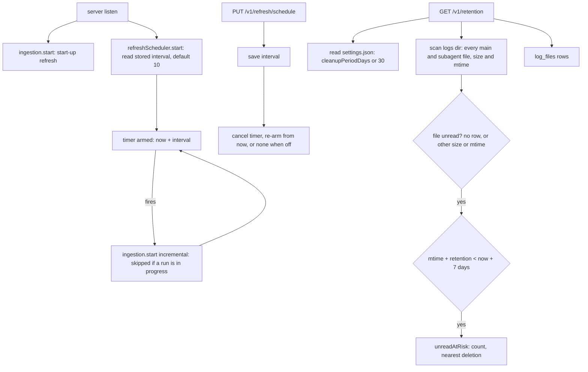

# Periodic refresh and log retention alert

Feature: `session-ingestion` · Components: `api`, `web` · Spec: FR-01, FR-13, FR-14, FR-15, BR-12, BR-13, BR-14

## Context

Until now a refresh runs at start-up, on the refresh button and after a live session ends. This iteration adds the `PeriodicRefresh`: a refresh the api starts by itself at an interval the person picks in the refresh control (off, 5, 10, 30 or 60 minutes, 10 by default), stored in the database so it survives a restart, re-armed at once when it changes. It also reads Claude Code's `LogRetention` (`cleanupPeriodDays` in `~/.claude/settings.json`, read only) and serves, on request, what the workspaces page shows under the refresh control: a discreet line (retention in force, oldest log file, sessions only the database holds), replaced by a warning banner when log files not read yet will be deleted within 7 days.

## Decisions

Technical questions parked by the person's spec grill, settled here:

- Where the interval is stored → a single-row table `refresh_schedules` in the ingestion feature (`id` always 1, `intervalMinutes` nullable: `null` is off), not a generic key-value settings table (one typed setting does not justify one). No row means the default, 10 minutes (FR-13), so nothing is seeded by the migration.
- How the scheduler restarts without an api restart → `PUT /v1/refresh/schedule` saves the value, then cancels the pending timer and arms a new one at `now + interval` (none when off). "Applies at once" means re-armed from the moment of the change, with no immediate refresh. The save comes first: a failed write leaves the running schedule as it was.
- Scheduler mechanics → a `setTimeout` chain behind an injected `Timer` port (`src/shared/timer.ts`), re-armed at each tick, not `setInterval`; tests use a fake timer, never real time. Each tick calls `ingestion.start({ mode: "incremental" })`, never `refresh()`: `start()` is what enforces BR-06, so a tick landing on a manual, start-up or live-triggered run is a no-op (BR-12) and the next tick stays armed. Ticks are paced from the tick (or the change), not from the end of the last refresh: a manual refresh does not shift them.
- Start-up → the start-up refresh (FR-01) stays as it is; `refreshScheduler.start()` runs after `listen` too, so the first periodic tick comes one interval after start-up.
- How "soon deleted" is computed (FR-15, BR-14) → per log file, as FR-15 counts files: every scanned main and subagent `.jsonl` is compared by path with its `log_files` row; it is unread when it has no row or another size or modification time (the FR-02 test). Its estimated deletion date is its own modification time plus the `LogRetention` in days. It is at risk when unread and its deletion date is before `clock.now()` + 7 days, overdue dates included (Claude Code cleans up when it starts, so an overdue file may still be there). The banner gives the number of at-risk files and the earliest deletion date.
- When it is computed → on request, by `GET /v1/retention` (a scan of the logs folder: `readdir` and `stat` only), not during a refresh: right after a refresh nothing is unread, the state that matters builds up between refreshes. The web re-reads it when a refresh ends and every 5 minutes.
- Where the retention comes from (BR-13) → only `~/.claude/settings.json` (`CLAUDE_SETTINGS_FILE` overrides it, for tests), read with `readFile` on each request (a change in Claude Code shows without restart), never written. Project settings, `settings.local.json` and managed settings are ignored, as the person asked. The api never opens `~/.claude/sessions/*.key`: the retention code does not touch `~/.claude/sessions` at all.
- Banner and discreet line → both under the refresh control on the workspaces page, never together: the banner replaces the line while at least one file is at risk (UX flow), and the line comes back once a refresh has read the files.

## Decisions taken autonomously

- Run the grill on the plan? → yes, in autonomous mode, every question below taking its recommended answer (autonomous mode of `write-plan`).
- Branch → stay on `develop`, no new branch (the person's instruction for this run, overriding the skill's default of a new branch on the base branch: `develop` already holds the stage commits of past features).
- Stage order → `api`, then `web` (the manifest's order; `web` needs the api's handoff).
- Review after each stage → yes (the autonomous default).
- Plan type and name → `add-periodic-refresh-and-retention` (new behaviour on an existing feature: `add`, commit type `feat`).
- Spec changes → none: every point here interprets an existing id (FR-13, FR-14, FR-15, BR-12, BR-13, BR-14); the spec stays as committed in 38ce29f, already `Approved`.
- What makes `cleanupPeriodDays` invalid (BR-13)? → anything but an integer from 1 to 36,500: a missing key, `0`, a negative or fractional number, a string, a file that is not a JSON object, a missing or unreadable file; each gives 30 days with `isDefault: true` (`0` means no transcript is kept at all, a case where this application has nothing to read, and the upper bound keeps the estimated dates valid; guessing Claude Code's own handling of edge values is not worth it).
- Do Scratch sessions count in the archived count and the at-risk count? → yes, always, whatever the Scratch switch (FR-09 governs the recap's totals; the retention warns about data loss, which does not depend on a display switch).
- Which date is "the oldest log file" (FR-14)? → the earliest modification time among every scanned main and subagent file (the date the retention counts from), `null` when the folder is missing or empty.
- Which sessions does "only the database still holds" count (FR-14)? → the archived sessions (BR-05: archived means its log file is gone).
- Warning window → 7 days, a constant (FR-15 fixes it; not a setting).
- How does a page notice a periodic refresh? → the refresh status, already read on every page by `AppLayout`, is polled every 30 s while idle (1 s while running, as today); its existing "new report" check then reloads the recap, the dashboard and the retention.
- Does the report say a refresh was periodic? → no: BR-12 makes it an ordinary refresh, its report replaces the previous one; no trigger column.
- Contract of the interval → `intervalMinutes: 5 | 10 | 30 | 60 | null`, `null` for off; any other value is a `400`.
- Interval control → a `Select` in a `Field` labelled "Actualisation automatique", in the refresh bar's action row, aligned on the buttons' bottom edge.
- Banner component → a new shared `Banner` (`shared/ui`), no feature word, `role="status"` (a warning, not an error: polite announcement), its colors from two new tokens `--warning` and `--warning-soft` in `overrides.css`, aliased to the existing amber `--status-awaiting` pair (same meaning, "needs the person, not a danger"; its dark values follow automatically). No blur (the skin keeps blur to the panel and the dialog).
- A `setSchedule` arriving while `start()` is still reading the stored interval → the change wins: `start()` does not arm once a `setSchedule` has run.
- Comments in files shared with other features → cite ids with the slug (`session-ingestion FR-15`): `WorkspacesPage` and `AppLayout` already cite other features' FR ids.
- Retention line when the retention query is loading → nothing (a discreet line, no spinner); on error, an `ErrorMessage`.

## api

### db

`src/features/ingestion/ingestion.table.ts`, new table:

- `refreshSchedules` (`refresh_schedules`): `id` integer PK (always `1`: one schedule for the application); `intervalMinutes` integer null (`null` is off); `updatedAt` timestamptz not null. A comment says no row means the default.

`src/db/schema.ts` already re-exports the module. Migration: `npm run db:generate -- --name periodic_refresh` (the `drizzle-migrations` skill), giving `drizzle/0002_periodic_refresh.sql`.

### services

`src/config.ts`: `CLAUDE_SETTINGS_FILE`, default `path.join(os.homedir(), ".claude", "settings.json")`, with a comment: Claude Code's user settings, read only for `cleanupPeriodDays`.

`src/shared/timer.ts`: `export interface Timer { schedule(run: () => void, delayMs: number): () => void }` (returns the cancel function) and `systemTimer` (`setTimeout`, the handle `unref()`ed so a pending tick never holds the process, `clearTimeout` as the cancel).

`src/features/ingestion/ingestion.source.ts`: export a new `isFileUnread(scanned: FileStat, stored: FileStat | undefined): boolean` (no stored row, or another `sizeBytes` or `modifiedAt`), and make `haveFilesChanged` use it, so FR-02 and FR-15 share one definition of "not read yet".

`src/features/ingestion/ingestion.repository.ts`, new methods:

- `findRefreshSchedule(): Promise<{ intervalMinutes: number | null } | null>` (the row, or `null` when none);
- `saveRefreshSchedule({ intervalMinutes, updatedAt })`: insert `id` 1, `onConflictDoUpdate` on `id`.

`src/features/ingestion/ingestion.scheduler.ts`: `createRefreshScheduler({ ingestion: Pick<IngestionService, "start">, ingestionRepo, clock, timer })`, with `DEFAULT_REFRESH_INTERVAL_MINUTES = 10`:

- in memory: the current interval and the cancel function of the pending timer;
- `arm(interval)` (private): cancel the pending timer; when `interval` is not `null`, `timer.schedule(tick, interval * 60_000)`;
- `tick()` (private): `ingestion.start({ mode: "incremental" })`, its rejection logged (`console.error`), not awaited; then `arm(currentInterval)` (BR-12: when a run is in progress `start()` starts nothing, the chain goes on);
- `start(): Promise<void>`: read the stored schedule (default 10 when no row), then `arm` it, unless a `setSchedule` ran meanwhile;
- `stop(): void`: cancel the pending timer (tests, shutdown);
- `getSchedule(): Promise<RefreshSchedule>`: `{ intervalMinutes }`, the stored value or the default;
- `setSchedule({ intervalMinutes }): Promise<RefreshSchedule>`: `saveRefreshSchedule` with `clock.now()`, then `arm(intervalMinutes)` (FR-13: applies at once), returns the schedule.

`RefreshScheduler = ReturnType<typeof createRefreshScheduler>`.

`src/features/workspaces/workspaces.repository.ts`: `countSessions({ isArchived }): Promise<number>` (one `count()` query).

New feature folder `src/features/retention/` (no table, no repository of its own: it reads `log_files` through `ingestionRepo.listLogFiles()` and the archived count through `workspacesRepo.countSessions`):

`retention.source.ts`, read only (`readFile`, nothing else): `readLogRetention(settingsFile): Promise<{ retentionDays: number; isDefault: boolean }>`, with `DEFAULT_LOG_RETENTION_DAYS = 30`. Any read error, a `JSON.parse` failure, or a parsed value that does not pass `z.object({ cleanupPeriodDays: z.number().int().min(1).max(36_500) })` gives `{ retentionDays: 30, isDefault: true }` (BR-13); else `{ retentionDays: cleanupPeriodDays, isDefault: false }`.

`retention.service.ts`: `createRetentionService({ ingestionRepo, workspacesRepo, clock, logsDir, settingsFile })`, with `RETENTION_WARNING_DAYS = 7`. `getRetention(): Promise<LogRetentionStatus>`:

1. `readLogRetention(settingsFile)`;
2. `scanLogs(logsDir)`, flattened to every main and subagent `FileStat`; `listLogFiles()` indexed by `path`;
3. `oldestLogAt`: the earliest `modifiedAt` of the scanned files, `null` when none (FR-14);
4. for each scanned file with `isFileUnread`: `deletionAt = modifiedAt + retentionDays` days (BR-14); at risk when `deletionAt < clock.now() + 7 days` (FR-15); `unreadAtRisk = { fileCount, nearestDeletionAt }` (the earliest `deletionAt`, `null` when the count is 0);
5. `archivedSessionCount = workspacesRepo.countSessions({ isArchived: true })` (FR-14, Scratch included).

A missing logs folder gives `oldestLogAt: null` and `fileCount: 0`. `RetentionService = ReturnType<typeof createRetentionService>`.

`src/app.ts`: `AppContext` gains `refreshScheduler: Pick<RefreshScheduler, "getSchedule" | "setSchedule">` and `retention: RetentionService`; `createApp` passes `refreshScheduler` to `ingestionRoutes` and mounts `retentionRoutes`. `src/server.ts` builds both (`systemTimer`, `config.CLAUDE_SETTINGS_FILE`), and in the `listen` callback, after `ingestion.start()`, calls `refreshScheduler.start()` (its rejection logged).

### routes

Public, like every route (`app.ts` says it once). Contracts with `.meta({ id })`:

`ingestion.schema.ts`:

- `refreshIntervalSchema = z.literal([5, 10, 30, 60]).nullable().meta({ id: "RefreshInterval" })` (if the generated document does not give an enum of numbers, a `z.union` of the four `z.literal`s);
- `refreshScheduleSchema = z.object({ intervalMinutes: refreshIntervalSchema }).meta({ id: "RefreshSchedule" })`;
- `GET /v1/refresh/schedule` → `200 RefreshSchedule`;
- `PUT /v1/refresh/schedule`, body `RefreshSchedule` → `200 RefreshSchedule`; `400` problem details for any other value or a missing field.

`ingestion.routes.ts`: `ingestionRoutes({ ingestion, refreshScheduler })` gains the two routes, each one `validate(...)` and one scheduler call.

`src/features/retention/retention.schema.ts`:

- `logRetentionStatusSchema` (`.meta({ id: "LogRetentionStatus" })`): `{ retentionDays: int, isDefault: boolean, oldestLogAt: iso datetime | null, archivedSessionCount: int, unreadAtRisk: { fileCount: int, nearestDeletionAt: iso datetime | null } }`;
- `GET /v1/retention` → `200 LogRetentionStatus`.

`src/features/retention/retention.routes.ts`: `retentionRoutes({ retention })`, the one route.

`scripts/export-openapi.ts` imports `retention.schema.js`. Handoff: `api/openapi.json`.

## web

### data

- `src/features/refresh/data/refreshKeys.ts`: `schedule: () => [...refreshKeys.all, "schedule"]`.
- `src/features/refresh/data/useRefreshScheduleQuery.ts`: `GET /v1/refresh/schedule`.
- `src/features/refresh/data/useSetRefreshScheduleMutation.ts`: `PUT /v1/refresh/schedule` with `{ intervalMinutes }`; `onSuccess` sets the returned schedule into the schedule query.
- `src/features/refresh/data/useRefreshStatusQuery.ts`: `refetchInterval` becomes 1 s while running and `IDLE_POLL_INTERVAL_MS = 30_000` while idle (a periodic refresh is noticed from every page, `AppLayout` already mounts the hook); both invalidation points (the running → idle edge and the new report) also invalidate `retentionKeys.all`.
- `src/features/retention/data/retentionKeys.ts` (`all`, `status()`) and `useLogRetentionQuery.ts`: `GET /v1/retention`, `refetchInterval: 5 * 60_000` (files age into the 7-day window and change between refreshes).
- `src/shared/lib/format.ts`: `formatDate(iso)`, `Intl.DateTimeFormat("fr-FR", { dateStyle: "medium" })` (day only).
- `src/shared/lib/i18n/fr.json`, new keys:
  - `refresh.interval.label`: "Actualisation automatique"
  - `refresh.interval.off`: "Désactivée"
  - `refresh.interval.minutes`: "Toutes les {minutes} min"
  - `refresh.interval.hour`: "Toutes les heures"
  - `refresh.interval.failed`: "Le réglage n'a pas pu être enregistré : {message}"
  - `retention.line.days.one` / `.other`: "{count} jour" / "{count} jours"
  - `retention.line.kept`: "Claude Code conserve les journaux {days}"
  - `retention.line.keptDefault`: "Claude Code conserve les journaux {days} (valeur par défaut)"
  - `retention.line.oldest`: "plus ancien journal : {date}"
  - `retention.line.archived.one` / `.other`: "{count} session conservée uniquement ici" / "{count} sessions conservées uniquement ici"
  - `retention.banner.upcoming.one`: "{count} journal pas encore lu sera supprimé par Claude Code à partir du {date}. Actualisez pour le conserver."
  - `retention.banner.upcoming.other`: "{count} journaux pas encore lus seront supprimés par Claude Code à partir du {date}. Actualisez pour les conserver."
  - `retention.banner.overdue.one`: "{count} journal pas encore lu a dépassé sa durée de conservation : Claude Code peut le supprimer à son prochain démarrage. Actualisez pour le conserver."
  - `retention.banner.overdue.other`: "{count} journaux pas encore lus ont dépassé leur durée de conservation : Claude Code peut les supprimer à son prochain démarrage. Actualisez pour les conserver."
  - `retention.state.error`: "Conservation des journaux indisponible : {message}"

### pages

`src/features/workspaces/pages/WorkspacesPage.tsx`: uses `useRefreshScheduleQuery`, `useSetRefreshScheduleMutation`, `useLogRetentionQuery` and `useNow(60_000)`. Passes the interval props to `RefreshBar` (FR-13). Right under `RefreshBar`: `RetentionNotice` once the retention is loaded (FR-14, FR-15), nothing while loading, `ErrorMessage` with `retention.state.error` on error.

### ui

- `src/shared/ui/Banner.tsx` and `Banner.module.css`: `Banner({ children })`, a `
`; text `var(--text)`, fill `var(--warning-soft)`, a `var(--border-width)` border in `var(--warning)`, `var(--radius-control)`, padding 10px 14px, `0.9em`; no blur; long text wraps.
- `src/shared/ui/theme/overrides.css`: `--warning: var(--status-awaiting)` and `--warning-soft: var(--status-awaiting-soft)` in `:root`, with a comment (a warning is not a danger; the dark values follow the aliased pair).
- `src/features/refresh/ui/RefreshBar.tsx`: new props `intervalMinutes: RefreshInterval | undefined`, `isIntervalSaving: boolean`, `intervalError: string | null`, `onIntervalChange(intervalMinutes: RefreshInterval): void`. In the action row, after the two buttons: a `Field` labelled `refresh.interval.label` holding a `Select` with the options off, 5, 10, 30 (`refresh.interval.minutes`) and 60 (`refresh.interval.hour`); its value `"off"` maps to `null`; disabled while `intervalMinutes` is `undefined` or saving; `intervalError` shown as the field's error with `refresh.interval.failed`. `RefreshBar.module.css`: `.actions` aligns its items on their bottom edge.
- `src/features/retention/ui/RetentionNotice.tsx` (and its `.module.css`): props `retention: LogRetentionStatus`, `now: Date`.
  - `unreadAtRisk.fileCount > 0` → `Banner` with `retention.banner.overdue` when `nearestDeletionAt` is not after `now`, else `retention.banner.upcoming` with `formatDate(nearestDeletionAt)` (FR-15);
  - otherwise a muted line (`--text-muted`, `0.86em`, like the report line) joining with " · ": `retention.line.kept` or `retention.line.keptDefault` (BR-13) with `days`, `retention.line.oldest` when `oldestLogAt` is not `null`, and `retention.line.archived` (FR-14).

## Conventions

- `CLAUDE.md` (root): the read-only hard rule names `~/.claude/settings.json` too (read for `cleanupPeriodDays`, never written); Local development names `CLAUDE_SETTINGS_FILE` beside `CLAUDE_PROJECTS_DIR` and `CLAUDE_SESSIONS_DIR`. Rationale: the api reads a third folder of the person's Claude Code installation.
- `api/CLAUDE.md`, Local run: the source data also lists `~/.claude/settings.json` (read only, `cleanupPeriodDays` only; `CLAUDE_SETTINGS_FILE` points elsewhere). Rationale: same.
- `web/CLAUDE.md`: the `shared/ui` list gains `Banner (a warning strip, role="status")`; the Design section gains one line: warnings use `--warning` and `--warning-soft` (`overrides.css`, aliased to the live page's amber), never `--danger`. Rationale: a new shared element and a new token pair.

## Tests

**api** (Vitest; route tests with Supertest on in-memory PGlite):

- `test/setup.ts`: `createTestTimer()` (`schedule` records `{ delayMs, run }` and returns a cancel that removes it; `pending()` lists the pending delays; `fire()` runs every pending task, removed first). `createTestContext` passes `settingsFile: path.join(tempRoot, "settings.json")` (absent unless a test writes it; never the real `~/.claude/settings.json`), builds the retention service and the scheduler on the test timer, and exposes `timer`, `settingsFile`, `refreshScheduler`. The scheduler is never started by the context; `reset()` stops it and swaps it for a fresh one (as it does for `live`: truncation wipes the row, not the memory) and clears the test timer; `dispose()` stops it.
- `test/ingestion/ingestion.scheduler.test.ts`:
  - with no stored schedule, `start()` arms one timer at 10 minutes;
  - a stored 30 arms 30 minutes; a stored off arms nothing;
  - firing the timer starts an incremental refresh (a `refresh_runs` row with mode `incremental` after `whenIdle`) and re-arms at the same delay;
  - firing while a refresh runs starts no second run and still re-arms (BR-12);
  - `setSchedule(5)` saves it (read back through `db`), cancels the pending timer and arms 5 minutes, without starting a refresh;
  - `setSchedule(null)` leaves nothing armed;
  - a new scheduler on the same database arms the saved interval (FR-13: survives a restart);
  - a `setSchedule` resolved before `start()` finishes is not overridden by it.
- `test/ingestion/ingestion.routes.test.ts`, added: `GET /v1/refresh/schedule` returns 10 with no row; `PUT` 30 returns 200 and the next `GET` returns 30; `PUT` `null` turns it off; `PUT` 15, a string or an empty body returns `400`.
- `test/retention/retention.service.test.ts` (temp logs dir, temp settings file, test clock; modification times set with `fs.utimes` on the temp files):
  - no settings file → 30 days, `isDefault: true`; `cleanupPeriodDays: 45` → 45, `isDefault: false`;
  - each invalid case gives 30 and `isDefault: true`: `0`, `-3`, `2.5`, `"30"`, `36_501`, invalid JSON, a JSON array;
  - `oldestLogAt` is the earliest modification time across main and subagent files; `null` with a missing logs folder, with `fileCount: 0`;
  - `archivedSessionCount` counts archived sessions, Scratch included;
  - a never-read file modified 25 days ago, retention 30 → at risk, `nearestDeletionAt` = modification + 30 days; the same file modified 10 days ago → not at risk;
  - after a refresh, that file is no longer at risk; a line appended to it (unread again) makes it at risk again;
  - an unread subagent file counts as its own file;
  - an overdue file (modified 40 days ago) is at risk, with a `nearestDeletionAt` in the past; the earliest of two dates is the nearest;
  - the logs folder's files and the settings file are unchanged after `getRetention` (sizes and modification times; BR-01, BR-13).
- `test/retention/retention.routes.test.ts`: `GET /v1/retention` returns `200` with every field of `LogRetentionStatus`, for an empty logs folder and for one at-risk file.

**web**: none (no unit tests on the front, per its `CLAUDE.md`); checked in the browser (Validation).

## Progress

### Stage 1 — api
Commit: `feat(session-ingestion): api — periodic refresh and log retention`
- [ ] db: `refresh_schedules` table; migration `periodic_refresh`
- [ ] services: config `CLAUDE_SETTINGS_FILE`, timer port, `isFileUnread` in the log source, schedule repository methods, refresh scheduler, `countSessions`, retention source and service, with their tests
- [ ] routes: schedule contracts and routes, retention contract and route, `app.ts` and `server.ts` wiring, route tests
- [ ] Conventions: root `CLAUDE.md` and `api/CLAUDE.md` name the settings file
- [ ] Handoff: `api/openapi.json` exported

### Stage 2 — web
Commit: `feat(session-ingestion): web — refresh interval and retention notice`
- [ ] Prepare: client regenerated from `api/openapi.json`
- [ ] data: schedule query and mutation, idle status polling and retention invalidation, retention query, `formatDate`, French strings
- [ ] pages: workspaces page wires the interval and the retention notice
- [ ] ui: `Banner` and the warning tokens, interval select in the refresh bar, `RetentionNotice`
- [ ] Conventions: `web/CLAUDE.md` lists `Banner` and the warning tokens

## Validation

- [ ] Review: the `reviewer` agent on the plan's implementation, its findings settled
- [ ] Tests: the full `test` command of `api` green on the plan's final code
- [ ] Browser test: the change tested in `web` (`test-in-browser` skill): the interval select shows 10 by default, a change survives a reload and an api restart, "Désactivée" stops the periodic runs; a periodic run (5 minutes) updates the report and the recap without a click; the retention line (default 30 days with the settings file left as is); the banner and its overdue wording with a `CLAUDE_PROJECTS_DIR` holding an old unread file, gone after a refresh
