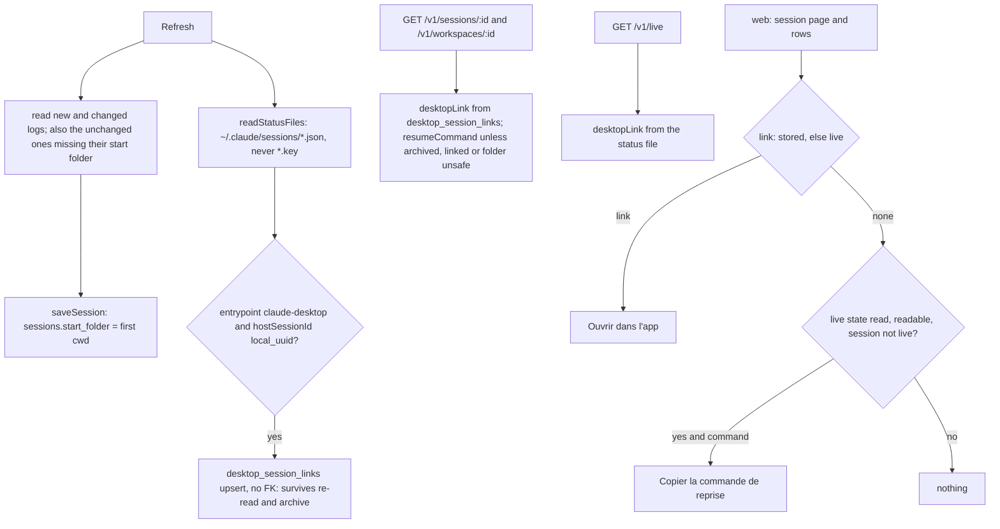

# Reopen a session: desktop link or resume command

Feature: `session-ingestion` · Components: `api`, `web` · Spec: FR-16, FR-17, FR-18, BR-15, BR-16, BR-17, BR-18, BR-19, BR-20; live-sessions FR-31, ~FR-07, BR-18

## Context

A stored session can now be reopened from the application. A desktop-app session with a `DesktopLink` offers "open in the desktop app"; any other session that is not live and not archived offers a button copying its `ResumeCommand`. Both show on the session page and on each row of the workspace's session list. On the live page, a desktop-app session offers its `DesktopLink` on its tile and on its line in the folded `Idle` group (live-sessions FR-31, ~FR-07). A live session never offers the command (BR-15, live-sessions BR-18).

The desktop link comes from Claude Code's live state. Each status file `~/.claude/sessions/{pid}.json` of a desktop-app process carries `hostSessionId: "local_<uuid>"`, the desktop app's id of the session; it differs from the CLI `sessionId` of the logs. The link is `claude://claude.ai/epitaxy/{hostSessionId}`. The logs never hold a session's own desktop id, so the refresh records it in a table of its own and keeps it after the process ends (BR-19). The resume command needs the folder the session started in (BR-16), which the parser reads (`firstCwd`) but the database does not store yet.



## Decisions

The parked technical questions, settled here:

- **Desktop link: shipped, from evidence.** All of the following was read without writing anything; no `*.key` file was opened.
  - Every status file of a desktop process on this machine (13 files) has `entrypoint: "claude-desktop"` and a `hostSessionId` of the form `local_<uuid>`, distinct from its `sessionId`.
  - The desktop app's own session list, seen in tool outputs inside the logs, pairs each `"sessionId": "local_X"` with `"link": "claude://claude.ai/epitaxy/local_X"`: 122 pairs over 61 ids, no mismatch.
  - One live file, `sessionId 7f79e566…` with `hostSessionId local_8696f16a…`, matches the desktop list entry `local_8696f16a…` on title ("Session ingestion dev plan stages 1-2") and on folder.
  - A scan of the top-level fields of every log line (320 files, 87,702 lines) found no field holding a session's own desktop id. `bridgeSessionId` (`session_01…`) is a remote-control id, not the desktop one. The `local_` values found in the logs are tool inputs and `origin.from` of messages from other sessions.
  - The mapping is stable across a process restart: the log of `7f79e566` starts on 2026-10-19, and the desktop app respawned it on 2026-10-20 with the same `sessionId`.
  - Not verified by clicking: the stage 2 browser test is the first one to open the link.
- **Where the desktop id is kept** → a table `desktop_session_links` keyed by CLI session id, with no foreign key to `sessions`, upserted by every refresh.
  - `saveSession` deletes and re-inserts the session row and its cascaded children, and the status file is gone once the process ends. A column on `sessions`, or a cascaded child, would lose the id at the first re-read, and the id could never be read again.
  - Without the foreign key, an id seen before the session is ever stored is kept too.
  - Re-read, full refresh and archive never touch the table.
- **Who records it** → the refresh (session-ingestion), never the live service: live-sessions BR-07 forbids the live page to store anything.
  - The refresh reads every status file through `readStatusFiles`, which keeps the existing `^\d+\.json$` guard, so a `*.key` file is never opened.
  - It takes files whose process is dead too: the mapping does not depend on liveness.
  - It records only files with `entrypoint === "claude-desktop"` and a `hostSessionId` matching `^local_<uuid>$`.
- **`hostSessionId` in the status schema** → `z.string().nullish()` in the loose `statusFileSchema`, with no regex there. A strict shape would make a file with an unexpected value fail to parse, and the session would look not live: the copy button would show on a live session (a BR-15 breach). The shape is checked only where the link is built.
- **Command form** → two lines, joined with `\n`, with no trailing newline:

  ```
  pushd "{start folder}"
  claude --resume {session id}
  ```

  - A newline is the only separator that PowerShell 5.1, PowerShell 7, cmd and bash share:
    - `&&` fails in PowerShell 5.1;
    - `;` does not separate commands in cmd;
    - a bare `&` is a parse error in PowerShell 5.1 and sends `pushd` to the background in bash.
  - `claude` has no option for its working directory (`claude --help`: only `--add-dir`), so the folder change is needed.
  - `pushd`, not `cd`: it exists in all four shells, and it switches the drive in cmd, where `cd` needs `/d` (an option PowerShell rejects).
  - The double quotes keep spaces in all four shells.
  - Without a trailing newline, nothing starts without the person's Enter. A cmd paste runs only the harmless `pushd` line at once; PowerShell's PSReadLine and bash's bracketed paste wait for Enter, then run both lines.
  - Accepted costs:
    - Windows Terminal asks to confirm a multi-line paste;
    - when `pushd` fails, line 2 still runs, and Claude Code says it found no conversation.
  - The glossary's `cd {folder} && …` is revised accordingly (spec delta below).
- **Folders that cannot be quoted** (BR-20) → no command when the folder holds any of these, since each breaks at least one shell even inside double quotes:
  - `"`;
  - `$` and a backtick (PowerShell and bash);
  - `%` (cmd);
  - `!` (interactive bash);
  - a carriage return or a line feed;
  - the sequence `\\` (bash folds it; this also excludes UNC paths).

  A folder ending with `\` (a drive root) gets a `.` appended (`pushd "C:\."`), so that bash does not read `\"` as an escaped quote. The session id goes in only when it matches `^[\w-]+$` (it is a file name).
- **How fast the copy button leaves a session that becomes live** (BR-15) → within the existing 3 s poll of the live state, which `AppLayout` already runs on every page.
  - The session page and the workspace page read the same query with `isPolling: false`: no new poll, no new request.
  - The button, and the hand-copy fallback with it, shows only when all of these hold:
    - the live query has data;
    - `isError` is false (TanStack keeps stale data after a failed refetch, so the data alone is not enough);
    - `isSessionsDirReadable` is true;
    - the session id is not among the live sessions.
- **Start folder** → a nullable column `sessions.start_folder`, written by `saveSession` from `firstCwd`.
  - Backfill: the next incremental refresh also re-reads every non-archived session whose `start_folder` is null, even unchanged. At the first start-up after the migration, that is every non-archived session, once, like a full refresh; they count as updated in that report.
  - Archived sessions have no log left and keep `null`; they get no command anyway (BR-17).
- **Where the rules run** → in the api, unit-tested, except the live state:
  - the api builds the link and the command and applies BR-16, BR-17, BR-18 (stored link) and BR-20. `resumeCommand` is `null` when the session is archived, has a stored link, has no start folder yet, or has an unsafe folder;
  - the web applies BR-15, and takes the live state's `desktopLink` for a session that is live but has no stored link yet (BR-18).

## Decisions taken autonomously

- Run the grill on the plan? → yes, autonomous: each question below took its recommended answer, none was left without one (autonomous mode of `write-plan`).
- Branch → stay on `develop`, no new branch (the person's instruction for this run; `develop` already holds past features' stage commits).
- Feature slug and spec ids → `session-ingestion`, existing, one plan for both specs' deltas; the live-sessions ids are cited with their slug, since the ids collide (the person's instruction).
- Stage order → `api`, then `web` (the manifest's order; `web` needs the handoff).
- Review after each stage → yes (the autonomous default).
- Plan type and name → `add-reopen-session` (new behaviour on an existing feature: `add`, commit type `feat`).
- Ship the desktop link, or the command only? → ship the link, as the evidence in Decisions shows; if the stage 2 browser test finds that the link does not open the session, the web stops rendering it and the change is recorded as a Deviation.
- Spec delta 1, unasked → the `ResumeCommand` glossary meaning no longer hard-codes `cd {folder} && claude --resume {id}` (it fails in PowerShell 5.1); it says the command moves to the folder, resumes, and is taken by PowerShell, cmd and bash (the exact form is this plan's).
- Spec delta 2, unasked → `+ BR-19`: the link comes from the live state, is kept from the first refresh that sees it, and outlives the process and the archive; a desktop-app session no refresh saw has none once it is no longer live, and offers its command (the source and lifetime of the link decide which sessions show what).
- Spec delta 3, unasked → `+ BR-20`: no command for a folder a terminal cannot take literally (a paste must never run anything but the resume).
- live-sessions spec delta? → none: "has a `DesktopLink`" in FR-31 is the live state's, which every desktop-app process carries.
- Where is the desktop id kept? → its own table, no foreign key, upserted (it must survive `saveSession`'s delete and re-insert and the archive).
- Which status files count? → every readable `*.json`, process alive or not, with `entrypoint` `claude-desktop` and a well-formed `hostSessionId` (the mapping does not depend on liveness).
- Does serving the stored link re-check the session's stored origin (FR-04)? → no: the id is recorded only from a `claude-desktop` status file, the origin Claude Code declares for the process. A session started in the CLI and later opened in the desktop app gets the link.
- Two CLI sessions sharing one desktop id (a `/clear` inside one desktop session) → both keep the link, and it opens the desktop session as it is now (limitation, not handled).
- A desktop session that starts and ends between two refreshes → never captured: once it is no longer live, it offers the command (limitation, BR-19). The refresh that live-sessions FR-13 starts when a session leaves comes after its status file is gone.
- A session deleted in the desktop app → its stored link stays and opens the desktop app on a session it no longer has (limitation: the application cannot know).
- A failure reading the sessions folder during a refresh → logged, the refresh goes on, the report does not change (the link is secondary to the history).
- Link safety → the api builds it from the validated id; the web also renders a link only when it matches exactly `claude://claude.ai/epitaxy/local_<uuid>`, as a plain `<a href>` with no `target`.
- Command line separator → `\n`; the browser's clipboard turns it into the platform's line ending.
- Where are the actions? → session page: an action row under the title. Session list: at the end of each row, before the "Archivée" badge. Live tile: in the footer, before the recap link. Idle line: before the recap link.
- Labels:
  - "Ouvrir dans l'app" for the link, and "Copier la commande de reprise" for the copy button;
  - each with an `aria-label` naming the session's title;
  - in the user-facing strings, the business terms of the glossary ("commande de reprise").
- Copy confirmation (FR-18) → one line with `role="status"`, "Commande copiée : collez-la dans un terminal.", gone after 4 s or at the next copy.
- Clipboard failure (FR-18) → the cases are a missing `navigator.clipboard` or a rejected `writeText`. The page then shows a line saying so, with the command in a selectable `<pre>` (`user-select: all`). It stays until the next copy attempt or until the person leaves, and leaves with the button when the session becomes live.
- A shared `ButtonLink` → yes, in `shared/ui`: two features (`workspaces`, `live`) need a link with the button's look, and `shared/ui` has none.
- Icons → `DesktopIcon` and `CopyIcon` added to `icons.tsx`, inline SVG in `currentColor`.
- Clipboard hook → `shared/lib/useClipboard.ts`: not a data hook (no API call), so a UI component may use it.
- Web unit tests → none (`web/CLAUDE.md`: no unit tests on the front); the browser test covers the stage.

## api

### db

`src/features/workspaces/workspaces.table.ts`:

- `sessions` gains `startFolder: text()`, nullable, with a comment: the first working directory (BR-16, session-ingestion BR-09). It is null for a session stored before it existed, until the next refresh re-reads it, and for an archived one.
- A new table `desktopSessionLinks` (`desktop_session_links`):
  - `sessionId` text primary key: the CLI session id;
  - `desktopSessionId` text, not null: the desktop app's `local_<uuid>`;
  - `seenAt` timestamptz, not null.

  A comment says why it has no foreign key to `sessions`: it must survive `saveSession`'s delete and re-insert and the archive, since the live state no longer holds the id once the process ends (BR-19).

`src/db/schema.ts` already re-exports the module. Migration: `npm run db:generate -- --name reopen_session` (the `drizzle-migrations` skill), giving `drizzle/0003_reopen_session.sql`.

### services

New file `src/features/ingestion/ingestion.reopen.ts`, pure functions and constants. Like `ingestion.workspace.ts`, the live and workspaces features share it:

- `DESKTOP_ENTRYPOINT = "claude-desktop"`.
- `DESKTOP_SESSION_ID = /^local_[0-9a-f]{8}-[0-9a-f]{4}-[0-9a-f]{4}-[0-9a-f]{4}-[0-9a-f]{12}$/`.
- `desktopSessionIdOf(status: { entrypoint?: string | null; hostSessionId?: string | null }): string | null` returns the `hostSessionId` when `entrypoint === DESKTOP_ENTRYPOINT` and the id matches `DESKTOP_SESSION_ID`, else `null`.
- `toDesktopLink(desktopSessionId: string | null): string | null` returns `claude://claude.ai/epitaxy/${id}` when the id matches `DESKTOP_SESSION_ID`, else `null`.
- `toResumeCommand(startFolder: string | null, sessionId: string): string | null` returns `null` when:
  - the folder is null or empty;
  - the session id does not match `^[\w-]+$`;
  - the folder contains `"`, `$`, a backtick, `%`, `!`, `\r`, `\n` or the sequence `\\` (BR-20).

  Otherwise, a folder ending with `\` gets a `.` appended, and the function returns `` `pushd "${folder}"\nclaude --resume ${sessionId}` ``. A comment gives the reason for each choice: newline, `pushd`, double quotes, no trailing newline.

`src/features/live/live.source.ts`: `statusFileSchema` gains `hostSessionId: z.string().nullish()`, with a comment: the desktop app's id of the session. It gets no regex here, since a strict shape would make a live session look dead; the shape is checked by `desktopSessionIdOf`.

`src/features/workspaces/workspaces.repository.ts`:

- `saveSession` writes `startFolder: session.firstCwd`.
- `sessionColumns` gains `startFolder`.
- `listSessions` and `findSession` gain a `leftJoin(desktopSessionLinks, eq(desktopSessionLinks.sessionId, sessions.id))` selecting `desktopSessionId`. `SessionRow` gains `desktopSessionId: string | null` (the mapped type is extended explicitly, since the joined column is not one of `sessions`').
- `saveDesktopSessionIds(rows: { sessionId: string; desktopSessionId: string; seenAt: Date }[]): Promise<void>` does nothing on an empty list. Otherwise it runs one insert with `onConflictDoUpdate` on `sessionId`, setting `desktopSessionId` and `seenAt` (the last one seen wins).
- `listSessionIdsMissingStartFolder(): Promise<string[]>` returns the non-archived sessions whose `startFolder` is null.
- `archiveSessions` and every other write leave `desktop_session_links` untouched.

`src/features/ingestion/ingestion.service.ts`:

- `createIngestionService` gains `sessionsDir: string`.
- `refresh`:
  - before the loop, it reads `const missingStartFolder = new Set(await workspacesRepo.listSessionIdsMissingStartFolder())`. The incremental skip becomes `mode === "incremental" && !hasChanged(...) && !missingStartFolder.has(session.sessionId)`, with a comment: the backfill of BR-16's folder;
  - after the archive step, it calls `recordDesktopSessions()`, which has its own `try`/`catch`: an error is logged with `console.error` and never fails the run nor changes its report;
  - `recordDesktopSessions()` calls `readStatusFiles(sessionsDir)`. An unreadable folder records nothing. For every file whose `status` is not null, it keeps those where `desktopSessionIdOf(status)` is not null, with `seenAt: clock.now()`, and calls `workspacesRepo.saveDesktopSessionIds(rows)`. A comment says: alive or not, since the mapping does not depend on liveness; the `*.key` files are never opened, through `readStatusFiles`' file-name filter (BR-19).

`src/features/workspaces/workspaces.service.ts`, `toSessionSummary`:

- `desktopLink: toDesktopLink(session.desktopSessionId)` (BR-19);
- `resumeCommand: session.isArchived || desktopLink !== null ? null : toResumeCommand(session.startFolder, session.id)`, with comments citing BR-17, BR-18 and BR-20. BR-15 (live) is the web's.

`src/features/live/live.service.ts`, `toEntry`: `desktopLink: toDesktopLink(desktopSessionIdOf(status))` (live-sessions FR-31).

`src/server.ts` passes `sessionsDir: config.CLAUDE_SESSIONS_DIR` to `createIngestionService`.

### routes

Public, like every route. Contracts only; no new route.

- `src/features/workspaces/workspaces.schema.ts`: `sessionSummarySchema` gains two fields, and `SessionDetail` inherits them:
  - `desktopLink: z.string().nullable()`, with a comment: the link that opens the session in the Claude desktop app, null without one (FR-16, BR-19);
  - `resumeCommand: z.string().nullable()`, with a comment: two lines, null when archived, linked, not re-read yet or with an unsafe folder; the web hides it while the session is live (FR-17, BR-15).
- `src/features/live/live.schema.ts`: `liveSessionSchema` gains `desktopLink: z.string().nullable()` (live-sessions FR-31).

Handoff: `api/openapi.json`.

## web

### data

- `src/shared/lib/desktopLink.ts`: `isDesktopLink(href: string): boolean` is an exact match of `^claude://claude\.ai/epitaxy/local_[0-9a-f]{8}-[0-9a-f]{4}-[0-9a-f]{4}-[0-9a-f]{4}-[0-9a-f]{12}$`. A comment says the page renders no other `href` from the api.
- `src/shared/lib/useClipboard.ts`: `useClipboard()` returns `{ state: "idle" | "copied" | "failed"; copy(text: string): Promise<void> }`.
  - `copy` calls `navigator.clipboard.writeText`. A missing `navigator.clipboard` or a rejection gives `failed`.
  - `copied` goes back to `idle` after 4 s; the timeout is cleared on unmount and at the next copy.
  - `failed` stays until the next copy.
- `src/features/workspaces/data/useReopenAction.ts`:
  - `export type ReopenAction = { kind: "desktop"; href: string } | { kind: "resume"; command: string } | { kind: "none" }`.
  - `useReopenAction()` reads `useLiveStateQuery({ isPolling: false })`: the layout runs the poll. It returns `reopenActionOf(session: { id: string; desktopLink: string | null; resumeCommand: string | null }): ReopenAction`, following these steps in order:
    1. `href = session.desktopLink ?? the live session's desktopLink ?? null`. When `href` passes `isDesktopLink`, it returns `desktop` (BR-18: the link wins).
    2. When the live state is not known (no data, `isError`, or `!isSessionsDirReadable`), it returns `none` (BR-15).
    3. When the session is among the live sessions, it returns `none` (BR-15, live-sessions BR-18).
    4. Otherwise, `resume` when `resumeCommand !== null`, else `none`.

    A comment says the 3 s poll of `AppLayout` is what removes the button from a session that becomes live (BR-15).

### pages

- `features/workspaces/pages/SessionPage.tsx`: `const reopenActionOf = useReopenAction()`. In the header, under `PageTitle`, it renders `<ReopenActions action={reopenActionOf(session)} title={session.title} />` (FR-16, FR-17).
- `features/workspaces/pages/WorkspacePage.tsx`: `const reopenActionOf = useReopenAction()`, passed to `SessionList` as `reopenActionOf`.

### ui

- `src/shared/ui/ButtonLink.tsx` and `ButtonLink.module.css`:
  - an `<a>` with the button recipe, `{ href, variant?: "quiet" | "ghost", children, "aria-label"? }`, no `className`, no `target`;
  - the style `composes` the `btn` and variant classes of `Button.module.css`, plus `text-decoration: none`;
  - hover, focus-visible and active states as the button's.
- `src/shared/ui/icons.tsx`: `DesktopIcon` (a monitor) and `CopyIcon` (two sheets), inline SVG, `currentColor`, 15–16px.
- `features/workspaces/ui/ReopenActions.tsx` and its `.module.css`: props `{ action: ReopenAction; title: string }`, using `useClipboard`.
  - `desktop`: `<ButtonLink variant="quiet" href={action.href} aria-label={t("session.reopen.desktopLabel", { title })}>`, with `<DesktopIcon />` and `t("session.reopen.desktop")`.
  - `resume`: `<Button variant="quiet" onClick={() => void copy(action.command)} aria-label={t("session.reopen.copyLabel", { title })}>`, with `<CopyIcon />` and `t("session.reopen.copy")`. Then:
    - when `copied`, a `<p role="status">` with `t("session.reopen.copied")`;
    - when `failed`, a `<p role="status">` with `t("session.reopen.copyFailed")` and a `<pre>` of the command (`user-select: all`, `overflow-wrap: anywhere`, wrapping, the skin's mono font token) (FR-18).
  - `none`: nothing.
  - Layout only in the module: a small gap between the button and its line; the `<pre>` bounded by its container.
- `features/workspaces/ui/SessionList.tsx`: a new prop `reopenActionOf: (session: SessionSummary) => ReopenAction`; each row renders `<ReopenActions>` at its end, before the "Archivée" badge. On a narrow row, `rows.module.css` lets the actions wrap under the text.
- `features/live/ui/LiveSessionTile.tsx`: in the footer's `actions`, before `RecapLink`, when `session.desktopLink !== null && isDesktopLink(session.desktopLink)`, a `<ButtonLink variant="ghost" href=… aria-label={t("live.tile.desktopLabel", { title })}>` with `<DesktopIcon />` and `t("live.tile.desktop")` (live-sessions FR-31).
- `features/live/ui/IdleGroup.tsx`: the same link in each row, before `RecapLink` (live-sessions ~FR-07). A comment updates the FR-07 line: the link when it has one.
- `src/shared/lib/i18n/fr.json`:
  - `session.reopen.desktop`: "Ouvrir dans l'app"
  - `session.reopen.desktopLabel`: "Ouvrir « {title} » dans l'app Claude"
  - `session.reopen.copy`: "Copier la commande de reprise"
  - `session.reopen.copyLabel`: "Copier la commande de reprise de « {title} »"
  - `session.reopen.copied`: "Commande copiée : collez-la dans un terminal."
  - `session.reopen.copyFailed`: "Copie impossible : sélectionnez la commande ci-dessous et copiez-la."
  - `live.tile.desktop`: "Ouvrir dans l'app"
  - `live.tile.desktopLabel`: "Ouvrir « {title} » dans l'app Claude"

## Conventions

- `api/CLAUDE.md`, Local run, the "Source data" item: add that the refresh also reads the status files of `~/.claude/sessions` (`*.json` only), solely for `hostSessionId`. That field is the desktop app's `local_<uuid>`, behind the desktop link `claude://claude.ai/epitaxy/{id}`, and appears in no session log. Rationale: the mapping took real searching, and the next session would otherwise look for it in the logs.

## Tests

### api

Vitest, Arrange/Act/Assert, data from `test/factories.ts` and the log builders. `test/setup.ts` creates `sessionsDir` before the ingestion service and passes it to `createIngestionService`.

- `test/ingestion/ingestion.reopen.test.ts` (new, unit):
  - `toResumeCommand` gives exactly `pushd "C:\WS\my project"\nclaude --resume {id}` for a folder with a space, and the POSIX form for `/home/me/repo`;
  - it gives `pushd "C:\."` for the drive root `C:\`;
  - it gives `null` for a null folder, for each of `"`, `$`, a backtick, `%`, `!`, `\n` and `\\` in the folder, and for a session id holding a character outside `[\w-]`;
  - `toDesktopLink` builds the link for a well-formed id and gives `null` for an ill-formed one;
  - `desktopSessionIdOf` gives the id for `claude-desktop`, and `null` for `cli`, a missing `hostSessionId` or an ill-formed one.
- `test/ingestion/ingestion.service.test.ts`:
  - a refresh stores the session's first working directory as its start folder;
  - an incremental refresh re-reads an unchanged, non-archived session whose start folder is null, and fills it. It does not re-read an unchanged session that has one;
  - a refresh records the desktop id from a `claude-desktop` status file whose process is not alive, and records none from a `cli` file or an ill-formed `hostSessionId`;
  - the link survives: a refresh with the status file, then the status file deleted and a full refresh, leaves the link. The log deleted and a refresh archiving the session leaves the link too;
  - a missing sessions folder does not fail the refresh, and its report is unchanged;
  - the sessions folder is unchanged after a refresh (read only).
- `test/workspaces/workspaces.routes.test.ts`, `GET /v1/sessions/{id}` and `GET /v1/workspaces/{id}`:
  - `resumeCommand` is the exact two-line command with the start folder;
  - for a worktree session, the folder is the worktree's, not the workspace's path (BR-16);
  - an archived session has `resumeCommand: null` (BR-17);
  - a session with a desktop link has `desktopLink` `claude://claude.ai/epitaxy/local_…` and `resumeCommand: null` (BR-18);
  - an archived session keeps its `desktopLink`;
  - a null start folder gives `resumeCommand: null`, and so does a folder with `$` (BR-20).
- `test/live/live.routes.test.ts`:
  - a live `claude-desktop` session with a well-formed `hostSessionId` has its `desktopLink`;
  - a `cli` session has `desktopLink: null`;
  - a status file with an ill-formed `hostSessionId` still gives a live session, with `desktopLink: null` (the schema stays loose).

No integration tests: the api declares no `integration_tests`.

### web

None: `web/CLAUDE.md` has no unit tests on the front. The browser test of Validation checks the change.

## Progress

### Stage 1 — api
Commit: `feat(session-ingestion): api — desktop link and resume command`
- [ ] db: `sessions.start_folder`, `desktop_session_links`, migration `0003_reopen_session`
- [ ] services: `ingestion.reopen.ts`; `hostSessionId` in the status schema; the repository's start folder, desktop links, join and backfill list; the refresh's backfill and desktop id recording; the summary's `desktopLink` and `resumeCommand`; the live `desktopLink`; server and test setup wiring, with their tests
- [ ] routes: `SessionSummary.desktopLink` and `resumeCommand`, `LiveSession.desktopLink`, route tests
- [ ] Conventions: `api/CLAUDE.md` source data note
- [ ] Handoff: `api/openapi.json` exported

### Stage 2 — web
Commit: `feat(session-ingestion): web — open in the desktop app or copy the resume command`
- [ ] Prepare: client regenerated from `api/openapi.json`
- [ ] data: `isDesktopLink`, `useClipboard`, `useReopenAction`
- [ ] pages: session page actions, workspace page passes the reopen action to the list
- [ ] ui: `ButtonLink`, icons, `ReopenActions`, session list rows, live tile and idle group links, i18n keys

## Validation

- [ ] Review: the `reviewer` agent on the plan's implementation, its findings settled
- [ ] Tests: the full `test` command of `api` green on the plan's final code
- [ ] Browser test: the change tested in `web` (`test-in-browser` skill):
  - a desktop-app session shows "Ouvrir dans l'app" on its page, its row, its live tile and its idle line, and clicking it opens that session in the desktop app (the first click-test of the link);
  - a non-live CLI session shows the copy button, its confirmation line, and a clipboard holding the two-line command. The command is not run;
  - with the clipboard refused (`navigator.clipboard` overridden), the command shows to copy by hand;
  - a live session without a link shows neither, and neither does an archived session without a link;
  - the copy button leaves within a few seconds when the session becomes live;
  - the page has no horizontal scroll at 375 px.
