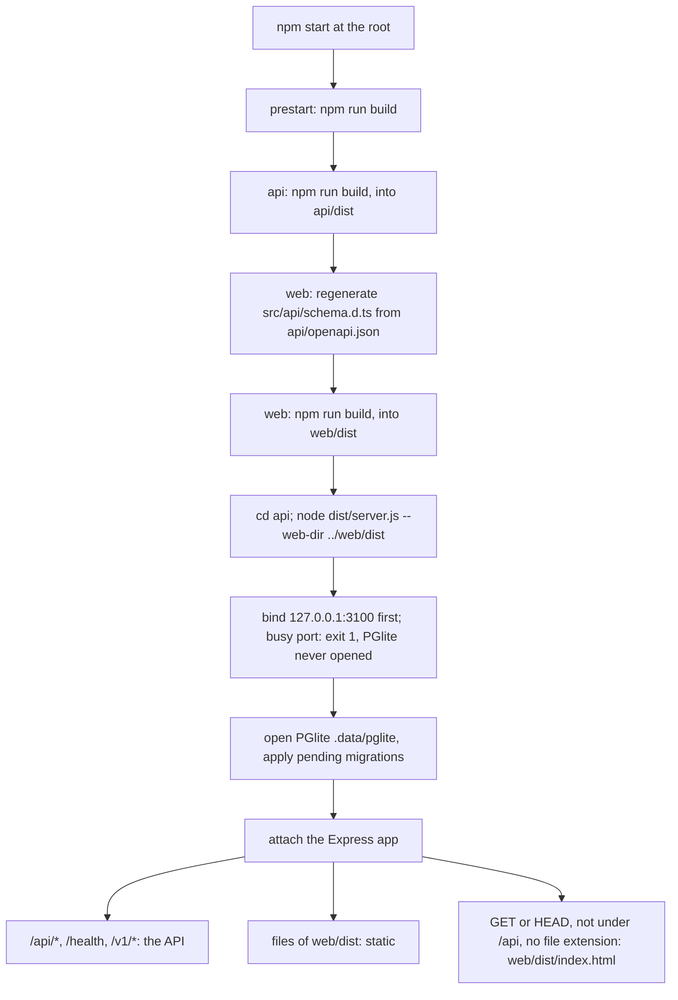

# Single-command launch on one port

Feature: `tooling` · Components: `api` · Spec: none (reserved slug)

## Context

Today the application runs as two dev servers: the API (`cd api && npm run dev`, port 3100) and the Vite front (`cd web && npm run dev`, port 5180, proxying `/api` to the API with the prefix stripped). Using the dashboard day to day means two terminals and two watchers. This iteration adds one command, `npm start` at the repository root: it builds both components, then runs the compiled API, which applies the pending migrations and serves the built front and the API on the API's port, 3100. The dev workflow (two dev servers, proxy, `npm run dev` in each component) keeps working unchanged.

Facts found while planning, which shape the work:

- The API already applies the migrations at start-up: `src/server.ts` calls `migrateDatabase(db)` (Drizzle's in-process migrator on the same PGlite instance) since the factory init. Nothing to add there; the separate `npm run db:migrate` step (drizzle-kit, another process on the same PGlite folder) is redundant and is dropped from the documented workflows.
- `server.ts` opens PGlite and migrates **before** `listen`: a second API process (an `npm start` while `npm run dev` runs, or two `npm start`) opens the same PGlite folder, which PGlite allows to one process only, before failing on the busy port.
- The API routes live at the root (`/health`, `/v1/...`); the front calls them under `/api` (`createClient({ baseUrl: "/api" })`), and Vite's proxy strips the prefix. No front route (`/`, `/workspaces/:workspaceId`, `/sessions/:sessionId`, `/dashboard`, `/live`) collides with an API path.
- `PGLITE_DIR` (`.data/pglite`) and the migrations folder (`drizzle`) resolve against the process's working directory: the compiled API must run with the working directory `api/`, or it opens a fresh, empty database elsewhere.
- `web/src/api/schema.d.ts` and `api/openapi.json` are both committed; regenerating `schema.d.ts` from the committed `openapi.json` with the web's `prepare` command gives a byte-identical file (checked while planning).
- Express is 5.3.0: `app.get("*", ...)` throws at start-up (path-to-regexp v8); a catch-all needs a terminal middleware or a named wildcard.



## Decisions

Decided by the person in the grill (not reopened): one command `npm start`, one port, the API serves the built `web` front, migrations applied at API start-up; no autostart with Windows (out of scope); slug `tooling`, no spec; the dev workflow (two dev servers, `npm run dev` on API 3100 and web 5180 with the proxy) keeps working.

Technical questions parked by the person, settled here:

- How the API serves the web build → only when started with `--web-dir {folder}`: `createApp` then mounts, after the API routers and before the error handler, `express.static(webDir)` and a terminal SPA fallback middleware that sends `{webDir}/index.html` for a request that is GET or HEAD, whose path is neither `/api` nor under `/api/`, and whose last path segment has no `.` (a missing `/assets/x.js` gets a 404, never `index.html`). Written as a middleware with these checks, not as a `"*"` route (Express 5). Without `--web-dir` (dev, tests, the OpenAPI export) nothing of this is mounted: behaviour unchanged.
- Not shadowing the API routes → the API routers are composed into one router, mounted at the root in every mode (as today: the OpenAPI document's paths, the route tests, and Vite's proxy, which strips `/api`, keep working, even when `npm start` holds port 3100 and a Vite dev server runs beside it), and, when serving the web, also at `/api` (the front's base URL). Both mounts come before the static files and the fallback, so an API path always wins; an unknown `/api/...` path ends in a 404, never `index.html`.
- How `web/src/api/schema.d.ts` is generated in the build chain → the root `build` runs the web's `prepare` command (`npx openapi-typescript ../api/openapi.json --output src/api/schema.d.ts`, in `web/`) before `npm run build` of the web: the front is always compiled against the committed handoff, and on an in-sync tree the file is rewritten byte-identical (no diff). The build chain never regenerates `api/openapi.json`: it is the API stage's committed handoff, written by `commands.handoff` only.
- Where `npm start` lives → a new root `package.json` (`private`, no dependency, no lockfile, not an npm workspace: both components keep their own `package.json`, lockfile and commands). Its scripts reach the components with `cd api && ...` / `cd ../web && ...`, which works under cmd.exe (npm's shell on Windows) and sh alike; the compiled API therefore runs with the working directory `api/`, where `.data/pglite` and `drizzle/` resolve as in dev (dev and `npm start` share the same database).
- The PGlite one-process-per-folder constraint with migrations at start-up → the start-up migration stays in-process (the API's own PGlite instance, never a second process), and `server.ts` binds the port **before** opening PGlite: it creates the HTTP server, awaits `listening` on `127.0.0.1:{PORT}`, then opens the database, migrates, builds the services and attaches the Express app (`server.on("request", app)`), then starts the start-up refresh and the scheduler as today. A busy port (`EADDRINUSE`) stops the process with exit code 1 and a message saying another API instance (`npm start` or `npm run dev`) is running and holds the database, before PGlite is opened. `npm start` and the dev API share port 3100 on purpose: the port is the single-instance lock. `npm run db:migrate` (drizzle-kit, a second process) disappears from every documented workflow and from the API's `serve` command; the script itself stays for drizzle-kit work done with the API stopped.
- Root `CLAUDE.md` "Local development" → rewritten: a "Launch" part (first run `npm run setup`, then `npm start` → http://localhost:3100, stop it before the dev API) and a "Development" part (the two dev servers as today, without `npm run db:migrate`). See Conventions.

## Decisions taken autonomously

- Run the grill on the plan? → yes, in autonomous mode, every question below taking its recommended answer (autonomous mode of `write-plan`).
- Mount the API only under `/api` when serving the web (the root namespace left to the front)? → no: mounted at the root in every mode plus an `/api` alias when serving the web (a Vite dev server started while `npm start` holds port 3100 sends `/v1/...` there; no front route collides with `/health` or `/v1/*`).
- How the API learns where the web build is → a `--web-dir {folder}` command-line flag parsed with `node:util` `parseArgs` (`readCliOptions(argv)` in `src/config.ts`, resolved to an absolute path), not an environment variable (departs from "env parsed with zod" in `config.ts`: an npm script cannot set an environment variable portably, `VAR=x cmd` fails under cmd.exe, and a default folder would make the dev API serve a stale build).
- A `--web-dir` folder without `index.html` → the API stops at start-up with exit code 1 and a message pointing to `npm run build` at the root (an explicit flag must not silently serve the API alone).
- Which port for the single-command launch → the API's `PORT`, 3100 by default, loopback only as today (the port doubles as the single-instance lock of the PGlite folder; `PORT` still overrides it, and an instance on another port with the same `PGLITE_DIR` is not guarded: documented).
- Does `npm start` build every time? → yes, through a root `prestart: npm run build` (a launch after a `git pull` always serves the current code; a full build takes seconds).
- Does `npm start` install the dependencies? → no: a root `setup` script (`cd api && npm ci && cd ../web && npm ci`) is run once after a clone and after a dependency change, documented as the first-run step (`npm ci` on every launch wipes `node_modules` and fails on Windows while a dev server holds its files; `npm install` may rewrite the lockfiles).
- Where the API's own `start` script stands → unchanged (`node dist/server.js`, the API alone); the root `start` passes the flag: `cd api && npm start -- --web-dir ../web/dist`.
- The web's `prepare` command duplicated in the root `build` script → accepted, no new web npm script: the web component stays untouched (one stage), the command is one line.
- Where the static serving lives in the api → `src/shared/web.ts` (`webRoutes({ webDir })`, a router with the static files and the fallback): it is cross-cutting, not a feature with a schema, table or service.
- Cache headers of the served build → `express.static` defaults (ETag, `max-age=0`); no long-lived cache for the hashed assets (a local, single-user app).
- Open the browser on start → no (not asked; the log line gives the URL).
- Stage structure → one stage, `api`: the root `package.json` and the instruction files have no component and no command of their own; they ride in the api stage, verified by its build and test plus a manual launch check.
- Review after every stage → yes (default under `autopilot`).
- Branch → stay on `develop`, no branch created (the person works on `develop` directly; overrides `planning.md`'s branch default).
- Spec for the slug → none (`tooling` is a reserved slug with no `00_spec.md`).

## api

### routes

- `src/shared/web.ts` (new): `webRoutes({ webDir }: { webDir: string })` returns an Express `Router` holding `express.static(webDir)` then the SPA fallback middleware (Decisions): `req.method` is `GET` or `HEAD`, `req.path` is not `/api` and does not start with `/api/`, the last segment of `req.path` contains no `.` → `res.sendFile(path.join(webDir, "index.html"))`; otherwise `next()`. Comment why: Express 5 rejects `"*"`, and an asset missing from the build must 404.
- `src/app.ts`: `AppContext` gains `webDir?: string` (absolute). The feature routers (`healthRoutes`, `ingestionRoutes`, `workspacesRoutes`, `dashboardRoutes`, `liveRoutes`, `retentionRoutes`) are composed into one `Router`, mounted with `app.use(apiRouter)` always and `app.use("/api", apiRouter)` when `webDir` is set; then `app.use(webRoutes({ webDir }))` when set; then `errorHandler`, last as today. Keep the comment that every route is public.
- `src/config.ts`: `readCliOptions(argv: string[] = process.argv.slice(2)): { webDir: string | null }` with `parseArgs` from `node:util` (`options: { "web-dir": { type: "string" } }`, `strict: true`: an unknown flag fails at start-up), the folder resolved with `path.resolve`.
- `src/server.ts`, reordered:
  1. `readConfig()`, `readCliOptions()`; when `webDir` is set and `{webDir}/index.html` does not exist (`existsSync`), `console.error` a message naming the folder and `npm run build` at the repository root, then `process.exit(1)`.
  2. `const server = http.createServer()`; await `listening` on `config.PORT`, `"127.0.0.1"` (a promise over `listen` and `error`). On `EADDRINUSE`, `console.error` that port {PORT} is in use, probably by another instance of the API (`npm start` or `npm run dev`) which holds the database, and `process.exit(1)`; any other error is rethrown. Comment why the port is bound first: it is the single-instance lock of the PGlite folder.
  3. `openDatabase(config.PGLITE_DIR)`, `await migrateDatabase(db)`, the services as today.
  4. `server.on("request", createApp({ ..., webDir }))` (pass `webDir` only when set: `exactOptionalPropertyTypes`).
  5. Log `api listening on http://127.0.0.1:{PORT}` and, when serving the web, `app on http://localhost:{PORT}`; then `ingestion.start()` and `refreshScheduler.start()` with their current error logging (FR-01 and FR-13 comments kept).
- `package.json` (api): unchanged (`start` stays `node dist/server.js`).

### Root files (no component, carried by this stage)

- `package.json` (new, repository root):
  ```json
  {
    "name": "claude-companion",
    "private": true,
    "engines": { "node": ">=22" },
    "scripts": {
      "setup": "cd api && npm ci && cd ../web && npm ci",
      "build": "cd api && npm run build && cd ../web && npx openapi-typescript ../api/openapi.json --output src/api/schema.d.ts && npm run build",
      "prestart": "npm run build",
      "start": "cd api && npm start -- --web-dir ../web/dist"
    }
  }
  ```
  No dependency, no `package-lock.json` at the root (none is needed to run scripts). `.gitignore` already ignores `node_modules/` and `dist/` everywhere.

## Conventions

| File | Change | Rationale |
|---|---|---|
| `CLAUDE.md` (root), "Local development" | Rewrite: **Launch** — once after a clone or a dependency change `npm run setup`, then `npm start` at the root → http://localhost:3100 (builds both components, regenerates `web/src/api/schema.d.ts` from `api/openapi.json`, applies the pending migrations at start-up, serves the front and the API under `/api` on one port); it and the dev API are exclusive (same port, same database). **Development** — the two components as today, minus `npm run db:migrate`: `cd api && npm ci && npm run dev` (the API applies the pending migrations at start-up; restart it after a new migration) and `cd web && npm ci && npx openapi-typescript ... && npm run dev`. Keep the `CLAUDE_PROJECTS_DIR` / `CLAUDE_SESSIONS_DIR` sentence. | The person's single-command launch; the obsolete migrate step removed. |
| `api/CLAUDE.md`, `component` block | `serve: npm run dev` (was `npm run db:migrate && npm run dev`). | The API migrates itself at start-up; no second process on the PGlite folder. |
| `api/CLAUDE.md`, Structure | Add `shared/web.ts` (serves the built front and its SPA fallback when started with `--web-dir`); `server.ts` line: binds the port, then opens and migrates the database, then listens with the app. | New file, new start-up order. |
| `api/CLAUDE.md`, Package scripts | `start` row: `node dist/server.js`; with `--web-dir {folder}` it also serves the built front (the root's `npm start` passes `../web/dist`). `db:migrate` row: drizzle-kit, a second process: only with the API stopped; the API applies the migrations itself at start-up. | Documents the flag and the remaining use of `db:migrate`. |
| `api/CLAUDE.md`, Local run | Drop "First run and after every new migration: `npm run db:migrate`"; say the API applies the pending migrations at start-up (restart it after a new migration); `serve` no longer migrates; the port is bound before PGlite is opened, so a second instance on the same port exits before touching the database (an instance on another `PORT` with the same `PGLITE_DIR` is not guarded); reset: stop the API, delete `.data/pglite`, start it again. Keep the PGlite one-process rule for `db:migrate` and `drizzle-kit studio`. | Matches the new start-up order. |
| `web/CLAUDE.md`, Local run | Add one line: the root's `npm run build` builds the front into `dist/` (after `prepare`), and `npm start` has the API serve it on http://localhost:3100; the dev server stays the way to work on the front. | The front's second way to run. |

## Tests

- **api** — route tests, Supertest against `createApp` on the in-memory PGlite, new file `test/shared/web.routes.test.ts`. `createTestContext` (`test/setup.ts`) gains the option `webDir?: string`, passed to `createApp`. The test writes a temporary web build (`index.html` with a marker, `assets/app.js`) under a temp folder in `beforeAll` and removes it in `afterAll`.
  - `it("serves index.html at the root")`
  - `it("serves index.html for a front route")` — `/live` and `/workspaces/3`
  - `it("serves a built asset with its content type")` — `/assets/app.js`, JavaScript content type
  - `it("returns 404, not index.html, for a missing asset")` — `/assets/missing.js`
  - `it("serves the API under /api")` — `GET /api/health` 200, body parsed by `healthResponseSchema`
  - `it("still serves the API at its root paths")` — `GET /health` 200 JSON (the Vite proxy's path)
  - `it("returns 404, not index.html, for an unknown /api path")` — `GET /api/v1/unknown`
  - `it("does not answer a POST to a front route with index.html")` — `POST /live` → 404
  - `it("serves no front and no /api alias without a web folder")` — a context without `webDir`: `GET /` → 404, `GET /api/health` → 404, `GET /health` → 200
  - Existing tests unchanged (the API stays mounted at the root).
- `src/server.ts` and `readCliOptions`: no unit test (the entry point binds a real port and reads the real `~/.claude`, as today it has no test); covered by the manual launch check in Progress.
- **web** — none: not touched (and the front has no unit tests).
- Integration tests: none.

## Progress

### Stage 1 — api
Commit: `feat(tooling): api — single-command launch on one port`
- [ ] routes: `test/setup.ts` option `webDir`, `test/shared/web.routes.test.ts` written first
- [ ] routes: `src/shared/web.ts` (static files, SPA fallback), `src/app.ts` (API router at the root, `/api` alias and web routes when `webDir` is set)
- [ ] routes: `src/config.ts` `readCliOptions`, `src/server.ts` reordered (web folder check, port bound before PGlite, app attached after the migrations)
- [ ] Root: `package.json` with `setup`, `build`, `prestart`, `start`
- [ ] Docs: root `CLAUDE.md` Local development, `api/CLAUDE.md` (serve command, Structure, Package scripts, Local run), `web/CLAUDE.md` Local run
- [ ] Verify by hand, with no dev server running: `npm start` at the root builds and serves http://127.0.0.1:3100 (front at `/`, reload on `/live` serves the page, `/api/health` answers); its recap is the dev database's (same `api/.data/pglite`); a second `npm start` (or `cd api && npm run dev`) exits on the busy port; `git status` shows no change to `web/src/api/schema.d.ts`; stop it, then `cd api && npm run dev` and `cd web && npm run dev` still work on 3100 and 5180
- [ ] Handoff: `api/openapi.json` exported (unchanged: no contract change)

## Validation

- [ ] Review: the `reviewer` agent on the plan's implementation, its findings settled
- [ ] Tests: the full `test` command of `api` green on the plan's final code
